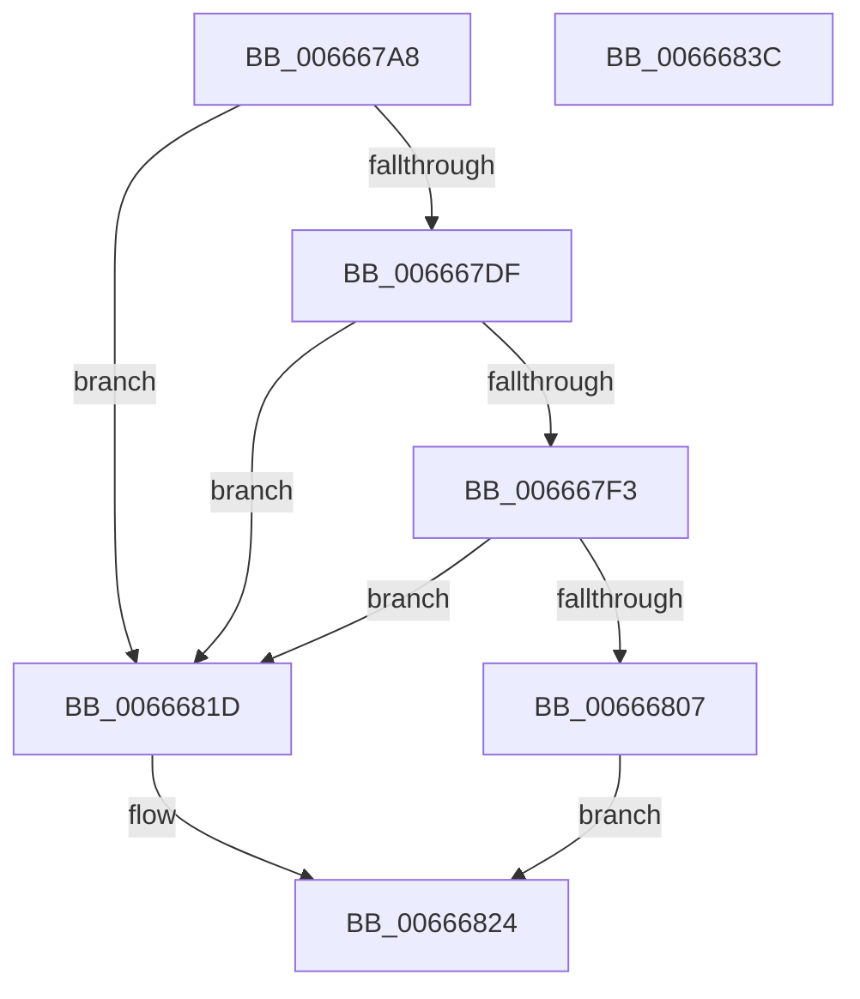

# HviGetIptFeatures

- RVA: `0x006667A8`–`0x0066683D` (길이 `149` bytes)
- VA: `0x00000001406667A8`
- 실행 섹션: `.text`
- PDB 이름 있음: `예`; PDB Function 태그: `아니요`
- unwind 정보 RVA: `0x000BE828`
- 디코드: `41`개 명령, `149/149` bytes 표시
- 미해석 바이트: `0` (있으면 어셈블리에 `.byte`로 보존)

> 이 문서는 커널 이미지의 기계어와 PDB 기호를 분석해 생성했습니다. 4번과 5번은 함수 원형과 자료형을 바이너리 사용 방식에서 추정한 C 해석이며 원본 소스 복구 결과는 아닙니다.

## 1. Dependencies

- 직접 호출 지점: **4**; 고유 호출 대상: **4**
- 직접 호출자로 확인된 함수: **1**
- RIP 상대 이미지 참조: **1**

### Outgoing calls
- `0x006667D4` → [HviIsHypervisorMicrosoftCompatible](HviIsHypervisorMicrosoftCompatible_function_006668C8.md) (function, `0x006668C8`)
- `0x006667E4` → [HviGetHypervisorVendorAndMaxFunction](../4A/HviGetHypervisorVendorAndMaxFunction_function_004ADB6C.md) (function, `0x004ADB6C`)
- `0x006667F8` → [HviGetHypervisorFeatures](HviGetHypervisorFeatures_function_00666630.md) (function, `0x00666630`)
- `0x0066682C` → [_security_check_cookie](../6A/_security_check_cookie_function_006AC640.md) (function, `0x006AC640`)

### Direct callers
- [KiGetIptInfo](../5B/KiGetIptInfo_function_005B9D38.md) at `0x005B9D98`

### Static image references
- `0x006667B2` → RVA `0x00E0A740` (`.data`; read)

## 2. Other-region calls and transfers

- 다른 실행 섹션으로 향하는 call: **0**
- 별도 외부 분기/꼬리 이동을 확인하지 못했습니다.

## 3. Assembly (complete function range)

```asm
006667A8  48 89 5C 24 10                  mov qword ptr [rsp + 0x10], rbx
006667AD  57                              push rdi
006667AE  48 83 EC 50                     sub rsp, 0x50
006667B2  48 8B 05 87 3F 7A 00            mov rax, qword ptr [rip + 0x7a3f87]
006667B9  48 33 C4                        xor rax, rsp
006667BC  48 89 44 24 40                  mov qword ptr [rsp + 0x40], rax
006667C1  0F 57 C0                        xorps xmm0, xmm0
006667C4  0F 57 C9                        xorps xmm1, xmm1
006667C7  0F 11 44 24 20                  movups xmmword ptr [rsp + 0x20], xmm0
006667CC  48 8B F9                        mov rdi, rcx
006667CF  0F 11 4C 24 30                  movups xmmword ptr [rsp + 0x30], xmm1
006667D4  E8 EF 00 00 00                  call 0x1406668c8
006667D9  33 DB                           xor ebx, ebx
006667DB  84 C0                           test al, al
006667DD  74 3E                           je 0x14066681d
006667DF  48 8D 4C 24 20                  lea rcx, [rsp + 0x20]
006667E4  E8 83 73 E4 FF                  call 0x1404adb6c
006667E9  81 7C 24 20 0B 00 00 40         cmp dword ptr [rsp + 0x20], 0x4000000b
006667F1  72 2A                           jb 0x14066681d
006667F3  48 8D 4C 24 30                  lea rcx, [rsp + 0x30]
006667F8  E8 33 FE FF FF                  call 0x140666630
006667FD  F7 44 24 3C 00 00 00 08         test dword ptr [rsp + 0x3c], 0x8000000
00666805  74 16                           je 0x14066681d
00666807  B8 0B 00 00 40                  mov eax, 0x4000000b
0066680C  33 C9                           xor ecx, ecx
0066680E  0F A2                           cpuid
00666810  89 07                           mov dword ptr [rdi], eax
00666812  89 5F 04                        mov dword ptr [rdi + 4], ebx
00666815  89 4F 08                        mov dword ptr [rdi + 8], ecx
00666818  89 57 0C                        mov dword ptr [rdi + 0xc], edx
0066681B  EB 07                           jmp 0x140666824
0066681D  48 89 1F                        mov qword ptr [rdi], rbx
00666820  48 89 5F 08                     mov qword ptr [rdi + 8], rbx
00666824  48 8B 4C 24 40                  mov rcx, qword ptr [rsp + 0x40]
00666829  48 33 CC                        xor rcx, rsp
0066682C  E8 0F 5E 04 00                  call 0x1406ac640
00666831  48 8B 5C 24 68                  mov rbx, qword ptr [rsp + 0x68]
00666836  48 83 C4 50                     add rsp, 0x50
0066683A  5F                              pop rdi
0066683B  C3                              ret
0066683C  CC                              int3
```

## 4. C-style interpretation (structured pseudocode)

```c
__int64 __fastcall HviGetIptFeatures(__int64 a1, int a2)
{
    __int64 result;
    __int64 v_rbx;
    __int64 v_rsp;
    unsigned __int64 v_stack_m18;
    unsigned int v_stack_m1C;
    unsigned __int64 v_stack_m28;
    unsigned __int64 v_stack_m38;
    unsigned __int64 v_stack_p10;

    v_stack_p10 = v_rbx;
    v_rsp = (v_rsp) - (80);
    result = (*(unsigned __int64 *)(v_rip + 8011655)) ^ (v_rsp);
    v_stack_m18 = result;
    v_stack_m38 = v_xmm0;
    v_stack_m28 = v_xmm1;
    result = HviIsHypervisorMicrosoftCompatible(a1, a2, a3, a4);
    v_rbx = 0;
    if ((unsigned __int8)(result) == 0) goto loc_0066681D;
    result = HviGetHypervisorVendorAndMaxFunction(v_stack_m38, a2, a3, a4);
    if (v_stack_m38 < 0x4000000BULL) goto loc_0066681D;
    result = HviGetHypervisorFeatures(v_stack_m28, a2, a3, a4);
    if (((v_stack_m1C) & (0x8000000ULL)) == 0) goto loc_0066681D;
    a1 = 0;
    *(unsigned int *)(a1) = (unsigned int)((unsigned int)(0x4000000BULL));
    *(unsigned int *)(a1 + 4) = 0;
    *(unsigned int *)(a1 + 8) = 0;
    *(unsigned int *)(a1 + 12) = a2;
    goto loc_00666824;
loc_0066681D:
    *(unsigned __int64 *)(a1) = 0;
    *(unsigned __int64 *)(a1 + 8) = 0;
loc_00666824:
    a1 = (v_stack_m18) ^ (v_rsp);
    result = _security_check_cookie(a1, a2, a3, a4);
    v_rsp = (v_rsp) + (80);
    return result;
}
```

## 5. (Beta) C Style

```c
int64_t HviGetIptFeatures(void *Arg1, int32_t Arg2)
{
    uint8_t *arg1 = (uint8_t *)Arg1;

    int64_t result;
    int64_t local_rbx;
    int64_t local_rsp;
    uint64_t v_stack_m18;
    uint32_t v_stack_m1C;
    uint64_t v_stack_m28;
    uint64_t v_stack_m38;
    uint64_t v_stack_p10;

    v_stack_p10 = local_rbx;
    local_rsp = (local_rsp) - (80);
    result = (*(uint64_t *)(v_rip + 0x7A3F87)) ^ (local_rsp);
    v_stack_m18 = result;
    v_stack_m38 = v_xmm0;
    v_stack_m28 = v_xmm1;
    result = HviIsHypervisorMicrosoftCompatible(Arg1, Arg2, a3, a4);
    local_rbx = 0;
    if ((uint8_t)(result) == 0) goto loc_0066681D;
    result = HviGetHypervisorVendorAndMaxFunction(v_stack_m38, Arg2, a3, a4);
    if (v_stack_m38 < 0x4000000BULL) goto loc_0066681D;
    result = HviGetHypervisorFeatures(v_stack_m28, Arg2, a3, a4);
    if (((v_stack_m1C) & (0x8000000ULL)) == 0) goto loc_0066681D;
    Arg1 = 0;
    *(uint32_t *)(arg1) = (uint32_t)((uint32_t)(0x4000000BULL));
    *(uint32_t *)(arg1 + 0x4) = 0;
    *(uint32_t *)(arg1 + 0x8) = 0;
    *(uint32_t *)(arg1 + 0xC) = Arg2;
    goto loc_00666824;
loc_0066681D:
    *(uint64_t *)(arg1) = 0;
    *(uint64_t *)(arg1 + 0x8) = 0;
loc_00666824:
    Arg1 = (v_stack_m18) ^ (local_rsp);
    result = _security_check_cookie(Arg1, Arg2, a3, a4);
    local_rsp = (local_rsp) + (80);
    return result;
}
```

### 관측된 메모리 오프셋

구조체 형식이 확인되지 않은 접근은 인자 기준의 오프셋으로만 기록했습니다.

| 기준 인자 | 오프셋 표현 | 폭 (bit) | 접근 |
|---|---:|---:|---|
| `Arg1` | `+ 0x0` | `32` | `W` |
| `Arg1` | `+ 0x0` | `64` | `W` |
| `Arg1` | `+ 0x4` | `32` | `W` |
| `Arg1` | `+ 0x8` | `32` | `W` |
| `Arg1` | `+ 0x8` | `64` | `W` |
| `Arg1` | `+ 0xC` | `32` | `W` |

## 6. Execution-region graph

[열기: 2D/3D 그래프와 함수 탐색 컨트롤 패널](../../../control-panel.html?section=text&rva=0x006667A8&view=graph)

- 2D 그래프는 위에서 아래로 흐르고, 3D 그래프는 빈 공간을 드래그해 회전합니다. Shift+드래그는 이동, 휠은 확대·축소, 함수 노드 선택은 대상 보고서 이동입니다.

### Static fallback


