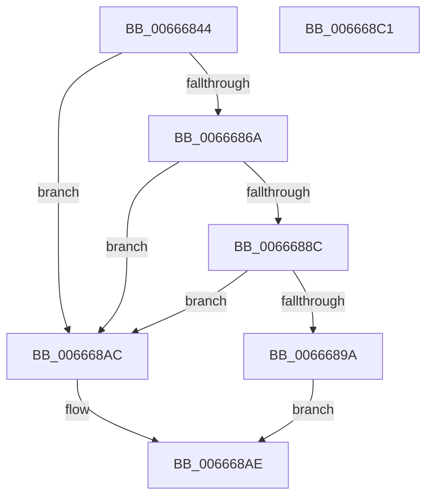

# HviGetSharedGpaBoundary

- RVA: `0x00666844`–`0x006668C2` (길이 `126` bytes)
- VA: `0x0000000140666844`
- 실행 섹션: `.text`
- PDB 이름 있음: `예`; PDB Function 태그: `아니요`
- unwind 정보 RVA: `0x000AB2E4`
- 디코드: `37`개 명령, `126/126` bytes 표시
- 미해석 바이트: `0` (있으면 어셈블리에 `.byte`로 보존)

> 이 문서는 커널 이미지의 기계어와 PDB 기호를 분석해 생성했습니다. 4번과 5번은 함수 원형과 자료형을 바이너리 사용 방식에서 추정한 C 해석이며 원본 소스 복구 결과는 아닙니다.

## 1. Dependencies

- 직접 호출 지점: **2**; 고유 호출 대상: **2**
- 직접 호출자로 확인된 함수: **1**
- RIP 상대 이미지 참조: **1**

### Outgoing calls
- `0x00666861` → [HviIsHypervisorMicrosoftCompatible](HviIsHypervisorMicrosoftCompatible_function_006668C8.md) (function, `0x006668C8`)
- `0x006668B6` → [_security_check_cookie](../6A/_security_check_cookie_function_006AC640.md) (function, `0x006AC640`)

### Direct callers
- [HalpDmaInitializeCvmSupport](../../init/C2/HalpDmaInitializeCvmSupport_function_00C211C4.md) at `0x00C2122E`

### Static image references
- `0x0066684A` → RVA `0x00E0A740` (`.data`; read)

## 2. Other-region calls and transfers

- 다른 실행 섹션으로 향하는 call: **0**
- 별도 외부 분기/꼬리 이동을 확인하지 못했습니다.

## 3. Assembly (complete function range)

```asm
00666844  40 53                           push rbx
00666846  48 83 EC 40                     sub rsp, 0x40
0066684A  48 8B 05 EF 3E 7A 00            mov rax, qword ptr [rip + 0x7a3eef]
00666851  48 33 C4                        xor rax, rsp
00666854  48 89 44 24 30                  mov qword ptr [rsp + 0x30], rax
00666859  0F 57 C0                        xorps xmm0, xmm0
0066685C  0F 11 44 24 20                  movups xmmword ptr [rsp + 0x20], xmm0
00666861  E8 62 00 00 00                  call 0x1406668c8
00666866  84 C0                           test al, al
00666868  74 42                           je 0x1406668ac
0066686A  B8 03 00 00 40                  mov eax, 0x40000003
0066686F  33 C9                           xor ecx, ecx
00666871  0F A2                           cpuid
00666873  89 44 24 20                     mov dword ptr [rsp + 0x20], eax
00666877  48 B8 00 00 00 00 00 00 40 00   movabs rax, 0x40000000000000
00666881  89 5C 24 24                     mov dword ptr [rsp + 0x24], ebx
00666885  48 85 44 24 20                  test qword ptr [rsp + 0x20], rax
0066688A  74 20                           je 0x1406668ac
0066688C  33 C9                           xor ecx, ecx
0066688E  B8 0C 00 00 40                  mov eax, 0x4000000c
00666893  0F A2                           cpuid
00666895  F6 C3 20                        test bl, 0x20
00666898  74 12                           je 0x1406668ac
0066689A  C1 EB 06                        shr ebx, 6
0066689D  B8 01 00 00 00                  mov eax, 1
006668A2  83 E3 3F                        and ebx, 0x3f
006668A5  8A CB                           mov cl, bl
006668A7  48 D3 E0                        shl rax, cl
006668AA  EB 02                           jmp 0x1406668ae
006668AC  33 C0                           xor eax, eax
006668AE  48 8B 4C 24 30                  mov rcx, qword ptr [rsp + 0x30]
006668B3  48 33 CC                        xor rcx, rsp
006668B6  E8 85 5D 04 00                  call 0x1406ac640
006668BB  48 83 C4 40                     add rsp, 0x40
006668BF  5B                              pop rbx
006668C0  C3                              ret
006668C1  CC                              int3
```

## 4. C-style interpretation (structured pseudocode)

```c
__int64 __fastcall HviGetSharedGpaBoundary(int a1)
{
    __int64 result;
    __int64 v_rbx;
    __int64 v_rsp;
    unsigned __int64 v_stack_m18;
    unsigned int v_stack_m24;
    unsigned __int64 v_stack_m28;

    v_rsp = (v_rsp) - (64);
    result = (*(unsigned __int64 *)(v_rip + 8011503)) ^ (v_rsp);
    v_stack_m18 = result;
    v_stack_m28 = v_xmm0;
    result = HviIsHypervisorMicrosoftCompatible(a1, a2, a3, a4);
    if ((unsigned __int8)(result) == 0) goto loc_006668AC;
    a1 = 0;
    v_stack_m28 = (unsigned int)((unsigned int)(0x40000003ULL));
    v_stack_m24 = (unsigned int)(v_rbx);
    if (((v_stack_m28) & ((unsigned int)(0x40000003ULL))) == 0) goto loc_006668AC;
    a1 = 0;
    if ((((unsigned __int8)(v_rbx)) & (32)) == 0) goto loc_006668AC;
    v_rbx = (unsigned int)((v_rbx) >> (6));
    v_rbx = (unsigned int)((v_rbx) & (63));
    result = (1) << ((unsigned __int8)((unsigned __int8)(v_rbx)));
    goto loc_006668AE;
loc_006668AC:
    result = 0;
loc_006668AE:
    a1 = (v_stack_m18) ^ (v_rsp);
    result = _security_check_cookie(a1, a2, a3, a4);
    v_rsp = (v_rsp) + (64);
    return result;
}
```

## 5. (Beta) C Style

```c
int64_t HviGetSharedGpaBoundary(int32_t Arg1)
{
    int64_t result;
    int64_t local_rbx;
    int64_t local_rsp;
    uint64_t v_stack_m18;
    uint32_t v_stack_m24;
    uint64_t v_stack_m28;

    local_rsp = (local_rsp) - (64);
    result = (*(uint64_t *)(v_rip + 0x7A3EEF)) ^ (local_rsp);
    v_stack_m18 = result;
    v_stack_m28 = v_xmm0;
    result = HviIsHypervisorMicrosoftCompatible(Arg1, a2, a3, a4);
    if ((uint8_t)(result) == 0) goto loc_006668AC;
    Arg1 = 0;
    v_stack_m28 = (uint32_t)((uint32_t)(0x40000003ULL));
    v_stack_m24 = (uint32_t)(local_rbx);
    if (((v_stack_m28) & ((uint32_t)(0x40000003ULL))) == 0) goto loc_006668AC;
    Arg1 = 0;
    if ((((uint8_t)(local_rbx)) & (32)) == 0) goto loc_006668AC;
    local_rbx = (uint32_t)((local_rbx) >> (6));
    local_rbx = (uint32_t)((local_rbx) & (63));
    result = (1) << ((uint8_t)((uint8_t)(local_rbx)));
    goto loc_006668AE;
loc_006668AC:
    result = 0;
loc_006668AE:
    Arg1 = (v_stack_m18) ^ (local_rsp);
    result = _security_check_cookie(Arg1, a2, a3, a4);
    local_rsp = (local_rsp) + (64);
    return result;
}
```

## 6. Execution-region graph

[열기: 2D/3D 그래프와 함수 탐색 컨트롤 패널](../../../control-panel.html?section=text&rva=0x00666844&view=graph)

- 2D 그래프는 위에서 아래로 흐르고, 3D 그래프는 빈 공간을 드래그해 회전합니다. Shift+드래그는 이동, 휠은 확대·축소, 함수 노드 선택은 대상 보고서 이동입니다.

### Static fallback


