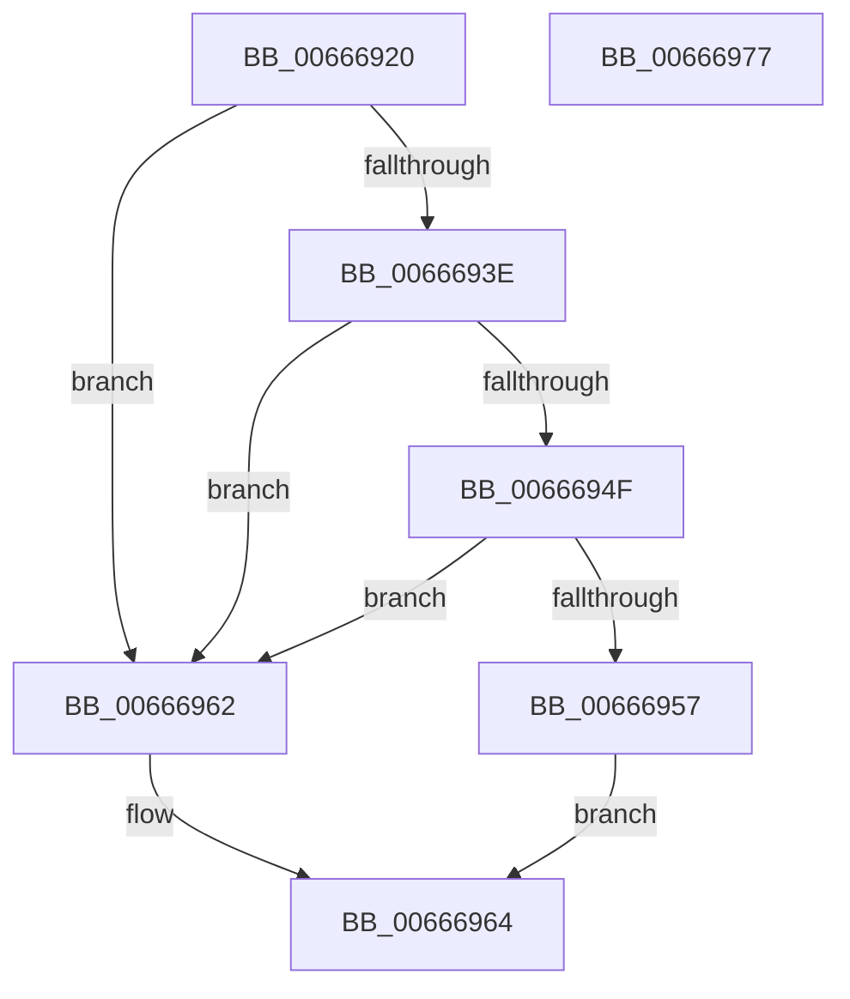

# HviIsHypervisorVendorMicrosoft

- RVA: `0x00666920`–`0x00666978` (길이 `88` bytes)
- VA: `0x0000000140666920`
- 실행 섹션: `.text`
- PDB 이름 있음: `예`; PDB Function 태그: `아니요`
- unwind 정보 RVA: `0x000AB2E4`
- 디코드: `26`개 명령, `88/88` bytes 표시
- 미해석 바이트: `0` (있으면 어셈블리에 `.byte`로 보존)

> 이 문서는 커널 이미지의 기계어와 PDB 기호를 분석해 생성했습니다. 4번과 5번은 함수 원형과 자료형을 바이너리 사용 방식에서 추정한 C 해석이며 원본 소스 복구 결과는 아닙니다.

## 1. Dependencies

- 직접 호출 지점: **2**; 고유 호출 대상: **2**
- 직접 호출자로 확인된 함수: **4**
- RIP 상대 이미지 참조: **1**

### Outgoing calls
- `0x00666935` → [HviIsAnyHypervisorPresent](../4A/HviIsAnyHypervisorPresent_function_004ADC50.md) (function, `0x004ADC50`)
- `0x0066696C` → [_security_check_cookie](../6A/_security_check_cookie_function_006AC640.md) (function, `0x006AC640`)

### Direct callers
- [HviIsKernelApertureAvailable](../60/HviIsKernelApertureAvailable_function_006025CC.md) at `0x00602608`
- [MicrocodeUpdate](MicrocodeUpdate_function_00667480.md) at `0x006674B7`
- [SpcIsHyperVCr3RspErrataPresent](../6A/SpcIsHyperVCr3RspErrataPresent_function_006A788C.md) at `0x006A78B2`
- [EtwpTraceSystemInitialization](../../init/C4/EtwpTraceSystemInitialization_function_00C4E720.md) at `0x00C4E92B`

### Static image references
- `0x00666926` → RVA `0x00E0A740` (`.data`; read)

## 2. Other-region calls and transfers

- 다른 실행 섹션으로 향하는 call: **0**
- 별도 외부 분기/꼬리 이동을 확인하지 못했습니다.

## 3. Assembly (complete function range)

```asm
00666920  40 53                           push rbx
00666922  48 83 EC 40                     sub rsp, 0x40
00666926  48 8B 05 13 3E 7A 00            mov rax, qword ptr [rip + 0x7a3e13]
0066692D  48 33 C4                        xor rax, rsp
00666930  48 89 44 24 30                  mov qword ptr [rsp + 0x30], rax
00666935  E8 16 73 E4 FF                  call 0x1404adc50
0066693A  84 C0                           test al, al
0066693C  74 24                           je 0x140666962
0066693E  33 C9                           xor ecx, ecx
00666940  B8 00 00 00 40                  mov eax, 0x40000000
00666945  0F A2                           cpuid
00666947  81 FB 4D 69 63 72               cmp ebx, 0x7263694d
0066694D  75 13                           jne 0x140666962
0066694F  81 F9 6F 73 6F 66               cmp ecx, 0x666f736f
00666955  75 0B                           jne 0x140666962
00666957  81 FA 74 20 48 76               cmp edx, 0x76482074
0066695D  0F 94 C0                        sete al
00666960  EB 02                           jmp 0x140666964
00666962  32 C0                           xor al, al
00666964  48 8B 4C 24 30                  mov rcx, qword ptr [rsp + 0x30]
00666969  48 33 CC                        xor rcx, rsp
0066696C  E8 CF 5C 04 00                  call 0x1406ac640
00666971  48 83 C4 40                     add rsp, 0x40
00666975  5B                              pop rbx
00666976  C3                              ret
00666977  CC                              int3
```

## 4. C-style interpretation (structured pseudocode)

```c
__int64 __fastcall HviIsHypervisorVendorMicrosoft(int a1, int a2)
{
    __int64 result;
    __int64 v_rsp;
    unsigned __int64 v_stack_m18;

    v_rsp = (v_rsp) - (64);
    result = (*(unsigned __int64 *)(v_rip + 8011283)) ^ (v_rsp);
    v_stack_m18 = result;
    result = HviIsAnyHypervisorPresent(a1, a2, a3, a4);
    if ((unsigned __int8)(result) == 0) goto loc_00666962;
    a1 = 0;
    if (((unsigned int)(v_rbx)) != 0x7263694DULL) goto loc_00666962;
    if (0 != 0x666F736FULL) goto loc_00666962;
    result = (a2 == 0x76482074ULL) ? 1 : 0;
    goto loc_00666964;
loc_00666962:
    result = 0;
loc_00666964:
    a1 = (v_stack_m18) ^ (v_rsp);
    result = _security_check_cookie(a1, a2, a3, a4);
    v_rsp = (v_rsp) + (64);
    return result;
}
```

## 5. (Beta) C Style

```c
int64_t HviIsHypervisorVendorMicrosoft(int32_t Arg1, int32_t Arg2)
{
    int64_t result;
    int64_t local_rsp;
    uint64_t v_stack_m18;

    local_rsp = (local_rsp) - (64);
    result = (*(uint64_t *)(v_rip + 0x7A3E13)) ^ (local_rsp);
    v_stack_m18 = result;
    result = HviIsAnyHypervisorPresent(Arg1, Arg2, a3, a4);
    if ((uint8_t)(result) == 0) goto loc_00666962;
    Arg1 = 0;
    if (((uint32_t)(local_rbx)) != 0x7263694DULL) goto loc_00666962;
    if (0 != 0x666F736FULL) goto loc_00666962;
    result = (Arg2 == 0x76482074ULL) ? 1 : 0;
    goto loc_00666964;
loc_00666962:
    result = 0;
loc_00666964:
    Arg1 = (v_stack_m18) ^ (local_rsp);
    result = _security_check_cookie(Arg1, Arg2, a3, a4);
    local_rsp = (local_rsp) + (64);
    return result;
}
```

## 6. Execution-region graph

[열기: 2D/3D 그래프와 함수 탐색 컨트롤 패널](../../../control-panel.html?section=text&rva=0x00666920&view=graph)

- 2D 그래프는 위에서 아래로 흐르고, 3D 그래프는 빈 공간을 드래그해 회전합니다. Shift+드래그는 이동, 휠은 확대·축소, 함수 노드 선택은 대상 보고서 이동입니다.

### Static fallback


