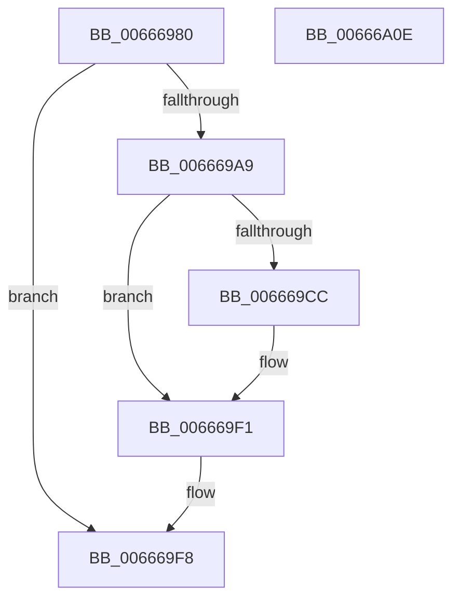

# HviIsXboxNanovisorPresent

- RVA: `0x00666980`–`0x00666A0F` (길이 `143` bytes)
- VA: `0x0000000140666980`
- 실행 섹션: `.text`
- PDB 이름 있음: `예`; PDB Function 태그: `아니요`
- unwind 정보 RVA: `0x000B64AC`
- 디코드: `40`개 명령, `143/143` bytes 표시
- 미해석 바이트: `0` (있으면 어셈블리에 `.byte`로 보존)

> 이 문서는 커널 이미지의 기계어와 PDB 기호를 분석해 생성했습니다. 4번과 5번은 함수 원형과 자료형을 바이너리 사용 방식에서 추정한 C 해석이며 원본 소스 복구 결과는 아닙니다.

## 1. Dependencies

- 직접 호출 지점: **1**; 고유 호출 대상: **1**
- 직접 호출자로 확인된 함수: **3**
- RIP 상대 이미지 참조: **3**

### Outgoing calls
- `0x00666A03` → [_security_check_cookie](../6A/_security_check_cookie_function_006AC640.md) (function, `0x006AC640`)

### Direct callers
- [HalpTscSynchronization](../54/HalpTscSynchronization_function_0054AFC0.md) at `0x0054AFFB`
- [KeDeepSleepProcessor](../5B/KeDeepSleepProcessor_function_005BDB24.md) at `0x005BDB3E`
- [KiIntSteerInit](../../init/C3/KiIntSteerInit_function_00C3A1CC.md) at `0x00C3A2A4`

### Static image references
- `0x00666986` → RVA `0x00E0A740` (`.data`; read)
- `0x00666995` → RVA `0x00E0EC60` (`.data`; read)
- `0x006669F1` → RVA `0x00E0EC60` (`.data`; write)

## 2. Other-region calls and transfers

- 다른 실행 섹션으로 향하는 call: **0**
- 별도 외부 분기/꼬리 이동을 확인하지 못했습니다.

## 3. Assembly (complete function range)

```asm
00666980  40 53                           push rbx
00666982  48 83 EC 20                     sub rsp, 0x20
00666986  48 8B 05 B3 3D 7A 00            mov rax, qword ptr [rip + 0x7a3db3]
0066698D  48 33 C4                        xor rax, rsp
00666990  48 89 44 24 10                  mov qword ptr [rsp + 0x10], rax
00666995  44 8A 05 C4 82 7A 00            mov r8b, byte ptr [rip + 0x7a82c4]
0066699C  0F 57 C0                        xorps xmm0, xmm0
0066699F  0F 11 04 24                     movups xmmword ptr [rsp], xmm0
006669A3  41 80 F8 FF                     cmp r8b, 0xff
006669A7  75 4F                           jne 0x1406669f8
006669A9  33 C9                           xor ecx, ecx
006669AB  41 B9 01 00 00 00               mov r9d, 1
006669B1  41 8B C1                        mov eax, r9d
006669B4  45 32 C0                        xor r8b, r8b
006669B7  0F A2                           cpuid
006669B9  89 04 24                        mov dword ptr [rsp], eax
006669BC  89 5C 24 04                     mov dword ptr [rsp + 4], ebx
006669C0  89 4C 24 08                     mov dword ptr [rsp + 8], ecx
006669C4  89 54 24 0C                     mov dword ptr [rsp + 0xc], edx
006669C8  85 C9                           test ecx, ecx
006669CA  79 25                           jns 0x1406669f1
006669CC  33 C9                           xor ecx, ecx
006669CE  45 0F B6 C0                     movzx r8d, r8b
006669D2  B8 01 00 00 40                  mov eax, 0x40000001
006669D7  0F A2                           cpuid
006669D9  3D 58 62 6E 76                  cmp eax, 0x766e6258
006669DE  89 04 24                        mov dword ptr [rsp], eax
006669E1  89 5C 24 04                     mov dword ptr [rsp + 4], ebx
006669E5  45 0F 44 C1                     cmove r8d, r9d
006669E9  89 4C 24 08                     mov dword ptr [rsp + 8], ecx
006669ED  89 54 24 0C                     mov dword ptr [rsp + 0xc], edx
006669F1  44 88 05 68 82 7A 00            mov byte ptr [rip + 0x7a8268], r8b
006669F8  41 8A C0                        mov al, r8b
006669FB  48 8B 4C 24 10                  mov rcx, qword ptr [rsp + 0x10]
00666A00  48 33 CC                        xor rcx, rsp
00666A03  E8 38 5C 04 00                  call 0x1406ac640
00666A08  48 83 C4 20                     add rsp, 0x20
00666A0C  5B                              pop rbx
00666A0D  C3                              ret
00666A0E  CC                              int3
```

## 4. C-style interpretation (structured pseudocode)

```c
__int64 __fastcall HviIsXboxNanovisorPresent(int a1, int a2)
{
    __int64 result;
    __int64 v_rsp;
    unsigned __int64 v_stack_m18;
    unsigned int v_stack_m1C;
    unsigned int v_stack_m20;
    unsigned int v_stack_m24;
    unsigned __int64 v_stack_m28;

    v_rsp = (v_rsp) - (32);
    result = (*(unsigned __int64 *)(v_rip + 8011187)) ^ (v_rsp);
    v_stack_m18 = result;
    v_stack_m28 = v_xmm0;
    if (((unsigned __int8)(*(unsigned __int8 *)(v_rip + 8028868))) != 255) goto loc_006669F8;
    a1 = 0;
    a3 = 0;
    v_stack_m28 = 1;
    v_stack_m24 = (unsigned int)(v_rbx);
    v_stack_m20 = 0;
    v_stack_m1C = a2;
    result = 1;
    if (sign_flag) {
        a1 = 0;
        a3 = 0;
        result = 0x40000001ULL;
        v_stack_m28 = (unsigned int)(result);
        v_stack_m24 = (unsigned int)(v_rbx);
        if (((unsigned int)(result)) == 0x766E6258ULL) { a3 = 1; }
        v_stack_m20 = 0;
        v_stack_m1C = a2;
    }
    *(unsigned __int8 *)(v_rip + 8028776) = (unsigned __int8)(a3);
loc_006669F8:
    a1 = (v_stack_m18) ^ (v_rsp);
    result = _security_check_cookie(a1, a2, a3, 1);
    v_rsp = (v_rsp) + (32);
    return result;
}
```

## 5. (Beta) C Style

```c
int64_t HviIsXboxNanovisorPresent(int32_t Arg1, int32_t Arg2)
{
    int64_t result;
    int64_t local_rsp;
    uint64_t v_stack_m18;
    uint32_t v_stack_m1C;
    uint32_t v_stack_m20;
    uint32_t v_stack_m24;
    uint64_t v_stack_m28;

    local_rsp = (local_rsp) - (32);
    result = (*(uint64_t *)(v_rip + 0x7A3DB3)) ^ (local_rsp);
    v_stack_m18 = result;
    v_stack_m28 = v_xmm0;
    if (((uint8_t)(*(uint8_t *)(v_rip + 0x7A82C4))) != 255) goto loc_006669F8;
    Arg1 = 0;
    a3 = 0;
    v_stack_m28 = 1;
    v_stack_m24 = (uint32_t)(local_rbx);
    v_stack_m20 = 0;
    v_stack_m1C = Arg2;
    result = 1;
    if (sign_flag) {
        Arg1 = 0;
        a3 = 0;
        result = 0x40000001ULL;
        v_stack_m28 = (uint32_t)(result);
        v_stack_m24 = (uint32_t)(local_rbx);
        if (((uint32_t)(result)) == 0x766E6258ULL) { a3 = 1; }
        v_stack_m20 = 0;
        v_stack_m1C = Arg2;
    }
    *(uint8_t *)(v_rip + 0x7A8268) = (uint8_t)(a3);
loc_006669F8:
    Arg1 = (v_stack_m18) ^ (local_rsp);
    result = _security_check_cookie(Arg1, Arg2, a3, 1);
    local_rsp = (local_rsp) + (32);
    return result;
}
```

## 6. Execution-region graph

[열기: 2D/3D 그래프와 함수 탐색 컨트롤 패널](../../../control-panel.html?section=text&rva=0x00666980&view=graph)

- 2D 그래프는 위에서 아래로 흐르고, 3D 그래프는 빈 공간을 드래그해 회전합니다. Shift+드래그는 이동, 휠은 확대·축소, 함수 노드 선택은 대상 보고서 이동입니다.

### Static fallback


