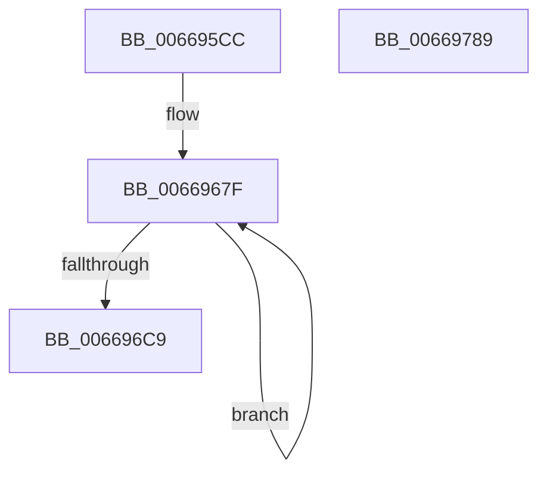

# IaaBuildDescriptorFixedCompress

- RVA: `0x006695CC`–`0x0066978A` (길이 `446` bytes)
- VA: `0x00000001406695CC`
- 실행 섹션: `.text`
- PDB 이름 있음: `예`; PDB Function 태그: `아니요`
- unwind 정보 RVA: `0x000697A4`
- 디코드: `101`개 명령, `446/446` bytes 표시
- 미해석 바이트: `0` (있으면 어셈블리에 `.byte`로 보존)

> 이 문서는 커널 이미지의 기계어와 PDB 기호를 분석해 생성했습니다. 4번과 5번은 함수 원형과 자료형을 바이너리 사용 방식에서 추정한 C 해석이며 원본 소스 복구 결과는 아닙니다.

## 1. Dependencies

- 직접 호출 지점: **2**; 고유 호출 대상: **2**
- 직접 호출자로 확인된 함수: **1**
- RIP 상대 이미지 참조: **9**

### Outgoing calls
- `0x0066960F` → [DsaBuildDescriptorCommon](../48/DsaBuildDescriptorCommon_function_00483934.md) (function, `0x00483934`)
- `0x00669663` → [memset](../6C/memset_function_006C6C40.md) (function, `0x006C6C40`)

### Direct callers
- [AccelpSiovCompressionDecompression](AccelpSiovCompressionDecompression_function_00668BE0.md) at `0x00668D05`

### Static image references
- `0x00669674` → RVA `0x0003A1B0` (`.rdata`; read)
- `0x0066970A` → RVA `0x0003A130` (`.rdata`; read)
- `0x00669718` → RVA `0x0003A140` (`.rdata`; read)
- `0x00669726` → RVA `0x0003A150` (`.rdata`; read)
- `0x00669734` → RVA `0x0003A160` (`.rdata`; read)
- `0x00669742` → RVA `0x0003A170` (`.rdata`; read)
- `0x00669750` → RVA `0x0003A180` (`.rdata`; read)
- `0x0066975E` → RVA `0x0003A190` (`.rdata`; read)
- `0x0066976C` → RVA `0x0003A1A0` (`.rdata`; read)

## 2. Other-region calls and transfers

- 다른 실행 섹션으로 향하는 call: **0**
- 별도 외부 분기/꼬리 이동을 확인하지 못했습니다.

## 3. Assembly (complete function range)

```asm
006695CC  40 53                           push rbx
006695CE  48 83 EC 40                     sub rsp, 0x40
006695D2  8A 84 24 A0 00 00 00            mov al, byte ptr [rsp + 0xa0]
006695D9  49 8B D8                        mov rbx, r8
006695DC  88 44 24 30                     mov byte ptr [rsp + 0x30], al
006695E0  4C 8B C2                        mov r8, rdx
006695E3  8A 84 24 98 00 00 00            mov al, byte ptr [rsp + 0x98]
006695EA  4C 8B D9                        mov r11, rcx
006695ED  88 44 24 28                     mov byte ptr [rsp + 0x28], al
006695F1  48 8B D1                        mov rdx, rcx
006695F4  8B 84 24 90 00 00 00            mov eax, dword ptr [rsp + 0x90]
006695FB  4D 8B D1                        mov r10, r9
006695FE  44 8A 8C 24 88 00 00 00         mov r9b, byte ptr [rsp + 0x88]
00669606  B9 43 00 00 00                  mov ecx, 0x43
0066960B  89 44 24 20                     mov dword ptr [rsp + 0x20], eax
0066960F  E8 20 A3 E1 FF                  call 0x140483934
00669614  8A 42 06                        mov al, byte ptr [rdx + 6]
00669617  B9 F7 FF 00 00                  mov ecx, 0xfff7
0066961C  24 FD                           and al, 0xfd
0066961E  4C 89 52 10                     mov qword ptr [rdx + 0x10], r10
00669622  0C 01                           or al, 1
00669624  48 89 5A 28                     mov qword ptr [rdx + 0x28], rbx
00669628  88 42 06                        mov byte ptr [rdx + 6], al
0066962B  41 B8 20 06 00 00               mov r8d, 0x620
00669631  0F B7 42 26                     movzx eax, word ptr [rdx + 0x26]
00669635  66 23 C1                        and ax, cx
00669638  44 89 42 34                     mov dword ptr [rdx + 0x34], r8d
0066963C  66 83 C8 06                     or ax, 6
00669640  48 8B CB                        mov rcx, rbx
00669643  66 89 42 26                     mov word ptr [rdx + 0x26], ax
00669647  8B 44 24 70                     mov eax, dword ptr [rsp + 0x70]
0066964B  89 42 20                        mov dword ptr [rdx + 0x20], eax
0066964E  48 8B 44 24 78                  mov rax, qword ptr [rsp + 0x78]
00669653  48 89 42 18                     mov qword ptr [rdx + 0x18], rax
00669657  8B 84 24 80 00 00 00            mov eax, dword ptr [rsp + 0x80]
0066965E  89 42 30                        mov dword ptr [rdx + 0x30], eax
00669661  33 D2                           xor edx, edx
00669663  E8 D8 D5 05 00                  call 0x1406c6c40
00669668  BA 08 00 00 00                  mov edx, 8
0066966D  48 8D 8B 20 01 00 00            lea rcx, [rbx + 0x120]
00669674  48 8D 05 35 0B 9D FF            lea rax, [rip - 0x62f4cb]
0066967B  44 8D 42 78                     lea r8d, [rdx + 0x78]
0066967F  0F 10 00                        movups xmm0, xmmword ptr [rax]
00669682  0F 11 01                        movups xmmword ptr [rcx], xmm0
00669685  0F 10 48 10                     movups xmm1, xmmword ptr [rax + 0x10]
00669689  0F 11 49 10                     movups xmmword ptr [rcx + 0x10], xmm1
0066968D  0F 10 40 20                     movups xmm0, xmmword ptr [rax + 0x20]
00669691  0F 11 41 20                     movups xmmword ptr [rcx + 0x20], xmm0
00669695  0F 10 48 30                     movups xmm1, xmmword ptr [rax + 0x30]
00669699  0F 11 49 30                     movups xmmword ptr [rcx + 0x30], xmm1
0066969D  0F 10 40 40                     movups xmm0, xmmword ptr [rax + 0x40]
006696A1  0F 11 41 40                     movups xmmword ptr [rcx + 0x40], xmm0
006696A5  0F 10 48 50                     movups xmm1, xmmword ptr [rax + 0x50]
006696A9  0F 11 49 50                     movups xmmword ptr [rcx + 0x50], xmm1
006696AD  0F 10 40 60                     movups xmm0, xmmword ptr [rax + 0x60]
006696B1  0F 11 41 60                     movups xmmword ptr [rcx + 0x60], xmm0
006696B5  49 03 C8                        add rcx, r8
006696B8  0F 10 48 70                     movups xmm1, xmmword ptr [rax + 0x70]
006696BC  49 03 C0                        add rax, r8
006696BF  0F 11 49 F0                     movups xmmword ptr [rcx - 0x10], xmm1
006696C3  48 83 EA 01                     sub rdx, 1
006696C7  75 B6                           jne 0x14066967f
006696C9  0F 10 00                        movups xmm0, xmmword ptr [rax]
006696CC  0F 11 01                        movups xmmword ptr [rcx], xmm0
006696CF  0F 10 48 10                     movups xmm1, xmmword ptr [rax + 0x10]
006696D3  0F 11 49 10                     movups xmmword ptr [rcx + 0x10], xmm1
006696D7  0F 10 40 20                     movups xmm0, xmmword ptr [rax + 0x20]
006696DB  0F 11 41 20                     movups xmmword ptr [rcx + 0x20], xmm0
006696DF  0F 10 48 30                     movups xmm1, xmmword ptr [rax + 0x30]
006696E3  0F 11 49 30                     movups xmmword ptr [rcx + 0x30], xmm1
006696E7  0F 10 40 40                     movups xmm0, xmmword ptr [rax + 0x40]
006696EB  0F 11 41 40                     movups xmmword ptr [rcx + 0x40], xmm0
006696EF  0F 10 48 50                     movups xmm1, xmmword ptr [rax + 0x50]
006696F3  0F 11 49 50                     movups xmmword ptr [rcx + 0x50], xmm1
006696F7  0F 10 40 60                     movups xmm0, xmmword ptr [rax + 0x60]
006696FB  0F 11 41 60                     movups xmmword ptr [rcx + 0x60], xmm0
006696FF  48 8B 40 70                     mov rax, qword ptr [rax + 0x70]
00669703  48 89 41 70                     mov qword ptr [rcx + 0x70], rax
00669707  8D 42 03                        lea eax, [rdx + 3]
0066970A  0F 28 05 1F 0A 9D FF            movaps xmm0, xmmword ptr [rip - 0x62f5e1]
00669711  0F 11 83 A0 05 00 00            movups xmmword ptr [rbx + 0x5a0], xmm0
00669718  0F 28 0D 21 0A 9D FF            movaps xmm1, xmmword ptr [rip - 0x62f5df]
0066971F  0F 11 8B B0 05 00 00            movups xmmword ptr [rbx + 0x5b0], xmm1
00669726  0F 28 05 23 0A 9D FF            movaps xmm0, xmmword ptr [rip - 0x62f5dd]
0066972D  0F 11 83 C0 05 00 00            movups xmmword ptr [rbx + 0x5c0], xmm0
00669734  0F 28 0D 25 0A 9D FF            movaps xmm1, xmmword ptr [rip - 0x62f5db]
0066973B  0F 11 8B D0 05 00 00            movups xmmword ptr [rbx + 0x5d0], xmm1
00669742  0F 28 05 27 0A 9D FF            movaps xmm0, xmmword ptr [rip - 0x62f5d9]
00669749  0F 11 83 E0 05 00 00            movups xmmword ptr [rbx + 0x5e0], xmm0
00669750  0F 28 0D 29 0A 9D FF            movaps xmm1, xmmword ptr [rip - 0x62f5d7]
00669757  0F 11 8B F0 05 00 00            movups xmmword ptr [rbx + 0x5f0], xmm1
0066975E  0F 28 05 2B 0A 9D FF            movaps xmm0, xmmword ptr [rip - 0x62f5d5]
00669765  0F 11 83 00 06 00 00            movups xmmword ptr [rbx + 0x600], xmm0
0066976C  F2 0F 10 05 2C 0A 9D FF         movsd xmm0, qword ptr [rip - 0x62f5d4]
00669774  F2 0F 11 83 10 06 00 00         movsd qword ptr [rbx + 0x610], xmm0
0066977C  88 43 20                        mov byte ptr [rbx + 0x20], al
0066977F  66 89 43 1C                     mov word ptr [rbx + 0x1c], ax
00669783  48 83 C4 40                     add rsp, 0x40
00669787  5B                              pop rbx
00669788  C3                              ret
00669789  CC                              int3
```

## 4. C-style interpretation (structured pseudocode)

```c
__int64 __fastcall IaaBuildDescriptorFixedCompress(__int64 a1, __int64 a2, __int64 a3, __int64 a4, unsigned int a5, __int64 a6, unsigned int a7, unsigned __int8 a8, unsigned int a9, unsigned __int8 a10, unsigned __int8 a11)
{
    __int64 result;
    __int64 v_rsp;
    unsigned __int8 v_stack_m18;
    unsigned __int8 v_stack_m20;
    unsigned int v_stack_m28;

    v_rsp = (v_rsp) - (64);
    v_stack_m18 = a11;
    v_stack_m20 = a10;
    v_stack_m28 = (unsigned int)((unsigned int)(a9));
    result = DsaBuildDescriptorCommon(67, a1, a2, a8);
    result = (unsigned __int8)((*(unsigned __int8 *)(a1 + 6)) & (253));
    *(unsigned __int64 *)(a1 + 16) = a4;
    result = (unsigned __int8)((result) | (1));
    *(unsigned __int64 *)(a1 + 40) = a3;
    *(unsigned __int8 *)(a1 + 6) = (unsigned __int8)(result);
    result = (unsigned __int16)((*(unsigned __int16 *)(a1 + 38)) & ((unsigned __int16)((unsigned int)(0xFFF7ULL))));
    *(unsigned int *)(a1 + 52) = (unsigned int)((unsigned int)(0x620ULL));
    result = (unsigned __int16)((result) | (6));
    *(unsigned __int16 *)(a1 + 38) = (unsigned __int16)(result);
    *(unsigned int *)(a1 + 32) = (unsigned int)((unsigned int)(a5));
    *(unsigned __int64 *)(a1 + 24) = a6;
    *(unsigned int *)(a1 + 48) = (unsigned int)((unsigned int)(a7));
    a2 = 0;
    result = memset(a3, a2, (unsigned int)(0x620ULL), a8);
loc_0066967F:
    *(unsigned __int64 *)(a3 + 288) = v_xmm0;
    *(unsigned __int64 *)(a3 + 288 + 16) = v_xmm1;
    *(unsigned __int64 *)(a3 + 288 + 32) = v_xmm0;
    *(unsigned __int64 *)(a3 + 288 + 48) = v_xmm1;
    *(unsigned __int64 *)(a3 + 288 + 64) = v_xmm0;
    *(unsigned __int64 *)(a3 + 288 + 80) = v_xmm1;
    *(unsigned __int64 *)(a3 + 288 + 96) = v_xmm0;
    a1 = (a3 + 288) + (8 + 120);
    result = (v_rip - 6485195) + (8 + 120);
    *(unsigned __int64 *)(a1 - 16) = v_xmm1;
    a2 = (8) - (1);
    if (condition_is_not_equal) goto loc_0066967F;
    *(unsigned __int64 *)(a1) = v_xmm0;
    *(unsigned __int64 *)(a1 + 16) = v_xmm1;
    *(unsigned __int64 *)(a1 + 32) = v_xmm0;
    *(unsigned __int64 *)(a1 + 48) = v_xmm1;
    *(unsigned __int64 *)(a1 + 64) = v_xmm0;
    *(unsigned __int64 *)(a1 + 80) = v_xmm1;
    *(unsigned __int64 *)(a1 + 96) = v_xmm0;
    *(unsigned __int64 *)(a1 + 112) = *(unsigned __int64 *)(result + 112);
    *(unsigned __int64 *)(a3 + 1440) = v_xmm0;
    *(unsigned __int64 *)(a3 + 1456) = v_xmm1;
    *(unsigned __int64 *)(a3 + 1472) = v_xmm0;
    *(unsigned __int64 *)(a3 + 1488) = v_xmm1;
    *(unsigned __int64 *)(a3 + 1504) = v_xmm0;
    *(unsigned __int64 *)(a3 + 1520) = v_xmm1;
    *(unsigned __int64 *)(a3 + 1536) = v_xmm0;
    *(unsigned __int64 *)(a3 + 1552) = v_xmm0;
    *(unsigned __int8 *)(a3 + 32) = (unsigned __int8)(a2 + 3);
    *(unsigned __int16 *)(a3 + 28) = (unsigned __int16)(a2 + 3);
    v_rsp = (v_rsp) + (64);
    return a2 + 3;
}
```

## 5. (Beta) C Style

```c
int64_t IaaBuildDescriptorFixedCompress(int64_t Arg1, int64_t Arg2, void *Arg3, int64_t Arg4, uint32_t Arg5, int64_t Arg6, uint32_t Arg7, uint8_t Arg8, uint32_t Arg9, uint8_t Arg10, uint8_t Arg11)
{
    uint8_t *arg3 = (uint8_t *)Arg3;

    int64_t result;
    int64_t local_rsp;
    uint8_t v_stack_m18;
    uint8_t v_stack_m20;
    uint32_t v_stack_m28;

    local_rsp = (local_rsp) - (64);
    v_stack_m18 = Arg11;
    v_stack_m20 = Arg10;
    v_stack_m28 = (uint32_t)((uint32_t)(Arg9));
    result = DsaBuildDescriptorCommon(67, Arg1, Arg2, Arg8);
    result = (uint8_t)((*(uint8_t *)(Arg1 + 0x6)) & (253));
    *(uint64_t *)(Arg1 + 0x10) = Arg4;
    result = (uint8_t)((result) | (1));
    *(void **)(Arg1 + 0x28) = Arg3;
    *(uint8_t *)(Arg1 + 0x6) = (uint8_t)(result);
    result = (uint16_t)((*(uint16_t *)(Arg1 + 0x26)) & ((uint16_t)((uint32_t)(0xFFF7ULL))));
    *(uint32_t *)(Arg1 + 0x34) = (uint32_t)((uint32_t)(0x620ULL));
    result = (uint16_t)((result) | (6));
    *(uint16_t *)(Arg1 + 0x26) = (uint16_t)(result);
    *(uint32_t *)(Arg1 + 0x20) = (uint32_t)((uint32_t)(Arg5));
    *(uint64_t *)(Arg1 + 0x18) = Arg6;
    *(uint32_t *)(Arg1 + 0x30) = (uint32_t)((uint32_t)(Arg7));
    Arg2 = 0;
    result = memset(Arg3, Arg2, (uint32_t)(0x620ULL), Arg8);
loc_0066967F:
    *(uint64_t *)(arg3 + 0x120) = v_xmm0;
    *(uint64_t *)(arg3 + 0x120 + 0x10) = v_xmm1;
    *(uint64_t *)(arg3 + 0x120 + 0x20) = v_xmm0;
    *(uint64_t *)(arg3 + 0x120 + 0x30) = v_xmm1;
    *(uint64_t *)(arg3 + 0x120 + 0x40) = v_xmm0;
    *(uint64_t *)(arg3 + 0x120 + 0x50) = v_xmm1;
    *(uint64_t *)(arg3 + 0x120 + 0x60) = v_xmm0;
    Arg1 = (Arg3 + 288) + (8 + 120);
    result = (v_rip - 6485195) + (8 + 120);
    *(uint64_t *)(Arg1 - 0x10) = v_xmm1;
    Arg2 = (8) - (1);
    if (condition_is_not_equal) goto loc_0066967F;
    *(uint64_t *)(Arg1) = v_xmm0;
    *(uint64_t *)(Arg1 + 0x10) = v_xmm1;
    *(uint64_t *)(Arg1 + 0x20) = v_xmm0;
    *(uint64_t *)(Arg1 + 0x30) = v_xmm1;
    *(uint64_t *)(Arg1 + 0x40) = v_xmm0;
    *(uint64_t *)(Arg1 + 0x50) = v_xmm1;
    *(uint64_t *)(Arg1 + 0x60) = v_xmm0;
    *(uint64_t *)(Arg1 + 0x70) = *(uint64_t *)(result + 0x70);
    *(uint64_t *)(arg3 + 0x5A0) = v_xmm0;
    *(uint64_t *)(arg3 + 0x5B0) = v_xmm1;
    *(uint64_t *)(arg3 + 0x5C0) = v_xmm0;
    *(uint64_t *)(arg3 + 0x5D0) = v_xmm1;
    *(uint64_t *)(arg3 + 0x5E0) = v_xmm0;
    *(uint64_t *)(arg3 + 0x5F0) = v_xmm1;
    *(uint64_t *)(arg3 + 0x600) = v_xmm0;
    *(uint64_t *)(arg3 + 0x610) = v_xmm0;
    *(uint8_t *)(arg3 + 0x20) = (uint8_t)(Arg2 + 3);
    *(uint16_t *)(arg3 + 0x1C) = (uint16_t)(Arg2 + 3);
    local_rsp = (local_rsp) + (64);
    return Arg2 + 3;
}
```

### 관측된 메모리 오프셋

구조체 형식이 확인되지 않은 접근은 인자 기준의 오프셋으로만 기록했습니다.

| 기준 인자 | 오프셋 표현 | 폭 (bit) | 접근 |
|---|---:|---:|---|
| `Arg3` | `- 0x10` | `128` | `R` |
| `Arg3` | `+ 0x0` | `128` | `R` |
| `Arg3` | `+ 0x10` | `128` | `R` |
| `Arg3` | `+ 0x1C` | `16` | `W` |
| `Arg3` | `+ 0x20` | `8` | `W` |
| `Arg3` | `+ 0x20` | `128` | `R` |
| `Arg3` | `+ 0x30` | `128` | `R` |
| `Arg3` | `+ 0x40` | `128` | `R` |
| `Arg3` | `+ 0x50` | `128` | `R` |
| `Arg3` | `+ 0x60` | `128` | `R` |
| `Arg3` | `+ 0x70` | `64` | `W` |
| `Arg3` | `+ 0x120` | `64` | `R` |
| `Arg3` | `+ 0x5A0` | `128` | `R` |
| `Arg3` | `+ 0x5B0` | `128` | `R` |
| `Arg3` | `+ 0x5C0` | `128` | `R` |
| `Arg3` | `+ 0x5D0` | `128` | `R` |
| `Arg3` | `+ 0x5E0` | `128` | `R` |
| `Arg3` | `+ 0x5F0` | `128` | `R` |
| `Arg3` | `+ 0x600` | `128` | `R` |
| `Arg3` | `+ 0x610` | `64` | `W` |

## 6. Execution-region graph

[열기: 2D/3D 그래프와 함수 탐색 컨트롤 패널](../../../control-panel.html?section=text&rva=0x006695CC&view=graph)

- 2D 그래프는 위에서 아래로 흐르고, 3D 그래프는 빈 공간을 드래그해 회전합니다. Shift+드래그는 이동, 휠은 확대·축소, 함수 노드 선택은 대상 보고서 이동입니다.

### Static fallback


