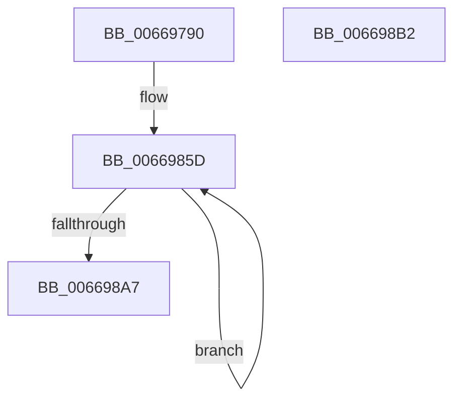

# IaaBuildDescriptorHuffmanCompress

- RVA: `0x00669790`–`0x006698B3` (길이 `291` bytes)
- VA: `0x0000000140669790`
- 실행 섹션: `.text`
- PDB 이름 있음: `예`; PDB Function 태그: `아니요`
- unwind 정보 RVA: `0x00065960`
- 디코드: `73`개 명령, `291/291` bytes 표시
- 미해석 바이트: `0` (있으면 어셈블리에 `.byte`로 보존)

> 이 문서는 커널 이미지의 기계어와 PDB 기호를 분석해 생성했습니다. 4번과 5번은 함수 원형과 자료형을 바이너리 사용 방식에서 추정한 C 해석이며 원본 소스 복구 결과는 아닙니다.

## 1. Dependencies

- 직접 호출 지점: **2**; 고유 호출 대상: **2**
- 직접 호출자로 확인된 함수: **1**
- RIP 상대 이미지 참조: **0**

### Outgoing calls
- `0x006697D7` → [DsaBuildDescriptorCommon](../48/DsaBuildDescriptorCommon_function_00483934.md) (function, `0x00483934`)
- `0x00669849` → [memset](../6C/memset_function_006C6C40.md) (function, `0x006C6C40`)

### Direct callers
- [AccelpSiovCompressionDecompression](AccelpSiovCompressionDecompression_function_00668BE0.md) at `0x00668CAC`

### Static image references
- 디코드된 RIP-relative 메모리 참조가 없습니다.

## 2. Other-region calls and transfers

- 다른 실행 섹션으로 향하는 call: **0**
- 별도 외부 분기/꼬리 이동을 확인하지 못했습니다.

## 3. Assembly (complete function range)

```asm
00669790  48 89 5C 24 08                  mov qword ptr [rsp + 8], rbx
00669795  57                              push rdi
00669796  48 83 EC 40                     sub rsp, 0x40
0066979A  8A 84 24 B0 00 00 00            mov al, byte ptr [rsp + 0xb0]
006697A1  49 8B D8                        mov rbx, r8
006697A4  88 44 24 30                     mov byte ptr [rsp + 0x30], al
006697A8  4C 8B C2                        mov r8, rdx
006697AB  8A 84 24 A8 00 00 00            mov al, byte ptr [rsp + 0xa8]
006697B2  4C 8B D1                        mov r10, rcx
006697B5  88 44 24 28                     mov byte ptr [rsp + 0x28], al
006697B9  48 8B D1                        mov rdx, rcx
006697BC  8B 84 24 A0 00 00 00            mov eax, dword ptr [rsp + 0xa0]
006697C3  49 8B F9                        mov rdi, r9
006697C6  44 8A 8C 24 98 00 00 00         mov r9b, byte ptr [rsp + 0x98]
006697CE  B9 43 00 00 00                  mov ecx, 0x43
006697D3  89 44 24 20                     mov dword ptr [rsp + 0x20], eax
006697D7  E8 58 A1 E1 FF                  call 0x140483934
006697DC  8A 42 06                        mov al, byte ptr [rdx + 6]
006697DF  41 B8 20 06 00 00               mov r8d, 0x620
006697E5  24 FD                           and al, 0xfd
006697E7  49 89 5A 28                     mov qword ptr [r10 + 0x28], rbx
006697EB  0C 01                           or al, 1
006697ED  45 89 42 34                     mov dword ptr [r10 + 0x34], r8d
006697F1  88 42 06                        mov byte ptr [rdx + 6], al
006697F4  8A 84 24 90 00 00 00            mov al, byte ptr [rsp + 0x90]
006697FB  24 01                           and al, 1
006697FD  0F B6 C8                        movzx ecx, al
00669800  0F B7 42 26                     movzx eax, word ptr [rdx + 0x26]
00669804  BA DF FF 00 00                  mov edx, 0xffdf
00669809  66 23 C2                        and ax, dx
0066980C  66 C1 E1 05                     shl cx, 5
00669810  66 0B C8                        or cx, ax
00669813  33 D2                           xor edx, edx
00669815  48 8B 44 24 70                  mov rax, qword ptr [rsp + 0x70]
0066981A  66 83 C9 12                     or cx, 0x12
0066981E  49 89 42 10                     mov qword ptr [r10 + 0x10], rax
00669822  8B 44 24 78                     mov eax, dword ptr [rsp + 0x78]
00669826  41 89 42 20                     mov dword ptr [r10 + 0x20], eax
0066982A  48 8B 84 24 80 00 00 00         mov rax, qword ptr [rsp + 0x80]
00669832  49 89 42 18                     mov qword ptr [r10 + 0x18], rax
00669836  8B 84 24 88 00 00 00            mov eax, dword ptr [rsp + 0x88]
0066983D  66 41 89 4A 26                  mov word ptr [r10 + 0x26], cx
00669842  48 8B CB                        mov rcx, rbx
00669845  41 89 42 30                     mov dword ptr [r10 + 0x30], eax
00669849  E8 F2 D3 05 00                  call 0x1406c6c40
0066984E  B8 08 00 00 00                  mov eax, 8
00669853  48 81 C3 20 01 00 00            add rbx, 0x120
0066985A  8D 48 78                        lea ecx, [rax + 0x78]
0066985D  0F 10 07                        movups xmm0, xmmword ptr [rdi]
00669860  0F 11 03                        movups xmmword ptr [rbx], xmm0
00669863  0F 10 4F 10                     movups xmm1, xmmword ptr [rdi + 0x10]
00669867  0F 11 4B 10                     movups xmmword ptr [rbx + 0x10], xmm1
0066986B  0F 10 47 20                     movups xmm0, xmmword ptr [rdi + 0x20]
0066986F  0F 11 43 20                     movups xmmword ptr [rbx + 0x20], xmm0
00669873  0F 10 4F 30                     movups xmm1, xmmword ptr [rdi + 0x30]
00669877  0F 11 4B 30                     movups xmmword ptr [rbx + 0x30], xmm1
0066987B  0F 10 47 40                     movups xmm0, xmmword ptr [rdi + 0x40]
0066987F  0F 11 43 40                     movups xmmword ptr [rbx + 0x40], xmm0
00669883  0F 10 4F 50                     movups xmm1, xmmword ptr [rdi + 0x50]
00669887  0F 11 4B 50                     movups xmmword ptr [rbx + 0x50], xmm1
0066988B  0F 10 47 60                     movups xmm0, xmmword ptr [rdi + 0x60]
0066988F  0F 11 43 60                     movups xmmword ptr [rbx + 0x60], xmm0
00669893  48 03 D9                        add rbx, rcx
00669896  0F 10 4F 70                     movups xmm1, xmmword ptr [rdi + 0x70]
0066989A  48 03 F9                        add rdi, rcx
0066989D  0F 11 4B F0                     movups xmmword ptr [rbx - 0x10], xmm1
006698A1  48 83 E8 01                     sub rax, 1
006698A5  75 B6                           jne 0x14066985d
006698A7  48 8B 5C 24 50                  mov rbx, qword ptr [rsp + 0x50]
006698AC  48 83 C4 40                     add rsp, 0x40
006698B0  5F                              pop rdi
006698B1  C3                              ret
006698B2  CC                              int3
```

## 4. C-style interpretation (structured pseudocode)

```c
__int64 __fastcall IaaBuildDescriptorHuffmanCompress(__int64 a1, __int64 a2, __int64 a3, __int64 a4, __int64 a5, unsigned int a6, __int64 a7, unsigned int a8, unsigned __int8 a9, unsigned __int8 a10, unsigned int a11, unsigned __int8 a12, unsigned __int8 a13)
{
    __int64 result;
    __int64 v_rbx;
    __int64 v_rdi;
    __int64 v_rsp;
    unsigned __int8 v_stack_m18;
    unsigned __int8 v_stack_m20;
    unsigned int v_stack_m28;
    unsigned __int64 v_stack_p8;

    v_stack_p8 = v_rbx;
    v_rsp = (v_rsp) - (64);
    v_stack_m18 = a13;
    v_stack_m20 = a12;
    v_stack_m28 = (unsigned int)((unsigned int)(a11));
    result = DsaBuildDescriptorCommon(67, a1, a2, a10);
    result = (unsigned __int8)((*(unsigned __int8 *)(a1 + 6)) & (253));
    *(unsigned __int64 *)(a1 + 40) = a3;
    result = (unsigned __int8)((result) | (1));
    *(unsigned int *)(a1 + 52) = (unsigned int)((unsigned int)(0x620ULL));
    *(unsigned __int8 *)(a1 + 6) = (unsigned __int8)(result);
    result = (unsigned __int8)((a9) & (1));
    result = (unsigned __int16)((*(unsigned __int16 *)(a1 + 38)) & ((unsigned __int16)((unsigned int)(0xFFDFULL))));
    a1 = (unsigned __int16)(((unsigned __int8)(result)) << (5));
    a1 = (unsigned __int16)((a1) | ((unsigned __int16)(result)));
    a2 = 0;
    a1 = (unsigned __int16)((a1) | (18));
    *(unsigned __int64 *)(a1 + 16) = a5;
    *(unsigned int *)(a1 + 32) = (unsigned int)((unsigned int)(a6));
    *(unsigned __int64 *)(a1 + 24) = a7;
    *(unsigned __int16 *)(a1 + 38) = (unsigned __int16)(a1);
    *(unsigned int *)(a1 + 48) = (unsigned int)((unsigned int)(a8));
    result = memset(a3, a2, (unsigned int)(0x620ULL), a10);
    v_rbx = (a3) + (288);
loc_0066985D:
    *(unsigned __int64 *)(v_rbx) = v_xmm0;
    *(unsigned __int64 *)(v_rbx + 16) = v_xmm1;
    *(unsigned __int64 *)(v_rbx + 32) = v_xmm0;
    *(unsigned __int64 *)(v_rbx + 48) = v_xmm1;
    *(unsigned __int64 *)(v_rbx + 64) = v_xmm0;
    *(unsigned __int64 *)(v_rbx + 80) = v_xmm1;
    *(unsigned __int64 *)(v_rbx + 96) = v_xmm0;
    v_rbx = (v_rbx) + (8 + 120);
    v_rdi = (a4) + (8 + 120);
    *(unsigned __int64 *)(v_rbx - 16) = v_xmm1;
    result = (8) - (1);
    if (condition_is_not_equal) goto loc_0066985D;
    v_rsp = (v_rsp) + (64);
    return result;
}
```

## 5. (Beta) C Style

```c
int64_t IaaBuildDescriptorHuffmanCompress(int64_t Arg1, int64_t Arg2, void *Arg3, void *Arg4, int64_t Arg5, uint32_t Arg6, int64_t Arg7, uint32_t Arg8, uint8_t Arg9, uint8_t Arg10, uint32_t Arg11, uint8_t Arg12, uint8_t Arg13)
{
    uint8_t *arg3 = (uint8_t *)Arg3;
    uint8_t *arg4 = (uint8_t *)Arg4;

    int64_t result;
    int64_t local_rbx;
    int64_t local_rdi;
    int64_t local_rsp;
    uint8_t v_stack_m18;
    uint8_t v_stack_m20;
    uint32_t v_stack_m28;
    uint64_t v_stack_p8;

    v_stack_p8 = local_rbx;
    local_rsp = (local_rsp) - (64);
    v_stack_m18 = Arg13;
    v_stack_m20 = Arg12;
    v_stack_m28 = (uint32_t)((uint32_t)(Arg11));
    result = DsaBuildDescriptorCommon(67, Arg1, Arg2, Arg10);
    result = (uint8_t)((*(uint8_t *)(Arg1 + 0x6)) & (253));
    *(void **)(Arg1 + 0x28) = Arg3;
    result = (uint8_t)((result) | (1));
    *(uint32_t *)(Arg1 + 0x34) = (uint32_t)((uint32_t)(0x620ULL));
    *(uint8_t *)(Arg1 + 0x6) = (uint8_t)(result);
    result = (uint8_t)((Arg9) & (1));
    result = (uint16_t)((*(uint16_t *)(Arg1 + 0x26)) & ((uint16_t)((uint32_t)(0xFFDFULL))));
    Arg1 = (uint16_t)(((uint8_t)(result)) << (5));
    Arg1 = (uint16_t)((Arg1) | ((uint16_t)(result)));
    Arg2 = 0;
    Arg1 = (uint16_t)((Arg1) | (18));
    *(uint64_t *)(Arg1 + 0x10) = Arg5;
    *(uint32_t *)(Arg1 + 0x20) = (uint32_t)((uint32_t)(Arg6));
    *(uint64_t *)(Arg1 + 0x18) = Arg7;
    *(uint16_t *)(Arg1 + 0x26) = (uint16_t)(Arg1);
    *(uint32_t *)(Arg1 + 0x30) = (uint32_t)((uint32_t)(Arg8));
    result = memset(Arg3, Arg2, (uint32_t)(0x620ULL), Arg10);
    local_rbx = (Arg3) + (288);
loc_0066985D:
    *(uint64_t *)(local_rbx) = v_xmm0;
    *(uint64_t *)(local_rbx + 0x10) = v_xmm1;
    *(uint64_t *)(local_rbx + 0x20) = v_xmm0;
    *(uint64_t *)(local_rbx + 0x30) = v_xmm1;
    *(uint64_t *)(local_rbx + 0x40) = v_xmm0;
    *(uint64_t *)(local_rbx + 0x50) = v_xmm1;
    *(uint64_t *)(local_rbx + 0x60) = v_xmm0;
    local_rbx = (local_rbx) + (8 + 120);
    local_rdi = (Arg4) + (8 + 120);
    *(uint64_t *)(local_rbx - 0x10) = v_xmm1;
    result = (8) - (1);
    if (condition_is_not_equal) goto loc_0066985D;
    local_rsp = (local_rsp) + (64);
    return result;
}
```

### 관측된 메모리 오프셋

구조체 형식이 확인되지 않은 접근은 인자 기준의 오프셋으로만 기록했습니다.

| 기준 인자 | 오프셋 표현 | 폭 (bit) | 접근 |
|---|---:|---:|---|
| `Arg3` | `- 0x10` | `128` | `R` |
| `Arg3` | `+ 0x0` | `128` | `R` |
| `Arg3` | `+ 0x10` | `128` | `R` |
| `Arg3` | `+ 0x20` | `128` | `R` |
| `Arg3` | `+ 0x30` | `128` | `R` |
| `Arg3` | `+ 0x40` | `128` | `R` |
| `Arg3` | `+ 0x50` | `128` | `R` |
| `Arg3` | `+ 0x60` | `128` | `R` |
| `Arg4` | `+ 0x0` | `128` | `R` |
| `Arg4` | `+ 0x10` | `128` | `R` |
| `Arg4` | `+ 0x20` | `128` | `R` |
| `Arg4` | `+ 0x30` | `128` | `R` |
| `Arg4` | `+ 0x40` | `128` | `R` |
| `Arg4` | `+ 0x50` | `128` | `R` |
| `Arg4` | `+ 0x60` | `128` | `R` |
| `Arg4` | `+ 0x70` | `128` | `R` |

## 6. Execution-region graph

[열기: 2D/3D 그래프와 함수 탐색 컨트롤 패널](../../../control-panel.html?section=text&rva=0x00669790&view=graph)

- 2D 그래프는 위에서 아래로 흐르고, 3D 그래프는 빈 공간을 드래그해 회전합니다. Shift+드래그는 이동, 휠은 확대·축소, 함수 노드 선택은 대상 보고서 이동입니다.

### Static fallback


