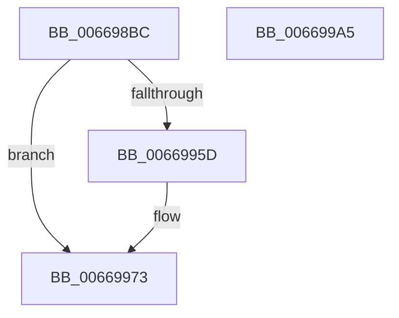

# IaaBuildDescriptorHuffmanDecompress

- RVA: `0x006698BC`–`0x006699A6` (길이 `234` bytes)
- VA: `0x00000001406698BC`
- 실행 섹션: `.text`
- PDB 이름 있음: `예`; PDB Function 태그: `아니요`
- unwind 정보 RVA: `0x000697A4`
- 디코드: `56`개 명령, `234/234` bytes 표시
- 미해석 바이트: `0` (있으면 어셈블리에 `.byte`로 보존)

> 이 문서는 커널 이미지의 기계어와 PDB 기호를 분석해 생성했습니다. 4번과 5번은 함수 원형과 자료형을 바이너리 사용 방식에서 추정한 C 해석이며 원본 소스 복구 결과는 아닙니다.

## 1. Dependencies

- 직접 호출 지점: **1**; 고유 호출 대상: **1**
- 직접 호출자로 확인된 함수: **1**
- RIP 상대 이미지 참조: **0**

### Outgoing calls
- `0x006698FF` → [DsaBuildDescriptorCommon](../48/DsaBuildDescriptorCommon_function_00483934.md) (function, `0x00483934`)

### Direct callers
- [AccelpSiovCompressionDecompression](AccelpSiovCompressionDecompression_function_00668BE0.md) at `0x00668D85`

### Static image references
- 디코드된 RIP-relative 메모리 참조가 없습니다.

## 2. Other-region calls and transfers

- 다른 실행 섹션으로 향하는 call: **0**
- 별도 외부 분기/꼬리 이동을 확인하지 못했습니다.

## 3. Assembly (complete function range)

```asm
006698BC  40 53                           push rbx
006698BE  48 83 EC 40                     sub rsp, 0x40
006698C2  8A 84 24 C0 00 00 00            mov al, byte ptr [rsp + 0xc0]
006698C9  4D 8B D8                        mov r11, r8
006698CC  88 44 24 30                     mov byte ptr [rsp + 0x30], al
006698D0  4C 8B C2                        mov r8, rdx
006698D3  8A 84 24 B8 00 00 00            mov al, byte ptr [rsp + 0xb8]
006698DA  4C 8B D1                        mov r10, rcx
006698DD  88 44 24 28                     mov byte ptr [rsp + 0x28], al
006698E1  48 8B D1                        mov rdx, rcx
006698E4  8B 84 24 B0 00 00 00            mov eax, dword ptr [rsp + 0xb0]
006698EB  49 8B D9                        mov rbx, r9
006698EE  44 8A 8C 24 A8 00 00 00         mov r9b, byte ptr [rsp + 0xa8]
006698F6  B9 42 00 00 00                  mov ecx, 0x42
006698FB  89 44 24 20                     mov dword ptr [rsp + 0x20], eax
006698FF  E8 30 A0 E1 FF                  call 0x140483934
00669904  8A 42 06                        mov al, byte ptr [rdx + 6]
00669907  B9 DF FF 00 00                  mov ecx, 0xffdf
0066990C  24 FD                           and al, 0xfd
0066990E  0C 01                           or al, 1
00669910  88 42 06                        mov byte ptr [rdx + 6], al
00669913  8A 84 24 88 00 00 00            mov al, byte ptr [rsp + 0x88]
0066991A  24 01                           and al, 1
0066991C  0F B6 D0                        movzx edx, al
0066991F  41 0F B7 42 26                  movzx eax, word ptr [r10 + 0x26]
00669924  66 23 C1                        and ax, cx
00669927  66 C1 E2 05                     shl dx, 5
0066992B  66 0B D0                        or dx, ax
0066992E  B8 3F FE 00 00                  mov eax, 0xfe3f
00669933  66 23 D0                        and dx, ax
00669936  8A 84 24 90 00 00 00            mov al, byte ptr [rsp + 0x90]
0066993D  24 07                           and al, 7
0066993F  0F B6 C8                        movzx ecx, al
00669942  66 C1 E1 06                     shl cx, 6
00669946  66 0B D1                        or dx, cx
00669949  8A 8C 24 98 00 00 00            mov cl, byte ptr [rsp + 0x98]
00669950  66 83 CA 03                     or dx, 3
00669954  66 41 89 52 26                  mov word ptr [r10 + 0x26], dx
00669959  84 C9                           test cl, cl
0066995B  74 16                           je 0x140669973
0066995D  0F B6 84 24 A0 00 00 00         movzx eax, byte ptr [rsp + 0xa0]
00669965  49 89 83 B8 00 00 00            mov qword ptr [r11 + 0xb8], rax
0066996C  41 88 8B B8 01 00 00            mov byte ptr [r11 + 0x1b8], cl
00669973  48 8B 44 24 78                  mov rax, qword ptr [rsp + 0x78]
00669978  49 89 42 10                     mov qword ptr [r10 + 0x10], rax
0066997C  8B 84 24 80 00 00 00            mov eax, dword ptr [rsp + 0x80]
00669983  41 89 42 20                     mov dword ptr [r10 + 0x20], eax
00669987  8B 44 24 70                     mov eax, dword ptr [rsp + 0x70]
0066998B  41 89 42 30                     mov dword ptr [r10 + 0x30], eax
0066998F  49 89 5A 18                     mov qword ptr [r10 + 0x18], rbx
00669993  4D 89 5A 28                     mov qword ptr [r10 + 0x28], r11
00669997  41 C7 42 34 00 15 00 00         mov dword ptr [r10 + 0x34], 0x1500
0066999F  48 83 C4 40                     add rsp, 0x40
006699A3  5B                              pop rbx
006699A4  C3                              ret
006699A5  CC                              int3
```

## 4. C-style interpretation (structured pseudocode)

```c
__int64 __fastcall IaaBuildDescriptorHuffmanDecompress(__int64 a1, __int64 a2, __int64 a3, __int64 a4, unsigned int a5, __int64 a6, unsigned int a7, unsigned __int8 a8, unsigned __int8 a9, unsigned __int8 a10, unsigned __int8 a11, unsigned __int8 a12, unsigned int a13, unsigned __int8 a14, unsigned __int8 a15)
{
    __int64 result;
    __int64 v_rsp;
    unsigned __int8 v_stack_m18;
    unsigned __int8 v_stack_m20;
    unsigned int v_stack_m28;

    v_rsp = (v_rsp) - (64);
    v_stack_m18 = a15;
    v_stack_m20 = a14;
    v_stack_m28 = (unsigned int)((unsigned int)(a13));
    result = DsaBuildDescriptorCommon(66, a1, a2, a12);
    result = (unsigned __int8)((*(unsigned __int8 *)(a1 + 6)) & (253));
    result = (unsigned __int8)((result) | (1));
    *(unsigned __int8 *)(a1 + 6) = (unsigned __int8)(result);
    result = (unsigned __int8)((a8) & (1));
    result = (unsigned __int16)((*(unsigned __int16 *)(a1 + 38)) & ((unsigned __int16)((unsigned int)(0xFFDFULL))));
    a2 = (unsigned __int16)(((unsigned __int8)(result)) << (5));
    a2 = (unsigned __int16)((a2) | ((unsigned __int16)(result)));
    a2 = (unsigned __int16)((a2) & ((unsigned __int16)((unsigned int)(0xFE3FULL))));
    result = (unsigned __int8)((a9) & (7));
    a1 = (unsigned __int16)(((unsigned __int8)(result)) << (6));
    a2 = (unsigned __int16)((a2) | ((unsigned __int16)(a1)));
    a2 = (unsigned __int16)((a2) | (3));
    *(unsigned __int16 *)(a1 + 38) = (unsigned __int16)(a2);
    if (a10 != 0) {
        result = a11;
        *(unsigned __int64 *)(a3 + 184) = result;
        *(unsigned __int8 *)(a3 + 440) = a10;
    }
    *(unsigned __int64 *)(a1 + 16) = a6;
    *(unsigned int *)(a1 + 32) = (unsigned int)((unsigned int)(a7));
    *(unsigned int *)(a1 + 48) = (unsigned int)((unsigned int)(a5));
    *(unsigned __int64 *)(a1 + 24) = a4;
    *(unsigned __int64 *)(a1 + 40) = a3;
    *(unsigned int *)(a1 + 52) = 0x1500ULL;
    v_rsp = (v_rsp) + (64);
    return (unsigned int)(a5);
}
```

## 5. (Beta) C Style

```c
int64_t IaaBuildDescriptorHuffmanDecompress(int64_t Arg1, int64_t Arg2, int64_t Arg3, int64_t Arg4, uint32_t Arg5, int64_t Arg6, uint32_t Arg7, uint8_t Arg8, uint8_t Arg9, uint8_t Arg10, uint8_t Arg11, uint8_t Arg12, uint32_t Arg13, uint8_t Arg14, uint8_t Arg15)
{
    int64_t result;
    int64_t local_rsp;
    uint8_t v_stack_m18;
    uint8_t v_stack_m20;
    uint32_t v_stack_m28;

    local_rsp = (local_rsp) - (64);
    v_stack_m18 = Arg15;
    v_stack_m20 = Arg14;
    v_stack_m28 = (uint32_t)((uint32_t)(Arg13));
    result = DsaBuildDescriptorCommon(66, Arg1, Arg2, Arg12);
    result = (uint8_t)((*(uint8_t *)(Arg1 + 0x6)) & (253));
    result = (uint8_t)((result) | (1));
    *(uint8_t *)(Arg1 + 0x6) = (uint8_t)(result);
    result = (uint8_t)((Arg8) & (1));
    result = (uint16_t)((*(uint16_t *)(Arg1 + 0x26)) & ((uint16_t)((uint32_t)(0xFFDFULL))));
    Arg2 = (uint16_t)(((uint8_t)(result)) << (5));
    Arg2 = (uint16_t)((Arg2) | ((uint16_t)(result)));
    Arg2 = (uint16_t)((Arg2) & ((uint16_t)((uint32_t)(0xFE3FULL))));
    result = (uint8_t)((Arg9) & (7));
    Arg1 = (uint16_t)(((uint8_t)(result)) << (6));
    Arg2 = (uint16_t)((Arg2) | ((uint16_t)(Arg1)));
    Arg2 = (uint16_t)((Arg2) | (3));
    *(uint16_t *)(Arg1 + 0x26) = (uint16_t)(Arg2);
    if (Arg10 != 0) {
        result = Arg11;
        *(uint64_t *)(Arg3 + 0xB8) = result;
        *(uint8_t *)(Arg3 + 0x1B8) = Arg10;
    }
    *(uint64_t *)(Arg1 + 0x10) = Arg6;
    *(uint32_t *)(Arg1 + 0x20) = (uint32_t)((uint32_t)(Arg7));
    *(uint32_t *)(Arg1 + 0x30) = (uint32_t)((uint32_t)(Arg5));
    *(uint64_t *)(Arg1 + 0x18) = Arg4;
    *(uint64_t *)(Arg1 + 0x28) = Arg3;
    *(uint32_t *)(Arg1 + 0x34) = 0x1500ULL;
    local_rsp = (local_rsp) + (64);
    return (uint32_t)(Arg5);
}
```

## 6. Execution-region graph

[열기: 2D/3D 그래프와 함수 탐색 컨트롤 패널](../../../control-panel.html?section=text&rva=0x006698BC&view=graph)

- 2D 그래프는 위에서 아래로 흐르고, 3D 그래프는 빈 공간을 드래그해 회전합니다. Shift+드래그는 이동, 휠은 확대·축소, 함수 노드 선택은 대상 보고서 이동입니다.

### Static fallback


