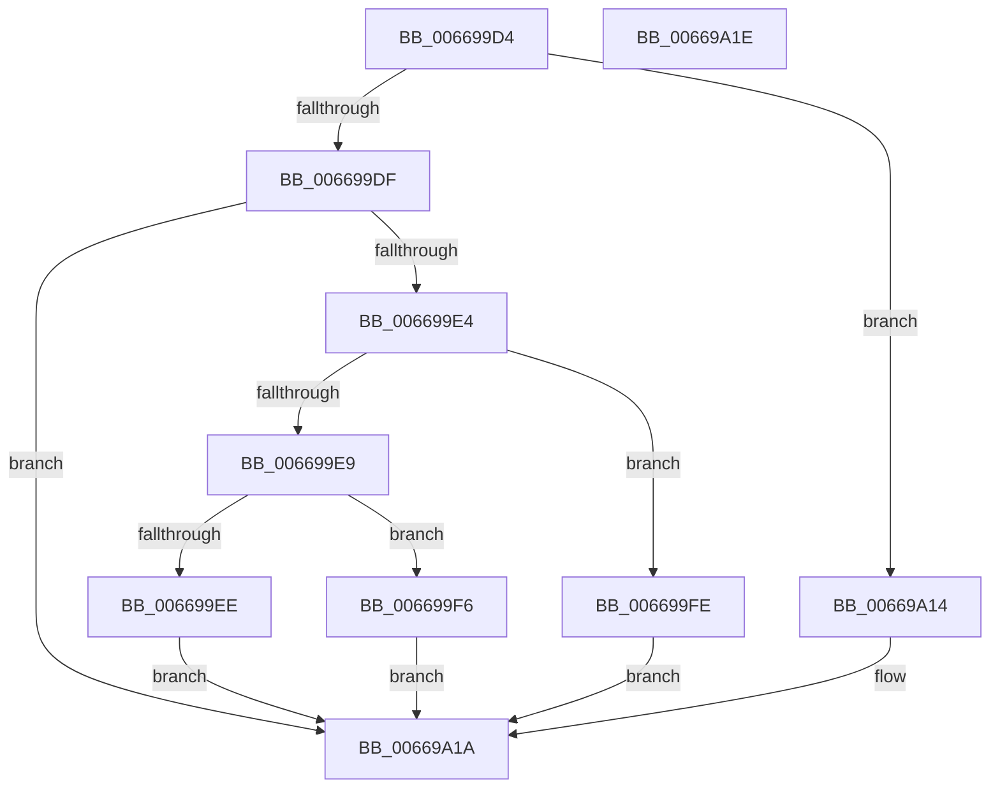

# IaaGetStatusFromCompletionRecord

- RVA: `0x006699D4`–`0x00669A1F` (길이 `75` bytes)
- VA: `0x00000001406699D4`
- 실행 섹션: `.text`
- PDB 이름 있음: `예`; PDB Function 태그: `아니요`
- unwind 정보 RVA: `0x000DB714`
- 디코드: `24`개 명령, `75/75` bytes 표시
- 미해석 바이트: `0` (있으면 어셈블리에 `.byte`로 보존)

> 이 문서는 커널 이미지의 기계어와 PDB 기호를 분석해 생성했습니다. 4번과 5번은 함수 원형과 자료형을 바이너리 사용 방식에서 추정한 C 해석이며 원본 소스 복구 결과는 아닙니다.

## 1. Dependencies

- 직접 호출 지점: **0**; 고유 호출 대상: **0**
- 직접 호출자로 확인된 함수: **2**
- RIP 상대 이미지 참조: **0**

### Outgoing calls
- 직접 디코드된 call 명령이 없습니다.

### Direct callers
- [AccelpSiovIaaOperationHandler](AccelpSiovIaaOperationHandler_function_00668EF0.md) at `0x00669102`
- [AccelpSiovIaaQueryCompletionInformation](AccelpSiovIaaQueryCompletionInformation_function_00669190.md) at `0x00669206`
- [AccelpSiovIaaQueryCompletionInformation](AccelpSiovIaaQueryCompletionInformation_function_00669190.md) at `0x00669238`
- [AccelpSiovIaaQueryCompletionInformation](AccelpSiovIaaQueryCompletionInformation_function_00669190.md) at `0x00669278`
- [AccelpSiovIaaQueryCompletionInformation](AccelpSiovIaaQueryCompletionInformation_function_00669190.md) at `0x00669348`
- [AccelpSiovIaaQueryCompletionInformation](AccelpSiovIaaQueryCompletionInformation_function_00669190.md) at `0x0066936E`

### Static image references
- 디코드된 RIP-relative 메모리 참조가 없습니다.

## 2. Other-region calls and transfers

- 다른 실행 섹션으로 향하는 call: **0**
- 별도 외부 분기/꼬리 이동을 확인하지 못했습니다.

## 3. Assembly (complete function range)

```asm
006699D4  0F B6 11                        movzx edx, byte ptr [rcx]
006699D7  45 33 C0                        xor r8d, r8d
006699DA  83 E2 3F                        and edx, 0x3f
006699DD  74 35                           je 0x140669a14
006699DF  83 EA 01                        sub edx, 1
006699E2  74 36                           je 0x140669a1a
006699E4  83 EA 09                        sub edx, 9
006699E7  74 15                           je 0x1406699fe
006699E9  83 FA 01                        cmp edx, 1
006699EC  74 08                           je 0x1406699f6
006699EE  41 B8 01 00 00 C0               mov r8d, 0xc0000001
006699F4  EB 24                           jmp 0x140669a1a
006699F6  41 B8 23 00 00 C0               mov r8d, 0xc0000023
006699FC  EB 1C                           jmp 0x140669a1a
006699FE  80 79 01 19                     cmp byte ptr [rcx + 1], 0x19
00669A02  B8 23 00 00 C0                  mov eax, 0xc0000023
00669A07  44 8D 40 DE                     lea r8d, [rax - 0x22]
00669A0B  41 0F 45 C0                     cmovne eax, r8d
00669A0F  44 8B C0                        mov r8d, eax
00669A12  EB 06                           jmp 0x140669a1a
00669A14  41 B8 03 01 00 00               mov r8d, 0x103
00669A1A  41 8B C0                        mov eax, r8d
00669A1D  C3                              ret
00669A1E  CC                              int3
```

## 4. C-style interpretation (structured pseudocode)

```c
__int64 __fastcall IaaGetStatusFromCompletionRecord(__int64 a1, __int64 a2, int a3)
{
    __int64 result;

    a3 = 0;
    a2 = (unsigned int)((*(unsigned __int8 *)(a1)) & (63));
    if (condition_is_equal) goto loc_00669A14;
    a2 = (unsigned int)((a2) - (1));
    if (condition_is_equal) goto loc_00669A1A;
    a2 = (unsigned int)((a2) - (9));
    if (condition_is_equal) goto loc_006699FE;
    if (((unsigned int)(a2)) == 1) goto loc_006699F6;
    goto loc_00669A1A;
loc_006699F6:
    goto loc_00669A1A;
loc_006699FE:
    result = (unsigned int)(0xC0000023ULL);
    if ((*(unsigned __int8 *)(a1 + 1)) != 25) { result = (unsigned int)((unsigned int)(0xC0000023ULL) - 34); }
    goto loc_00669A1A;
loc_00669A14:
loc_00669A1A:
    return 259;
}
```

## 5. (Beta) C Style

```c
int64_t IaaGetStatusFromCompletionRecord(void *Arg1, int64_t Arg2, int32_t Arg3)
{
    uint8_t *arg1 = (uint8_t *)Arg1;

    int64_t result;

    Arg3 = 0;
    Arg2 = (uint32_t)((*(uint8_t *)(arg1)) & (63));
    if (condition_is_equal) goto loc_00669A14;
    Arg2 = (uint32_t)((Arg2) - (1));
    if (condition_is_equal) goto loc_00669A1A;
    Arg2 = (uint32_t)((Arg2) - (9));
    if (condition_is_equal) goto loc_006699FE;
    if (((uint32_t)(Arg2)) == 1) goto loc_006699F6;
    goto loc_00669A1A;
loc_006699F6:
    goto loc_00669A1A;
loc_006699FE:
    result = (uint32_t)(0xC0000023ULL);
    if ((*(uint8_t *)(arg1 + 0x1)) != 25) { result = (uint32_t)((uint32_t)(0xC0000023ULL) - 34); }
    goto loc_00669A1A;
loc_00669A14:
loc_00669A1A:
    return 259;
}
```

### 관측된 메모리 오프셋

구조체 형식이 확인되지 않은 접근은 인자 기준의 오프셋으로만 기록했습니다.

| 기준 인자 | 오프셋 표현 | 폭 (bit) | 접근 |
|---|---:|---:|---|
| `Arg1` | `+ 0x0` | `8` | `R` |
| `Arg1` | `+ 0x1` | `8` | `R` |

## 6. Execution-region graph

[열기: 2D/3D 그래프와 함수 탐색 컨트롤 패널](../../../control-panel.html?section=text&rva=0x006699D4&view=graph)

- 2D 그래프는 위에서 아래로 흐르고, 3D 그래프는 빈 공간을 드래그해 회전합니다. Shift+드래그는 이동, 휠은 확대·축소, 함수 노드 선택은 대상 보고서 이동입니다.

### Static fallback


