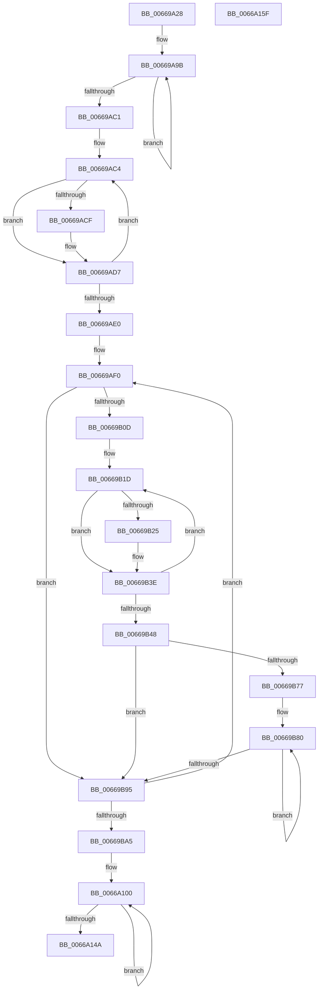

# IaapSetAecsDecompressionHuffmanTable

- RVA: `0x00669A28`–`0x0066A160` (길이 `1,848` bytes)
- VA: `0x0000000140669A28`
- 실행 섹션: `.text`
- PDB 이름 있음: `예`; PDB Function 태그: `아니요`
- unwind 정보 RVA: `0x000AF26C`
- 디코드: `486`개 명령, `1,848/1,848` bytes 표시
- 미해석 바이트: `0` (있으면 어셈블리에 `.byte`로 보존)

> 이 문서는 커널 이미지의 기계어와 PDB 기호를 분석해 생성했습니다. 4번과 5번은 함수 원형과 자료형을 바이너리 사용 방식에서 추정한 C 해석이며 원본 소스 복구 결과는 아닙니다.

## 1. Dependencies

- 직접 호출 지점: **4**; 고유 호출 대상: **2**
- 직접 호출자로 확인된 함수: **1**
- RIP 상대 이미지 참조: **2**

### Outgoing calls
- `0x00669A5D` → [memset](../6C/memset_function_006C6C40.md) (function, `0x006C6C40`)
- `0x00669A75` → [memset](../6C/memset_function_006C6C40.md) (function, `0x006C6C40`)
- `0x00669AFB` → [memset](../6C/memset_function_006C6C40.md) (function, `0x006C6C40`)
- `0x00669B5A` → [qsort](../50/qsort_function_005009F0.md) (function, `0x005009F0`)

### Direct callers
- [AccelpSiovCompressionDecompression](AccelpSiovCompressionDecompression_function_00668BE0.md) at `0x00668DB3`

### Static image references
- `0x00669B4A` → RVA `0x006699B0` (`IaaCodeValuesSort`; read)
- `0x00669F74` → RVA `0x00010850` (`.rdata`; read)

## 2. Other-region calls and transfers

- 다른 실행 섹션으로 향하는 call: **0**
- 별도 외부 분기/꼬리 이동을 확인하지 못했습니다.

## 3. Assembly (complete function range)

```asm
00669A28  48 89 5C 24 08                  mov qword ptr [rsp + 8], rbx
00669A2D  4C 89 4C 24 20                  mov qword ptr [rsp + 0x20], r9
00669A32  48 89 54 24 10                  mov qword ptr [rsp + 0x10], rdx
00669A37  55                              push rbp
00669A38  56                              push rsi
00669A39  57                              push rdi
00669A3A  41 54                           push r12
00669A3C  41 55                           push r13
00669A3E  41 56                           push r14
00669A40  41 57                           push r15
00669A42  48 83 EC 20                     sub rsp, 0x20
00669A46  4C 8B EA                        mov r13, rdx
00669A49  49 8B F8                        mov rdi, r8
00669A4C  4C 8B F1                        mov r14, rcx
00669A4F  33 D2                           xor edx, edx
00669A51  49 8B CD                        mov rcx, r13
00669A54  41 B8 00 15 00 00               mov r8d, 0x1500
00669A5A  49 8B E9                        mov rbp, r9
00669A5D  E8 DE D1 05 00                  call 0x1406c6c40
00669A62  48 8B B4 24 80 00 00 00         mov rsi, qword ptr [rsp + 0x80]
00669A6A  33 D2                           xor edx, edx
00669A6C  48 8B CE                        mov rcx, rsi
00669A6F  41 B8 78 01 00 00               mov r8d, 0x178
00669A75  E8 C6 D1 05 00                  call 0x1406c6c40
00669A7A  45 33 D2                        xor r10d, r10d
00669A7D  48 8B CD                        mov rcx, rbp
00669A80  41 8B DA                        mov ebx, r10d
00669A83  45 8B C2                        mov r8d, r10d
00669A86  49 8B D6                        mov rdx, r14
00669A89  49 2B CE                        sub rcx, r14
00669A8C  BD FF 7F 00 00                  mov ebp, 0x7fff
00669A91  41 BB 00 01 00 00               mov r11d, 0x100
00669A97  45 8D 4A 01                     lea r9d, [r10 + 1]
00669A9B  0F B7 02                        movzx eax, word ptr [rdx]
00669A9E  66 23 C5                        and ax, bp
00669AA1  66 89 04 11                     mov word ptr [rcx + rdx], ax
00669AA5  8B 02                           mov eax, dword ptr [rdx]
00669AA7  C1 E8 0F                        shr eax, 0xf
00669AAA  44 88 44 11 03                  mov byte ptr [rcx + rdx + 3], r8b
00669AAF  48 8D 52 04                     lea rdx, [rdx + 4]
00669AB3  24 0F                           and al, 0xf
00669AB5  45 03 C1                        add r8d, r9d
00669AB8  88 44 11 FE                     mov byte ptr [rcx + rdx - 2], al
00669ABC  45 3B C3                        cmp r8d, r11d
00669ABF  72 DA                           jb 0x140669a9b
00669AC1  49 8B D3                        mov rdx, r11
00669AC4  41 8B 06                        mov eax, dword ptr [r14]
00669AC7  C1 E8 0F                        shr eax, 0xf
00669ACA  83 E0 0F                        and eax, 0xf
00669ACD  74 08                           je 0x140669ad7
00669ACF  FF C8                           dec eax
00669AD1  66 44 01 4C 46 1E               add word ptr [rsi + rax*2 + 0x1e], r9w
00669AD7  49 83 C6 04                     add r14, 4
00669ADB  49 2B D1                        sub rdx, r9
00669ADE  75 E4                           jne 0x140669ac4
00669AE0  4C 8B 6C 24 78                  mov r13, qword ptr [rsp + 0x78]
00669AE5  4C 8D 76 3C                     lea r14, [rsi + 0x3c]
00669AE9  45 8B FA                        mov r15d, r10d
00669AEC  44 8D 62 02                     lea r12d, [rdx + 2]
00669AF0  33 D2                           xor edx, edx
00669AF2  41 B8 00 04 00 00               mov r8d, 0x400
00669AF8  48 8B CF                        mov rcx, rdi
00669AFB  E8 40 D1 05 00                  call 0x1406c6c40
00669B00  33 C0                           xor eax, eax
00669B02  66 41 39 46 E2                  cmp word ptr [r14 - 0x1e], ax
00669B07  0F 84 88 00 00 00               je 0x140669b95
00669B0D  8B E8                           mov ebp, eax
00669B0F  49 8D 55 02                     lea rdx, [r13 + 2]
00669B13  41 B8 00 01 00 00               mov r8d, 0x100
00669B19  45 8D 4F 01                     lea r9d, [r15 + 1]
00669B1D  0F B6 02                        movzx eax, byte ptr [rdx]
00669B20  41 3B C1                        cmp eax, r9d
00669B23  75 19                           jne 0x140669b3e
00669B25  8A 42 01                        mov al, byte ptr [rdx + 1]
00669B28  8B CD                           mov ecx, ebp
00669B2A  FF C5                           inc ebp
00669B2C  88 44 8F 03                     mov byte ptr [rdi + rcx*4 + 3], al
00669B30  0F B7 42 FE                     movzx eax, word ptr [rdx - 2]
00669B34  66 89 04 8F                     mov word ptr [rdi + rcx*4], ax
00669B38  8A 02                           mov al, byte ptr [rdx]
00669B3A  88 44 8F 02                     mov byte ptr [rdi + rcx*4 + 2], al
00669B3E  48 83 C2 04                     add rdx, 4
00669B42  49 83 E8 01                     sub r8, 1
00669B46  75 D5                           jne 0x140669b1d
00669B48  8B D5                           mov edx, ebp
00669B4A  4C 8D 0D 5F FE FF FF            lea r9, [rip - 0x1a1]
00669B51  41 B8 04 00 00 00               mov r8d, 4
00669B57  48 8B CF                        mov rcx, rdi
00669B5A  E8 91 6E E9 FF                  call 0x1405009f0
00669B5F  0F B7 07                        movzx eax, word ptr [rdi]
00669B62  44 8D 04 2B                     lea r8d, [rbx + rbp]
00669B66  66 41 89 06                     mov word ptr [r14], ax
00669B6A  44 8B CB                        mov r9d, ebx
00669B6D  66 41 89 5E C4                  mov word ptr [r14 - 0x3c], bx
00669B72  41 3B D8                        cmp ebx, r8d
00669B75  73 1E                           jae 0x140669b95
00669B77  8B D3                           mov edx, ebx
00669B79  48 83 C2 78                     add rdx, 0x78
00669B7D  48 03 D6                        add rdx, rsi
00669B80  8B C3                           mov eax, ebx
00669B82  FF C3                           inc ebx
00669B84  41 2B C1                        sub eax, r9d
00669B87  8A 4C 87 03                     mov cl, byte ptr [rdi + rax*4 + 3]
00669B8B  88 0A                           mov byte ptr [rdx], cl
00669B8D  48 FF C2                        inc rdx
00669B90  41 3B D8                        cmp ebx, r8d
00669B93  72 EB                           jb 0x140669b80
00669B95  41 FF C7                        inc r15d
00669B98  4D 03 F4                        add r14, r12
00669B9B  41 83 FF 0F                     cmp r15d, 0xf
00669B9F  0F 82 4B FF FF FF               jb 0x140669af0
00669BA5  4C 8B 6C 24 68                  mov r13, qword ptr [rsp + 0x68]
00669BAA  33 C0                           xor eax, eax
00669BAC  0F 57 C0                        xorps xmm0, xmm0
00669BAF  41 BE 00 FF 01 00               mov r14d, 0x1ff00
00669BB5  BD 00 00 FE 07                  mov ebp, 0x7fe0000
00669BBA  BF FF 07 00 00                  mov edi, 0x7ff
00669BBF  BB 00 F8 7F 00                  mov ebx, 0x7ff800
00669BC4  41 BB FF 1F 00 00               mov r11d, 0x1fff
00669BCA  41 0F 11 85 E0 01 00 00         movups xmmword ptr [r13 + 0x1e0], xmm0
00669BD2  41 89 85 F0 01 00 00            mov dword ptr [r13 + 0x1f0], eax
00669BD9  41 BA 00 E0 FF 07               mov r10d, 0x7ffe000
00669BDF  0F B7 06                        movzx eax, word ptr [rsi]
00669BE2  83 E0 03                        and eax, 3
00669BE5  41 89 85 E0 01 00 00            mov dword ptr [r13 + 0x1e0], eax
00669BEC  0F B7 4E 02                     movzx ecx, word ptr [rsi + 2]
00669BF0  83 E1 07                        and ecx, 7
00669BF3  C1 E1 02                        shl ecx, 2
00669BF6  0B C8                           or ecx, eax
00669BF8  41 89 8D E0 01 00 00            mov dword ptr [r13 + 0x1e0], ecx
00669BFF  0F B7 46 04                     movzx eax, word ptr [rsi + 4]
00669C03  83 E0 0F                        and eax, 0xf
00669C06  C1 E0 05                        shl eax, 5
00669C09  0B C1                           or eax, ecx
00669C0B  41 89 85 E0 01 00 00            mov dword ptr [r13 + 0x1e0], eax
00669C12  0F B7 4E 06                     movzx ecx, word ptr [rsi + 6]
00669C16  83 E1 1F                        and ecx, 0x1f
00669C19  C1 E1 09                        shl ecx, 9
00669C1C  0B C8                           or ecx, eax
00669C1E  41 89 8D E0 01 00 00            mov dword ptr [r13 + 0x1e0], ecx
00669C25  0F B7 56 08                     movzx edx, word ptr [rsi + 8]
00669C29  83 E2 3F                        and edx, 0x3f
00669C2C  C1 E2 0E                        shl edx, 0xe
00669C2F  0B D1                           or edx, ecx
00669C31  41 89 95 E0 01 00 00            mov dword ptr [r13 + 0x1e0], edx
00669C38  0F B7 46 0A                     movzx eax, word ptr [rsi + 0xa]
00669C3C  83 E0 7F                        and eax, 0x7f
00669C3F  C1 E0 14                        shl eax, 0x14
00669C42  0B C2                           or eax, edx
00669C44  41 89 85 E0 01 00 00            mov dword ptr [r13 + 0x1e0], eax
00669C4B  8A 46 0C                        mov al, byte ptr [rsi + 0xc]
00669C4E  41 88 85 E4 01 00 00            mov byte ptr [r13 + 0x1e4], al
00669C55  0F B7 4E 0E                     movzx ecx, word ptr [rsi + 0xe]
00669C59  41 8B 85 E4 01 00 00            mov eax, dword ptr [r13 + 0x1e4]
00669C60  C1 E1 08                        shl ecx, 8
00669C63  33 C8                           xor ecx, eax
00669C65  41 23 CE                        and ecx, r14d
00669C68  33 C8                           xor ecx, eax
00669C6A  41 89 8D E4 01 00 00            mov dword ptr [r13 + 0x1e4], ecx
00669C71  0F B7 46 10                     movzx eax, word ptr [rsi + 0x10]
00669C75  C1 E0 11                        shl eax, 0x11
00669C78  33 C1                           xor eax, ecx
00669C7A  23 C5                           and eax, ebp
00669C7C  33 C1                           xor eax, ecx
00669C7E  41 89 85 E4 01 00 00            mov dword ptr [r13 + 0x1e4], eax
00669C85  0F B7 4E 12                     movzx ecx, word ptr [rsi + 0x12]
00669C89  41 8B 85 E8 01 00 00            mov eax, dword ptr [r13 + 0x1e8]
00669C90  33 C8                           xor ecx, eax
00669C92  23 CF                           and ecx, edi
00669C94  33 C8                           xor ecx, eax
00669C96  41 89 8D E8 01 00 00            mov dword ptr [r13 + 0x1e8], ecx
00669C9D  0F B7 46 14                     movzx eax, word ptr [rsi + 0x14]
00669CA1  C1 E0 0B                        shl eax, 0xb
00669CA4  33 C1                           xor eax, ecx
00669CA6  23 C3                           and eax, ebx
00669CA8  33 C1                           xor eax, ecx
00669CAA  41 89 85 E8 01 00 00            mov dword ptr [r13 + 0x1e8], eax
00669CB1  41 8B 85 EC 01 00 00            mov eax, dword ptr [r13 + 0x1ec]
00669CB8  0F B7 4E 16                     movzx ecx, word ptr [rsi + 0x16]
00669CBC  33 C8                           xor ecx, eax
00669CBE  41 23 CB                        and ecx, r11d
00669CC1  33 C8                           xor ecx, eax
00669CC3  41 89 8D EC 01 00 00            mov dword ptr [r13 + 0x1ec], ecx
00669CCA  0F B7 46 18                     movzx eax, word ptr [rsi + 0x18]
00669CCE  C1 E0 0D                        shl eax, 0xd
00669CD1  33 C1                           xor eax, ecx
00669CD3  41 23 C2                        and eax, r10d
00669CD6  33 C1                           xor eax, ecx
00669CD8  41 89 85 EC 01 00 00            mov dword ptr [r13 + 0x1ec], eax
00669CDF  0F B7 4E 1A                     movzx ecx, word ptr [rsi + 0x1a]
00669CE3  41 8B 85 F0 01 00 00            mov eax, dword ptr [r13 + 0x1f0]
00669CEA  33 C8                           xor ecx, eax
00669CEC  41 BF FF 7F 00 00               mov r15d, 0x7fff
00669CF2  41 B9 FF 7F 00 80               mov r9d, 0x80007fff
00669CF8  41 23 CF                        and ecx, r15d
00669CFB  33 C8                           xor ecx, eax
00669CFD  41 89 8D F0 01 00 00            mov dword ptr [r13 + 0x1f0], ecx
00669D04  41 23 C9                        and ecx, r9d
00669D07  0F B7 46 1C                     movzx eax, word ptr [rsi + 0x1c]
00669D0B  C1 E0 0F                        shl eax, 0xf
00669D0E  0B C1                           or eax, ecx
00669D10  41 89 85 F0 01 00 00            mov dword ptr [r13 + 0x1f0], eax
00669D17  33 C0                           xor eax, eax
00669D19  41 0F 11 85 F4 01 00 00         movups xmmword ptr [r13 + 0x1f4], xmm0
00669D21  41 89 85 04 02 00 00            mov dword ptr [r13 + 0x204], eax
00669D28  0F B7 46 1E                     movzx eax, word ptr [rsi + 0x1e]
00669D2C  83 E0 03                        and eax, 3
00669D2F  41 89 85 F4 01 00 00            mov dword ptr [r13 + 0x1f4], eax
00669D36  0F B7 4E 20                     movzx ecx, word ptr [rsi + 0x20]
00669D3A  83 E1 07                        and ecx, 7
00669D3D  C1 E1 02                        shl ecx, 2
00669D40  0B C8                           or ecx, eax
00669D42  41 89 8D F4 01 00 00            mov dword ptr [r13 + 0x1f4], ecx
00669D49  0F B7 46 22                     movzx eax, word ptr [rsi + 0x22]
00669D4D  83 E0 0F                        and eax, 0xf
00669D50  C1 E0 05                        shl eax, 5
00669D53  0B C1                           or eax, ecx
00669D55  41 89 85 F4 01 00 00            mov dword ptr [r13 + 0x1f4], eax
00669D5C  0F B7 4E 24                     movzx ecx, word ptr [rsi + 0x24]
00669D60  83 E1 1F                        and ecx, 0x1f
00669D63  C1 E1 09                        shl ecx, 9
00669D66  0B C8                           or ecx, eax
00669D68  41 89 8D F4 01 00 00            mov dword ptr [r13 + 0x1f4], ecx
00669D6F  0F B7 56 26                     movzx edx, word ptr [rsi + 0x26]
00669D73  83 E2 3F                        and edx, 0x3f
00669D76  C1 E2 0E                        shl edx, 0xe
00669D79  0B D1                           or edx, ecx
00669D7B  41 89 95 F4 01 00 00            mov dword ptr [r13 + 0x1f4], edx
00669D82  0F B7 46 28                     movzx eax, word ptr [rsi + 0x28]
00669D86  83 E0 7F                        and eax, 0x7f
00669D89  C1 E0 14                        shl eax, 0x14
00669D8C  0B C2                           or eax, edx
00669D8E  41 89 85 F4 01 00 00            mov dword ptr [r13 + 0x1f4], eax
00669D95  8A 46 2A                        mov al, byte ptr [rsi + 0x2a]
00669D98  41 88 85 F8 01 00 00            mov byte ptr [r13 + 0x1f8], al
00669D9F  0F B7 4E 2C                     movzx ecx, word ptr [rsi + 0x2c]
00669DA3  41 8B 85 F8 01 00 00            mov eax, dword ptr [r13 + 0x1f8]
00669DAA  C1 E1 08                        shl ecx, 8
00669DAD  33 C8                           xor ecx, eax
00669DAF  41 23 CE                        and ecx, r14d
00669DB2  33 C8                           xor ecx, eax
00669DB4  41 89 8D F8 01 00 00            mov dword ptr [r13 + 0x1f8], ecx
00669DBB  0F B7 46 2E                     movzx eax, word ptr [rsi + 0x2e]
00669DBF  C1 E0 11                        shl eax, 0x11
00669DC2  33 C1                           xor eax, ecx
00669DC4  23 C5                           and eax, ebp
00669DC6  33 C1                           xor eax, ecx
00669DC8  41 89 85 F8 01 00 00            mov dword ptr [r13 + 0x1f8], eax
00669DCF  0F B7 4E 30                     movzx ecx, word ptr [rsi + 0x30]
00669DD3  41 8B 85 FC 01 00 00            mov eax, dword ptr [r13 + 0x1fc]
00669DDA  33 C8                           xor ecx, eax
00669DDC  23 CF                           and ecx, edi
00669DDE  33 C8                           xor ecx, eax
00669DE0  41 89 8D FC 01 00 00            mov dword ptr [r13 + 0x1fc], ecx
00669DE7  0F B7 46 32                     movzx eax, word ptr [rsi + 0x32]
00669DEB  C1 E0 0B                        shl eax, 0xb
00669DEE  33 C1                           xor eax, ecx
00669DF0  23 C3                           and eax, ebx
00669DF2  33 C1                           xor eax, ecx
00669DF4  41 89 85 FC 01 00 00            mov dword ptr [r13 + 0x1fc], eax
00669DFB  41 8B 85 00 02 00 00            mov eax, dword ptr [r13 + 0x200]
00669E02  0F B7 4E 34                     movzx ecx, word ptr [rsi + 0x34]
00669E06  33 C8                           xor ecx, eax
00669E08  41 23 CB                        and ecx, r11d
00669E0B  33 C8                           xor ecx, eax
00669E0D  41 89 8D 00 02 00 00            mov dword ptr [r13 + 0x200], ecx
00669E14  0F B7 46 36                     movzx eax, word ptr [rsi + 0x36]
00669E18  C1 E0 0D                        shl eax, 0xd
00669E1B  33 C1                           xor eax, ecx
00669E1D  41 23 C2                        and eax, r10d
00669E20  33 C1                           xor eax, ecx
00669E22  41 89 85 00 02 00 00            mov dword ptr [r13 + 0x200], eax
00669E29  41 8B 85 04 02 00 00            mov eax, dword ptr [r13 + 0x204]
00669E30  0F B7 4E 38                     movzx ecx, word ptr [rsi + 0x38]
00669E34  33 C8                           xor ecx, eax
00669E36  41 23 CF                        and ecx, r15d
00669E39  33 C8                           xor ecx, eax
00669E3B  41 89 8D 04 02 00 00            mov dword ptr [r13 + 0x204], ecx
00669E42  41 23 C9                        and ecx, r9d
00669E45  0F B7 46 3A                     movzx eax, word ptr [rsi + 0x3a]
00669E49  C1 E0 0F                        shl eax, 0xf
00669E4C  0B C1                           or eax, ecx
00669E4E  41 89 85 04 02 00 00            mov dword ptr [r13 + 0x204], eax
00669E55  33 C0                           xor eax, eax
00669E57  41 0F 11 85 08 02 00 00         movups xmmword ptr [r13 + 0x208], xmm0
00669E5F  41 89 85 18 02 00 00            mov dword ptr [r13 + 0x218], eax
00669E66  0F B7 46 3C                     movzx eax, word ptr [rsi + 0x3c]
00669E6A  83 E0 03                        and eax, 3
00669E6D  41 89 85 08 02 00 00            mov dword ptr [r13 + 0x208], eax
00669E74  0F B7 4E 3E                     movzx ecx, word ptr [rsi + 0x3e]
00669E78  83 E1 07                        and ecx, 7
00669E7B  C1 E1 02                        shl ecx, 2
00669E7E  0B C8                           or ecx, eax
00669E80  41 89 8D 08 02 00 00            mov dword ptr [r13 + 0x208], ecx
00669E87  0F B7 46 40                     movzx eax, word ptr [rsi + 0x40]
00669E8B  83 E0 0F                        and eax, 0xf
00669E8E  C1 E0 05                        shl eax, 5
00669E91  0B C1                           or eax, ecx
00669E93  41 89 85 08 02 00 00            mov dword ptr [r13 + 0x208], eax
00669E9A  0F B7 4E 42                     movzx ecx, word ptr [rsi + 0x42]
00669E9E  83 E1 1F                        and ecx, 0x1f
00669EA1  C1 E1 09                        shl ecx, 9
00669EA4  0B C8                           or ecx, eax
00669EA6  41 89 8D 08 02 00 00            mov dword ptr [r13 + 0x208], ecx
00669EAD  0F B7 56 44                     movzx edx, word ptr [rsi + 0x44]
00669EB1  83 E2 3F                        and edx, 0x3f
00669EB4  C1 E2 0E                        shl edx, 0xe
00669EB7  0B D1                           or edx, ecx
00669EB9  41 89 95 08 02 00 00            mov dword ptr [r13 + 0x208], edx
00669EC0  0F B7 46 46                     movzx eax, word ptr [rsi + 0x46]
00669EC4  83 E0 7F                        and eax, 0x7f
00669EC7  C1 E0 14                        shl eax, 0x14
00669ECA  0B C2                           or eax, edx
00669ECC  41 89 85 08 02 00 00            mov dword ptr [r13 + 0x208], eax
00669ED3  8A 46 48                        mov al, byte ptr [rsi + 0x48]
00669ED6  41 88 85 0C 02 00 00            mov byte ptr [r13 + 0x20c], al
00669EDD  0F B7 4E 4A                     movzx ecx, word ptr [rsi + 0x4a]
00669EE1  41 8B 85 0C 02 00 00            mov eax, dword ptr [r13 + 0x20c]
00669EE8  C1 E1 08                        shl ecx, 8
00669EEB  33 C8                           xor ecx, eax
00669EED  41 23 CE                        and ecx, r14d
00669EF0  33 C8                           xor ecx, eax
00669EF2  41 89 8D 0C 02 00 00            mov dword ptr [r13 + 0x20c], ecx
00669EF9  0F B7 46 4C                     movzx eax, word ptr [rsi + 0x4c]
00669EFD  C1 E0 11                        shl eax, 0x11
00669F00  33 C1                           xor eax, ecx
00669F02  23 C5                           and eax, ebp
00669F04  33 C1                           xor eax, ecx
00669F06  41 89 85 0C 02 00 00            mov dword ptr [r13 + 0x20c], eax
00669F0D  0F B7 4E 4E                     movzx ecx, word ptr [rsi + 0x4e]
00669F11  41 8B 85 10 02 00 00            mov eax, dword ptr [r13 + 0x210]
00669F18  33 C8                           xor ecx, eax
00669F1A  23 CF                           and ecx, edi
00669F1C  33 C8                           xor ecx, eax
00669F1E  41 89 8D 10 02 00 00            mov dword ptr [r13 + 0x210], ecx
00669F25  0F B7 46 50                     movzx eax, word ptr [rsi + 0x50]
00669F29  C1 E0 0B                        shl eax, 0xb
00669F2C  33 C1                           xor eax, ecx
00669F2E  23 C3                           and eax, ebx
00669F30  33 C1                           xor eax, ecx
00669F32  41 89 85 10 02 00 00            mov dword ptr [r13 + 0x210], eax
00669F39  41 8B 85 14 02 00 00            mov eax, dword ptr [r13 + 0x214]
00669F40  0F B7 4E 52                     movzx ecx, word ptr [rsi + 0x52]
00669F44  33 C8                           xor ecx, eax
00669F46  41 23 CB                        and ecx, r11d
00669F49  33 C8                           xor ecx, eax
00669F4B  41 89 8D 14 02 00 00            mov dword ptr [r13 + 0x214], ecx
00669F52  0F B7 46 54                     movzx eax, word ptr [rsi + 0x54]
00669F56  C1 E0 0D                        shl eax, 0xd
00669F59  33 C1                           xor eax, ecx
00669F5B  41 23 C2                        and eax, r10d
00669F5E  33 C1                           xor eax, ecx
00669F60  41 89 85 14 02 00 00            mov dword ptr [r13 + 0x214], eax
00669F67  41 8B 85 18 02 00 00            mov eax, dword ptr [r13 + 0x218]
00669F6E  0F B7 4E 56                     movzx ecx, word ptr [rsi + 0x56]
00669F72  33 C8                           xor ecx, eax
00669F74  66 0F 6F 05 D4 68 9A FF         movdqa xmm0, xmmword ptr [rip - 0x65972c]
00669F7C  41 23 CF                        and ecx, r15d
00669F7F  33 C8                           xor ecx, eax
00669F81  41 89 8D 18 02 00 00            mov dword ptr [r13 + 0x218], ecx
00669F88  41 23 C9                        and ecx, r9d
00669F8B  0F B7 46 58                     movzx eax, word ptr [rsi + 0x58]
00669F8F  C1 E0 0F                        shl eax, 0xf
00669F92  0B C1                           or eax, ecx
00669F94  41 89 85 18 02 00 00            mov dword ptr [r13 + 0x218], eax
00669F9B  66 48 0F 7E C0                  movq rax, xmm0
00669FA0  0F 11 46 5A                     movups xmmword ptr [rsi + 0x5a], xmm0
00669FA4  48 89 46 6A                     mov qword ptr [rsi + 0x6a], rax
00669FA8  89 46 72                        mov dword ptr [rsi + 0x72], eax
00669FAB  0F 57 C0                        xorps xmm0, xmm0
00669FAE  66 89 46 76                     mov word ptr [rsi + 0x76], ax
00669FB2  33 C0                           xor eax, eax
00669FB4  41 0F 11 85 1C 02 00 00         movups xmmword ptr [r13 + 0x21c], xmm0
00669FBC  41 89 85 2C 02 00 00            mov dword ptr [r13 + 0x22c], eax
00669FC3  0F B7 46 5A                     movzx eax, word ptr [rsi + 0x5a]
00669FC7  83 E0 03                        and eax, 3
00669FCA  41 89 85 1C 02 00 00            mov dword ptr [r13 + 0x21c], eax
00669FD1  0F B7 4E 5C                     movzx ecx, word ptr [rsi + 0x5c]
00669FD5  83 E1 07                        and ecx, 7
00669FD8  C1 E1 02                        shl ecx, 2
00669FDB  0B C8                           or ecx, eax
00669FDD  41 89 8D 1C 02 00 00            mov dword ptr [r13 + 0x21c], ecx
00669FE4  0F B7 46 5E                     movzx eax, word ptr [rsi + 0x5e]
00669FE8  83 E0 0F                        and eax, 0xf
00669FEB  C1 E0 05                        shl eax, 5
00669FEE  0B C1                           or eax, ecx
00669FF0  41 89 85 1C 02 00 00            mov dword ptr [r13 + 0x21c], eax
00669FF7  0F B7 4E 60                     movzx ecx, word ptr [rsi + 0x60]
00669FFB  83 E1 1F                        and ecx, 0x1f
00669FFE  C1 E1 09                        shl ecx, 9
0066A001  0B C8                           or ecx, eax
0066A003  41 89 8D 1C 02 00 00            mov dword ptr [r13 + 0x21c], ecx
0066A00A  0F B7 56 62                     movzx edx, word ptr [rsi + 0x62]
0066A00E  83 E2 3F                        and edx, 0x3f
0066A011  C1 E2 0E                        shl edx, 0xe
0066A014  0B D1                           or edx, ecx
0066A016  41 89 95 1C 02 00 00            mov dword ptr [r13 + 0x21c], edx
0066A01D  0F B7 46 64                     movzx eax, word ptr [rsi + 0x64]
0066A021  83 E0 7F                        and eax, 0x7f
0066A024  C1 E0 14                        shl eax, 0x14
0066A027  0B C2                           or eax, edx
0066A029  41 89 85 1C 02 00 00            mov dword ptr [r13 + 0x21c], eax
0066A030  8A 46 66                        mov al, byte ptr [rsi + 0x66]
0066A033  41 88 85 20 02 00 00            mov byte ptr [r13 + 0x220], al
0066A03A  0F B7 4E 68                     movzx ecx, word ptr [rsi + 0x68]
0066A03E  41 8B 85 20 02 00 00            mov eax, dword ptr [r13 + 0x220]
0066A045  C1 E1 08                        shl ecx, 8
0066A048  33 C8                           xor ecx, eax
0066A04A  41 23 CE                        and ecx, r14d
0066A04D  33 C8                           xor ecx, eax
0066A04F  41 89 8D 20 02 00 00            mov dword ptr [r13 + 0x220], ecx
0066A056  0F B7 46 6A                     movzx eax, word ptr [rsi + 0x6a]
0066A05A  C1 E0 11                        shl eax, 0x11
0066A05D  33 C1                           xor eax, ecx
0066A05F  23 C5                           and eax, ebp
0066A061  33 C1                           xor eax, ecx
0066A063  41 89 85 20 02 00 00            mov dword ptr [r13 + 0x220], eax
0066A06A  41 8B 85 24 02 00 00            mov eax, dword ptr [r13 + 0x224]
0066A071  0F B7 4E 6C                     movzx ecx, word ptr [rsi + 0x6c]
0066A075  33 C8                           xor ecx, eax
0066A077  23 CF                           and ecx, edi
0066A079  33 C8                           xor ecx, eax
0066A07B  41 89 8D 24 02 00 00            mov dword ptr [r13 + 0x224], ecx
0066A082  0F B7 46 6E                     movzx eax, word ptr [rsi + 0x6e]
0066A086  C1 E0 0B                        shl eax, 0xb
0066A089  33 C1                           xor eax, ecx
0066A08B  23 C3                           and eax, ebx
0066A08D  33 C1                           xor eax, ecx
0066A08F  41 89 85 24 02 00 00            mov dword ptr [r13 + 0x224], eax
0066A096  41 8B 85 28 02 00 00            mov eax, dword ptr [r13 + 0x228]
0066A09D  0F B7 4E 70                     movzx ecx, word ptr [rsi + 0x70]
0066A0A1  33 C8                           xor ecx, eax
0066A0A3  41 23 CB                        and ecx, r11d
0066A0A6  33 C8                           xor ecx, eax
0066A0A8  41 89 8D 28 02 00 00            mov dword ptr [r13 + 0x228], ecx
0066A0AF  0F B7 46 72                     movzx eax, word ptr [rsi + 0x72]
0066A0B3  BA 80 00 00 00                  mov edx, 0x80
0066A0B8  C1 E0 0D                        shl eax, 0xd
0066A0BB  33 C1                           xor eax, ecx
0066A0BD  41 23 C2                        and eax, r10d
0066A0C0  33 C1                           xor eax, ecx
0066A0C2  41 89 85 28 02 00 00            mov dword ptr [r13 + 0x228], eax
0066A0C9  41 8B 85 2C 02 00 00            mov eax, dword ptr [r13 + 0x22c]
0066A0D0  0F B7 4E 74                     movzx ecx, word ptr [rsi + 0x74]
0066A0D4  33 C8                           xor ecx, eax
0066A0D6  41 23 CF                        and ecx, r15d
0066A0D9  33 C8                           xor ecx, eax
0066A0DB  41 89 8D 2C 02 00 00            mov dword ptr [r13 + 0x22c], ecx
0066A0E2  41 23 C9                        and ecx, r9d
0066A0E5  0F B7 46 76                     movzx eax, word ptr [rsi + 0x76]
0066A0E9  C1 E0 0F                        shl eax, 0xf
0066A0EC  0B C1                           or eax, ecx
0066A0EE  48 8D 4E 78                     lea rcx, [rsi + 0x78]
0066A0F2  41 89 85 2C 02 00 00            mov dword ptr [r13 + 0x22c], eax
0066A0F9  49 8D 85 28 03 00 00            lea rax, [r13 + 0x328]
0066A100  0F 10 01                        movups xmm0, xmmword ptr [rcx]
0066A103  0F 11 00                        movups xmmword ptr [rax], xmm0
0066A106  0F 10 49 10                     movups xmm1, xmmword ptr [rcx + 0x10]
0066A10A  0F 11 48 10                     movups xmmword ptr [rax + 0x10], xmm1
0066A10E  0F 10 41 20                     movups xmm0, xmmword ptr [rcx + 0x20]
0066A112  0F 11 40 20                     movups xmmword ptr [rax + 0x20], xmm0
0066A116  0F 10 49 30                     movups xmm1, xmmword ptr [rcx + 0x30]
0066A11A  0F 11 48 30                     movups xmmword ptr [rax + 0x30], xmm1
0066A11E  0F 10 41 40                     movups xmm0, xmmword ptr [rcx + 0x40]
0066A122  0F 11 40 40                     movups xmmword ptr [rax + 0x40], xmm0
0066A126  0F 10 49 50                     movups xmm1, xmmword ptr [rcx + 0x50]
0066A12A  0F 11 48 50                     movups xmmword ptr [rax + 0x50], xmm1
0066A12E  0F 10 41 60                     movups xmm0, xmmword ptr [rcx + 0x60]
0066A132  0F 11 40 60                     movups xmmword ptr [rax + 0x60], xmm0
0066A136  48 03 C2                        add rax, rdx
0066A139  0F 10 49 70                     movups xmm1, xmmword ptr [rcx + 0x70]
0066A13D  48 03 CA                        add rcx, rdx
0066A140  0F 11 48 F0                     movups xmmword ptr [rax - 0x10], xmm1
0066A144  49 83 EC 01                     sub r12, 1
0066A148  75 B6                           jne 0x14066a100
0066A14A  48 8B 5C 24 60                  mov rbx, qword ptr [rsp + 0x60]
0066A14F  48 83 C4 20                     add rsp, 0x20
0066A153  41 5F                           pop r15
0066A155  41 5E                           pop r14
0066A157  41 5D                           pop r13
0066A159  41 5C                           pop r12
0066A15B  5F                              pop rdi
0066A15C  5E                              pop rsi
0066A15D  5D                              pop rbp
0066A15E  C3                              ret
0066A15F  CC                              int3
```

## 4. C-style interpretation (structured pseudocode)

```c
__int64 __fastcall IaapSetAecsDecompressionHuffmanTable(__int64 a1, __int64 a2, __int64 a3, __int64 a4, __int64 a5)
{
    __int64 result;
    __int64 v_r10;
    __int64 v_r12;
    __int64 v_r14;
    __int64 v_r15;
    __int64 v_rbp;
    __int64 v_rbx;
    __int64 v_rsp;
    unsigned __int64 v_stack_p10;
    unsigned __int64 v_stack_p20;
    unsigned __int64 v_stack_p8;

    v_stack_p8 = v_rbx;
    v_stack_p20 = a4;
    v_stack_p10 = a2;
    v_rsp = (v_rsp) - (32);
    a2 = 0;
    result = memset(0, a2, (unsigned int)(0x1500ULL), a4);
    a2 = 0;
    result = memset(a5, a2, 376, a4);
    v_r10 = 0;
    a1 = (a4) - (a1);
loc_00669A9B:
    result = (unsigned __int16)((*(unsigned __int16 *)(a1)) & ((unsigned __int16)((unsigned int)(0x7FFFULL))));
    *(unsigned __int16 *)(a1 + a1 * 1) = (unsigned __int16)(result);
    result = (unsigned int)(((unsigned int)(*(unsigned int *)(a1))) >> (15));
    *(unsigned __int8 *)(a1 + a1 * 1 + 3) = 0;
    result = (unsigned __int8)((result) & (15));
    a3 = (unsigned int)((0) + ((unsigned int)(v_r10 + 1)));
    *(unsigned __int8 *)(a1 + a1 + 4 * 1 - 2) = (unsigned __int8)(result);
    if (((unsigned int)(a3)) < 256) goto loc_00669A9B;
loc_00669AC4:
    result = (unsigned int)(((unsigned int)(*(unsigned int *)(a1))) >> (15));
    result = (unsigned int)((result) & (15));
    if (!(condition_is_equal)) {
        result = (unsigned int)((result) - 1);
    }
    v_r14 = (a1) + (4);
    a2 = (256) - (v_r10 + 1);
    if (condition_is_not_equal) goto loc_00669AC4;
loc_00669AF0:
    a2 = 0;
    result = memset(a3, a2, (unsigned int)(0x400ULL), v_r10 + 1);
    result = 0;
    if ((*(unsigned __int16 *)(a5 + 60 - 30)) == 0) goto loc_00669B95;
loc_00669B1D:
    result = *(unsigned __int8 *)(v_stack_p20 + 2);
    v_rbp = 0;
    if (((unsigned int)(*(unsigned __int8 *)(v_stack_p20 + 2))) == ((unsigned int)(0 + 1))) {
        result = *(unsigned __int8 *)(v_stack_p20 + 2 + 1);
        a1 = 0;
        v_rbp = (unsigned int)((0) + 1);
        *(unsigned __int8 *)(a3 + a1 * 4 + 3) = (unsigned __int8)(result);
        result = *(unsigned __int16 *)(v_stack_p20 + 2 - 2);
        *(unsigned __int16 *)(a3 + a1 * 4) = (unsigned __int16)(result);
        result = *(unsigned __int8 *)(v_stack_p20 + 2);
        *(unsigned __int8 *)(a3 + a1 * 4 + 2) = (unsigned __int8)(result);
    }
    a2 = (v_stack_p20 + 2) + (4);
    a3 = (256) - (1);
    if (condition_is_not_equal) goto loc_00669B1D;
    result = qsort(a3, (unsigned int)((unsigned int)(v_rbp)), 4, v_rip - 417);
    *(unsigned __int16 *)(a5 + 60) = (unsigned __int16)(*(unsigned __int16 *)(a3));
    *(unsigned __int16 *)(a5 + 60 - 60) = 0;
    if (0 >= ((unsigned int)(0 + v_rbp * 1))) goto loc_00669B95;
    a2 = (0) + (120);
    a2 = (a2) + (a5);
loc_00669B80:
    v_rbx = (unsigned int)((0) + 1);
    result = (unsigned int)((0) - (0));
    *(unsigned __int8 *)(a2) = (unsigned __int8)(*(unsigned __int8 *)(a3 + result * 4 + 3));
    a2 = (a2) + 1;
    if (((unsigned int)(v_rbx)) < ((unsigned int)(0 + v_rbp * 1))) goto loc_00669B80;
loc_00669B95:
    v_r15 = (unsigned int)((0) + 1);
    v_r14 = (a5 + 60) + (a2 + 2);
    if (((unsigned int)(v_r15)) < 15) goto loc_00669AF0;
    result = 0;
    *(unsigned __int64 *)(v_stack_p10 + 480) = v_xmm0;
    *(unsigned int *)(v_stack_p10 + 496) = 0;
    result = (unsigned int)((*(unsigned __int16 *)(a5)) & (3));
    *(unsigned int *)(v_stack_p10 + 480) = (unsigned int)(result);
    a1 = (unsigned int)((*(unsigned __int16 *)(a5 + 2)) & (7));
    a1 = (unsigned int)((a1) << (2));
    a1 = (unsigned int)((a1) | ((unsigned int)(result)));
    *(unsigned int *)(v_stack_p10 + 480) = (unsigned int)(a1);
    result = (unsigned int)((*(unsigned __int16 *)(a5 + 4)) & (15));
    result = (unsigned int)((result) << (5));
    result = (unsigned int)((result) | ((unsigned int)(a1)));
    *(unsigned int *)(v_stack_p10 + 480) = (unsigned int)(result);
    a1 = (unsigned int)((*(unsigned __int16 *)(a5 + 6)) & (31));
    a1 = (unsigned int)((a1) << (9));
    a1 = (unsigned int)((a1) | ((unsigned int)(result)));
    *(unsigned int *)(v_stack_p10 + 480) = (unsigned int)(a1);
    a2 = (unsigned int)((*(unsigned __int16 *)(a5 + 8)) & (63));
    a2 = (unsigned int)((a2) << (14));
    a2 = (unsigned int)((a2) | ((unsigned int)(a1)));
    *(unsigned int *)(v_stack_p10 + 480) = (unsigned int)(a2);
    result = (unsigned int)((*(unsigned __int16 *)(a5 + 10)) & (127));
    result = (unsigned int)((result) << (20));
    result = (unsigned int)((result) | ((unsigned int)(a2)));
    *(unsigned int *)(v_stack_p10 + 480) = (unsigned int)(result);
    *(unsigned __int8 *)(v_stack_p10 + 484) = (unsigned __int8)(*(unsigned __int8 *)(a5 + 12));
    a1 = (unsigned int)((*(unsigned __int16 *)(a5 + 14)) << (8));
    a1 = (unsigned int)((a1) ^ ((unsigned int)((unsigned int)(*(unsigned int *)(v_stack_p10 + 484)))));
    a1 = (unsigned int)((a1) & ((unsigned int)((unsigned int)(0x1FF00ULL))));
    a1 = (unsigned int)((a1) ^ ((unsigned int)((unsigned int)(*(unsigned int *)(v_stack_p10 + 484)))));
    *(unsigned int *)(v_stack_p10 + 484) = (unsigned int)(a1);
    result = (unsigned int)((*(unsigned __int16 *)(a5 + 16)) << (17));
    result = (unsigned int)((result) ^ ((unsigned int)(a1)));
    result = (unsigned int)((result) & ((unsigned int)((unsigned int)(0x7FE0000ULL))));
    result = (unsigned int)((result) ^ ((unsigned int)(a1)));
    *(unsigned int *)(v_stack_p10 + 484) = (unsigned int)(result);
    a1 = (unsigned int)((*(unsigned __int16 *)(a5 + 18)) ^ ((unsigned int)((unsigned int)(*(unsigned int *)(v_stack_p10 + 488)))));
    a1 = (unsigned int)((a1) & ((unsigned int)((unsigned int)(0x7FFULL))));
    a1 = (unsigned int)((a1) ^ ((unsigned int)((unsigned int)(*(unsigned int *)(v_stack_p10 + 488)))));
    *(unsigned int *)(v_stack_p10 + 488) = (unsigned int)(a1);
    result = (unsigned int)((*(unsigned __int16 *)(a5 + 20)) << (11));
    result = (unsigned int)((result) ^ ((unsigned int)(a1)));
    result = (unsigned int)((result) & ((unsigned int)((unsigned int)(0x7FF800ULL))));
    result = (unsigned int)((result) ^ ((unsigned int)(a1)));
    *(unsigned int *)(v_stack_p10 + 488) = (unsigned int)(result);
    a1 = (unsigned int)((*(unsigned __int16 *)(a5 + 22)) ^ ((unsigned int)((unsigned int)(*(unsigned int *)(v_stack_p10 + 492)))));
    a1 = (unsigned int)((a1) & ((unsigned int)((unsigned int)(0x1FFFULL))));
    a1 = (unsigned int)((a1) ^ ((unsigned int)((unsigned int)(*(unsigned int *)(v_stack_p10 + 492)))));
    *(unsigned int *)(v_stack_p10 + 492) = (unsigned int)(a1);
    result = (unsigned int)((*(unsigned __int16 *)(a5 + 24)) << (13));
    result = (unsigned int)((result) ^ ((unsigned int)(a1)));
    result = (unsigned int)((result) & ((unsigned int)((unsigned int)(0x7FFE000ULL))));
    result = (unsigned int)((result) ^ ((unsigned int)(a1)));
    *(unsigned int *)(v_stack_p10 + 492) = (unsigned int)(result);
    a1 = (unsigned int)((*(unsigned __int16 *)(a5 + 26)) ^ ((unsigned int)((unsigned int)(*(unsigned int *)(v_stack_p10 + 496)))));
    a1 = (unsigned int)((a1) & ((unsigned int)((unsigned int)(0x7FFFULL))));
    a1 = (unsigned int)((a1) ^ ((unsigned int)((unsigned int)(*(unsigned int *)(v_stack_p10 + 496)))));
    *(unsigned int *)(v_stack_p10 + 496) = (unsigned int)(a1);
    a1 = (unsigned int)((a1) & ((unsigned int)((unsigned int)(0x80007FFFULL))));
    result = (unsigned int)((*(unsigned __int16 *)(a5 + 28)) << (15));
    result = (unsigned int)((result) | ((unsigned int)(a1)));
    *(unsigned int *)(v_stack_p10 + 496) = (unsigned int)(result);
    result = 0;
    *(unsigned __int64 *)(v_stack_p10 + 500) = v_xmm0;
    *(unsigned int *)(v_stack_p10 + 516) = 0;
    result = (unsigned int)((*(unsigned __int16 *)(a5 + 30)) & (3));
    *(unsigned int *)(v_stack_p10 + 500) = (unsigned int)(result);
    a1 = (unsigned int)((*(unsigned __int16 *)(a5 + 32)) & (7));
    a1 = (unsigned int)((a1) << (2));
    a1 = (unsigned int)((a1) | ((unsigned int)(result)));
    *(unsigned int *)(v_stack_p10 + 500) = (unsigned int)(a1);
    result = (unsigned int)((*(unsigned __int16 *)(a5 + 34)) & (15));
    result = (unsigned int)((result) << (5));
    result = (unsigned int)((result) | ((unsigned int)(a1)));
    *(unsigned int *)(v_stack_p10 + 500) = (unsigned int)(result);
    a1 = (unsigned int)((*(unsigned __int16 *)(a5 + 36)) & (31));
    a1 = (unsigned int)((a1) << (9));
    a1 = (unsigned int)((a1) | ((unsigned int)(result)));
    *(unsigned int *)(v_stack_p10 + 500) = (unsigned int)(a1);
    a2 = (unsigned int)((*(unsigned __int16 *)(a5 + 38)) & (63));
    a2 = (unsigned int)((a2) << (14));
    a2 = (unsigned int)((a2) | ((unsigned int)(a1)));
    *(unsigned int *)(v_stack_p10 + 500) = (unsigned int)(a2);
    result = (unsigned int)((*(unsigned __int16 *)(a5 + 40)) & (127));
    result = (unsigned int)((result) << (20));
    result = (unsigned int)((result) | ((unsigned int)(a2)));
    *(unsigned int *)(v_stack_p10 + 500) = (unsigned int)(result);
    *(unsigned __int8 *)(v_stack_p10 + 504) = (unsigned __int8)(*(unsigned __int8 *)(a5 + 42));
    a1 = (unsigned int)((*(unsigned __int16 *)(a5 + 44)) << (8));
    a1 = (unsigned int)((a1) ^ ((unsigned int)((unsigned int)(*(unsigned int *)(v_stack_p10 + 504)))));
    a1 = (unsigned int)((a1) & ((unsigned int)((unsigned int)(0x1FF00ULL))));
    a1 = (unsigned int)((a1) ^ ((unsigned int)((unsigned int)(*(unsigned int *)(v_stack_p10 + 504)))));
    *(unsigned int *)(v_stack_p10 + 504) = (unsigned int)(a1);
    result = (unsigned int)((*(unsigned __int16 *)(a5 + 46)) << (17));
    result = (unsigned int)((result) ^ ((unsigned int)(a1)));
    result = (unsigned int)((result) & ((unsigned int)((unsigned int)(0x7FE0000ULL))));
    result = (unsigned int)((result) ^ ((unsigned int)(a1)));
    *(unsigned int *)(v_stack_p10 + 504) = (unsigned int)(result);
    a1 = (unsigned int)((*(unsigned __int16 *)(a5 + 48)) ^ ((unsigned int)((unsigned int)(*(unsigned int *)(v_stack_p10 + 508)))));
    a1 = (unsigned int)((a1) & ((unsigned int)((unsigned int)(0x7FFULL))));
    a1 = (unsigned int)((a1) ^ ((unsigned int)((unsigned int)(*(unsigned int *)(v_stack_p10 + 508)))));
    *(unsigned int *)(v_stack_p10 + 508) = (unsigned int)(a1);
    result = (unsigned int)((*(unsigned __int16 *)(a5 + 50)) << (11));
    result = (unsigned int)((result) ^ ((unsigned int)(a1)));
    result = (unsigned int)((result) & ((unsigned int)((unsigned int)(0x7FF800ULL))));
    result = (unsigned int)((result) ^ ((unsigned int)(a1)));
    *(unsigned int *)(v_stack_p10 + 508) = (unsigned int)(result);
    a1 = (unsigned int)((*(unsigned __int16 *)(a5 + 52)) ^ ((unsigned int)((unsigned int)(*(unsigned int *)(v_stack_p10 + 512)))));
    a1 = (unsigned int)((a1) & ((unsigned int)((unsigned int)(0x1FFFULL))));
    a1 = (unsigned int)((a1) ^ ((unsigned int)((unsigned int)(*(unsigned int *)(v_stack_p10 + 512)))));
    *(unsigned int *)(v_stack_p10 + 512) = (unsigned int)(a1);
    result = (unsigned int)((*(unsigned __int16 *)(a5 + 54)) << (13));
    result = (unsigned int)((result) ^ ((unsigned int)(a1)));
    result = (unsigned int)((result) & ((unsigned int)((unsigned int)(0x7FFE000ULL))));
    result = (unsigned int)((result) ^ ((unsigned int)(a1)));
    *(unsigned int *)(v_stack_p10 + 512) = (unsigned int)(result);
    a1 = (unsigned int)((*(unsigned __int16 *)(a5 + 56)) ^ ((unsigned int)((unsigned int)(*(unsigned int *)(v_stack_p10 + 516)))));
    a1 = (unsigned int)((a1) & ((unsigned int)((unsigned int)(0x7FFFULL))));
    a1 = (unsigned int)((a1) ^ ((unsigned int)((unsigned int)(*(unsigned int *)(v_stack_p10 + 516)))));
    *(unsigned int *)(v_stack_p10 + 516) = (unsigned int)(a1);
    a1 = (unsigned int)((a1) & ((unsigned int)((unsigned int)(0x80007FFFULL))));
    result = (unsigned int)((*(unsigned __int16 *)(a5 + 58)) << (15));
    result = (unsigned int)((result) | ((unsigned int)(a1)));
    *(unsigned int *)(v_stack_p10 + 516) = (unsigned int)(result);
    result = 0;
    *(unsigned __int64 *)(v_stack_p10 + 520) = v_xmm0;
    *(unsigned int *)(v_stack_p10 + 536) = 0;
    result = (unsigned int)((*(unsigned __int16 *)(a5 + 60)) & (3));
    *(unsigned int *)(v_stack_p10 + 520) = (unsigned int)(result);
    a1 = (unsigned int)((*(unsigned __int16 *)(a5 + 62)) & (7));
    a1 = (unsigned int)((a1) << (2));
    a1 = (unsigned int)((a1) | ((unsigned int)(result)));
    *(unsigned int *)(v_stack_p10 + 520) = (unsigned int)(a1);
    result = (unsigned int)((*(unsigned __int16 *)(a5 + 64)) & (15));
    result = (unsigned int)((result) << (5));
    result = (unsigned int)((result) | ((unsigned int)(a1)));
    *(unsigned int *)(v_stack_p10 + 520) = (unsigned int)(result);
    a1 = (unsigned int)((*(unsigned __int16 *)(a5 + 66)) & (31));
    a1 = (unsigned int)((a1) << (9));
    a1 = (unsigned int)((a1) | ((unsigned int)(result)));
    *(unsigned int *)(v_stack_p10 + 520) = (unsigned int)(a1);
    a2 = (unsigned int)((*(unsigned __int16 *)(a5 + 68)) & (63));
    a2 = (unsigned int)((a2) << (14));
    a2 = (unsigned int)((a2) | ((unsigned int)(a1)));
    *(unsigned int *)(v_stack_p10 + 520) = (unsigned int)(a2);
    result = (unsigned int)((*(unsigned __int16 *)(a5 + 70)) & (127));
    result = (unsigned int)((result) << (20));
    result = (unsigned int)((result) | ((unsigned int)(a2)));
    *(unsigned int *)(v_stack_p10 + 520) = (unsigned int)(result);
    *(unsigned __int8 *)(v_stack_p10 + 524) = (unsigned __int8)(*(unsigned __int8 *)(a5 + 72));
    a1 = (unsigned int)((*(unsigned __int16 *)(a5 + 74)) << (8));
    a1 = (unsigned int)((a1) ^ ((unsigned int)((unsigned int)(*(unsigned int *)(v_stack_p10 + 524)))));
    a1 = (unsigned int)((a1) & ((unsigned int)((unsigned int)(0x1FF00ULL))));
    a1 = (unsigned int)((a1) ^ ((unsigned int)((unsigned int)(*(unsigned int *)(v_stack_p10 + 524)))));
    *(unsigned int *)(v_stack_p10 + 524) = (unsigned int)(a1);
    result = (unsigned int)((*(unsigned __int16 *)(a5 + 76)) << (17));
    result = (unsigned int)((result) ^ ((unsigned int)(a1)));
    result = (unsigned int)((result) & ((unsigned int)((unsigned int)(0x7FE0000ULL))));
    result = (unsigned int)((result) ^ ((unsigned int)(a1)));
    *(unsigned int *)(v_stack_p10 + 524) = (unsigned int)(result);
    a1 = (unsigned int)((*(unsigned __int16 *)(a5 + 78)) ^ ((unsigned int)((unsigned int)(*(unsigned int *)(v_stack_p10 + 528)))));
    a1 = (unsigned int)((a1) & ((unsigned int)((unsigned int)(0x7FFULL))));
    a1 = (unsigned int)((a1) ^ ((unsigned int)((unsigned int)(*(unsigned int *)(v_stack_p10 + 528)))));
    *(unsigned int *)(v_stack_p10 + 528) = (unsigned int)(a1);
    result = (unsigned int)((*(unsigned __int16 *)(a5 + 80)) << (11));
    result = (unsigned int)((result) ^ ((unsigned int)(a1)));
    result = (unsigned int)((result) & ((unsigned int)((unsigned int)(0x7FF800ULL))));
    result = (unsigned int)((result) ^ ((unsigned int)(a1)));
    *(unsigned int *)(v_stack_p10 + 528) = (unsigned int)(result);
    a1 = (unsigned int)((*(unsigned __int16 *)(a5 + 82)) ^ ((unsigned int)((unsigned int)(*(unsigned int *)(v_stack_p10 + 532)))));
    a1 = (unsigned int)((a1) & ((unsigned int)((unsigned int)(0x1FFFULL))));
    a1 = (unsigned int)((a1) ^ ((unsigned int)((unsigned int)(*(unsigned int *)(v_stack_p10 + 532)))));
    *(unsigned int *)(v_stack_p10 + 532) = (unsigned int)(a1);
    result = (unsigned int)((*(unsigned __int16 *)(a5 + 84)) << (13));
    result = (unsigned int)((result) ^ ((unsigned int)(a1)));
    result = (unsigned int)((result) & ((unsigned int)((unsigned int)(0x7FFE000ULL))));
    result = (unsigned int)((result) ^ ((unsigned int)(a1)));
    *(unsigned int *)(v_stack_p10 + 532) = (unsigned int)(result);
    a1 = (unsigned int)((*(unsigned __int16 *)(a5 + 86)) ^ ((unsigned int)((unsigned int)(*(unsigned int *)(v_stack_p10 + 536)))));
    a1 = (unsigned int)((a1) & ((unsigned int)((unsigned int)(0x7FFFULL))));
    a1 = (unsigned int)((a1) ^ ((unsigned int)((unsigned int)(*(unsigned int *)(v_stack_p10 + 536)))));
    *(unsigned int *)(v_stack_p10 + 536) = (unsigned int)(a1);
    a1 = (unsigned int)((a1) & ((unsigned int)((unsigned int)(0x80007FFFULL))));
    result = (unsigned int)((*(unsigned __int16 *)(a5 + 88)) << (15));
    result = (unsigned int)((result) | ((unsigned int)(a1)));
    *(unsigned int *)(v_stack_p10 + 536) = (unsigned int)(result);
    *(unsigned __int64 *)(a5 + 90) = v_xmm0;
    *(unsigned __int64 *)(a5 + 106) = result;
    *(unsigned int *)(a5 + 114) = (unsigned int)(result);
    *(unsigned __int16 *)(a5 + 118) = (unsigned __int16)(result);
    result = 0;
    *(unsigned __int64 *)(v_stack_p10 + 540) = v_xmm0;
    *(unsigned int *)(v_stack_p10 + 556) = 0;
    result = (unsigned int)((*(unsigned __int16 *)(a5 + 90)) & (3));
    *(unsigned int *)(v_stack_p10 + 540) = (unsigned int)(result);
    a1 = (unsigned int)((*(unsigned __int16 *)(a5 + 92)) & (7));
    a1 = (unsigned int)((a1) << (2));
    a1 = (unsigned int)((a1) | ((unsigned int)(result)));
    *(unsigned int *)(v_stack_p10 + 540) = (unsigned int)(a1);
    result = (unsigned int)((*(unsigned __int16 *)(a5 + 94)) & (15));
    result = (unsigned int)((result) << (5));
    result = (unsigned int)((result) | ((unsigned int)(a1)));
    *(unsigned int *)(v_stack_p10 + 540) = (unsigned int)(result);
    a1 = (unsigned int)((*(unsigned __int16 *)(a5 + 96)) & (31));
    a1 = (unsigned int)((a1) << (9));
    a1 = (unsigned int)((a1) | ((unsigned int)(result)));
    *(unsigned int *)(v_stack_p10 + 540) = (unsigned int)(a1);
    a2 = (unsigned int)((*(unsigned __int16 *)(a5 + 98)) & (63));
    a2 = (unsigned int)((a2) << (14));
    a2 = (unsigned int)((a2) | ((unsigned int)(a1)));
    *(unsigned int *)(v_stack_p10 + 540) = (unsigned int)(a2);
    result = (unsigned int)((*(unsigned __int16 *)(a5 + 100)) & (127));
    result = (unsigned int)((result) << (20));
    result = (unsigned int)((result) | ((unsigned int)(a2)));
    *(unsigned int *)(v_stack_p10 + 540) = (unsigned int)(result);
    *(unsigned __int8 *)(v_stack_p10 + 544) = (unsigned __int8)(*(unsigned __int8 *)(a5 + 102));
    a1 = (unsigned int)((*(unsigned __int16 *)(a5 + 104)) << (8));
    a1 = (unsigned int)((a1) ^ ((unsigned int)((unsigned int)(*(unsigned int *)(v_stack_p10 + 544)))));
    a1 = (unsigned int)((a1) & ((unsigned int)((unsigned int)(0x1FF00ULL))));
    a1 = (unsigned int)((a1) ^ ((unsigned int)((unsigned int)(*(unsigned int *)(v_stack_p10 + 544)))));
    *(unsigned int *)(v_stack_p10 + 544) = (unsigned int)(a1);
    result = (unsigned int)((*(unsigned __int16 *)(a5 + 106)) << (17));
    result = (unsigned int)((result) ^ ((unsigned int)(a1)));
    result = (unsigned int)((result) & ((unsigned int)((unsigned int)(0x7FE0000ULL))));
    result = (unsigned int)((result) ^ ((unsigned int)(a1)));
    *(unsigned int *)(v_stack_p10 + 544) = (unsigned int)(result);
    a1 = (unsigned int)((*(unsigned __int16 *)(a5 + 108)) ^ ((unsigned int)((unsigned int)(*(unsigned int *)(v_stack_p10 + 548)))));
    a1 = (unsigned int)((a1) & ((unsigned int)((unsigned int)(0x7FFULL))));
    a1 = (unsigned int)((a1) ^ ((unsigned int)((unsigned int)(*(unsigned int *)(v_stack_p10 + 548)))));
    *(unsigned int *)(v_stack_p10 + 548) = (unsigned int)(a1);
    result = (unsigned int)((*(unsigned __int16 *)(a5 + 110)) << (11));
    result = (unsigned int)((result) ^ ((unsigned int)(a1)));
    result = (unsigned int)((result) & ((unsigned int)((unsigned int)(0x7FF800ULL))));
    result = (unsigned int)((result) ^ ((unsigned int)(a1)));
    *(unsigned int *)(v_stack_p10 + 548) = (unsigned int)(result);
    a1 = (unsigned int)((*(unsigned __int16 *)(a5 + 112)) ^ ((unsigned int)((unsigned int)(*(unsigned int *)(v_stack_p10 + 552)))));
    a1 = (unsigned int)((a1) & ((unsigned int)((unsigned int)(0x1FFFULL))));
    a1 = (unsigned int)((a1) ^ ((unsigned int)((unsigned int)(*(unsigned int *)(v_stack_p10 + 552)))));
    *(unsigned int *)(v_stack_p10 + 552) = (unsigned int)(a1);
    result = (unsigned int)((*(unsigned __int16 *)(a5 + 114)) << (13));
    result = (unsigned int)((result) ^ ((unsigned int)(a1)));
    result = (unsigned int)((result) & ((unsigned int)((unsigned int)(0x7FFE000ULL))));
    result = (unsigned int)((result) ^ ((unsigned int)(a1)));
    *(unsigned int *)(v_stack_p10 + 552) = (unsigned int)(result);
    a1 = (unsigned int)((*(unsigned __int16 *)(a5 + 116)) ^ ((unsigned int)((unsigned int)(*(unsigned int *)(v_stack_p10 + 556)))));
    a1 = (unsigned int)((a1) & ((unsigned int)((unsigned int)(0x7FFFULL))));
    a1 = (unsigned int)((a1) ^ ((unsigned int)((unsigned int)(*(unsigned int *)(v_stack_p10 + 556)))));
    *(unsigned int *)(v_stack_p10 + 556) = (unsigned int)(a1);
    a1 = (unsigned int)((a1) & ((unsigned int)((unsigned int)(0x80007FFFULL))));
    result = (unsigned int)((*(unsigned __int16 *)(a5 + 118)) << (15));
    result = (unsigned int)((result) | ((unsigned int)(a1)));
    *(unsigned int *)(v_stack_p10 + 556) = (unsigned int)(result);
loc_0066A100:
    *(unsigned __int64 *)(v_stack_p10 + 808) = v_xmm0;
    *(unsigned __int64 *)(v_stack_p10 + 808 + 16) = v_xmm1;
    *(unsigned __int64 *)(v_stack_p10 + 808 + 32) = v_xmm0;
    *(unsigned __int64 *)(v_stack_p10 + 808 + 48) = v_xmm1;
    *(unsigned __int64 *)(v_stack_p10 + 808 + 64) = v_xmm0;
    *(unsigned __int64 *)(v_stack_p10 + 808 + 80) = v_xmm1;
    *(unsigned __int64 *)(v_stack_p10 + 808 + 96) = v_xmm0;
    result = (v_stack_p10 + 808) + (128);
    a1 = (a5 + 120) + (128);
    *(unsigned __int64 *)(result - 16) = v_xmm1;
    v_r12 = (a2 + 2) - (1);
    if (condition_is_not_equal) goto loc_0066A100;
    v_rsp = (v_rsp) + (32);
    return result;
}
```

## 5. (Beta) C Style

```c
int64_t IaapSetAecsDecompressionHuffmanTable(void *Arg1, int64_t Arg2, void *Arg3, void *Arg4, void *Arg5)
{
    uint8_t *arg1 = (uint8_t *)Arg1;
    uint8_t *arg3 = (uint8_t *)Arg3;
    uint8_t *arg4 = (uint8_t *)Arg4;
    uint8_t *arg5 = (uint8_t *)Arg5;

    int64_t result;
    int64_t local_r10;
    int64_t local_r12;
    int64_t local_r14;
    int64_t local_r15;
    int64_t local_rbp;
    int64_t local_rbx;
    int64_t local_rsp;
    uint64_t v_stack_p10;
    uint64_t v_stack_p20;
    uint64_t v_stack_p8;

    v_stack_p8 = local_rbx;
    v_stack_p20 = Arg4;
    v_stack_p10 = Arg2;
    local_rsp = (local_rsp) - (32);
    Arg2 = 0;
    result = memset(0, Arg2, (uint32_t)(0x1500ULL), Arg4);
    Arg2 = 0;
    result = memset(Arg5, Arg2, 376, Arg4);
    local_r10 = 0;
    Arg1 = (Arg4) - (Arg1);
loc_00669A9B:
    result = (uint16_t)((*(uint16_t *)(arg1)) & ((uint16_t)((uint32_t)(0x7FFFULL))));
    *(uint16_t *)(arg1 + arg1 * 1) = (uint16_t)(result);
    result = (uint32_t)(((uint32_t)(*(uint32_t *)(arg1))) >> (15));
    *(uint8_t *)(arg1 + arg1 * 1 + 0x3) = 0;
    result = (uint8_t)((result) & (15));
    Arg3 = (uint32_t)((0) + ((uint32_t)(local_r10 + 1)));
    *(uint8_t *)(arg1 + arg1 + 0x4 * 1 - 0x2) = (uint8_t)(result);
    if (((uint32_t)(Arg3)) < 256) goto loc_00669A9B;
loc_00669AC4:
    result = (uint32_t)(((uint32_t)(*(uint32_t *)(arg1))) >> (15));
    result = (uint32_t)((result) & (15));
    if (!(condition_is_equal)) {
        result = (uint32_t)((result) - 1);
    }
    local_r14 = (Arg1) + (4);
    Arg2 = (256) - (local_r10 + 1);
    if (condition_is_not_equal) goto loc_00669AC4;
loc_00669AF0:
    Arg2 = 0;
    result = memset(Arg3, Arg2, (uint32_t)(0x400ULL), local_r10 + 1);
    result = 0;
    if ((*(uint16_t *)(arg5 + 0x3C - 0x1E)) == 0) goto loc_00669B95;
loc_00669B1D:
    result = *(uint8_t *)(v_stack_p20 + 0x2);
    local_rbp = 0;
    if (((uint32_t)(*(uint8_t *)(v_stack_p20 + 0x2))) == ((uint32_t)(0 + 1))) {
        result = *(uint8_t *)(v_stack_p20 + 0x2 + 0x1);
        Arg1 = 0;
        local_rbp = (uint32_t)((0) + 1);
        *(uint8_t *)(arg3 + arg1 * 4 + 0x3) = (uint8_t)(result);
        result = *(uint16_t *)(v_stack_p20 + 0x2 - 0x2);
        *(uint16_t *)(arg3 + arg1 * 4) = (uint16_t)(result);
        result = *(uint8_t *)(v_stack_p20 + 0x2);
        *(uint8_t *)(arg3 + arg1 * 4 + 0x2) = (uint8_t)(result);
    }
    Arg2 = (v_stack_p20 + 2) + (4);
    Arg3 = (256) - (1);
    if (condition_is_not_equal) goto loc_00669B1D;
    result = qsort(Arg3, (uint32_t)((uint32_t)(local_rbp)), 4, v_rip - 417);
    *(uint16_t *)(arg5 + 0x3C) = (uint16_t)(*(uint16_t *)(arg3));
    *(uint16_t *)(arg5 + 0x3C - 0x3C) = 0;
    if (0 >= ((uint32_t)(0 + local_rbp * 1))) goto loc_00669B95;
    Arg2 = (0) + (120);
    Arg2 = (Arg2) + (Arg5);
loc_00669B80:
    local_rbx = (uint32_t)((0) + 1);
    result = (uint32_t)((0) - (0));
    *(uint8_t *)(Arg2) = (uint8_t)(*(uint8_t *)(arg3 + result * 4 + 0x3));
    Arg2 = (Arg2) + 1;
    if (((uint32_t)(local_rbx)) < ((uint32_t)(0 + local_rbp * 1))) goto loc_00669B80;
loc_00669B95:
    local_r15 = (uint32_t)((0) + 1);
    local_r14 = (Arg5 + 60) + (Arg2 + 2);
    if (((uint32_t)(local_r15)) < 15) goto loc_00669AF0;
    result = 0;
    *(uint64_t *)(v_stack_p10 + 0x1E0) = v_xmm0;
    *(uint32_t *)(v_stack_p10 + 0x1F0) = 0;
    result = (uint32_t)((*(uint16_t *)(arg5)) & (3));
    *(uint32_t *)(v_stack_p10 + 0x1E0) = (uint32_t)(result);
    Arg1 = (uint32_t)((*(uint16_t *)(arg5 + 0x2)) & (7));
    Arg1 = (uint32_t)((Arg1) << (2));
    Arg1 = (uint32_t)((Arg1) | ((uint32_t)(result)));
    *(uint32_t *)(v_stack_p10 + 0x1E0) = (uint32_t)(Arg1);
    result = (uint32_t)((*(uint16_t *)(arg5 + 0x4)) & (15));
    result = (uint32_t)((result) << (5));
    result = (uint32_t)((result) | ((uint32_t)(Arg1)));
    *(uint32_t *)(v_stack_p10 + 0x1E0) = (uint32_t)(result);
    Arg1 = (uint32_t)((*(uint16_t *)(arg5 + 0x6)) & (31));
    Arg1 = (uint32_t)((Arg1) << (9));
    Arg1 = (uint32_t)((Arg1) | ((uint32_t)(result)));
    *(uint32_t *)(v_stack_p10 + 0x1E0) = (uint32_t)(Arg1);
    Arg2 = (uint32_t)((*(uint16_t *)(arg5 + 0x8)) & (63));
    Arg2 = (uint32_t)((Arg2) << (14));
    Arg2 = (uint32_t)((Arg2) | ((uint32_t)(Arg1)));
    *(uint32_t *)(v_stack_p10 + 0x1E0) = (uint32_t)(Arg2);
    result = (uint32_t)((*(uint16_t *)(arg5 + 0xA)) & (127));
    result = (uint32_t)((result) << (20));
    result = (uint32_t)((result) | ((uint32_t)(Arg2)));
    *(uint32_t *)(v_stack_p10 + 0x1E0) = (uint32_t)(result);
    *(uint8_t *)(v_stack_p10 + 0x1E4) = (uint8_t)(*(uint8_t *)(arg5 + 0xC));
    Arg1 = (uint32_t)((*(uint16_t *)(arg5 + 0xE)) << (8));
    Arg1 = (uint32_t)((Arg1) ^ ((uint32_t)((uint32_t)(*(uint32_t *)(v_stack_p10 + 0x1E4)))));
    Arg1 = (uint32_t)((Arg1) & ((uint32_t)((uint32_t)(0x1FF00ULL))));
    Arg1 = (uint32_t)((Arg1) ^ ((uint32_t)((uint32_t)(*(uint32_t *)(v_stack_p10 + 0x1E4)))));
    *(uint32_t *)(v_stack_p10 + 0x1E4) = (uint32_t)(Arg1);
    result = (uint32_t)((*(uint16_t *)(arg5 + 0x10)) << (17));
    result = (uint32_t)((result) ^ ((uint32_t)(Arg1)));
    result = (uint32_t)((result) & ((uint32_t)((uint32_t)(0x7FE0000ULL))));
    result = (uint32_t)((result) ^ ((uint32_t)(Arg1)));
    *(uint32_t *)(v_stack_p10 + 0x1E4) = (uint32_t)(result);
    Arg1 = (uint32_t)((*(uint16_t *)(arg5 + 0x12)) ^ ((uint32_t)((uint32_t)(*(uint32_t *)(v_stack_p10 + 0x1E8)))));
    Arg1 = (uint32_t)((Arg1) & ((uint32_t)((uint32_t)(0x7FFULL))));
    Arg1 = (uint32_t)((Arg1) ^ ((uint32_t)((uint32_t)(*(uint32_t *)(v_stack_p10 + 0x1E8)))));
    *(uint32_t *)(v_stack_p10 + 0x1E8) = (uint32_t)(Arg1);
    result = (uint32_t)((*(uint16_t *)(arg5 + 0x14)) << (11));
    result = (uint32_t)((result) ^ ((uint32_t)(Arg1)));
    result = (uint32_t)((result) & ((uint32_t)((uint32_t)(0x7FF800ULL))));
    result = (uint32_t)((result) ^ ((uint32_t)(Arg1)));
    *(uint32_t *)(v_stack_p10 + 0x1E8) = (uint32_t)(result);
    Arg1 = (uint32_t)((*(uint16_t *)(arg5 + 0x16)) ^ ((uint32_t)((uint32_t)(*(uint32_t *)(v_stack_p10 + 0x1EC)))));
    Arg1 = (uint32_t)((Arg1) & ((uint32_t)((uint32_t)(0x1FFFULL))));
    Arg1 = (uint32_t)((Arg1) ^ ((uint32_t)((uint32_t)(*(uint32_t *)(v_stack_p10 + 0x1EC)))));
    *(uint32_t *)(v_stack_p10 + 0x1EC) = (uint32_t)(Arg1);
    result = (uint32_t)((*(uint16_t *)(arg5 + 0x18)) << (13));
    result = (uint32_t)((result) ^ ((uint32_t)(Arg1)));
    result = (uint32_t)((result) & ((uint32_t)((uint32_t)(0x7FFE000ULL))));
    result = (uint32_t)((result) ^ ((uint32_t)(Arg1)));
    *(uint32_t *)(v_stack_p10 + 0x1EC) = (uint32_t)(result);
    Arg1 = (uint32_t)((*(uint16_t *)(arg5 + 0x1A)) ^ ((uint32_t)((uint32_t)(*(uint32_t *)(v_stack_p10 + 0x1F0)))));
    Arg1 = (uint32_t)((Arg1) & ((uint32_t)((uint32_t)(0x7FFFULL))));
    Arg1 = (uint32_t)((Arg1) ^ ((uint32_t)((uint32_t)(*(uint32_t *)(v_stack_p10 + 0x1F0)))));
    *(uint32_t *)(v_stack_p10 + 0x1F0) = (uint32_t)(Arg1);
    Arg1 = (uint32_t)((Arg1) & ((uint32_t)((uint32_t)(0x80007FFFULL))));
    result = (uint32_t)((*(uint16_t *)(arg5 + 0x1C)) << (15));
    result = (uint32_t)((result) | ((uint32_t)(Arg1)));
    *(uint32_t *)(v_stack_p10 + 0x1F0) = (uint32_t)(result);
    result = 0;
    *(uint64_t *)(v_stack_p10 + 0x1F4) = v_xmm0;
    *(uint32_t *)(v_stack_p10 + 0x204) = 0;
    result = (uint32_t)((*(uint16_t *)(arg5 + 0x1E)) & (3));
    *(uint32_t *)(v_stack_p10 + 0x1F4) = (uint32_t)(result);
    Arg1 = (uint32_t)((*(uint16_t *)(arg5 + 0x20)) & (7));
    Arg1 = (uint32_t)((Arg1) << (2));
    Arg1 = (uint32_t)((Arg1) | ((uint32_t)(result)));
    *(uint32_t *)(v_stack_p10 + 0x1F4) = (uint32_t)(Arg1);
    result = (uint32_t)((*(uint16_t *)(arg5 + 0x22)) & (15));
    result = (uint32_t)((result) << (5));
    result = (uint32_t)((result) | ((uint32_t)(Arg1)));
    *(uint32_t *)(v_stack_p10 + 0x1F4) = (uint32_t)(result);
    Arg1 = (uint32_t)((*(uint16_t *)(arg5 + 0x24)) & (31));
    Arg1 = (uint32_t)((Arg1) << (9));
    Arg1 = (uint32_t)((Arg1) | ((uint32_t)(result)));
    *(uint32_t *)(v_stack_p10 + 0x1F4) = (uint32_t)(Arg1);
    Arg2 = (uint32_t)((*(uint16_t *)(arg5 + 0x26)) & (63));
    Arg2 = (uint32_t)((Arg2) << (14));
    Arg2 = (uint32_t)((Arg2) | ((uint32_t)(Arg1)));
    *(uint32_t *)(v_stack_p10 + 0x1F4) = (uint32_t)(Arg2);
    result = (uint32_t)((*(uint16_t *)(arg5 + 0x28)) & (127));
    result = (uint32_t)((result) << (20));
    result = (uint32_t)((result) | ((uint32_t)(Arg2)));
    *(uint32_t *)(v_stack_p10 + 0x1F4) = (uint32_t)(result);
    *(uint8_t *)(v_stack_p10 + 0x1F8) = (uint8_t)(*(uint8_t *)(arg5 + 0x2A));
    Arg1 = (uint32_t)((*(uint16_t *)(arg5 + 0x2C)) << (8));
    Arg1 = (uint32_t)((Arg1) ^ ((uint32_t)((uint32_t)(*(uint32_t *)(v_stack_p10 + 0x1F8)))));
    Arg1 = (uint32_t)((Arg1) & ((uint32_t)((uint32_t)(0x1FF00ULL))));
    Arg1 = (uint32_t)((Arg1) ^ ((uint32_t)((uint32_t)(*(uint32_t *)(v_stack_p10 + 0x1F8)))));
    *(uint32_t *)(v_stack_p10 + 0x1F8) = (uint32_t)(Arg1);
    result = (uint32_t)((*(uint16_t *)(arg5 + 0x2E)) << (17));
    result = (uint32_t)((result) ^ ((uint32_t)(Arg1)));
    result = (uint32_t)((result) & ((uint32_t)((uint32_t)(0x7FE0000ULL))));
    result = (uint32_t)((result) ^ ((uint32_t)(Arg1)));
    *(uint32_t *)(v_stack_p10 + 0x1F8) = (uint32_t)(result);
    Arg1 = (uint32_t)((*(uint16_t *)(arg5 + 0x30)) ^ ((uint32_t)((uint32_t)(*(uint32_t *)(v_stack_p10 + 0x1FC)))));
    Arg1 = (uint32_t)((Arg1) & ((uint32_t)((uint32_t)(0x7FFULL))));
    Arg1 = (uint32_t)((Arg1) ^ ((uint32_t)((uint32_t)(*(uint32_t *)(v_stack_p10 + 0x1FC)))));
    *(uint32_t *)(v_stack_p10 + 0x1FC) = (uint32_t)(Arg1);
    result = (uint32_t)((*(uint16_t *)(arg5 + 0x32)) << (11));
    result = (uint32_t)((result) ^ ((uint32_t)(Arg1)));
    result = (uint32_t)((result) & ((uint32_t)((uint32_t)(0x7FF800ULL))));
    result = (uint32_t)((result) ^ ((uint32_t)(Arg1)));
    *(uint32_t *)(v_stack_p10 + 0x1FC) = (uint32_t)(result);
    Arg1 = (uint32_t)((*(uint16_t *)(arg5 + 0x34)) ^ ((uint32_t)((uint32_t)(*(uint32_t *)(v_stack_p10 + 0x200)))));
    Arg1 = (uint32_t)((Arg1) & ((uint32_t)((uint32_t)(0x1FFFULL))));
    Arg1 = (uint32_t)((Arg1) ^ ((uint32_t)((uint32_t)(*(uint32_t *)(v_stack_p10 + 0x200)))));
    *(uint32_t *)(v_stack_p10 + 0x200) = (uint32_t)(Arg1);
    result = (uint32_t)((*(uint16_t *)(arg5 + 0x36)) << (13));
    result = (uint32_t)((result) ^ ((uint32_t)(Arg1)));
    result = (uint32_t)((result) & ((uint32_t)((uint32_t)(0x7FFE000ULL))));
    result = (uint32_t)((result) ^ ((uint32_t)(Arg1)));
    *(uint32_t *)(v_stack_p10 + 0x200) = (uint32_t)(result);
    Arg1 = (uint32_t)((*(uint16_t *)(arg5 + 0x38)) ^ ((uint32_t)((uint32_t)(*(uint32_t *)(v_stack_p10 + 0x204)))));
    Arg1 = (uint32_t)((Arg1) & ((uint32_t)((uint32_t)(0x7FFFULL))));
    Arg1 = (uint32_t)((Arg1) ^ ((uint32_t)((uint32_t)(*(uint32_t *)(v_stack_p10 + 0x204)))));
    *(uint32_t *)(v_stack_p10 + 0x204) = (uint32_t)(Arg1);
    Arg1 = (uint32_t)((Arg1) & ((uint32_t)((uint32_t)(0x80007FFFULL))));
    result = (uint32_t)((*(uint16_t *)(arg5 + 0x3A)) << (15));
    result = (uint32_t)((result) | ((uint32_t)(Arg1)));
    *(uint32_t *)(v_stack_p10 + 0x204) = (uint32_t)(result);
    result = 0;
    *(uint64_t *)(v_stack_p10 + 0x208) = v_xmm0;
    *(uint32_t *)(v_stack_p10 + 0x218) = 0;
    result = (uint32_t)((*(uint16_t *)(arg5 + 0x3C)) & (3));
    *(uint32_t *)(v_stack_p10 + 0x208) = (uint32_t)(result);
    Arg1 = (uint32_t)((*(uint16_t *)(arg5 + 0x3E)) & (7));
    Arg1 = (uint32_t)((Arg1) << (2));
    Arg1 = (uint32_t)((Arg1) | ((uint32_t)(result)));
    *(uint32_t *)(v_stack_p10 + 0x208) = (uint32_t)(Arg1);
    result = (uint32_t)((*(uint16_t *)(arg5 + 0x40)) & (15));
    result = (uint32_t)((result) << (5));
    result = (uint32_t)((result) | ((uint32_t)(Arg1)));
    *(uint32_t *)(v_stack_p10 + 0x208) = (uint32_t)(result);
    Arg1 = (uint32_t)((*(uint16_t *)(arg5 + 0x42)) & (31));
    Arg1 = (uint32_t)((Arg1) << (9));
    Arg1 = (uint32_t)((Arg1) | ((uint32_t)(result)));
    *(uint32_t *)(v_stack_p10 + 0x208) = (uint32_t)(Arg1);
    Arg2 = (uint32_t)((*(uint16_t *)(arg5 + 0x44)) & (63));
    Arg2 = (uint32_t)((Arg2) << (14));
    Arg2 = (uint32_t)((Arg2) | ((uint32_t)(Arg1)));
    *(uint32_t *)(v_stack_p10 + 0x208) = (uint32_t)(Arg2);
    result = (uint32_t)((*(uint16_t *)(arg5 + 0x46)) & (127));
    result = (uint32_t)((result) << (20));
    result = (uint32_t)((result) | ((uint32_t)(Arg2)));
    *(uint32_t *)(v_stack_p10 + 0x208) = (uint32_t)(result);
    *(uint8_t *)(v_stack_p10 + 0x20C) = (uint8_t)(*(uint8_t *)(arg5 + 0x48));
    Arg1 = (uint32_t)((*(uint16_t *)(arg5 + 0x4A)) << (8));
    Arg1 = (uint32_t)((Arg1) ^ ((uint32_t)((uint32_t)(*(uint32_t *)(v_stack_p10 + 0x20C)))));
    Arg1 = (uint32_t)((Arg1) & ((uint32_t)((uint32_t)(0x1FF00ULL))));
    Arg1 = (uint32_t)((Arg1) ^ ((uint32_t)((uint32_t)(*(uint32_t *)(v_stack_p10 + 0x20C)))));
    *(uint32_t *)(v_stack_p10 + 0x20C) = (uint32_t)(Arg1);
    result = (uint32_t)((*(uint16_t *)(arg5 + 0x4C)) << (17));
    result = (uint32_t)((result) ^ ((uint32_t)(Arg1)));
    result = (uint32_t)((result) & ((uint32_t)((uint32_t)(0x7FE0000ULL))));
    result = (uint32_t)((result) ^ ((uint32_t)(Arg1)));
    *(uint32_t *)(v_stack_p10 + 0x20C) = (uint32_t)(result);
    Arg1 = (uint32_t)((*(uint16_t *)(arg5 + 0x4E)) ^ ((uint32_t)((uint32_t)(*(uint32_t *)(v_stack_p10 + 0x210)))));
    Arg1 = (uint32_t)((Arg1) & ((uint32_t)((uint32_t)(0x7FFULL))));
    Arg1 = (uint32_t)((Arg1) ^ ((uint32_t)((uint32_t)(*(uint32_t *)(v_stack_p10 + 0x210)))));
    *(uint32_t *)(v_stack_p10 + 0x210) = (uint32_t)(Arg1);
    result = (uint32_t)((*(uint16_t *)(arg5 + 0x50)) << (11));
    result = (uint32_t)((result) ^ ((uint32_t)(Arg1)));
    result = (uint32_t)((result) & ((uint32_t)((uint32_t)(0x7FF800ULL))));
    result = (uint32_t)((result) ^ ((uint32_t)(Arg1)));
    *(uint32_t *)(v_stack_p10 + 0x210) = (uint32_t)(result);
    Arg1 = (uint32_t)((*(uint16_t *)(arg5 + 0x52)) ^ ((uint32_t)((uint32_t)(*(uint32_t *)(v_stack_p10 + 0x214)))));
    Arg1 = (uint32_t)((Arg1) & ((uint32_t)((uint32_t)(0x1FFFULL))));
    Arg1 = (uint32_t)((Arg1) ^ ((uint32_t)((uint32_t)(*(uint32_t *)(v_stack_p10 + 0x214)))));
    *(uint32_t *)(v_stack_p10 + 0x214) = (uint32_t)(Arg1);
    result = (uint32_t)((*(uint16_t *)(arg5 + 0x54)) << (13));
    result = (uint32_t)((result) ^ ((uint32_t)(Arg1)));
    result = (uint32_t)((result) & ((uint32_t)((uint32_t)(0x7FFE000ULL))));
    result = (uint32_t)((result) ^ ((uint32_t)(Arg1)));
    *(uint32_t *)(v_stack_p10 + 0x214) = (uint32_t)(result);
    Arg1 = (uint32_t)((*(uint16_t *)(arg5 + 0x56)) ^ ((uint32_t)((uint32_t)(*(uint32_t *)(v_stack_p10 + 0x218)))));
    Arg1 = (uint32_t)((Arg1) & ((uint32_t)((uint32_t)(0x7FFFULL))));
    Arg1 = (uint32_t)((Arg1) ^ ((uint32_t)((uint32_t)(*(uint32_t *)(v_stack_p10 + 0x218)))));
    *(uint32_t *)(v_stack_p10 + 0x218) = (uint32_t)(Arg1);
    Arg1 = (uint32_t)((Arg1) & ((uint32_t)((uint32_t)(0x80007FFFULL))));
    result = (uint32_t)((*(uint16_t *)(arg5 + 0x58)) << (15));
    result = (uint32_t)((result) | ((uint32_t)(Arg1)));
    *(uint32_t *)(v_stack_p10 + 0x218) = (uint32_t)(result);
    *(uint64_t *)(arg5 + 0x5A) = v_xmm0;
    *(uint64_t *)(arg5 + 0x6A) = result;
    *(uint32_t *)(arg5 + 0x72) = (uint32_t)(result);
    *(uint16_t *)(arg5 + 0x76) = (uint16_t)(result);
    result = 0;
    *(uint64_t *)(v_stack_p10 + 0x21C) = v_xmm0;
    *(uint32_t *)(v_stack_p10 + 0x22C) = 0;
    result = (uint32_t)((*(uint16_t *)(arg5 + 0x5A)) & (3));
    *(uint32_t *)(v_stack_p10 + 0x21C) = (uint32_t)(result);
    Arg1 = (uint32_t)((*(uint16_t *)(arg5 + 0x5C)) & (7));
    Arg1 = (uint32_t)((Arg1) << (2));
    Arg1 = (uint32_t)((Arg1) | ((uint32_t)(result)));
    *(uint32_t *)(v_stack_p10 + 0x21C) = (uint32_t)(Arg1);
    result = (uint32_t)((*(uint16_t *)(arg5 + 0x5E)) & (15));
    result = (uint32_t)((result) << (5));
    result = (uint32_t)((result) | ((uint32_t)(Arg1)));
    *(uint32_t *)(v_stack_p10 + 0x21C) = (uint32_t)(result);
    Arg1 = (uint32_t)((*(uint16_t *)(arg5 + 0x60)) & (31));
    Arg1 = (uint32_t)((Arg1) << (9));
    Arg1 = (uint32_t)((Arg1) | ((uint32_t)(result)));
    *(uint32_t *)(v_stack_p10 + 0x21C) = (uint32_t)(Arg1);
    Arg2 = (uint32_t)((*(uint16_t *)(arg5 + 0x62)) & (63));
    Arg2 = (uint32_t)((Arg2) << (14));
    Arg2 = (uint32_t)((Arg2) | ((uint32_t)(Arg1)));
    *(uint32_t *)(v_stack_p10 + 0x21C) = (uint32_t)(Arg2);
    result = (uint32_t)((*(uint16_t *)(arg5 + 0x64)) & (127));
    result = (uint32_t)((result) << (20));
    result = (uint32_t)((result) | ((uint32_t)(Arg2)));
    *(uint32_t *)(v_stack_p10 + 0x21C) = (uint32_t)(result);
    *(uint8_t *)(v_stack_p10 + 0x220) = (uint8_t)(*(uint8_t *)(arg5 + 0x66));
    Arg1 = (uint32_t)((*(uint16_t *)(arg5 + 0x68)) << (8));
    Arg1 = (uint32_t)((Arg1) ^ ((uint32_t)((uint32_t)(*(uint32_t *)(v_stack_p10 + 0x220)))));
    Arg1 = (uint32_t)((Arg1) & ((uint32_t)((uint32_t)(0x1FF00ULL))));
    Arg1 = (uint32_t)((Arg1) ^ ((uint32_t)((uint32_t)(*(uint32_t *)(v_stack_p10 + 0x220)))));
    *(uint32_t *)(v_stack_p10 + 0x220) = (uint32_t)(Arg1);
    result = (uint32_t)((*(uint16_t *)(arg5 + 0x6A)) << (17));
    result = (uint32_t)((result) ^ ((uint32_t)(Arg1)));
    result = (uint32_t)((result) & ((uint32_t)((uint32_t)(0x7FE0000ULL))));
    result = (uint32_t)((result) ^ ((uint32_t)(Arg1)));
    *(uint32_t *)(v_stack_p10 + 0x220) = (uint32_t)(result);
    Arg1 = (uint32_t)((*(uint16_t *)(arg5 + 0x6C)) ^ ((uint32_t)((uint32_t)(*(uint32_t *)(v_stack_p10 + 0x224)))));
    Arg1 = (uint32_t)((Arg1) & ((uint32_t)((uint32_t)(0x7FFULL))));
    Arg1 = (uint32_t)((Arg1) ^ ((uint32_t)((uint32_t)(*(uint32_t *)(v_stack_p10 + 0x224)))));
    *(uint32_t *)(v_stack_p10 + 0x224) = (uint32_t)(Arg1);
    result = (uint32_t)((*(uint16_t *)(arg5 + 0x6E)) << (11));
    result = (uint32_t)((result) ^ ((uint32_t)(Arg1)));
    result = (uint32_t)((result) & ((uint32_t)((uint32_t)(0x7FF800ULL))));
    result = (uint32_t)((result) ^ ((uint32_t)(Arg1)));
    *(uint32_t *)(v_stack_p10 + 0x224) = (uint32_t)(result);
    Arg1 = (uint32_t)((*(uint16_t *)(arg5 + 0x70)) ^ ((uint32_t)((uint32_t)(*(uint32_t *)(v_stack_p10 + 0x228)))));
    Arg1 = (uint32_t)((Arg1) & ((uint32_t)((uint32_t)(0x1FFFULL))));
    Arg1 = (uint32_t)((Arg1) ^ ((uint32_t)((uint32_t)(*(uint32_t *)(v_stack_p10 + 0x228)))));
    *(uint32_t *)(v_stack_p10 + 0x228) = (uint32_t)(Arg1);
    result = (uint32_t)((*(uint16_t *)(arg5 + 0x72)) << (13));
    result = (uint32_t)((result) ^ ((uint32_t)(Arg1)));
    result = (uint32_t)((result) & ((uint32_t)((uint32_t)(0x7FFE000ULL))));
    result = (uint32_t)((result) ^ ((uint32_t)(Arg1)));
    *(uint32_t *)(v_stack_p10 + 0x228) = (uint32_t)(result);
    Arg1 = (uint32_t)((*(uint16_t *)(arg5 + 0x74)) ^ ((uint32_t)((uint32_t)(*(uint32_t *)(v_stack_p10 + 0x22C)))));
    Arg1 = (uint32_t)((Arg1) & ((uint32_t)((uint32_t)(0x7FFFULL))));
    Arg1 = (uint32_t)((Arg1) ^ ((uint32_t)((uint32_t)(*(uint32_t *)(v_stack_p10 + 0x22C)))));
    *(uint32_t *)(v_stack_p10 + 0x22C) = (uint32_t)(Arg1);
    Arg1 = (uint32_t)((Arg1) & ((uint32_t)((uint32_t)(0x80007FFFULL))));
    result = (uint32_t)((*(uint16_t *)(arg5 + 0x76)) << (15));
    result = (uint32_t)((result) | ((uint32_t)(Arg1)));
    *(uint32_t *)(v_stack_p10 + 0x22C) = (uint32_t)(result);
loc_0066A100:
    *(uint64_t *)(v_stack_p10 + 0x328) = v_xmm0;
    *(uint64_t *)(v_stack_p10 + 0x328 + 0x10) = v_xmm1;
    *(uint64_t *)(v_stack_p10 + 0x328 + 0x20) = v_xmm0;
    *(uint64_t *)(v_stack_p10 + 0x328 + 0x30) = v_xmm1;
    *(uint64_t *)(v_stack_p10 + 0x328 + 0x40) = v_xmm0;
    *(uint64_t *)(v_stack_p10 + 0x328 + 0x50) = v_xmm1;
    *(uint64_t *)(v_stack_p10 + 0x328 + 0x60) = v_xmm0;
    result = (v_stack_p10 + 808) + (128);
    Arg1 = (Arg5 + 120) + (128);
    *(uint64_t *)(result - 0x10) = v_xmm1;
    local_r12 = (Arg2 + 2) - (1);
    if (condition_is_not_equal) goto loc_0066A100;
    local_rsp = (local_rsp) + (32);
    return result;
}
```

### 관측된 메모리 오프셋

구조체 형식이 확인되지 않은 접근은 인자 기준의 오프셋으로만 기록했습니다.

| 기준 인자 | 오프셋 표현 | 폭 (bit) | 접근 |
|---|---:|---:|---|
| `Arg1` | `+ 0x0` | `16` | `R` |
| `Arg1` | `+ 0x0` | `32` | `R` |
| `Arg1` | `+ 0x4` | `64` | `R` |
| `Arg3` | `+ 0x0` | `16` | `R` |
| `Arg3` | `+ 0x0 + rcx*4` | `16` | `W` |
| `Arg3` | `+ 0x2 + rcx*4` | `8` | `W` |
| `Arg3` | `+ 0x3 + rax*4` | `8` | `R` |
| `Arg3` | `+ 0x3 + rcx*4` | `8` | `W` |
| `Arg4` | `- 0x2 + rdx*1` | `8` | `W` |
| `Arg4` | `+ 0x0 + rdx*1` | `16` | `W` |
| `Arg4` | `+ 0x3 + rdx*1` | `8` | `W` |
| `Arg5` | `- 0x3C` | `16` | `W` |
| `Arg5` | `- 0x1E` | `16` | `R` |
| `Arg5` | `+ 0x0` | `16` | `R` |
| `Arg5` | `+ 0x0` | `16` | `W` |
| `Arg5` | `+ 0x0` | `128` | `R` |
| `Arg5` | `+ 0x2` | `16` | `R` |
| `Arg5` | `+ 0x4` | `16` | `R` |
| `Arg5` | `+ 0x6` | `16` | `R` |
| `Arg5` | `+ 0x8` | `16` | `R` |
| `Arg5` | `+ 0xA` | `16` | `R` |
| `Arg5` | `+ 0xC` | `8` | `R` |
| `Arg5` | `+ 0xE` | `16` | `R` |
| `Arg5` | `+ 0x10` | `16` | `R` |
| `Arg5` | `+ 0x10` | `128` | `R` |
| `Arg5` | `+ 0x12` | `16` | `R` |
| `Arg5` | `+ 0x14` | `16` | `R` |
| `Arg5` | `+ 0x16` | `16` | `R` |
| `Arg5` | `+ 0x18` | `16` | `R` |
| `Arg5` | `+ 0x1A` | `16` | `R` |
| `Arg5` | `+ 0x1C` | `16` | `R` |
| `Arg5` | `+ 0x1E` | `16` | `R` |

추가 오프셋 57개는 표에서 생략했습니다.

## 6. Execution-region graph

[열기: 2D/3D 그래프와 함수 탐색 컨트롤 패널](../../../control-panel.html?section=text&rva=0x00669A28&view=graph)

- 2D 그래프는 위에서 아래로 흐르고, 3D 그래프는 빈 공간을 드래그해 회전합니다. Shift+드래그는 이동, 휠은 확대·축소, 함수 노드 선택은 대상 보고서 이동입니다.

### Static fallback


