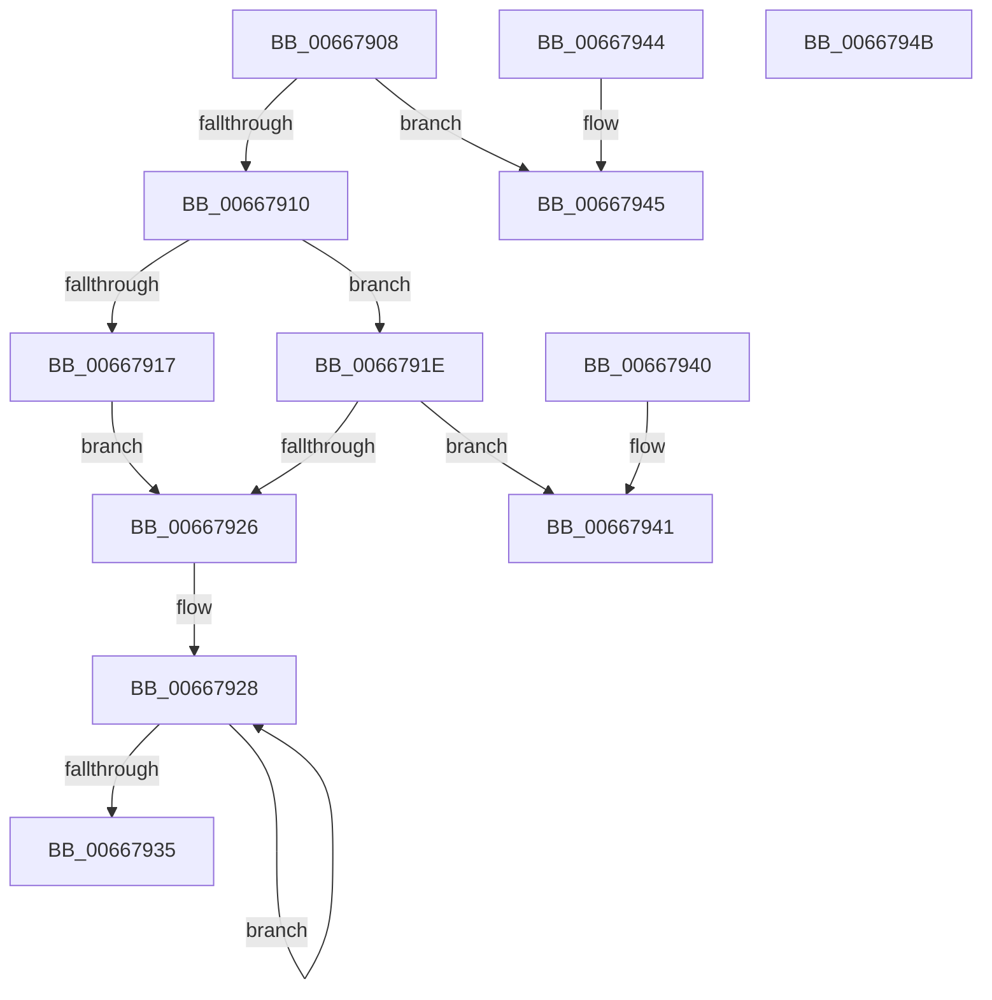

# IntelMicrocodeChecksumValidate

- RVA: `0x00667908`–`0x0066794C` (길이 `68` bytes)
- VA: `0x0000000140667908`
- 실행 섹션: `.text`
- PDB 이름 있음: `예`; PDB Function 태그: `아니요`
- unwind 정보 RVA: `0x000DB714`
- 디코드: `27`개 명령, `68/68` bytes 표시
- 미해석 바이트: `0` (있으면 어셈블리에 `.byte`로 보존)

> 이 문서는 커널 이미지의 기계어와 PDB 기호를 분석해 생성했습니다. 4번과 5번은 함수 원형과 자료형을 바이너리 사용 방식에서 추정한 C 해석이며 원본 소스 복구 결과는 아닙니다.

## 1. Dependencies

- 직접 호출 지점: **0**; 고유 호출 대상: **0**
- 직접 호출자로 확인된 함수: **2**
- RIP 상대 이미지 참조: **0**

### Outgoing calls
- 직접 디코드된 call 명령이 없습니다.

### Direct callers
- [GetMicrocodePatchData](GetMicrocodePatchData_function_00666E48.md) at `0x00667028`
- [MicrocodeUpdate](MicrocodeUpdate_function_00667480.md) at `0x006675F2`

### Static image references
- 디코드된 RIP-relative 메모리 참조가 없습니다.

## 2. Other-region calls and transfers

- 다른 실행 섹션으로 향하는 call: **0**
- 별도 외부 분기/꼬리 이동을 확인하지 못했습니다.

## 3. Assembly (complete function range)

```asm
00667908  45 33 C0                        xor r8d, r8d
0066790B  83 FA 31                        cmp edx, 0x31
0066790E  72 35                           jb 0x140667945
00667910  8B 41 1C                        mov eax, dword ptr [rcx + 0x1c]
00667913  85 C0                           test eax, eax
00667915  75 07                           jne 0x14066791e
00667917  B8 00 02 00 00                  mov eax, 0x200
0066791C  EB 08                           jmp 0x140667926
0066791E  C1 E8 02                        shr eax, 2
00667921  83 C0 0C                        add eax, 0xc
00667924  74 1B                           je 0x140667941
00667926  8B D0                           mov edx, eax
00667928  44 03 01                        add r8d, dword ptr [rcx]
0066792B  48 8D 49 04                     lea rcx, [rcx + 4]
0066792F  48 83 EA 01                     sub rdx, 1
00667933  75 F3                           jne 0x140667928
00667935  41 F7 D8                        neg r8d
00667938  1B C0                           sbb eax, eax
0066793A  25 01 00 00 C0                  and eax, 0xc0000001
0066793F  C3                              ret
00667940  CC                              int3
00667941  33 C0                           xor eax, eax
00667943  C3                              ret
00667944  CC                              int3
00667945  B8 0D 00 00 C0                  mov eax, 0xc000000d
0066794A  C3                              ret
0066794B  CC                              int3
```

## 4. C-style interpretation (structured pseudocode)

```c
__int64 __fastcall IntelMicrocodeChecksumValidate(__int64 a1, int a2, int a3)
{
    __int64 result;

    a3 = 0;
    if (a2 < 49) goto loc_00667945;
    if ((unsigned int)((unsigned int)(*(unsigned int *)(a1 + 28))) != 0) goto loc_0066791E;
    goto loc_00667926;
loc_0066791E:
    result = (unsigned int)((512) >> (2));
    result = (unsigned int)((result) + (12));
    if (condition_is_equal) goto loc_00667941;
loc_00667926:
loc_00667928:
    a3 = (unsigned int)((a3) + (*(unsigned int *)(a1)));
    a2 = ((unsigned int)((unsigned int)(result))) - (1);
    if (condition_is_not_equal) goto loc_00667928;
    a3 = (unsigned int)(-(a3));
    result = (unsigned int)((result) & (0xC0000001ULL));
    return result;
loc_00667941:
    result = 0;
    return result;
loc_00667945:
    return (unsigned int)(0xC000000DULL);
}
```

## 5. (Beta) C Style

```c
int64_t IntelMicrocodeChecksumValidate(void *Arg1, int32_t Arg2, int32_t Arg3)
{
    uint8_t *arg1 = (uint8_t *)Arg1;

    int64_t result;

    Arg3 = 0;
    if (Arg2 < 49) goto loc_00667945;
    if ((uint32_t)((uint32_t)(*(uint32_t *)(arg1 + 0x1C))) != 0) goto loc_0066791E;
    goto loc_00667926;
loc_0066791E:
    result = (uint32_t)((512) >> (2));
    result = (uint32_t)((result) + (12));
    if (condition_is_equal) goto loc_00667941;
loc_00667926:
loc_00667928:
    Arg3 = (uint32_t)((Arg3) + (*(uint32_t *)(arg1)));
    Arg2 = ((uint32_t)((uint32_t)(result))) - (1);
    if (condition_is_not_equal) goto loc_00667928;
    Arg3 = (uint32_t)(-(Arg3));
    result = (uint32_t)((result) & (0xC0000001ULL));
    return result;
loc_00667941:
    result = 0;
    return result;
loc_00667945:
    return (uint32_t)(0xC000000DULL);
}
```

### 관측된 메모리 오프셋

구조체 형식이 확인되지 않은 접근은 인자 기준의 오프셋으로만 기록했습니다.

| 기준 인자 | 오프셋 표현 | 폭 (bit) | 접근 |
|---|---:|---:|---|
| `Arg1` | `+ 0x0` | `32` | `R` |
| `Arg1` | `+ 0x4` | `64` | `R` |
| `Arg1` | `+ 0x1C` | `32` | `R` |

## 6. Execution-region graph

[열기: 2D/3D 그래프와 함수 탐색 컨트롤 패널](../../../control-panel.html?section=text&rva=0x00667908&view=graph)

- 2D 그래프는 위에서 아래로 흐르고, 3D 그래프는 빈 공간을 드래그해 회전합니다. Shift+드래그는 이동, 휠은 확대·축소, 함수 노드 선택은 대상 보고서 이동입니다.

### Static fallback


