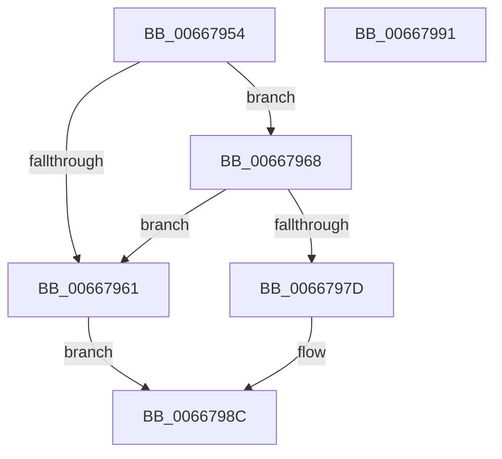

# IntelMicrocodeGetRecordData

- RVA: `0x00667954`–`0x00667992` (길이 `62` bytes)
- VA: `0x0000000140667954`
- 실행 섹션: `.text`
- PDB 이름 있음: `예`; PDB Function 태그: `아니요`
- unwind 정보 RVA: `0x0005C788`
- 디코드: `19`개 명령, `62/62` bytes 표시
- 미해석 바이트: `0` (있으면 어셈블리에 `.byte`로 보존)

> 이 문서는 커널 이미지의 기계어와 PDB 기호를 분석해 생성했습니다. 4번과 5번은 함수 원형과 자료형을 바이너리 사용 방식에서 추정한 C 해석이며 원본 소스 복구 결과는 아닙니다.

## 1. Dependencies

- 직접 호출 지점: **1**; 고유 호출 대상: **1**
- 직접 호출자로 확인된 함수: **2**
- RIP 상대 이미지 참조: **0**

### Outgoing calls
- `0x00667987` → [PrExtGetRecordDataLength](PrExtGetRecordDataLength_function_00666D90.md) (function, `0x00666D90`)

### Direct callers
- [GetMicrocodePatchData](GetMicrocodePatchData_function_00666E48.md) at `0x00667011`
- [MicrocodeUpdate](MicrocodeUpdate_function_00667480.md) at `0x006675DB`

### Static image references
- 디코드된 RIP-relative 메모리 참조가 없습니다.

## 2. Other-region calls and transfers

- 다른 실행 섹션으로 향하는 call: **0**
- 별도 외부 분기/꼬리 이동을 확인하지 못했습니다.

## 3. Assembly (complete function range)

```asm
00667954  48 83 EC 28                     sub rsp, 0x28
00667958  4C 8B D2                        mov r10, rdx
0066795B  48 83 FA 10                     cmp rdx, 0x10
0066795F  73 07                           jae 0x140667968
00667961  B8 0D 00 00 C0                  mov eax, 0xc000000d
00667966  EB 24                           jmp 0x14066798c
00667968  8B 41 1C                        mov eax, dword ptr [rcx + 0x1c]
0066796B  8D 04 85 20 00 00 00            lea eax, [rax*4 + 0x20]
00667972  48 63 D0                        movsxd rdx, eax
00667975  8B 41 10                        mov eax, dword ptr [rcx + 0x10]
00667978  48 3B D0                        cmp rdx, rax
0066797B  75 E4                           jne 0x140667961
0066797D  48 8D 04 0A                     lea rax, [rdx + rcx]
00667981  49 8B D2                        mov rdx, r10
00667984  49 89 01                        mov qword ptr [r9], rax
00667987  E8 04 F4 FF FF                  call 0x140666d90
0066798C  48 83 C4 28                     add rsp, 0x28
00667990  C3                              ret
00667991  CC                              int3
```

## 4. C-style interpretation (structured pseudocode)

```c
__int64 __fastcall IntelMicrocodeGetRecordData(__int64 a1, __int64 a2, __int64 a3, __int64 a4)
{
    __int64 result;
    __int64 v_rsp;

    v_rsp = (v_rsp) - (40);
    if (a2 >= 16) goto loc_00667968;
loc_00667961:
    goto loc_0066798C;
loc_00667968:
    if (((int)((unsigned int)((unsigned int)(*(unsigned int *)(a1 + 28)) * 4 + 32))) != ((unsigned int)(*(unsigned int *)(a1 + 16)))) goto loc_00667961;
    *(unsigned __int64 *)(a4) = (int)((unsigned int)((unsigned int)(*(unsigned int *)(a1 + 28)) * 4 + 32)) + a1 * 1;
    result = PrExtGetRecordDataLength(a1, a2, a3, a4);
loc_0066798C:
    v_rsp = (v_rsp) + (40);
    return result;
}
```

## 5. (Beta) C Style

```c
int64_t IntelMicrocodeGetRecordData(void *Arg1, int64_t Arg2, int64_t Arg3, void *Arg4)
{
    uint8_t *arg1 = (uint8_t *)Arg1;
    uint8_t *arg4 = (uint8_t *)Arg4;

    int64_t result;
    int64_t local_rsp;

    local_rsp = (local_rsp) - (40);
    if (Arg2 >= 16) goto loc_00667968;
loc_00667961:
    goto loc_0066798C;
loc_00667968:
    if (((int32_t)((uint32_t)((uint32_t)(*(uint32_t *)(arg1 + 0x1C)) * 4 + 32))) != ((uint32_t)(*(uint32_t *)(arg1 + 0x10)))) goto loc_00667961;
    *(uint64_t *)(arg4) = (int32_t)((uint32_t)((uint32_t)(*(uint32_t *)(arg1 + 0x1C)) * 4 + 32)) + Arg1 * 1;
    result = PrExtGetRecordDataLength(Arg1, Arg2, Arg3, Arg4);
loc_0066798C:
    local_rsp = (local_rsp) + (40);
    return result;
}
```

### 관측된 메모리 오프셋

구조체 형식이 확인되지 않은 접근은 인자 기준의 오프셋으로만 기록했습니다.

| 기준 인자 | 오프셋 표현 | 폭 (bit) | 접근 |
|---|---:|---:|---|
| `Arg1` | `+ 0x10` | `32` | `R` |
| `Arg1` | `+ 0x1C` | `32` | `R` |
| `Arg4` | `+ 0x0` | `64` | `W` |

## 6. Execution-region graph

[열기: 2D/3D 그래프와 함수 탐색 컨트롤 패널](../../../control-panel.html?section=text&rva=0x00667954&view=graph)

- 2D 그래프는 위에서 아래로 흐르고, 3D 그래프는 빈 공간을 드래그해 회전합니다. Shift+드래그는 이동, 휠은 확대·축소, 함수 노드 선택은 대상 보고서 이동입니다.

### Static fallback


