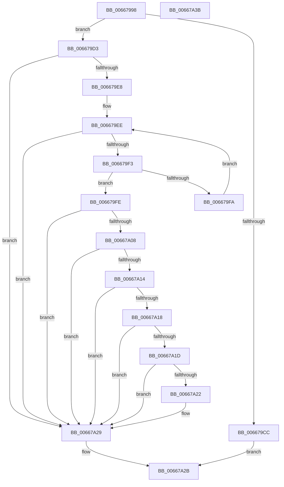

# IntelMicrocodeMetaDataCheck

- RVA: `0x00667998`–`0x00667A3C` (길이 `164` bytes)
- VA: `0x0000000140667998`
- 실행 섹션: `.text`
- PDB 이름 있음: `예`; PDB Function 태그: `아니요`
- unwind 정보 RVA: `0x000717F8`
- 디코드: `51`개 명령, `164/164` bytes 표시
- 미해석 바이트: `0` (있으면 어셈블리에 `.byte`로 보존)

> 이 문서는 커널 이미지의 기계어와 PDB 기호를 분석해 생성했습니다. 4번과 5번은 함수 원형과 자료형을 바이너리 사용 방식에서 추정한 C 해석이며 원본 소스 복구 결과는 아닙니다.

## 1. Dependencies

- 직접 호출 지점: **1**; 고유 호출 대상: **1**
- 직접 호출자로 확인된 함수: **1**
- RIP 상대 이미지 참조: **4**

### Outgoing calls
- `0x006679C3` → [IntelUpdateMicrocodeGetProcessorFlags](IntelUpdateMicrocodeGetProcessorFlags_function_00667A44.md) (function, `0x00667A44`)

### Direct callers
- [MicrocodeGetRecord](MicrocodeGetRecord_function_00667060.md) at `0x006671B4`

### Static image references
- `0x006679DC` → RVA `0x00EF7CAC` (`.data`; write)
- `0x00667A00` → RVA `0x00EF7CE0` (`.data`; read)
- `0x00667A08` → RVA `0x00EF7CD8` (`.data`; read)
- `0x00667A22` → RVA `0x00EF7CE0` (`.data`; write)

## 2. Other-region calls and transfers

- 다른 실행 섹션으로 향하는 call: **0**
- 별도 외부 분기/꼬리 이동을 확인하지 못했습니다.

## 3. Assembly (complete function range)

```asm
00667998  48 89 5C 24 10                  mov qword ptr [rsp + 0x10], rbx
0066799D  48 89 74 24 18                  mov qword ptr [rsp + 0x18], rsi
006679A2  57                              push rdi
006679A3  48 83 EC 30                     sub rsp, 0x30
006679A7  83 64 24 40 00                  and dword ptr [rsp + 0x40], 0
006679AC  4C 8B D9                        mov r11, rcx
006679AF  33 C9                           xor ecx, ecx
006679B1  8B F2                           mov esi, edx
006679B3  B8 01 00 00 00                  mov eax, 1
006679B8  0F A2                           cpuid
006679BA  48 8D 54 24 40                  lea rdx, [rsp + 0x40]
006679BF  8B C8                           mov ecx, eax
006679C1  8B F8                           mov edi, eax
006679C3  E8 7C 00 00 00                  call 0x140667a44
006679C8  85 C0                           test eax, eax
006679CA  79 07                           jns 0x1406679d3
006679CC  B8 0D 00 00 C0                  mov eax, 0xc000000d
006679D1  EB 58                           jmp 0x140667a2b
006679D3  8B 44 24 40                     mov eax, dword ptr [rsp + 0x40]
006679D7  BA 25 02 00 C0                  mov edx, 0xc0000225
006679DC  89 05 CA 02 89 00               mov dword ptr [rip + 0x8902ca], eax
006679E2  41 85 43 14                     test dword ptr [r11 + 0x14], eax
006679E6  74 41                           je 0x140667a29
006679E8  45 8B 43 1C                     mov r8d, dword ptr [r11 + 0x1c]
006679EC  33 DB                           xor ebx, ebx
006679EE  41 3B D8                        cmp ebx, r8d
006679F1  73 36                           jae 0x140667a29
006679F3  41 39 7C 9B 20                  cmp dword ptr [r11 + rbx*4 + 0x20], edi
006679F8  74 04                           je 0x1406679fe
006679FA  FF C3                           inc ebx
006679FC  EB F0                           jmp 0x1406679ee
006679FE  33 D2                           xor edx, edx
00667A00  38 15 DA 02 89 00               cmp byte ptr [rip + 0x8902da], dl
00667A06  75 21                           jne 0x140667a29
00667A08  48 8B 0D C9 02 89 00            mov rcx, qword ptr [rip + 0x8902c9]
00667A0F  48 85 C9                        test rcx, rcx
00667A12  74 15                           je 0x140667a29
00667A14  39 39                           cmp dword ptr [rcx], edi
00667A16  75 11                           jne 0x140667a29
00667A18  39 71 04                        cmp dword ptr [rcx + 4], esi
00667A1B  75 0C                           jne 0x140667a29
00667A1D  39 41 08                        cmp dword ptr [rcx + 8], eax
00667A20  75 07                           jne 0x140667a29
00667A22  C6 05 B7 02 89 00 01            mov byte ptr [rip + 0x8902b7], 1
00667A29  8B C2                           mov eax, edx
00667A2B  48 8B 5C 24 48                  mov rbx, qword ptr [rsp + 0x48]
00667A30  48 8B 74 24 50                  mov rsi, qword ptr [rsp + 0x50]
00667A35  48 83 C4 30                     add rsp, 0x30
00667A39  5F                              pop rdi
00667A3A  C3                              ret
00667A3B  CC                              int3
```

## 4. C-style interpretation (structured pseudocode)

```c
__int64 __fastcall IntelMicrocodeMetaDataCheck(__int64 a1, int a2)
{
    __int64 result;
    __int64 v_rbx;
    __int64 v_rsp;
    unsigned __int64 v_stack_p10;
    unsigned __int64 v_stack_p18;
    unsigned int v_stack_p8;

    v_stack_p10 = v_rbx;
    v_stack_p18 = v_rsi;
    v_rsp = (v_rsp) - (48);
    a1 = 0;
    result = IntelUpdateMicrocodeGetProcessorFlags(1, v_stack_p8, a3, a4);
    if (!sign_flag) goto loc_006679D3;
    goto loc_00667A2B;
loc_006679D3:
    *(unsigned int *)(v_rip + 8979146) = (unsigned int)((unsigned int)(v_stack_p8));
    if (((*(unsigned int *)(a1 + 20)) & ((unsigned int)((unsigned int)(v_stack_p8)))) == 0) goto loc_00667A29;
    v_rbx = 0;
loc_006679EE:
    if (0 >= ((unsigned int)((unsigned int)(*(unsigned int *)(a1 + 28))))) goto loc_00667A29;
    if ((*(unsigned int *)(a1 + v_rbx * 4 + 32)) == 1) goto loc_006679FE;
    v_rbx = (unsigned int)((v_rbx) + 1);
    goto loc_006679EE;
loc_006679FE:
    a2 = 0;
    if ((*(unsigned __int8 *)(v_rip + 8979162)) != 0) goto loc_00667A29;
    if (*(unsigned __int64 *)(v_rip + 8979145) == 0) goto loc_00667A29;
    if ((*(unsigned int *)(*(unsigned __int64 *)(v_rip + 8979145))) != 1) goto loc_00667A29;
    if ((*(unsigned int *)(*(unsigned __int64 *)(v_rip + 8979145) + 4)) != ((unsigned int)((unsigned int)(a2)))) goto loc_00667A29;
    if ((*(unsigned int *)(*(unsigned __int64 *)(v_rip + 8979145) + 8)) == ((unsigned int)((unsigned int)(v_stack_p8)))) {
        *(unsigned __int8 *)(v_rip + 8979127) = 1;
    }
loc_00667A2B:
    v_rsp = (v_rsp) + (48);
    return 0;
}
```

## 5. (Beta) C Style

```c
int64_t IntelMicrocodeMetaDataCheck(int64_t Arg1, int32_t Arg2)
{
    int64_t result;
    int64_t local_rbx;
    int64_t local_rsp;
    uint64_t v_stack_p10;
    uint64_t v_stack_p18;
    uint32_t v_stack_p8;

    v_stack_p10 = local_rbx;
    v_stack_p18 = local_rsi;
    local_rsp = (local_rsp) - (48);
    Arg1 = 0;
    result = IntelUpdateMicrocodeGetProcessorFlags(1, v_stack_p8, a3, a4);
    if (!sign_flag) goto loc_006679D3;
    goto loc_00667A2B;
loc_006679D3:
    *(uint32_t *)(v_rip + 0x8902CA) = (uint32_t)((uint32_t)(v_stack_p8));
    if (((*(uint32_t *)(Arg1 + 0x14)) & ((uint32_t)((uint32_t)(v_stack_p8)))) == 0) goto loc_00667A29;
    local_rbx = 0;
loc_006679EE:
    if (0 >= ((uint32_t)((uint32_t)(*(uint32_t *)(Arg1 + 0x1C))))) goto loc_00667A29;
    if ((*(uint32_t *)(Arg1 + local_rbx * 4 + 0x20)) == 1) goto loc_006679FE;
    local_rbx = (uint32_t)((local_rbx) + 1);
    goto loc_006679EE;
loc_006679FE:
    Arg2 = 0;
    if ((*(uint8_t *)(v_rip + 0x8902DA)) != 0) goto loc_00667A29;
    if (*(uint64_t *)(v_rip + 0x8902C9) == 0) goto loc_00667A29;
    if ((*(uint32_t *)(*(uint64_t *)(v_rip + 0x8902C9))) != 1) goto loc_00667A29;
    if ((*(uint32_t *)(*(uint64_t *)(v_rip + 0x8902C9) + 0x4)) != ((uint32_t)((uint32_t)(Arg2)))) goto loc_00667A29;
    if ((*(uint32_t *)(*(uint64_t *)(v_rip + 0x8902C9) + 0x8)) == ((uint32_t)((uint32_t)(v_stack_p8)))) {
        *(uint8_t *)(v_rip + 0x8902B7) = 1;
    }
loc_00667A2B:
    local_rsp = (local_rsp) + (48);
    return 0;
}
```

## 6. Execution-region graph

[열기: 2D/3D 그래프와 함수 탐색 컨트롤 패널](../../../control-panel.html?section=text&rva=0x00667998&view=graph)

- 2D 그래프는 위에서 아래로 흐르고, 3D 그래프는 빈 공간을 드래그해 회전합니다. Shift+드래그는 이동, 휠은 확대·축소, 함수 노드 선택은 대상 보고서 이동입니다.

### Static fallback


