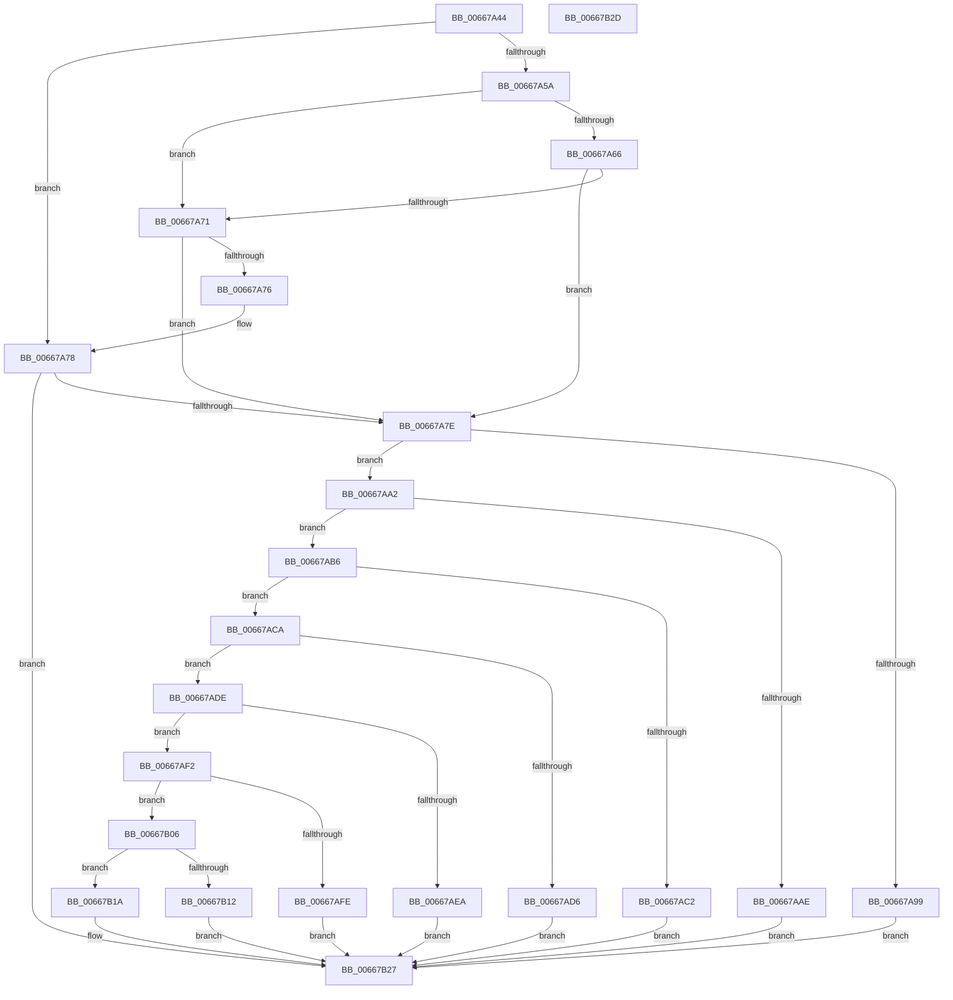

# IntelUpdateMicrocodeGetProcessorFlags

- RVA: `0x00667A44`–`0x00667B2E` (길이 `234` bytes)
- VA: `0x0000000140667A44`
- 실행 섹션: `.text`
- PDB 이름 있음: `예`; PDB Function 태그: `아니요`
- unwind 정보 RVA: `0x000DB714`
- 디코드: `71`개 명령, `234/234` bytes 표시
- 미해석 바이트: `0` (있으면 어셈블리에 `.byte`로 보존)

> 이 문서는 커널 이미지의 기계어와 PDB 기호를 분석해 생성했습니다. 4번과 5번은 함수 원형과 자료형을 바이너리 사용 방식에서 추정한 C 해석이며 원본 소스 복구 결과는 아닙니다.

## 1. Dependencies

- 직접 호출 지점: **0**; 고유 호출 대상: **0**
- 직접 호출자로 확인된 함수: **1**
- RIP 상대 이미지 참조: **0**

### Outgoing calls
- 직접 디코드된 call 명령이 없습니다.

### Direct callers
- [IntelMicrocodeMetaDataCheck](IntelMicrocodeMetaDataCheck_function_00667998.md) at `0x006679C3`

### Static image references
- 디코드된 RIP-relative 메모리 참조가 없습니다.

## 2. Other-region calls and transfers

- 다른 실행 섹션으로 향하는 call: **0**
- 별도 외부 분기/꼬리 이동을 확인하지 못했습니다.

## 3. Assembly (complete function range)

```asm
00667A44  8B C1                           mov eax, ecx
00667A46  4C 8B D2                        mov r10, rdx
00667A49  25 00 0F 00 00                  and eax, 0xf00
00667A4E  45 33 C0                        xor r8d, r8d
00667A51  BA 00 06 00 00                  mov edx, 0x600
00667A56  3B C2                           cmp eax, edx
00667A58  75 1E                           jne 0x140667a78
00667A5A  44 8B C9                        mov r9d, ecx
00667A5D  41 81 E1 00 00 0F 00            and r9d, 0xf0000
00667A64  75 0B                           jne 0x140667a71
00667A66  81 E1 F0 00 00 00               and ecx, 0xf0
00667A6C  83 F9 50                        cmp ecx, 0x50
00667A6F  73 0D                           jae 0x140667a7e
00667A71  45 85 C9                        test r9d, r9d
00667A74  75 08                           jne 0x140667a7e
00667A76  3B C2                           cmp eax, edx
00667A78  0F 86 A9 00 00 00               jbe 0x140667b27
00667A7E  B9 17 00 00 00                  mov ecx, 0x17
00667A83  0F 32                           rdmsr
00667A85  48 C1 E2 20                     shl rdx, 0x20
00667A89  48 0B C2                        or rax, rdx
00667A8C  BA 00 00 1C 00                  mov edx, 0x1c0000
00667A91  48 C1 E8 20                     shr rax, 0x20
00667A95  85 C2                           test edx, eax
00667A97  75 09                           jne 0x140667aa2
00667A99  44 8D 41 EA                     lea r8d, [rcx - 0x16]
00667A9D  E9 85 00 00 00                  jmp 0x140667b27
00667AA2  8B C8                           mov ecx, eax
00667AA4  23 CA                           and ecx, edx
00667AA6  81 F9 00 00 04 00               cmp ecx, 0x40000
00667AAC  75 08                           jne 0x140667ab6
00667AAE  41 B8 02 00 00 00               mov r8d, 2
00667AB4  EB 71                           jmp 0x140667b27
00667AB6  8B C8                           mov ecx, eax
00667AB8  23 CA                           and ecx, edx
00667ABA  81 F9 00 00 08 00               cmp ecx, 0x80000
00667AC0  75 08                           jne 0x140667aca
00667AC2  41 B8 04 00 00 00               mov r8d, 4
00667AC8  EB 5D                           jmp 0x140667b27
00667ACA  8B C8                           mov ecx, eax
00667ACC  23 CA                           and ecx, edx
00667ACE  81 F9 00 00 0C 00               cmp ecx, 0xc0000
00667AD4  75 08                           jne 0x140667ade
00667AD6  41 B8 08 00 00 00               mov r8d, 8
00667ADC  EB 49                           jmp 0x140667b27
00667ADE  8B C8                           mov ecx, eax
00667AE0  23 CA                           and ecx, edx
00667AE2  81 F9 00 00 10 00               cmp ecx, 0x100000
00667AE8  75 08                           jne 0x140667af2
00667AEA  41 B8 10 00 00 00               mov r8d, 0x10
00667AF0  EB 35                           jmp 0x140667b27
00667AF2  8B C8                           mov ecx, eax
00667AF4  23 CA                           and ecx, edx
00667AF6  81 F9 00 00 14 00               cmp ecx, 0x140000
00667AFC  75 08                           jne 0x140667b06
00667AFE  41 B8 20 00 00 00               mov r8d, 0x20
00667B04  EB 21                           jmp 0x140667b27
00667B06  8B C8                           mov ecx, eax
00667B08  23 CA                           and ecx, edx
00667B0A  81 F9 00 00 18 00               cmp ecx, 0x180000
00667B10  75 08                           jne 0x140667b1a
00667B12  41 B8 40 00 00 00               mov r8d, 0x40
00667B18  EB 0D                           jmp 0x140667b27
00667B1A  23 C2                           and eax, edx
00667B1C  B9 80 00 00 00                  mov ecx, 0x80
00667B21  3B C2                           cmp eax, edx
00667B23  44 0F 44 C1                     cmove r8d, ecx
00667B27  45 89 02                        mov dword ptr [r10], r8d
00667B2A  33 C0                           xor eax, eax
00667B2C  C3                              ret
00667B2D  CC                              int3
```

## 4. C-style interpretation (structured pseudocode)

```c
__int64 __fastcall IntelUpdateMicrocodeGetProcessorFlags(int a1, __int64 a2, int a3)
{
    __int64 result;

    result = (unsigned int)(((unsigned int)(a1)) & (0xF00ULL));
    a3 = 0;
    if (((unsigned int)(result)) != ((unsigned int)((unsigned int)(0x600ULL)))) goto loc_00667A78;
    a4 = (unsigned int)(((unsigned int)(a1)) & (0xF0000ULL));
    if (condition_is_not_equal) goto loc_00667A71;
    a1 = (unsigned int)((a1) & (240));
    if (a1 >= 80) goto loc_00667A7E;
loc_00667A71:
    if ((unsigned int)(a4) != 0) goto loc_00667A7E;
loc_00667A78:
    if (((unsigned int)(result)) <= ((unsigned int)((unsigned int)(0x600ULL)))) goto loc_00667B27;
loc_00667A7E:
    a2 = ((unsigned int)(0x600ULL)) << (32);
    result = (result) | (a2);
    result = (result) >> (32);
    if ((((unsigned int)((unsigned int)(0x1C0000ULL))) & ((unsigned int)(result))) != 0) goto loc_00667AA2;
    goto loc_00667B27;
loc_00667AA2:
    a1 = (unsigned int)(((unsigned int)((unsigned int)(result))) & ((unsigned int)((unsigned int)(0x1C0000ULL))));
    if (a1 != 0x40000ULL) goto loc_00667AB6;
    goto loc_00667B27;
loc_00667AB6:
    a1 = (unsigned int)(((unsigned int)((unsigned int)(result))) & ((unsigned int)((unsigned int)(0x1C0000ULL))));
    if (a1 != 0x80000ULL) goto loc_00667ACA;
    goto loc_00667B27;
loc_00667ACA:
    a1 = (unsigned int)(((unsigned int)((unsigned int)(result))) & ((unsigned int)((unsigned int)(0x1C0000ULL))));
    if (a1 != 0xC0000ULL) goto loc_00667ADE;
    goto loc_00667B27;
loc_00667ADE:
    a1 = (unsigned int)(((unsigned int)((unsigned int)(result))) & ((unsigned int)((unsigned int)(0x1C0000ULL))));
    if (a1 != 0x100000ULL) goto loc_00667AF2;
    goto loc_00667B27;
loc_00667AF2:
    a1 = (unsigned int)(((unsigned int)((unsigned int)(result))) & ((unsigned int)((unsigned int)(0x1C0000ULL))));
    if (a1 != 0x140000ULL) goto loc_00667B06;
    goto loc_00667B27;
loc_00667B06:
    a1 = (unsigned int)(((unsigned int)((unsigned int)(result))) & ((unsigned int)((unsigned int)(0x1C0000ULL))));
    if (a1 != 0x180000ULL) goto loc_00667B1A;
    goto loc_00667B27;
loc_00667B1A:
    result = (unsigned int)((result) & ((unsigned int)((unsigned int)(0x1C0000ULL))));
    a3 = 64;
    if (((unsigned int)(result)) == ((unsigned int)((unsigned int)(0x1C0000ULL)))) { a3 = 128; }
loc_00667B27:
    *(unsigned int *)(a2) = a3;
    result = 0;
    return result;
}
```

## 5. (Beta) C Style

```c
int64_t IntelUpdateMicrocodeGetProcessorFlags(int32_t Arg1, void *Arg2, int32_t Arg3)
{
    uint8_t *arg2 = (uint8_t *)Arg2;

    int64_t result;

    result = (uint32_t)(((uint32_t)(Arg1)) & (0xF00ULL));
    Arg3 = 0;
    if (((uint32_t)(result)) != ((uint32_t)((uint32_t)(0x600ULL)))) goto loc_00667A78;
    a4 = (uint32_t)(((uint32_t)(Arg1)) & (0xF0000ULL));
    if (condition_is_not_equal) goto loc_00667A71;
    Arg1 = (uint32_t)((Arg1) & (240));
    if (Arg1 >= 80) goto loc_00667A7E;
loc_00667A71:
    if ((uint32_t)(a4) != 0) goto loc_00667A7E;
loc_00667A78:
    if (((uint32_t)(result)) <= ((uint32_t)((uint32_t)(0x600ULL)))) goto loc_00667B27;
loc_00667A7E:
    Arg2 = ((uint32_t)(0x600ULL)) << (32);
    result = (result) | (Arg2);
    result = (result) >> (32);
    if ((((uint32_t)((uint32_t)(0x1C0000ULL))) & ((uint32_t)(result))) != 0) goto loc_00667AA2;
    goto loc_00667B27;
loc_00667AA2:
    Arg1 = (uint32_t)(((uint32_t)((uint32_t)(result))) & ((uint32_t)((uint32_t)(0x1C0000ULL))));
    if (Arg1 != 0x40000ULL) goto loc_00667AB6;
    goto loc_00667B27;
loc_00667AB6:
    Arg1 = (uint32_t)(((uint32_t)((uint32_t)(result))) & ((uint32_t)((uint32_t)(0x1C0000ULL))));
    if (Arg1 != 0x80000ULL) goto loc_00667ACA;
    goto loc_00667B27;
loc_00667ACA:
    Arg1 = (uint32_t)(((uint32_t)((uint32_t)(result))) & ((uint32_t)((uint32_t)(0x1C0000ULL))));
    if (Arg1 != 0xC0000ULL) goto loc_00667ADE;
    goto loc_00667B27;
loc_00667ADE:
    Arg1 = (uint32_t)(((uint32_t)((uint32_t)(result))) & ((uint32_t)((uint32_t)(0x1C0000ULL))));
    if (Arg1 != 0x100000ULL) goto loc_00667AF2;
    goto loc_00667B27;
loc_00667AF2:
    Arg1 = (uint32_t)(((uint32_t)((uint32_t)(result))) & ((uint32_t)((uint32_t)(0x1C0000ULL))));
    if (Arg1 != 0x140000ULL) goto loc_00667B06;
    goto loc_00667B27;
loc_00667B06:
    Arg1 = (uint32_t)(((uint32_t)((uint32_t)(result))) & ((uint32_t)((uint32_t)(0x1C0000ULL))));
    if (Arg1 != 0x180000ULL) goto loc_00667B1A;
    goto loc_00667B27;
loc_00667B1A:
    result = (uint32_t)((result) & ((uint32_t)((uint32_t)(0x1C0000ULL))));
    Arg3 = 64;
    if (((uint32_t)(result)) == ((uint32_t)((uint32_t)(0x1C0000ULL)))) { Arg3 = 128; }
loc_00667B27:
    *(uint32_t *)(arg2) = Arg3;
    result = 0;
    return result;
}
```

### 관측된 메모리 오프셋

구조체 형식이 확인되지 않은 접근은 인자 기준의 오프셋으로만 기록했습니다.

| 기준 인자 | 오프셋 표현 | 폭 (bit) | 접근 |
|---|---:|---:|---|
| `Arg2` | `+ 0x0` | `32` | `W` |

## 6. Execution-region graph

[열기: 2D/3D 그래프와 함수 탐색 컨트롤 패널](../../../control-panel.html?section=text&rva=0x00667A44&view=graph)

- 2D 그래프는 위에서 아래로 흐르고, 3D 그래프는 빈 공간을 드래그해 회전합니다. Shift+드래그는 이동, 휠은 확대·축소, 함수 노드 선택은 대상 보고서 이동입니다.

### Static fallback


