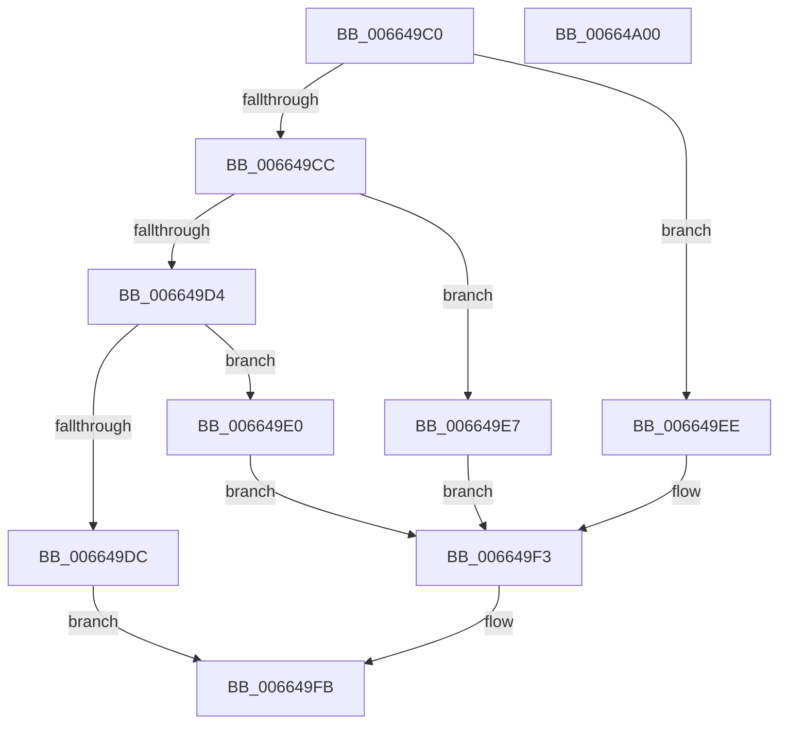

# IsFeatureEnabled

- RVA: `0x006649C0`–`0x00664A01` (길이 `65` bytes)
- VA: `0x00000001406649C0`
- 실행 섹션: `.text`
- PDB 이름 있음: `예`; PDB Function 태그: `아니요`
- unwind 정보 RVA: `0x0005C788`
- 디코드: `21`개 명령, `65/65` bytes 표시
- 미해석 바이트: `0` (있으면 어셈블리에 `.byte`로 보존)

> 이 문서는 커널 이미지의 기계어와 PDB 기호를 분석해 생성했습니다. 4번과 5번은 함수 원형과 자료형을 바이너리 사용 방식에서 추정한 C 해석이며 원본 소스 복구 결과는 아닙니다.

## 1. Dependencies

- 직접 호출 지점: **3**; 고유 호출 대상: **3**
- 직접 호출자로 확인된 함수: **1**
- RIP 상대 이미지 참조: **0**

### Outgoing calls
- `0x006649E0` → [Feature_LearningModeTraceService__private_IsEnabledDeviceUsageNoInline](Feature_LearningModeTraceService__private_IsEnabledDeviceUsageNoInline_function_00664918.md) (function, `0x00664918`)
- `0x006649E7` → [Feature_ProjectTessera_CreateProcessInSandbox__private_IsEnabledDeviceUsageNoInline](Feature_ProjectTessera_CreateProcessInSandbox__private_IsEnabledDeviceUsageNoInline_function_0066496C.md) (function, `0x0066496C`)
- `0x006649EE` → [Feature_DriverSetup_ReofferFingerprinting_v2__private_IsEnabledDeviceUsageNoInline](Feature_DriverSetup_ReofferFingerprinting_v2__private_IsEnabledDeviceUsageNoInline_function_006648C4.md) (function, `0x006648C4`)

### Direct callers
- [ApiSetpIsFeatureEnabled](ApiSetpIsFeatureEnabled_function_006648A8.md) at `0x006648AC`

### Static image references
- 디코드된 RIP-relative 메모리 참조가 없습니다.

## 2. Other-region calls and transfers

- 다른 실행 섹션으로 향하는 call: **0**
- 별도 외부 분기/꼬리 이동을 확인하지 못했습니다.

## 3. Assembly (complete function range)

```asm
006649C0  48 83 EC 28                     sub rsp, 0x28
006649C4  81 F9 A5 32 A1 03               cmp ecx, 0x3a132a5
006649CA  74 22                           je 0x1406649ee
006649CC  81 F9 68 2A A5 03               cmp ecx, 0x3a52a68
006649D2  74 13                           je 0x1406649e7
006649D4  81 F9 1D 6C B7 03               cmp ecx, 0x3b76c1d
006649DA  74 04                           je 0x1406649e0
006649DC  33 C0                           xor eax, eax
006649DE  EB 1B                           jmp 0x1406649fb
006649E0  E8 33 FF FF FF                  call 0x140664918
006649E5  EB 0C                           jmp 0x1406649f3
006649E7  E8 80 FF FF FF                  call 0x14066496c
006649EC  EB 05                           jmp 0x1406649f3
006649EE  E8 D1 FE FF FF                  call 0x1406648c4
006649F3  F7 D8                           neg eax
006649F5  1B C0                           sbb eax, eax
006649F7  F7 D8                           neg eax
006649F9  FF C0                           inc eax
006649FB  48 83 C4 28                     add rsp, 0x28
006649FF  C3                              ret
00664A00  CC                              int3
```

## 4. C-style interpretation (structured pseudocode)

```c
__int64 __fastcall IsFeatureEnabled(int a1)
{
    __int64 result;
    __int64 v_rsp;

    v_rsp = (v_rsp) - (40);
    if (a1 == 0x3A132A5ULL) goto loc_006649EE;
    if (a1 == 0x3A52A68ULL) goto loc_006649E7;
    if (a1 == 0x3B76C1DULL) goto loc_006649E0;
    result = 0;
    goto loc_006649FB;
loc_006649E0:
    result = Feature_LearningModeTraceService__private_IsEnabledDeviceUsageNoInline(a1, a2, a3, a4);
    goto loc_006649F3;
loc_006649E7:
    result = Feature_ProjectTessera_CreateProcessInSandbox__private_IsEnabledDeviceUsageNoInline(a1, a2, a3, a4);
    goto loc_006649F3;
loc_006649EE:
    result = Feature_DriverSetup_ReofferFingerprinting_v2__private_IsEnabledDeviceUsageNoInline(a1, a2, a3, a4);
loc_006649F3:
    result = (unsigned int)(-(result));
    result = (unsigned int)(-(result));
    result = (unsigned int)((result) + 1);
loc_006649FB:
    v_rsp = (v_rsp) + (40);
    return result;
}
```

## 5. (Beta) C Style

```c
int64_t IsFeatureEnabled(int32_t Arg1)
{
    int64_t result;
    int64_t local_rsp;

    local_rsp = (local_rsp) - (40);
    if (Arg1 == 0x3A132A5ULL) goto loc_006649EE;
    if (Arg1 == 0x3A52A68ULL) goto loc_006649E7;
    if (Arg1 == 0x3B76C1DULL) goto loc_006649E0;
    result = 0;
    goto loc_006649FB;
loc_006649E0:
    result = Feature_LearningModeTraceService__private_IsEnabledDeviceUsageNoInline(Arg1, a2, a3, a4);
    goto loc_006649F3;
loc_006649E7:
    result = Feature_ProjectTessera_CreateProcessInSandbox__private_IsEnabledDeviceUsageNoInline(Arg1, a2, a3, a4);
    goto loc_006649F3;
loc_006649EE:
    result = Feature_DriverSetup_ReofferFingerprinting_v2__private_IsEnabledDeviceUsageNoInline(Arg1, a2, a3, a4);
loc_006649F3:
    result = (uint32_t)(-(result));
    result = (uint32_t)(-(result));
    result = (uint32_t)((result) + 1);
loc_006649FB:
    local_rsp = (local_rsp) + (40);
    return result;
}
```

## 6. Execution-region graph

[열기: 2D/3D 그래프와 함수 탐색 컨트롤 패널](../../../control-panel.html?section=text&rva=0x006649C0&view=graph)

- 2D 그래프는 위에서 아래로 흐르고, 3D 그래프는 빈 공간을 드래그해 회전합니다. Shift+드래그는 이동, 휠은 확대·축소, 함수 노드 선택은 대상 보고서 이동입니다.

### Static fallback


