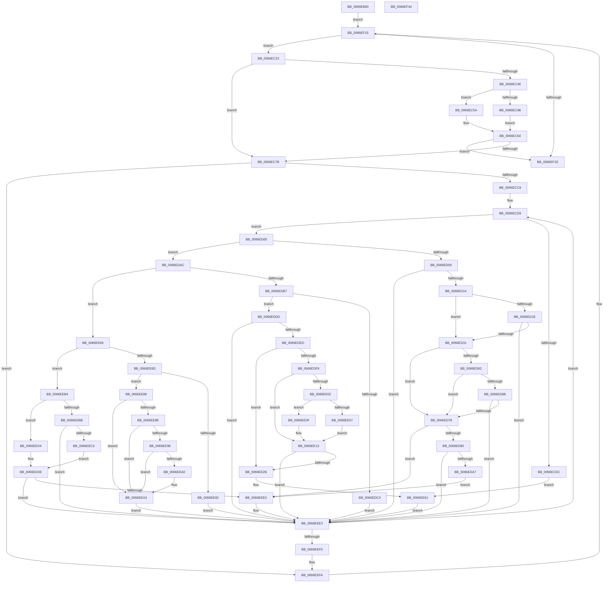

# MiCheckCommitReleaseFromVad

- RVA: `0x0066EB90`–`0x0066EF45` (길이 `949` bytes)
- VA: `0x000000014066EB90`
- 실행 섹션: `.text`
- PDB 이름 있음: `예`; PDB Function 태그: `아니요`
- unwind 정보 RVA: `0x000A8820`
- 디코드: `249`개 명령, `949/949` bytes 표시
- 미해석 바이트: `0` (있으면 어셈블리에 `.byte`로 보존)

> 이 문서는 커널 이미지의 기계어와 PDB 기호를 분석해 생성했습니다. 4번과 5번은 함수 원형과 자료형을 바이너리 사용 방식에서 추정한 C 해석이며 원본 소스 복구 결과는 아닙니다.

## 1. Dependencies

- 직접 호출 지점: **15**; 고유 호출 대상: **13**
- 직접 호출자로 확인된 함수: **1**
- RIP 상대 이미지 참조: **1**

### Outgoing calls
- `0x0066EC0F` → [MiLockWorkingSetShared](../27/MiLockWorkingSetShared_function_0027CBF0.md) (function, `0x0027CBF0`)
- `0x0066EC39` → [MiGetNextPageTable](../2C/MiGetNextPageTable_function_002C2EE0.md) (function, `0x002C2EE0`)
- `0x0066EC6A` → [MiComputeCommitChargeForZeroPteRange](MiComputeCommitChargeForZeroPteRange_function_0066EF94.md) (function, `0x0066EF94`)
- `0x0066ECDC` → [MI_READ_PTE_LOCK_FREE](../28/MI_READ_PTE_LOCK_FREE_function_002828A0.md) (function, `0x002828A0`)
- `0x0066ECF6` → [MiComputeCommitChargeForZeroPteRange](MiComputeCommitChargeForZeroPteRange_function_0066EF94.md) (function, `0x0066EF94`)
- `0x0066ED21` → [MiRotatedToFrameBuffer](../2C/MiRotatedToFrameBuffer_function_002C5FE4.md) (function, `0x002C5FE4`)
- `0x0066ED99` → [MiLocateCloneAddress](../3D/MiLocateCloneAddress_function_003D26B4.md) (function, `0x003D26B4`)
- `0x0066EDBA` → [MiIsPrototypePteVadLookup](../32/MiIsPrototypePteVadLookup_function_00328B70.md) (function, `0x00328B70`)
- `0x0066EDE0` → [MI_PROTO_FORMAT_COMBINED](../22/MI_PROTO_FORMAT_COMBINED_function_0022F720.md) (function, `0x0022F720`)
- `0x0066EE1D` → [MiLocateCloneAddress](../3D/MiLocateCloneAddress_function_003D26B4.md) (function, `0x003D26B4`)
- `0x0066EE5C` → [MiComputeImageVadCommitCharge](MiComputeImageVadCommitCharge_function_0066F054.md) (function, `0x0066F054`)
- `0x0066EE75` → [MiLockTransitionLeafPageEx](../40/MiLockTransitionLeafPageEx_function_00405884.md) (function, `0x00405884`)
- `0x0066EECB` → [MiIsPteInStore](../36/MiIsPteInStore_function_00362460.md) (function, `0x00362460`)
- `0x0066EF08` → [MiUnlockPageTable](../21/MiUnlockPageTable_function_00216EC0.md) (function, `0x00216EC0`)
- `0x0066EF24` → [MiUnlockWorkingSetShared](../27/MiUnlockWorkingSetShared_function_0027D690.md) (function, `0x0027D690`)

### Direct callers
- [MiReleaseOutSwappedProcessCommit](../3C/MiReleaseOutSwappedProcessCommit_function_003C8320.md) at `0x003C8496`

### Static image references
- `0x0066EDF6` → RVA `0x00E2DC80` (`.data`; read)

## 2. Other-region calls and transfers

- 다른 실행 섹션으로 향하는 call: **0**
- 별도 외부 분기/꼬리 이동을 확인하지 못했습니다.

## 3. Assembly (complete function range)

```asm
0066EB90  4C 8B DC                        mov r11, rsp
0066EB93  49 89 5B 10                     mov qword ptr [r11 + 0x10], rbx
0066EB97  4D 89 43 18                     mov qword ptr [r11 + 0x18], r8
0066EB9B  49 89 4B 08                     mov qword ptr [r11 + 8], rcx
0066EB9F  55                              push rbp
0066EBA0  56                              push rsi
0066EBA1  57                              push rdi
0066EBA2  41 54                           push r12
0066EBA4  41 55                           push r13
0066EBA6  41 56                           push r14
0066EBA8  41 57                           push r15
0066EBAA  48 83 EC 50                     sub rsp, 0x50
0066EBAE  45 0F B6 51 20                  movzx r10d, byte ptr [r9 + 0x20]
0066EBB3  33 C0                           xor eax, eax
0066EBB5  49 C1 E2 20                     shl r10, 0x20
0066EBB9  8B F0                           mov esi, eax
0066EBBB  49 89 43 B0                     mov qword ptr [r11 - 0x50], rax
0066EBBF  4C 8B EA                        mov r13, rdx
0066EBC2  41 8B 41 18                     mov eax, dword ptr [r9 + 0x18]
0066EBC6  48 BA FF FF FF FF 0F 00 00 00   movabs rdx, 0xfffffffff
0066EBD0  4C 0B D0                        or r10, rax
0066EBD3  49 8B E8                        mov rbp, r8
0066EBD6  4C 23 D2                        and r10, rdx
0066EBD9  49 B8 00 00 00 00 80 F6 FF FF   movabs r8, 0xfffff68000000000
0066EBE3  4D 8B F1                        mov r14, r9
0066EBE6  49 8B C0                        mov rax, r8
0066EBE9  41 0F B6 49 21                  movzx ecx, byte ptr [r9 + 0x21]
0066EBEE  4A 8D 3C D0                     lea rdi, [rax + r10*8]
0066EBF2  41 8B 41 1C                     mov eax, dword ptr [r9 + 0x1c]
0066EBF6  48 C1 E1 20                     shl rcx, 0x20
0066EBFA  48 0B C8                        or rcx, rax
0066EBFD  48 23 CA                        and rcx, rdx
0066EC00  49 8B C0                        mov rax, r8
0066EC03  4C 8D 3C C8                     lea r15, [rax + rcx*8]
0066EC07  48 8B CD                        mov rcx, rbp
0066EC0A  4C 89 7C 24 48                  mov qword ptr [rsp + 0x48], r15
0066EC0F  E8 DC DF C0 FF                  call 0x14027cbf0
0066EC14  44 8A E0                        mov r12b, al
0066EC17  88 84 24 A8 00 00 00            mov byte ptr [rsp + 0xa8], al
0066EC1E  E9 F2 02 00 00                  jmp 0x14066ef15
0066EC23  48 8D 44 24 30                  lea rax, [rsp + 0x30]
0066EC28  45 33 C9                        xor r9d, r9d
0066EC2B  45 8A C4                        mov r8b, r12b
0066EC2E  48 89 44 24 20                  mov qword ptr [rsp + 0x20], rax
0066EC33  49 8B D7                        mov rdx, r15
0066EC36  48 8B CF                        mov rcx, rdi
0066EC39  E8 A2 42 C5 FF                  call 0x1402c2ee0
0066EC3E  48 8B D8                        mov rbx, rax
0066EC41  48 3B C7                        cmp rax, rdi
0066EC44  74 35                           je 0x14066ec7b
0066EC46  48 85 C0                        test rax, rax
0066EC49  75 0F                           jne 0x14066ec5a
0066EC4B  4D 8B C7                        mov r8, r15
0066EC4E  4C 2B C7                        sub r8, rdi
0066EC51  49 C1 F8 03                     sar r8, 3
0066EC55  49 FF C0                        inc r8
0066EC58  EB 0A                           jmp 0x14066ec64
0066EC5A  4C 8B C3                        mov r8, rbx
0066EC5D  4C 2B C7                        sub r8, rdi
0066EC60  49 C1 F8 03                     sar r8, 3
0066EC64  48 8B D7                        mov rdx, rdi
0066EC67  49 8B CE                        mov rcx, r14
0066EC6A  E8 25 03 00 00                  call 0x14066ef94
0066EC6F  48 03 F0                        add rsi, rax
0066EC72  48 85 DB                        test rbx, rbx
0066EC75  0F 84 A3 02 00 00               je 0x14066ef1e
0066EC7B  48 B8 F8 FF FF FF 7F 00 00 00   movabs rax, 0x7ffffffff8
0066EC85  48 8B EB                        mov rbp, rbx
0066EC88  48 C1 ED 09                     shr rbp, 9
0066EC8C  48 8B FB                        mov rdi, rbx
0066EC8F  48 23 E8                        and rbp, rax
0066EC92  48 B8 00 00 00 00 80 F6 FF FF   movabs rax, 0xfffff68000000000
0066EC9C  48 8B C0                        mov rax, rax
0066EC9F  48 03 E8                        add rbp, rax
0066ECA2  4D 8B E7                        mov r12, r15
0066ECA5  48 8B C3                        mov rax, rbx
0066ECA8  48 89 6C 24 40                  mov qword ptr [rsp + 0x40], rbp
0066ECAD  48 25 00 F0 FF FF               and rax, 0xfffffffffffff000
0066ECB3  48 05 F8 0F 00 00               add rax, 0xff8
0066ECB9  49 3B C7                        cmp rax, r15
0066ECBC  4C 0F 46 E0                     cmovbe r12, rax
0066ECC0  49 3B DC                        cmp rbx, r12
0066ECC3  0F 87 31 02 00 00               ja 0x14066eefa
0066ECC9  4C 8B BC 24 B8 00 00 00         mov r15, qword ptr [rsp + 0xb8]
0066ECD1  48 8B AC 24 90 00 00 00         mov rbp, qword ptr [rsp + 0x90]
0066ECD9  48 8B CF                        mov rcx, rdi
0066ECDC  E8 BF 3B C1 FF                  call 0x1402828a0
0066ECE1  45 33 C9                        xor r9d, r9d
0066ECE4  48 8B D8                        mov rbx, rax
0066ECE7  48 85 C0                        test rax, rax
0066ECEA  75 14                           jne 0x14066ed00
0066ECEC  44 8D 40 01                     lea r8d, [rax + 1]
0066ECF0  48 8B D7                        mov rdx, rdi
0066ECF3  49 8B CE                        mov rcx, r14
0066ECF6  E8 99 02 00 00                  call 0x14066ef94
0066ECFB  E9 61 01 00 00                  jmp 0x14066ee61
0066ED00  F6 C3 01                        test bl, 1
0066ED03  0F 84 A3 00 00 00               je 0x14066edac
0066ED09  48 0F BA E3 09                  bt rbx, 9
0066ED0E  0F 83 CF 01 00 00               jae 0x14066eee3
0066ED14  41 8B 46 30                     mov eax, dword ptr [r14 + 0x30]
0066ED18  24 70                           and al, 0x70
0066ED1A  3C 40                           cmp al, 0x40
0066ED1C  75 13                           jne 0x14066ed31
0066ED1E  48 8B CF                        mov rcx, rdi
0066ED21  E8 BE 72 C5 FF                  call 0x1402c5fe4
0066ED26  45 33 C9                        xor r9d, r9d
0066ED29  85 C0                           test eax, eax
0066ED2B  0F 85 B2 01 00 00               jne 0x14066eee3
0066ED31  48 C1 EB 0C                     shr rbx, 0xc
0066ED35  48 B8 FF FF FF FF FF 00 00 00   movabs rax, 0xffffffffff
0066ED3F  48 23 D8                        and rbx, rax
0066ED42  48 8D 14 5B                     lea rdx, [rbx + rbx*2]
0066ED46  48 C1 E2 04                     shl rdx, 4
0066ED4A  48 B8 00 00 00 00 00 DE FF FF   movabs rax, 0xffffde0000000000
0066ED54  48 03 D0                        add rdx, rax
0066ED57  48 8B 42 28                     mov rax, qword ptr [rdx + 0x28]
0066ED5B  48 0F BA E0 28                  bt rax, 0x28
0066ED60  72 16                           jb 0x14066ed78
0066ED62  48 8B 42 08                     mov rax, qword ptr [rdx + 8]
0066ED66  48 85 C0                        test rax, rax
0066ED69  78 0D                           js 0x14066ed78
0066ED6B  48 8B 42 08                     mov rax, qword ptr [rdx + 8]
0066ED6F  48 85 C0                        test rax, rax
0066ED72  0F 85 6B 01 00 00               jne 0x14066eee3
0066ED78  4D 39 8D 80 02 00 00            cmp qword ptr [r13 + 0x280], r9
0066ED7F  0F 84 5B 01 00 00               je 0x14066eee0
0066ED85  48 8B 52 08                     mov rdx, qword ptr [rdx + 8]
0066ED89  48 B8 00 00 00 00 00 00 00 80   movabs rax, 0x8000000000000000
0066ED93  48 0B D0                        or rdx, rax
0066ED96  49 8B CD                        mov rcx, r13
0066ED99  E8 16 39 D6 FF                  call 0x1403d26b4
0066ED9E  48 85 C0                        test rax, rax
0066EDA1  0F 85 3C 01 00 00               jne 0x14066eee3
0066EDA7  E9 34 01 00 00                  jmp 0x14066eee0
0066EDAC  48 0F BA E3 0A                  bt rbx, 0xa
0066EDB1  0F 83 AF 00 00 00               jae 0x14066ee66
0066EDB7  48 8B CB                        mov rcx, rbx
0066EDBA  E8 B1 9D CB FF                  call 0x140328b70
0066EDBF  85 C0                           test eax, eax
0066EDC1  74 1A                           je 0x14066eddd
0066EDC3  48 C1 EB 05                     shr rbx, 5
0066EDC7  48 8D 46 01                     lea rax, [rsi + 1]
0066EDCB  83 E3 05                        and ebx, 5
0066EDCE  80 FB 05                        cmp bl, 5
0066EDD1  48 0F 45 C6                     cmovne rax, rsi
0066EDD5  48 8B F0                        mov rsi, rax
0066EDD8  E9 06 01 00 00                  jmp 0x14066eee3
0066EDDD  48 8B CB                        mov rcx, rbx
0066EDE0  E8 3B 09 BC FF                  call 0x14022f720
0066EDE5  84 C0                           test al, al
0066EDE7  0F 85 F6 00 00 00               jne 0x14066eee3
0066EDED  4D 39 8D 80 02 00 00            cmp qword ptr [r13 + 0x280], r9
0066EDF4  74 35                           je 0x14066ee2b
0066EDF6  48 8B 05 83 EE 7B 00            mov rax, qword ptr [rip + 0x7bee83]
0066EDFD  48 85 C0                        test rax, rax
0066EE00  74 11                           je 0x14066ee13
0066EE02  F6 C3 10                        test bl, 0x10
0066EE05  75 08                           jne 0x14066ee0f
0066EE07  48 F7 D0                        not rax
0066EE0A  48 23 D8                        and rbx, rax
0066EE0D  EB 04                           jmp 0x14066ee13
0066EE0F  48 83 E3 EF                     and rbx, 0xffffffffffffffef
0066EE13  48 C1 FB 10                     sar rbx, 0x10
0066EE17  49 8B CD                        mov rcx, r13
0066EE1A  48 8B D3                        mov rdx, rbx
0066EE1D  E8 92 38 D6 FF                  call 0x1403d26b4
0066EE22  48 85 C0                        test rax, rax
0066EE25  0F 85 B8 00 00 00               jne 0x14066eee3
0066EE2B  48 8B D7                        mov rdx, rdi
0066EE2E  48 B8 00 00 00 00 80 F6 FF FF   movabs rax, 0xfffff68000000000
0066EE38  48 C1 E2 19                     shl rdx, 0x19
0066EE3C  48 8B C0                        mov rax, rax
0066EE3F  48 C1 E0 19                     shl rax, 0x19
0066EE43  4C 8D 4C 24 38                  lea r9, [rsp + 0x38]
0066EE48  48 2B D0                        sub rdx, rax
0066EE4B  41 B8 01 00 00 00               mov r8d, 1
0066EE51  48 C1 FA 10                     sar rdx, 0x10
0066EE55  49 8B CE                        mov rcx, r14
0066EE58  48 C1 EA 0C                     shr rdx, 0xc
0066EE5C  E8 F3 01 00 00                  call 0x14066f054
0066EE61  48 03 F0                        add rsi, rax
0066EE64  EB 7D                           jmp 0x14066eee3
0066EE66  48 0F BA E3 0B                  bt rbx, 0xb
0066EE6B  73 47                           jae 0x14066eeb4
0066EE6D  45 33 C0                        xor r8d, r8d
0066EE70  33 D2                           xor edx, edx
0066EE72  48 8B CF                        mov rcx, rdi
0066EE75  E8 0A 6A D9 FF                  call 0x140405884
0066EE7A  48 8B C8                        mov rcx, rax
0066EE7D  48 85 C0                        test rax, rax
0066EE80  75 06                           jne 0x14066ee88
0066EE82  48 83 EF 08                     sub rdi, 8
0066EE86  EB 5B                           jmp 0x14066eee3
0066EE88  F6 40 22 10                     test byte ptr [rax + 0x22], 0x10
0066EE8C  75 15                           jne 0x14066eea3
0066EE8E  8B 40 10                        mov eax, dword ptr [rax + 0x10]
0066EE91  C0 E8 02                        shr al, 2
0066EE94  A8 01                           test al, 1
0066EE96  75 0B                           jne 0x14066eea3
0066EE98  8B 41 20                        mov eax, dword ptr [rcx + 0x20]
0066EE9B  66 85 C0                        test ax, ax
0066EE9E  75 03                           jne 0x14066eea3
0066EEA0  49 FF 07                        inc qword ptr [r15]
0066EEA3  48 B8 FF FF FF FF FF FF FF 7F   movabs rax, 0x7fffffffffffffff
0066EEAD  F0 48 21 41 18                  lock and qword ptr [rcx + 0x18], rax
0066EEB2  EB 2F                           jmp 0x14066eee3
0066EEB4  C0 E8 02                        shr al, 2
0066EEB7  A8 01                           test al, 1
0066EEB9  74 19                           je 0x14066eed4
0066EEBB  44 39 8C 24 B0 00 00 00         cmp dword ptr [rsp + 0xb0], r9d
0066EEC3  74 1E                           je 0x14066eee3
0066EEC5  48 8B D3                        mov rdx, rbx
0066EEC8  48 8B CD                        mov rcx, rbp
0066EECB  E8 90 35 CF FF                  call 0x140362460
0066EED0  85 C0                           test eax, eax
0066EED2  EB 0A                           jmp 0x14066eede
0066EED4  48 C1 EB 05                     shr rbx, 5
0066EED8  80 E3 1F                        and bl, 0x1f
0066EEDB  80 FB 10                        cmp bl, 0x10
0066EEDE  74 03                           je 0x14066eee3
0066EEE0  48 FF C6                        inc rsi
0066EEE3  48 83 C7 08                     add rdi, 8
0066EEE7  49 3B FC                        cmp rdi, r12
0066EEEA  0F 86 E9 FD FF FF               jbe 0x14066ecd9
0066EEF0  48 8B 6C 24 40                  mov rbp, qword ptr [rsp + 0x40]
0066EEF5  4C 8B 7C 24 48                  mov r15, qword ptr [rsp + 0x48]
0066EEFA  48 8B D5                        mov rdx, rbp
0066EEFD  48 8B AC 24 A0 00 00 00         mov rbp, qword ptr [rsp + 0xa0]
0066EF05  48 8B CD                        mov rcx, rbp
0066EF08  E8 B3 7F BA FF                  call 0x140216ec0
0066EF0D  44 8A A4 24 A8 00 00 00         mov r12b, byte ptr [rsp + 0xa8]
0066EF15  49 3B FF                        cmp rdi, r15
0066EF18  0F 86 05 FD FF FF               jbe 0x14066ec23
0066EF1E  41 8A D4                        mov dl, r12b
0066EF21  48 8B CD                        mov rcx, rbp
0066EF24  E8 67 E7 C0 FF                  call 0x14027d690
0066EF29  48 8B 9C 24 98 00 00 00         mov rbx, qword ptr [rsp + 0x98]
0066EF31  48 8B C6                        mov rax, rsi
0066EF34  48 83 C4 50                     add rsp, 0x50
0066EF38  41 5F                           pop r15
0066EF3A  41 5E                           pop r14
0066EF3C  41 5D                           pop r13
0066EF3E  41 5C                           pop r12
0066EF40  5F                              pop rdi
0066EF41  5E                              pop rsi
0066EF42  5D                              pop rbp
0066EF43  C3                              ret
0066EF44  CC                              int3
```

## 4. C-style interpretation (structured pseudocode)

```c
__int64 __fastcall MiCheckCommitReleaseFromVad(__int64 a1, __int64 a2, __int64 a3, __int64 a4, unsigned int a5, __int64 a6)
{
    __int64 result;
    __int64 v_r10;
    __int64 v_r12;
    __int64 v_rbp;
    __int64 v_rbx;
    __int64 v_rdi;
    __int64 v_rsi;
    __int64 v_rsp;
    unsigned __int64 v_stack_m40;
    unsigned __int64 v_stack_m48;
    unsigned __int64 v_stack_m50;
    unsigned __int64 v_stack_m58;
    unsigned __int64 v_stack_m68;
    unsigned __int64 v_stack_p10;
    unsigned __int64 v_stack_p18;
    unsigned __int8 v_stack_p20;
    unsigned __int64 v_stack_p8;

    *(unsigned __int64 *)(v_rsp + 16) = v_rbx;
    *(unsigned __int64 *)(v_rsp + 24) = a3;
    *(unsigned __int64 *)(v_rsp + 8) = a1;
    v_rsp = (v_rsp) - (80);
    result = 0;
    v_r10 = (*(unsigned __int8 *)(a4 + 32)) << (32);
    *(unsigned __int64 *)(v_rsp - 80) = 0;
    v_r10 = (v_r10) | ((unsigned int)(*(unsigned int *)(a4 + 24)));
    v_r10 = (v_r10) & (a2);
    a1 = (*(unsigned __int8 *)(a4 + 33)) << (32);
    a1 = (a1) | ((unsigned int)(*(unsigned int *)(a4 + 28)));
    a1 = (a1) & (a2);
    v_stack_m40 = a3 + a1 * 8;
    result = MiLockWorkingSetShared(a3, a2, a3, a4);
    v_stack_p20 = (unsigned __int8)(result);
    goto loc_0066EF15;
loc_0066EC23:
    a4 = 0;
    v_stack_m68 = v_stack_m58;
    result = MiGetNextPageTable(a3 + v_r10 * 8, a3 + a1 * 8, (unsigned __int8)((unsigned __int8)(result)), a4);
    if (result == (a3 + v_r10 * 8)) goto loc_0066EC7B;
    if (result != 0) goto loc_0066EC5A;
    a3 = (a3 + a1 * 8) - (a3 + v_r10 * 8);
    a3 = (a3) >> (3);
    a3 = (a3) + 1;
    goto loc_0066EC64;
loc_0066EC5A:
    a3 = (result) - (a3 + v_r10 * 8);
    a3 = (a3) >> (3);
loc_0066EC64:
    result = MiComputeCommitChargeForZeroPteRange(0, a3 + v_r10 * 8, a3, a4);
    v_rsi = (0) + (result);
    if (result == 0) goto loc_0066EF1E;
loc_0066EC7B:
    v_rbp = (result) >> (9);
    v_rbp = (v_rbp) & (result);
    v_rbp = (v_rbp) + (result);
    v_stack_m48 = v_rbp;
    result = (result) & (0xFFFFFFFFFFFFF000ULL);
    result = (result) + (0xFF8ULL);
    v_r12 = a3 + a1 * 8;
    if (result <= (a3 + a1 * 8)) { v_r12 = result; }
    if (result > v_r12) goto loc_0066EEFA;
loc_0066ECD9:
    result = MI_READ_PTE_LOCK_FREE(result, a3 + v_r10 * 8, a3, a4);
    a4 = 0;
    if (result != 0) goto loc_0066ED00;
    result = MiComputeCommitChargeForZeroPteRange(0, result, result + 1, a4);
    goto loc_0066EE61;
loc_0066ED00:
    if ((((unsigned __int8)(result)) & (1)) == 0) goto loc_0066EDAC;
    if (condition_is_above_or_equal) goto loc_0066EEE3;
    result = (unsigned __int8)(((unsigned int)(*(unsigned int *)(a4 + 48))) & (112));
    if (((unsigned __int8)(result)) != 64) goto loc_0066ED31;
    result = MiRotatedToFrameBuffer(result, result, result + 1, a4);
    a4 = 0;
    if ((unsigned int)(result) != 0) goto loc_0066EEE3;
loc_0066ED31:
    v_rbx = (result) >> (12);
    v_rbx = (v_rbx) & (result);
    a2 = (v_rbx + v_rbx * 2) << (4);
    a2 = (a2) + (result);
    if (condition_is_below) goto loc_0066ED78;
    if (sign_flag) goto loc_0066ED78;
    if (*(unsigned __int64 *)(a2 + 8) != 0) goto loc_0066EEE3;
loc_0066ED78:
    if ((*(unsigned __int64 *)(a2 + 640)) == 0) goto loc_0066EEE0;
    a2 = (*(unsigned __int64 *)(a2 + 8)) | (*(unsigned __int64 *)(a2 + 8));
    result = MiLocateCloneAddress(a2, a2, result + 1, a4);
    if (result != 0) goto loc_0066EEE3;
    goto loc_0066EEE0;
loc_0066EDAC:
    if (condition_is_above_or_equal) goto loc_0066EE66;
    result = MiIsPrototypePteVadLookup(v_rbx, a2, result + 1, a4);
    if ((unsigned int)(result) == 0) goto loc_0066EDDD;
    v_rbx = (v_rbx) >> (5);
    v_rbx = (unsigned int)((v_rbx) & (5));
    result = v_rsi + 1;
    if (((unsigned __int8)(v_rbx)) != 5) { result = v_rsi; }
    goto loc_0066EEE3;
loc_0066EDDD:
    result = MI_PROTO_FORMAT_COMBINED(v_rbx, a2, result + 1, a4);
    if ((unsigned __int8)(result) != 0) goto loc_0066EEE3;
    if ((*(unsigned __int64 *)(a2 + 640)) == 0) goto loc_0066EE2B;
    if (*(unsigned __int64 *)(v_rip + 8121987) == 0) goto loc_0066EE13;
    if ((((unsigned __int8)(v_rbx)) & (16)) != 0) goto loc_0066EE0F;
    result = ~(*(unsigned __int64 *)(v_rip + 8121987));
    v_rbx = (v_rbx) & (result);
    goto loc_0066EE13;
loc_0066EE0F:
    v_rbx = (v_rbx) & (-17);
loc_0066EE13:
    v_rbx = (v_rbx) >> (16);
    result = MiLocateCloneAddress(a2, v_rbx, result + 1, a4);
    if (result != 0) goto loc_0066EEE3;
loc_0066EE2B:
    a2 = (result) << (25);
    result = (result) << (25);
    a2 = (a2) - (result);
    a2 = (a2) >> (16);
    a2 = (a2) >> (12);
    result = MiComputeImageVadCommitCharge(0, a2, 1, v_stack_m50);
loc_0066EE61:
    v_rsi = (result) + (result);
    goto loc_0066EEE3;
loc_0066EE66:
    if (condition_is_above_or_equal) goto loc_0066EEB4;
    a3 = 0;
    a2 = 0;
    result = MiLockTransitionLeafPageEx(result, a2, a3, v_stack_m50);
    if (result != 0) goto loc_0066EE88;
    v_rdi = (result) - (8);
    goto loc_0066EEE3;
loc_0066EE88:
    if (((*(unsigned __int8 *)(result + 34)) & (16)) != 0) goto loc_0066EEA3;
    result = (unsigned __int8)(((unsigned int)(*(unsigned int *)(result + 16))) >> (2));
    if ((((unsigned __int8)(result)) & (1)) != 0) goto loc_0066EEA3;
    if ((unsigned __int16)((unsigned int)(*(unsigned int *)(result + 32))) == 0) {
    }
    goto loc_0066EEE3;
loc_0066EEB4:
    result = (unsigned __int8)(((unsigned int)(*(unsigned int *)(result + 32))) >> (2));
    if ((((unsigned __int8)(result)) & (1)) == 0) goto loc_0066EED4;
    if (a5 == ((unsigned int)(v_stack_m50))) goto loc_0066EEE3;
    result = MiIsPteInStore(v_stack_p8, v_rbx, a3, v_stack_m50);
    goto loc_0066EEDE;
loc_0066EED4:
    v_rbx = (v_rbx) >> (5);
    v_rbx = (unsigned __int8)((v_rbx) & (31));
loc_0066EEDE:
    if (((unsigned __int8)(v_rbx)) != 16) {
        v_rsi = (v_rsi) + 1;
    }
    v_rdi = (v_rdi) + (8);
    if (v_rdi <= v_r12) goto loc_0066ECD9;
loc_0066EEFA:
    result = MiUnlockPageTable(v_stack_p18, v_stack_m48, a3, v_stack_m50);
loc_0066EF15:
    if (v_rdi <= v_stack_m40) goto loc_0066EC23;
loc_0066EF1E:
    result = MiUnlockWorkingSetShared(v_stack_p18, (unsigned __int8)(v_stack_p20), a3, v_stack_m50);
    v_rsp = (v_rsp) + (80);
    return v_rsi;
}
```

## 5. (Beta) C Style

```c
int64_t MiCheckCommitReleaseFromVad(int64_t Arg1, void *Arg2, int64_t Arg3, void *Arg4, uint32_t Arg5, void *Arg6)
{
    uint8_t *arg2 = (uint8_t *)Arg2;
    uint8_t *arg4 = (uint8_t *)Arg4;
    uint8_t *arg6 = (uint8_t *)Arg6;

    int64_t result;
    int64_t local_r10;
    int64_t local_r12;
    int64_t local_rbp;
    int64_t local_rbx;
    int64_t local_rdi;
    int64_t local_rsi;
    int64_t local_rsp;
    uint64_t v_stack_m40;
    uint64_t v_stack_m48;
    uint64_t v_stack_m50;
    uint64_t v_stack_m58;
    uint64_t v_stack_m68;
    uint64_t v_stack_p10;
    uint64_t v_stack_p18;
    uint8_t v_stack_p20;
    uint64_t v_stack_p8;

    *(uint64_t *)(local_rsp + 0x10) = local_rbx;
    *(uint64_t *)(local_rsp + 0x18) = Arg3;
    *(uint64_t *)(local_rsp + 0x8) = Arg1;
    local_rsp = (local_rsp) - (80);
    result = 0;
    local_r10 = (*(uint8_t *)(arg4 + 0x20)) << (32);
    *(uint64_t *)(local_rsp - 0x50) = 0;
    local_r10 = (local_r10) | ((uint32_t)(*(uint32_t *)(arg4 + 0x18)));
    local_r10 = (local_r10) & (Arg2);
    Arg1 = (*(uint8_t *)(arg4 + 0x21)) << (32);
    Arg1 = (Arg1) | ((uint32_t)(*(uint32_t *)(arg4 + 0x1C)));
    Arg1 = (Arg1) & (Arg2);
    v_stack_m40 = Arg3 + Arg1 * 8;
    result = MiLockWorkingSetShared(Arg3, Arg2, Arg3, Arg4);
    v_stack_p20 = (uint8_t)(result);
    goto loc_0066EF15;
loc_0066EC23:
    Arg4 = 0;
    v_stack_m68 = v_stack_m58;
    result = MiGetNextPageTable(Arg3 + local_r10 * 8, Arg3 + Arg1 * 8, (uint8_t)((uint8_t)(result)), Arg4);
    if (result == (Arg3 + local_r10 * 8)) goto loc_0066EC7B;
    if (result != 0) goto loc_0066EC5A;
    Arg3 = (Arg3 + Arg1 * 8) - (Arg3 + local_r10 * 8);
    Arg3 = (Arg3) >> (3);
    Arg3 = (Arg3) + 1;
    goto loc_0066EC64;
loc_0066EC5A:
    Arg3 = (result) - (Arg3 + local_r10 * 8);
    Arg3 = (Arg3) >> (3);
loc_0066EC64:
    result = MiComputeCommitChargeForZeroPteRange(0, Arg3 + local_r10 * 8, Arg3, Arg4);
    local_rsi = (0) + (result);
    if (result == 0) goto loc_0066EF1E;
loc_0066EC7B:
    local_rbp = (result) >> (9);
    local_rbp = (local_rbp) & (result);
    local_rbp = (local_rbp) + (result);
    v_stack_m48 = local_rbp;
    result = (result) & (0xFFFFFFFFFFFFF000ULL);
    result = (result) + (0xFF8ULL);
    local_r12 = Arg3 + Arg1 * 8;
    if (result <= (Arg3 + Arg1 * 8)) { local_r12 = result; }
    if (result > local_r12) goto loc_0066EEFA;
loc_0066ECD9:
    result = MI_READ_PTE_LOCK_FREE(result, Arg3 + local_r10 * 8, Arg3, Arg4);
    Arg4 = 0;
    if (result != 0) goto loc_0066ED00;
    result = MiComputeCommitChargeForZeroPteRange(0, result, result + 1, Arg4);
    goto loc_0066EE61;
loc_0066ED00:
    if ((((uint8_t)(result)) & (1)) == 0) goto loc_0066EDAC;
    if (condition_is_above_or_equal) goto loc_0066EEE3;
    result = (uint8_t)(((uint32_t)(*(uint32_t *)(arg4 + 0x30))) & (112));
    if (((uint8_t)(result)) != 64) goto loc_0066ED31;
    result = MiRotatedToFrameBuffer(result, result, result + 1, Arg4);
    Arg4 = 0;
    if ((uint32_t)(result) != 0) goto loc_0066EEE3;
loc_0066ED31:
    local_rbx = (result) >> (12);
    local_rbx = (local_rbx) & (result);
    Arg2 = (local_rbx + local_rbx * 2) << (4);
    Arg2 = (Arg2) + (result);
    if (condition_is_below) goto loc_0066ED78;
    if (sign_flag) goto loc_0066ED78;
    if (*(uint64_t *)(arg2 + 0x8) != 0) goto loc_0066EEE3;
loc_0066ED78:
    if ((*(uint64_t *)(arg2 + 0x280)) == 0) goto loc_0066EEE0;
    Arg2 = (*(uint64_t *)(arg2 + 0x8)) | (*(uint64_t *)(arg2 + 0x8));
    result = MiLocateCloneAddress(Arg2, Arg2, result + 1, Arg4);
    if (result != 0) goto loc_0066EEE3;
    goto loc_0066EEE0;
loc_0066EDAC:
    if (condition_is_above_or_equal) goto loc_0066EE66;
    result = MiIsPrototypePteVadLookup(local_rbx, Arg2, result + 1, Arg4);
    if ((uint32_t)(result) == 0) goto loc_0066EDDD;
    local_rbx = (local_rbx) >> (5);
    local_rbx = (uint32_t)((local_rbx) & (5));
    result = local_rsi + 1;
    if (((uint8_t)(local_rbx)) != 5) { result = local_rsi; }
    goto loc_0066EEE3;
loc_0066EDDD:
    result = MI_PROTO_FORMAT_COMBINED(local_rbx, Arg2, result + 1, Arg4);
    if ((uint8_t)(result) != 0) goto loc_0066EEE3;
    if ((*(uint64_t *)(arg2 + 0x280)) == 0) goto loc_0066EE2B;
    if (*(uint64_t *)(v_rip + 0x7BEE83) == 0) goto loc_0066EE13;
    if ((((uint8_t)(local_rbx)) & (16)) != 0) goto loc_0066EE0F;
    result = ~(*(uint64_t *)(v_rip + 0x7BEE83));
    local_rbx = (local_rbx) & (result);
    goto loc_0066EE13;
loc_0066EE0F:
    local_rbx = (local_rbx) & (-17);
loc_0066EE13:
    local_rbx = (local_rbx) >> (16);
    result = MiLocateCloneAddress(Arg2, local_rbx, result + 1, Arg4);
    if (result != 0) goto loc_0066EEE3;
loc_0066EE2B:
    Arg2 = (result) << (25);
    result = (result) << (25);
    Arg2 = (Arg2) - (result);
    Arg2 = (Arg2) >> (16);
    Arg2 = (Arg2) >> (12);
    result = MiComputeImageVadCommitCharge(0, Arg2, 1, v_stack_m50);
loc_0066EE61:
    local_rsi = (result) + (result);
    goto loc_0066EEE3;
loc_0066EE66:
    if (condition_is_above_or_equal) goto loc_0066EEB4;
    Arg3 = 0;
    Arg2 = 0;
    result = MiLockTransitionLeafPageEx(result, Arg2, Arg3, v_stack_m50);
    if (result != 0) goto loc_0066EE88;
    local_rdi = (result) - (8);
    goto loc_0066EEE3;
loc_0066EE88:
    if (((*(uint8_t *)(result + 0x22)) & (16)) != 0) goto loc_0066EEA3;
    result = (uint8_t)(((uint32_t)(*(uint32_t *)(result + 0x10))) >> (2));
    if ((((uint8_t)(result)) & (1)) != 0) goto loc_0066EEA3;
    if ((uint16_t)((uint32_t)(*(uint32_t *)(result + 0x20))) == 0) {
    }
    goto loc_0066EEE3;
loc_0066EEB4:
    result = (uint8_t)(((uint32_t)(*(uint32_t *)(result + 0x20))) >> (2));
    if ((((uint8_t)(result)) & (1)) == 0) goto loc_0066EED4;
    if (Arg5 == ((uint32_t)(v_stack_m50))) goto loc_0066EEE3;
    result = MiIsPteInStore(v_stack_p8, local_rbx, Arg3, v_stack_m50);
    goto loc_0066EEDE;
loc_0066EED4:
    local_rbx = (local_rbx) >> (5);
    local_rbx = (uint8_t)((local_rbx) & (31));
loc_0066EEDE:
    if (((uint8_t)(local_rbx)) != 16) {
        local_rsi = (local_rsi) + 1;
    }
    local_rdi = (local_rdi) + (8);
    if (local_rdi <= local_r12) goto loc_0066ECD9;
loc_0066EEFA:
    result = MiUnlockPageTable(v_stack_p18, v_stack_m48, Arg3, v_stack_m50);
loc_0066EF15:
    if (local_rdi <= v_stack_m40) goto loc_0066EC23;
loc_0066EF1E:
    result = MiUnlockWorkingSetShared(v_stack_p18, (uint8_t)(v_stack_p20), Arg3, v_stack_m50);
    local_rsp = (local_rsp) + (80);
    return local_rsi;
}
```

### 관측된 메모리 오프셋

구조체 형식이 확인되지 않은 접근은 인자 기준의 오프셋으로만 기록했습니다.

| 기준 인자 | 오프셋 표현 | 폭 (bit) | 접근 |
|---|---:|---:|---|
| `Arg2` | `+ 0x280` | `64` | `R` |
| `Arg4` | `+ 0x18` | `32` | `R` |
| `Arg4` | `+ 0x1C` | `32` | `R` |
| `Arg4` | `+ 0x20` | `8` | `R` |
| `Arg4` | `+ 0x21` | `8` | `R` |
| `Arg4` | `+ 0x30` | `32` | `R` |
| `Arg6` | `+ 0x0` | `64` | `R/W` |

## 6. Execution-region graph

[열기: 2D/3D 그래프와 함수 탐색 컨트롤 패널](../../../control-panel.html?section=text&rva=0x0066EB90&view=graph)

- 2D 그래프는 위에서 아래로 흐르고, 3D 그래프는 빈 공간을 드래그해 회전합니다. Shift+드래그는 이동, 휠은 확대·축소, 함수 노드 선택은 대상 보고서 이동입니다.

### Static fallback


