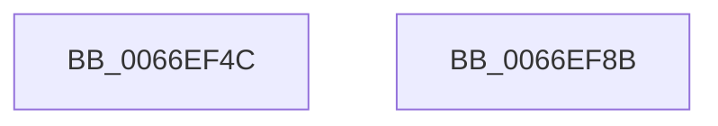

# MiClearCommitReleaseState

- RVA: `0x0066EF4C`–`0x0066EF8C` (길이 `64` bytes)
- VA: `0x000000014066EF4C`
- 실행 섹션: `.text`
- PDB 이름 있음: `예`; PDB Function 태그: `아니요`
- unwind 정보 RVA: `0x0005CF00`
- 디코드: `19`개 명령, `64/64` bytes 표시
- 미해석 바이트: `0` (있으면 어셈블리에 `.byte`로 보존)

> 이 문서는 커널 이미지의 기계어와 PDB 기호를 분석해 생성했습니다. 4번과 5번은 함수 원형과 자료형을 바이너리 사용 방식에서 추정한 C 해석이며 원본 소스 복구 결과는 아닙니다.

## 1. Dependencies

- 직접 호출 지점: **2**; 고유 호출 대상: **2**
- 직접 호출자로 확인된 함수: **1**
- RIP 상대 이미지 참조: **0**

### Outgoing calls
- `0x0066EF55` → [MiLockWorkingSetExclusive](../32/MiLockWorkingSetExclusive_function_003238A0.md) (function, `0x003238A0`)
- `0x0066EF80` → [MiUnlockWorkingSetExclusive](../27/MiUnlockWorkingSetExclusive_function_0027EC70.md) (function, `0x0027EC70`)

### Direct callers
- [MmCleanProcessAddressSpace](../../page/A1/MmCleanProcessAddressSpace_function_00A17EC0.md) at `0x00A1815C`

### Static image references
- 디코드된 RIP-relative 메모리 참조가 없습니다.

## 2. Other-region calls and transfers

- 다른 실행 섹션으로 향하는 call: **0**
- 별도 외부 분기/꼬리 이동을 확인하지 못했습니다.

## 3. Assembly (complete function range)

```asm
0066EF4C  40 53                           push rbx
0066EF4E  48 83 EC 20                     sub rsp, 0x20
0066EF52  48 8B D9                        mov rbx, rcx
0066EF55  E8 46 49 CB FF                  call 0x1403238a0
0066EF5A  8B 93 B8 00 00 00               mov edx, dword ptr [rbx + 0xb8]
0066EF60  48 8B CB                        mov rcx, rbx
0066EF63  89 54 24 30                     mov dword ptr [rsp + 0x30], edx
0066EF67  C1 EA 18                        shr edx, 0x18
0066EF6A  80 E2 CF                        and dl, 0xcf
0066EF6D  88 54 24 33                     mov byte ptr [rsp + 0x33], dl
0066EF71  8B 54 24 30                     mov edx, dword ptr [rsp + 0x30]
0066EF75  C1 EA 18                        shr edx, 0x18
0066EF78  88 93 BB 00 00 00               mov byte ptr [rbx + 0xbb], dl
0066EF7E  8A D0                           mov dl, al
0066EF80  E8 EB FC C0 FF                  call 0x14027ec70
0066EF85  48 83 C4 20                     add rsp, 0x20
0066EF89  5B                              pop rbx
0066EF8A  C3                              ret
0066EF8B  CC                              int3
```

## 4. C-style interpretation (structured pseudocode)

```c
__int64 __fastcall MiClearCommitReleaseState(__int64 a1)
{
    __int64 result;
    __int64 v_rsp;
    unsigned int v_stack_p8;
    unsigned __int8 v_stack_pB;

    v_rsp = (v_rsp) - (32);
    result = MiLockWorkingSetExclusive(a1, a2, a3, a4);
    v_stack_p8 = (unsigned int)((unsigned int)(*(unsigned int *)(a1 + 184)));
    a2 = (unsigned int)(((unsigned int)(*(unsigned int *)(a1 + 184))) >> (24));
    a2 = (unsigned __int8)((a2) & (207));
    v_stack_pB = (unsigned __int8)(a2);
    a2 = (unsigned int)(((unsigned int)(v_stack_p8)) >> (24));
    *(unsigned __int8 *)(a1 + 187) = (unsigned __int8)(a2);
    result = MiUnlockWorkingSetExclusive(a1, (unsigned __int8)(result), a3, a4);
    v_rsp = (v_rsp) + (32);
    return result;
}
```

## 5. (Beta) C Style

```c
int64_t MiClearCommitReleaseState(void *Arg1)
{
    uint8_t *arg1 = (uint8_t *)Arg1;

    int64_t result;
    int64_t local_rsp;
    uint32_t v_stack_p8;
    uint8_t v_stack_pB;

    local_rsp = (local_rsp) - (32);
    result = MiLockWorkingSetExclusive(Arg1, a2, a3, a4);
    v_stack_p8 = (uint32_t)((uint32_t)(*(uint32_t *)(arg1 + 0xB8)));
    a2 = (uint32_t)(((uint32_t)(*(uint32_t *)(arg1 + 0xB8))) >> (24));
    a2 = (uint8_t)((a2) & (207));
    v_stack_pB = (uint8_t)(a2);
    a2 = (uint32_t)(((uint32_t)(v_stack_p8)) >> (24));
    *(uint8_t *)(arg1 + 0xBB) = (uint8_t)(a2);
    result = MiUnlockWorkingSetExclusive(Arg1, (uint8_t)(result), a3, a4);
    local_rsp = (local_rsp) + (32);
    return result;
}
```

### 관측된 메모리 오프셋

구조체 형식이 확인되지 않은 접근은 인자 기준의 오프셋으로만 기록했습니다.

| 기준 인자 | 오프셋 표현 | 폭 (bit) | 접근 |
|---|---:|---:|---|
| `Arg1` | `+ 0xB8` | `32` | `R` |
| `Arg1` | `+ 0xBB` | `8` | `W` |

## 6. Execution-region graph

[열기: 2D/3D 그래프와 함수 탐색 컨트롤 패널](../../../control-panel.html?section=text&rva=0x0066EF4C&view=graph)

- 2D 그래프는 위에서 아래로 흐르고, 3D 그래프는 빈 공간을 드래그해 회전합니다. Shift+드래그는 이동, 휠은 확대·축소, 함수 노드 선택은 대상 보고서 이동입니다.

### Static fallback


