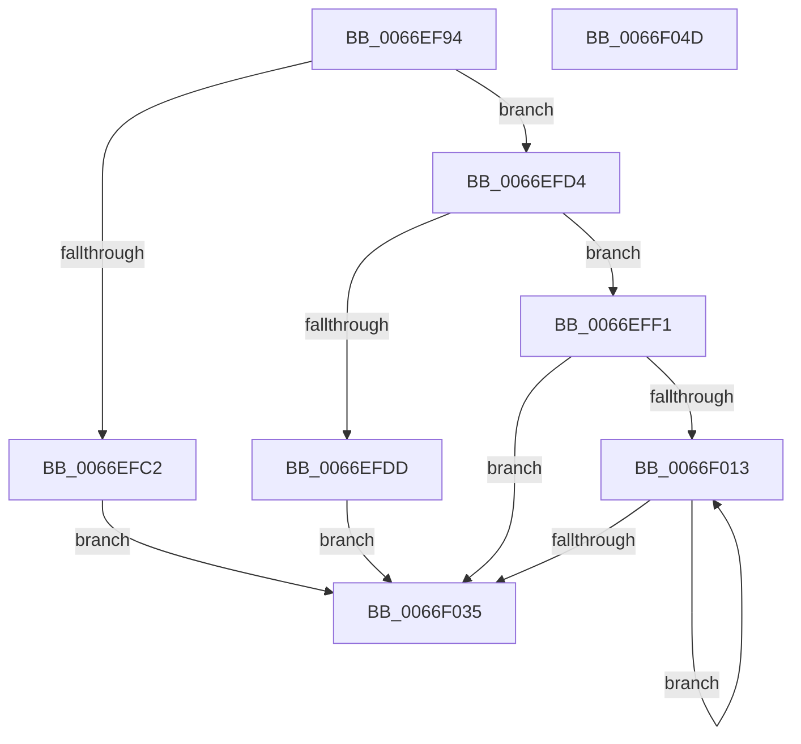

# MiComputeCommitChargeForZeroPteRange

- RVA: `0x0066EF94`–`0x0066F04E` (길이 `186` bytes)
- VA: `0x000000014066EF94`
- 실행 섹션: `.text`
- PDB 이름 있음: `예`; PDB Function 태그: `아니요`
- unwind 정보 RVA: `0x0006C8E8`
- 디코드: `54`개 명령, `186/186` bytes 표시
- 미해석 바이트: `0` (있으면 어셈블리에 `.byte`로 보존)

> 이 문서는 커널 이미지의 기계어와 PDB 기호를 분석해 생성했습니다. 4번과 5번은 함수 원형과 자료형을 바이너리 사용 방식에서 추정한 C 해석이며 원본 소스 복구 결과는 아닙니다.

## 1. Dependencies

- 직접 호출 지점: **1**; 고유 호출 대상: **1**
- 직접 호출자로 확인된 함수: **1**
- RIP 상대 이미지 참조: **0**

### Outgoing calls
- `0x0066F021` → [MiComputeImageVadCommitCharge](MiComputeImageVadCommitCharge_function_0066F054.md) (function, `0x0066F054`)

### Direct callers
- [MiCheckCommitReleaseFromVad](MiCheckCommitReleaseFromVad_function_0066EB90.md) at `0x0066EC6A`
- [MiCheckCommitReleaseFromVad](MiCheckCommitReleaseFromVad_function_0066EB90.md) at `0x0066ECF6`

### Static image references
- 디코드된 RIP-relative 메모리 참조가 없습니다.

## 2. Other-region calls and transfers

- 다른 실행 섹션으로 향하는 call: **0**
- 별도 외부 분기/꼬리 이동을 확인하지 못했습니다.

## 3. Assembly (complete function range)

```asm
0066EF94  48 8B C4                        mov rax, rsp
0066EF97  48 89 58 10                     mov qword ptr [rax + 0x10], rbx
0066EF9B  48 89 68 18                     mov qword ptr [rax + 0x18], rbp
0066EF9F  48 89 70 20                     mov qword ptr [rax + 0x20], rsi
0066EFA3  57                              push rdi
0066EFA4  48 83 EC 20                     sub rsp, 0x20
0066EFA8  44 8B 49 30                     mov r9d, dword ptr [rcx + 0x30]
0066EFAC  33 DB                           xor ebx, ebx
0066EFAE  48 89 58 08                     mov qword ptr [rax + 8], rbx
0066EFB2  49 8B F8                        mov rdi, r8
0066EFB5  48 8B F2                        mov rsi, rdx
0066EFB8  48 8B E9                        mov rbp, rcx
0066EFBB  41 0F BA E1 15                  bt r9d, 0x15
0066EFC0  73 12                           jae 0x14066efd4
0066EFC2  41 81 E1 00 00 00 02            and r9d, 0x2000000
0066EFC9  41 F7 D9                        neg r9d
0066EFCC  48 1B DB                        sbb rbx, rbx
0066EFCF  49 23 D8                        and rbx, r8
0066EFD2  EB 61                           jmp 0x14066f035
0066EFD4  41 8B C1                        mov eax, r9d
0066EFD7  24 70                           and al, 0x70
0066EFD9  3C 20                           cmp al, 0x20
0066EFDB  74 14                           je 0x14066eff1
0066EFDD  B8 80 02 00 00                  mov eax, 0x280
0066EFE2  44 23 C8                        and r9d, eax
0066EFE5  44 3B C8                        cmp r9d, eax
0066EFE8  48 0F 45 FB                     cmovne rdi, rbx
0066EFEC  48 8B DF                        mov rbx, rdi
0066EFEF  EB 44                           jmp 0x14066f035
0066EFF1  48 C1 E6 19                     shl rsi, 0x19
0066EFF5  48 B8 00 00 00 00 80 F6 FF FF   movabs rax, 0xfffff68000000000
0066EFFF  48 C1 E0 19                     shl rax, 0x19
0066F003  48 2B F0                        sub rsi, rax
0066F006  48 C1 FE 10                     sar rsi, 0x10
0066F00A  48 C1 EE 0C                     shr rsi, 0xc
0066F00E  48 85 FF                        test rdi, rdi
0066F011  74 22                           je 0x14066f035
0066F013  4C 8D 4C 24 30                  lea r9, [rsp + 0x30]
0066F018  4C 8B C7                        mov r8, rdi
0066F01B  48 8B D6                        mov rdx, rsi
0066F01E  48 8B CD                        mov rcx, rbp
0066F021  E8 2E 00 00 00                  call 0x14066f054
0066F026  48 03 74 24 30                  add rsi, qword ptr [rsp + 0x30]
0066F02B  48 03 D8                        add rbx, rax
0066F02E  48 2B 7C 24 30                  sub rdi, qword ptr [rsp + 0x30]
0066F033  75 DE                           jne 0x14066f013
0066F035  48 8B 6C 24 40                  mov rbp, qword ptr [rsp + 0x40]
0066F03A  48 8B C3                        mov rax, rbx
0066F03D  48 8B 5C 24 38                  mov rbx, qword ptr [rsp + 0x38]
0066F042  48 8B 74 24 48                  mov rsi, qword ptr [rsp + 0x48]
0066F047  48 83 C4 20                     add rsp, 0x20
0066F04B  5F                              pop rdi
0066F04C  C3                              ret
0066F04D  CC                              int3
```

## 4. C-style interpretation (structured pseudocode)

```c
__int64 __fastcall MiComputeCommitChargeForZeroPteRange(__int64 a1, __int64 a2, __int64 a3)
{
    __int64 result;
    __int64 v_rbx;
    __int64 v_rdi;
    __int64 v_rsi;
    __int64 v_rsp;
    unsigned __int64 v_stack_p10;
    unsigned __int64 v_stack_p18;
    unsigned __int64 v_stack_p20;
    unsigned __int64 v_stack_p8;

    *(unsigned __int64 *)(v_rsp + 16) = v_rbx;
    *(unsigned __int64 *)(v_rsp + 24) = v_rbp;
    *(unsigned __int64 *)(v_rsp + 32) = v_rsi;
    v_rsp = (v_rsp) - (32);
    v_rbx = 0;
    *(unsigned __int64 *)(v_rsp + 8) = 0;
    if (condition_is_above_or_equal) goto loc_0066EFD4;
    a4 = (unsigned int)(((unsigned int)(*(unsigned int *)(a1 + 48))) & (0x2000000ULL));
    a4 = (unsigned int)(-(a4));
    v_rbx = (v_rbx) & (a3);
    goto loc_0066F035;
loc_0066EFD4:
    result = (unsigned __int8)(((unsigned int)((unsigned int)(a4))) & (112));
    if (((unsigned __int8)(result)) == 32) goto loc_0066EFF1;
    a4 = (unsigned int)((a4) & (640));
    if (((unsigned int)(a4)) != 640) { a3 = v_rbx; }
    goto loc_0066F035;
loc_0066EFF1:
    v_rsi = (a2) << (25);
    result = (640) << (25);
    v_rsi = (v_rsi) - (result);
    v_rsi = (v_rsi) >> (16);
    v_rsi = (v_rsi) >> (12);
    if (a3 == 0) goto loc_0066F035;
loc_0066F013:
    result = MiComputeImageVadCommitCharge(a1, v_rsi, a3, v_stack_p8);
    v_rsi = (v_rsi) + (v_stack_p8);
    v_rbx = (a3) + (result);
    v_rdi = (a3) - (v_stack_p8);
    if (condition_is_not_equal) goto loc_0066F013;
loc_0066F035:
    v_rsp = (v_rsp) + (32);
    return v_rbx;
}
```

## 5. (Beta) C Style

```c
int64_t MiComputeCommitChargeForZeroPteRange(void *Arg1, int64_t Arg2, int64_t Arg3)
{
    uint8_t *arg1 = (uint8_t *)Arg1;

    int64_t result;
    int64_t local_rbx;
    int64_t local_rdi;
    int64_t local_rsi;
    int64_t local_rsp;
    uint64_t v_stack_p10;
    uint64_t v_stack_p18;
    uint64_t v_stack_p20;
    uint64_t v_stack_p8;

    *(uint64_t *)(local_rsp + 0x10) = local_rbx;
    *(uint64_t *)(local_rsp + 0x18) = local_rbp;
    *(uint64_t *)(local_rsp + 0x20) = local_rsi;
    local_rsp = (local_rsp) - (32);
    local_rbx = 0;
    *(uint64_t *)(local_rsp + 0x8) = 0;
    if (condition_is_above_or_equal) goto loc_0066EFD4;
    a4 = (uint32_t)(((uint32_t)(*(uint32_t *)(arg1 + 0x30))) & (0x2000000ULL));
    a4 = (uint32_t)(-(a4));
    local_rbx = (local_rbx) & (Arg3);
    goto loc_0066F035;
loc_0066EFD4:
    result = (uint8_t)(((uint32_t)((uint32_t)(a4))) & (112));
    if (((uint8_t)(result)) == 32) goto loc_0066EFF1;
    a4 = (uint32_t)((a4) & (640));
    if (((uint32_t)(a4)) != 640) { Arg3 = local_rbx; }
    goto loc_0066F035;
loc_0066EFF1:
    local_rsi = (Arg2) << (25);
    result = (640) << (25);
    local_rsi = (local_rsi) - (result);
    local_rsi = (local_rsi) >> (16);
    local_rsi = (local_rsi) >> (12);
    if (Arg3 == 0) goto loc_0066F035;
loc_0066F013:
    result = MiComputeImageVadCommitCharge(Arg1, local_rsi, Arg3, v_stack_p8);
    local_rsi = (local_rsi) + (v_stack_p8);
    local_rbx = (Arg3) + (result);
    local_rdi = (Arg3) - (v_stack_p8);
    if (condition_is_not_equal) goto loc_0066F013;
loc_0066F035:
    local_rsp = (local_rsp) + (32);
    return local_rbx;
}
```

### 관측된 메모리 오프셋

구조체 형식이 확인되지 않은 접근은 인자 기준의 오프셋으로만 기록했습니다.

| 기준 인자 | 오프셋 표현 | 폭 (bit) | 접근 |
|---|---:|---:|---|
| `Arg1` | `+ 0x30` | `32` | `R` |

## 6. Execution-region graph

[열기: 2D/3D 그래프와 함수 탐색 컨트롤 패널](../../../control-panel.html?section=text&rva=0x0066EF94&view=graph)

- 2D 그래프는 위에서 아래로 흐르고, 3D 그래프는 빈 공간을 드래그해 회전합니다. Shift+드래그는 이동, 휠은 확대·축소, 함수 노드 선택은 대상 보고서 이동입니다.

### Static fallback


