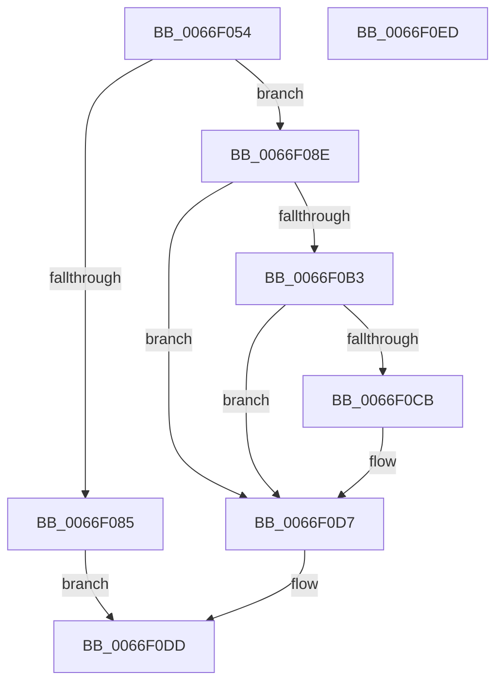

# MiComputeImageVadCommitCharge

- RVA: `0x0066F054`–`0x0066F0EE` (길이 `154` bytes)
- VA: `0x000000014066F054`
- 실행 섹션: `.text`
- PDB 이름 있음: `예`; PDB Function 태그: `아니요`
- unwind 정보 RVA: `0x000733E4`
- 디코드: `47`개 명령, `154/154` bytes 표시
- 미해석 바이트: `0` (있으면 어셈블리에 `.byte`로 보존)

> 이 문서는 커널 이미지의 기계어와 PDB 기호를 분석해 생성했습니다. 4번과 5번은 함수 원형과 자료형을 바이너리 사용 방식에서 추정한 C 해석이며 원본 소스 복구 결과는 아닙니다.

## 1. Dependencies

- 직접 호출 지점: **1**; 고유 호출 대상: **1**
- 직접 호출자로 확인된 함수: **2**
- RIP 상대 이미지 참조: **0**

### Outgoing calls
- `0x0066F078` → [MiGetProtoPteAddress](../32/MiGetProtoPteAddress_function_0032E970.md) (function, `0x0032E970`)

### Direct callers
- [MiCheckCommitReleaseFromVad](MiCheckCommitReleaseFromVad_function_0066EB90.md) at `0x0066EE5C`
- [MiComputeCommitChargeForZeroPteRange](MiComputeCommitChargeForZeroPteRange_function_0066EF94.md) at `0x0066F021`

### Static image references
- 디코드된 RIP-relative 메모리 참조가 없습니다.

## 2. Other-region calls and transfers

- 다른 실행 섹션으로 향하는 call: **0**
- 별도 외부 분기/꼬리 이동을 확인하지 못했습니다.

## 3. Assembly (complete function range)

```asm
0066F054  48 8B C4                        mov rax, rsp
0066F057  48 89 58 08                     mov qword ptr [rax + 8], rbx
0066F05B  48 89 70 10                     mov qword ptr [rax + 0x10], rsi
0066F05F  57                              push rdi
0066F060  48 83 EC 30                     sub rsp, 0x30
0066F064  33 DB                           xor ebx, ebx
0066F066  49 8B F9                        mov rdi, r9
0066F069  49 8B F0                        mov rsi, r8
0066F06C  48 89 58 E8                     mov qword ptr [rax - 0x18], rbx
0066F070  4C 8D 48 E8                     lea r9, [rax - 0x18]
0066F074  44 8D 43 06                     lea r8d, [rbx + 6]
0066F078  E8 F3 F8 CB FF                  call 0x14032e970
0066F07D  4C 8B D0                        mov r10, rax
0066F080  48 85 C0                        test rax, rax
0066F083  75 09                           jne 0x14066f08e
0066F085  48 C7 07 01 00 00 00            mov qword ptr [rdi], 1
0066F08C  EB 4F                           jmp 0x14066f0dd
0066F08E  48 8B 4C 24 20                  mov rcx, qword ptr [rsp + 0x20]
0066F093  4C 2B 51 08                     sub r10, qword ptr [rcx + 8]
0066F097  44 8B 41 2C                     mov r8d, dword ptr [rcx + 0x2c]
0066F09B  8B 41 20                        mov eax, dword ptr [rcx + 0x20]
0066F09E  49 C1 FA 03                     sar r10, 3
0066F0A2  45 2B C2                        sub r8d, r10d
0066F0A5  4C 3B C6                        cmp r8, rsi
0066F0A8  4C 0F 47 C6                     cmova r8, rsi
0066F0AC  83 E0 0A                        and eax, 0xa
0066F0AF  3C 0A                           cmp al, 0xa
0066F0B1  75 24                           jne 0x14066f0d7
0066F0B3  48 8B 44 24 20                  mov rax, qword ptr [rsp + 0x20]
0066F0B8  8B 48 34                        mov ecx, dword ptr [rax + 0x34]
0066F0BB  8B 50 2C                        mov edx, dword ptr [rax + 0x2c]
0066F0BE  81 E1 FF FF FF 3F               and ecx, 0x3fffffff
0066F0C4  2B D1                           sub edx, ecx
0066F0C6  44 3B D2                        cmp r10d, edx
0066F0C9  73 0C                           jae 0x14066f0d7
0066F0CB  41 2B D2                        sub edx, r10d
0066F0CE  8B DA                           mov ebx, edx
0066F0D0  49 3B D8                        cmp rbx, r8
0066F0D3  49 0F 47 D8                     cmova rbx, r8
0066F0D7  4C 89 07                        mov qword ptr [rdi], r8
0066F0DA  48 8B C3                        mov rax, rbx
0066F0DD  48 8B 5C 24 40                  mov rbx, qword ptr [rsp + 0x40]
0066F0E2  48 8B 74 24 48                  mov rsi, qword ptr [rsp + 0x48]
0066F0E7  48 83 C4 30                     add rsp, 0x30
0066F0EB  5F                              pop rdi
0066F0EC  C3                              ret
0066F0ED  CC                              int3
```

## 4. C-style interpretation (structured pseudocode)

```c
__int64 __fastcall MiComputeImageVadCommitCharge(__int64 a1, __int64 a2, __int64 a3, __int64 a4)
{
    __int64 result;
    __int64 v_r10;
    __int64 v_rbx;
    __int64 v_rsp;
    unsigned __int64 v_stack_m18;
    unsigned __int64 v_stack_p10;
    unsigned __int64 v_stack_p8;

    *(unsigned __int64 *)(v_rsp + 8) = v_rbx;
    *(unsigned __int64 *)(v_rsp + 16) = v_rsi;
    v_rsp = (v_rsp) - (48);
    v_rbx = 0;
    *(unsigned __int64 *)(v_rsp - 24) = 0;
    result = MiGetProtoPteAddress(a1, a2, v_rbx + 6, v_rsp - 24);
    if (result != 0) goto loc_0066F08E;
    *(unsigned __int64 *)(a4) = 1;
    goto loc_0066F0DD;
loc_0066F08E:
    v_r10 = (result) - (*(unsigned __int64 *)(v_stack_m18 + 8));
    v_r10 = (v_r10) >> (3);
    a3 = (unsigned int)(((unsigned int)(*(unsigned int *)(v_stack_m18 + 44))) - ((unsigned int)(v_r10)));
    if (a3 > a3) { a3 = a3; }
    result = (unsigned int)(((unsigned int)(*(unsigned int *)(v_stack_m18 + 32))) & (10));
    if (((unsigned __int8)(result)) != 10) goto loc_0066F0D7;
    a1 = (unsigned int)(((unsigned int)(*(unsigned int *)(v_stack_m18 + 52))) & (0x3FFFFFFFULL));
    a2 = (unsigned int)(((unsigned int)(*(unsigned int *)(v_stack_m18 + 44))) - ((unsigned int)(a1)));
    if (((unsigned int)(v_r10)) < ((unsigned int)(a2))) {
        a2 = (unsigned int)((a2) - ((unsigned int)(v_r10)));
        v_rbx = (unsigned int)(a2);
        if (v_rbx > a3) { v_rbx = a3; }
    }
    *(unsigned __int64 *)(a4) = a3;
loc_0066F0DD:
    v_rsp = (v_rsp) + (48);
    return v_rbx;
}
```

## 5. (Beta) C Style

```c
int64_t MiComputeImageVadCommitCharge(int64_t Arg1, int64_t Arg2, int64_t Arg3, void *Arg4)
{
    uint8_t *arg4 = (uint8_t *)Arg4;

    int64_t result;
    int64_t local_r10;
    int64_t local_rbx;
    int64_t local_rsp;
    uint64_t v_stack_m18;
    uint64_t v_stack_p10;
    uint64_t v_stack_p8;

    *(uint64_t *)(local_rsp + 0x8) = local_rbx;
    *(uint64_t *)(local_rsp + 0x10) = local_rsi;
    local_rsp = (local_rsp) - (48);
    local_rbx = 0;
    *(uint64_t *)(local_rsp - 0x18) = 0;
    result = MiGetProtoPteAddress(Arg1, Arg2, local_rbx + 6, local_rsp - 24);
    if (result != 0) goto loc_0066F08E;
    *(uint64_t *)(arg4) = 1;
    goto loc_0066F0DD;
loc_0066F08E:
    local_r10 = (result) - (*(uint64_t *)(v_stack_m18 + 0x8));
    local_r10 = (local_r10) >> (3);
    Arg3 = (uint32_t)(((uint32_t)(*(uint32_t *)(v_stack_m18 + 0x2C))) - ((uint32_t)(local_r10)));
    if (Arg3 > Arg3) { Arg3 = Arg3; }
    result = (uint32_t)(((uint32_t)(*(uint32_t *)(v_stack_m18 + 0x20))) & (10));
    if (((uint8_t)(result)) != 10) goto loc_0066F0D7;
    Arg1 = (uint32_t)(((uint32_t)(*(uint32_t *)(v_stack_m18 + 0x34))) & (0x3FFFFFFFULL));
    Arg2 = (uint32_t)(((uint32_t)(*(uint32_t *)(v_stack_m18 + 0x2C))) - ((uint32_t)(Arg1)));
    if (((uint32_t)(local_r10)) < ((uint32_t)(Arg2))) {
        Arg2 = (uint32_t)((Arg2) - ((uint32_t)(local_r10)));
        local_rbx = (uint32_t)(Arg2);
        if (local_rbx > Arg3) { local_rbx = Arg3; }
    }
    *(uint64_t *)(arg4) = Arg3;
loc_0066F0DD:
    local_rsp = (local_rsp) + (48);
    return local_rbx;
}
```

### 관측된 메모리 오프셋

구조체 형식이 확인되지 않은 접근은 인자 기준의 오프셋으로만 기록했습니다.

| 기준 인자 | 오프셋 표현 | 폭 (bit) | 접근 |
|---|---:|---:|---|
| `Arg4` | `+ 0x0` | `64` | `W` |

## 6. Execution-region graph

[열기: 2D/3D 그래프와 함수 탐색 컨트롤 패널](../../../control-panel.html?section=text&rva=0x0066F054&view=graph)

- 2D 그래프는 위에서 아래로 흐르고, 3D 그래프는 빈 공간을 드래그해 회전합니다. Shift+드래그는 이동, 휠은 확대·축소, 함수 노드 선택은 대상 보고서 이동입니다.

### Static fallback


