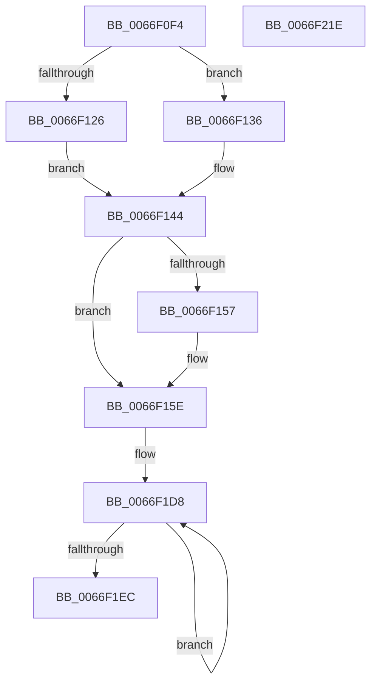

# MiCopyWorkingSetFields

- RVA: `0x0066F0F4`–`0x0066F21F` (길이 `299` bytes)
- VA: `0x000000014066F0F4`
- 실행 섹션: `.text`
- PDB 이름 있음: `예`; PDB Function 태그: `아니요`
- unwind 정보 RVA: `0x0005FEF8`
- 디코드: `73`개 명령, `299/299` bytes 표시
- 미해석 바이트: `0` (있으면 어셈블리에 `.byte`로 보존)

> 이 문서는 커널 이미지의 기계어와 PDB 기호를 분석해 생성했습니다. 4번과 5번은 함수 원형과 자료형을 바이너리 사용 방식에서 추정한 C 해석이며 원본 소스 복구 결과는 아닙니다.

## 1. Dependencies

- 직접 호출 지점: **4**; 고유 호출 대상: **4**
- 직접 호출자로 확인된 함수: **1**
- RIP 상대 이미지 참조: **3**

### Outgoing calls
- `0x0066F161` → [MiLockWorkingSetShared](../27/MiLockWorkingSetShared_function_0027CBF0.md) (function, `0x0027CBF0`)
- `0x0066F16C` → [MiLockWorkingSetCoreExclusive](../2C/MiLockWorkingSetCoreExclusive_function_002C0CFC.md) (function, `0x002C0CFC`)
- `0x0066F1EF` → [MiUnlockWorkingSetCoreExclusive](../2C/MiUnlockWorkingSetCoreExclusive_function_002C0DC4.md) (function, `0x002C0DC4`)
- `0x0066F1FA` → [MiUnlockWorkingSetShared](../27/MiUnlockWorkingSetShared_function_0027D690.md) (function, `0x0027D690`)

### Direct callers
- [MmInitializeHandBuiltProcess](../../page/7F/MmInitializeHandBuiltProcess_function_007F83EC.md) at `0x007F84DD`

### Static image references
- `0x0066F126` → RVA `0x00E38870` (`.data`; read)
- `0x0066F12D` → RVA `0x00E38878` (`.data`; read)
- `0x0066F14A` → RVA `0x00E38840` (`.data`; read)

## 2. Other-region calls and transfers

- 다른 실행 섹션으로 향하는 call: **0**
- 별도 외부 분기/꼬리 이동을 확인하지 못했습니다.

## 3. Assembly (complete function range)

```asm
0066F0F4  48 8B C4                        mov rax, rsp
0066F0F7  48 89 58 08                     mov qword ptr [rax + 8], rbx
0066F0FB  48 89 68 10                     mov qword ptr [rax + 0x10], rbp
0066F0FF  48 89 70 18                     mov qword ptr [rax + 0x18], rsi
0066F103  48 89 78 20                     mov qword ptr [rax + 0x20], rdi
0066F107  41 54                           push r12
0066F109  41 56                           push r14
0066F10B  41 57                           push r15
0066F10D  48 83 EC 20                     sub rsp, 0x20
0066F111  8B 81 B8 00 00 00               mov eax, dword ptr [rcx + 0xb8]
0066F117  4D 8B E0                        mov r12, r8
0066F11A  24 0F                           and al, 0xf
0066F11C  48 8B DA                        mov rbx, rdx
0066F11F  48 8B F9                        mov rdi, rcx
0066F122  3C 01                           cmp al, 1
0066F124  75 10                           jne 0x14066f136
0066F126  4C 8D 35 43 97 7C 00            lea r14, [rip + 0x7c9743]
0066F12D  4C 8D 3D 44 97 7C 00            lea r15, [rip + 0x7c9744]
0066F134  EB 0E                           jmp 0x14066f144
0066F136  4C 8D B1 F0 00 00 00            lea r14, [rcx + 0xf0]
0066F13D  4C 8D B9 F8 00 00 00            lea r15, [rcx + 0xf8]
0066F144  8B 82 B8 00 00 00               mov eax, dword ptr [rdx + 0xb8]
0066F14A  48 8D 35 EF 96 7C 00            lea rsi, [rip + 0x7c96ef]
0066F151  24 0F                           and al, 0xf
0066F153  3C 01                           cmp al, 1
0066F155  74 07                           je 0x14066f15e
0066F157  48 8D B2 C0 00 00 00            lea rsi, [rdx + 0xc0]
0066F15E  48 8B CB                        mov rcx, rbx
0066F161  E8 8A DA C0 FF                  call 0x14027cbf0
0066F166  48 8B CB                        mov rcx, rbx
0066F169  40 8A E8                        mov bpl, al
0066F16C  E8 8B 1B C5 FF                  call 0x1402c0cfc
0066F171  48 8B 4B 70                     mov rcx, qword ptr [rbx + 0x70]
0066F175  BA 08 00 00 00                  mov edx, 8
0066F17A  48 89 4F 70                     mov qword ptr [rdi + 0x70], rcx
0066F17E  48 8B 4B 78                     mov rcx, qword ptr [rbx + 0x78]
0066F182  48 89 4F 78                     mov qword ptr [rdi + 0x78], rcx
0066F186  48 8B 4E 30                     mov rcx, qword ptr [rsi + 0x30]
0066F18A  49 89 0E                        mov qword ptr [r14], rcx
0066F18D  48 8B 4E 38                     mov rcx, qword ptr [rsi + 0x38]
0066F191  49 89 0F                        mov qword ptr [r15], rcx
0066F194  48 8B 8B 80 00 00 00            mov rcx, qword ptr [rbx + 0x80]
0066F19B  48 89 8F 80 00 00 00            mov qword ptr [rdi + 0x80], rcx
0066F1A2  48 8D 4B 28                     lea rcx, [rbx + 0x28]
0066F1A6  48 8B 83 88 00 00 00            mov rax, qword ptr [rbx + 0x88]
0066F1AD  48 89 87 88 00 00 00            mov qword ptr [rdi + 0x88], rax
0066F1B4  48 8B 83 90 00 00 00            mov rax, qword ptr [rbx + 0x90]
0066F1BB  48 89 87 90 00 00 00            mov qword ptr [rdi + 0x90], rax
0066F1C2  48 8B 83 98 00 00 00            mov rax, qword ptr [rbx + 0x98]
0066F1C9  48 89 87 98 00 00 00            mov qword ptr [rdi + 0x98], rax
0066F1D0  4C 89 67 10                     mov qword ptr [rdi + 0x10], r12
0066F1D4  48 83 C7 28                     add rdi, 0x28
0066F1D8  48 8B 01                        mov rax, qword ptr [rcx]
0066F1DB  48 8D 49 08                     lea rcx, [rcx + 8]
0066F1DF  48 89 07                        mov qword ptr [rdi], rax
0066F1E2  48 8D 7F 08                     lea rdi, [rdi + 8]
0066F1E6  48 83 EA 01                     sub rdx, 1
0066F1EA  75 EC                           jne 0x14066f1d8
0066F1EC  48 8B CB                        mov rcx, rbx
0066F1EF  E8 D0 1B C5 FF                  call 0x1402c0dc4
0066F1F4  40 8A D5                        mov dl, bpl
0066F1F7  48 8B CB                        mov rcx, rbx
0066F1FA  E8 91 E4 C0 FF                  call 0x14027d690
0066F1FF  48 8B 5C 24 40                  mov rbx, qword ptr [rsp + 0x40]
0066F204  48 8B 6C 24 48                  mov rbp, qword ptr [rsp + 0x48]
0066F209  48 8B 74 24 50                  mov rsi, qword ptr [rsp + 0x50]
0066F20E  48 8B 7C 24 58                  mov rdi, qword ptr [rsp + 0x58]
0066F213  48 83 C4 20                     add rsp, 0x20
0066F217  41 5F                           pop r15
0066F219  41 5E                           pop r14
0066F21B  41 5C                           pop r12
0066F21D  C3                              ret
0066F21E  CC                              int3
```

## 4. C-style interpretation (structured pseudocode)

```c
__int64 __fastcall MiCopyWorkingSetFields(__int64 a1, __int64 a2, __int64 a3)
{
    __int64 result;
    __int64 v_rdi;
    __int64 v_rsi;
    __int64 v_rsp;
    unsigned __int64 v_stack_p10;
    unsigned __int64 v_stack_p18;
    unsigned __int64 v_stack_p20;
    unsigned __int64 v_stack_p8;

    *(unsigned __int64 *)(v_rsp + 8) = v_rbx;
    *(unsigned __int64 *)(v_rsp + 16) = v_rbp;
    *(unsigned __int64 *)(v_rsp + 24) = v_rsi;
    *(unsigned __int64 *)(v_rsp + 32) = v_rdi;
    v_rsp = (v_rsp) - (32);
    result = (unsigned __int8)(((unsigned int)(*(unsigned int *)(a1 + 184))) & (15));
    if (((unsigned __int8)(result)) != 1) goto loc_0066F136;
    goto loc_0066F144;
loc_0066F136:
loc_0066F144:
    result = (unsigned __int8)(((unsigned int)(*(unsigned int *)(a2 + 184))) & (15));
    v_rsi = v_rip + 8165103;
    if (((unsigned __int8)(result)) != 1) {
        v_rsi = a2 + 192;
    }
    result = MiLockWorkingSetShared(a2, a2, a3, a4);
    result = MiLockWorkingSetCoreExclusive(a2, a2, a3, a4);
    *(unsigned __int64 *)(a1 + 112) = *(unsigned __int64 *)(a2 + 112);
    *(unsigned __int64 *)(a1 + 120) = *(unsigned __int64 *)(a2 + 120);
    *(unsigned __int64 *)(a1 + 240) = *(unsigned __int64 *)(v_rsi + 48);
    *(unsigned __int64 *)(a1 + 248) = *(unsigned __int64 *)(v_rsi + 56);
    *(unsigned __int64 *)(a1 + 128) = *(unsigned __int64 *)(a2 + 128);
    *(unsigned __int64 *)(a1 + 136) = *(unsigned __int64 *)(a2 + 136);
    *(unsigned __int64 *)(a1 + 144) = *(unsigned __int64 *)(a2 + 144);
    *(unsigned __int64 *)(a1 + 152) = *(unsigned __int64 *)(a2 + 152);
    *(unsigned __int64 *)(a1 + 16) = a3;
    v_rdi = (a1) + (40);
loc_0066F1D8:
    *(unsigned __int64 *)(v_rdi) = *(unsigned __int64 *)(a2 + 40);
    a2 = (8) - (1);
    if (condition_is_not_equal) goto loc_0066F1D8;
    result = MiUnlockWorkingSetCoreExclusive(a2, a2, a3, a4);
    result = MiUnlockWorkingSetShared(a2, (unsigned __int8)((unsigned __int8)(result)), a3, a4);
    v_rsp = (v_rsp) + (32);
    return result;
}
```

## 5. (Beta) C Style

```c
int64_t MiCopyWorkingSetFields(void *Arg1, void *Arg2, int64_t Arg3)
{
    uint8_t *arg1 = (uint8_t *)Arg1;
    uint8_t *arg2 = (uint8_t *)Arg2;

    int64_t result;
    int64_t local_rdi;
    int64_t local_rsi;
    int64_t local_rsp;
    uint64_t v_stack_p10;
    uint64_t v_stack_p18;
    uint64_t v_stack_p20;
    uint64_t v_stack_p8;

    *(uint64_t *)(local_rsp + 0x8) = local_rbx;
    *(uint64_t *)(local_rsp + 0x10) = local_rbp;
    *(uint64_t *)(local_rsp + 0x18) = local_rsi;
    *(uint64_t *)(local_rsp + 0x20) = local_rdi;
    local_rsp = (local_rsp) - (32);
    result = (uint8_t)(((uint32_t)(*(uint32_t *)(arg1 + 0xB8))) & (15));
    if (((uint8_t)(result)) != 1) goto loc_0066F136;
    goto loc_0066F144;
loc_0066F136:
loc_0066F144:
    result = (uint8_t)(((uint32_t)(*(uint32_t *)(arg2 + 0xB8))) & (15));
    local_rsi = v_rip + 8165103;
    if (((uint8_t)(result)) != 1) {
        local_rsi = Arg2 + 192;
    }
    result = MiLockWorkingSetShared(Arg2, Arg2, Arg3, a4);
    result = MiLockWorkingSetCoreExclusive(Arg2, Arg2, Arg3, a4);
    *(uint64_t *)(arg1 + 0x70) = *(uint64_t *)(arg2 + 0x70);
    *(uint64_t *)(arg1 + 0x78) = *(uint64_t *)(arg2 + 0x78);
    *(uint64_t *)(arg1 + 0xF0) = *(uint64_t *)(local_rsi + 0x30);
    *(uint64_t *)(arg1 + 0xF8) = *(uint64_t *)(local_rsi + 0x38);
    *(uint64_t *)(arg1 + 0x80) = *(uint64_t *)(arg2 + 0x80);
    *(uint64_t *)(arg1 + 0x88) = *(uint64_t *)(arg2 + 0x88);
    *(uint64_t *)(arg1 + 0x90) = *(uint64_t *)(arg2 + 0x90);
    *(uint64_t *)(arg1 + 0x98) = *(uint64_t *)(arg2 + 0x98);
    *(uint64_t *)(arg1 + 0x10) = Arg3;
    local_rdi = (Arg1) + (40);
loc_0066F1D8:
    *(uint64_t *)(local_rdi) = *(uint64_t *)(arg2 + 0x28);
    Arg2 = (8) - (1);
    if (condition_is_not_equal) goto loc_0066F1D8;
    result = MiUnlockWorkingSetCoreExclusive(Arg2, Arg2, Arg3, a4);
    result = MiUnlockWorkingSetShared(Arg2, (uint8_t)((uint8_t)(result)), Arg3, a4);
    local_rsp = (local_rsp) + (32);
    return result;
}
```

### 관측된 메모리 오프셋

구조체 형식이 확인되지 않은 접근은 인자 기준의 오프셋으로만 기록했습니다.

| 기준 인자 | 오프셋 표현 | 폭 (bit) | 접근 |
|---|---:|---:|---|
| `Arg1` | `+ 0x0` | `64` | `W` |
| `Arg1` | `+ 0x8` | `64` | `R` |
| `Arg1` | `+ 0x10` | `64` | `W` |
| `Arg1` | `+ 0x70` | `64` | `W` |
| `Arg1` | `+ 0x78` | `64` | `W` |
| `Arg1` | `+ 0x80` | `64` | `W` |
| `Arg1` | `+ 0x88` | `64` | `W` |
| `Arg1` | `+ 0x90` | `64` | `W` |
| `Arg1` | `+ 0x98` | `64` | `W` |
| `Arg1` | `+ 0xB8` | `32` | `R` |
| `Arg1` | `+ 0xF0` | `64` | `R` |
| `Arg1` | `+ 0xF8` | `64` | `R` |
| `Arg2` | `+ 0x0` | `64` | `R` |
| `Arg2` | `+ 0x8` | `64` | `R` |
| `Arg2` | `+ 0x28` | `64` | `R` |
| `Arg2` | `+ 0x70` | `64` | `R` |
| `Arg2` | `+ 0x78` | `64` | `R` |
| `Arg2` | `+ 0x80` | `64` | `R` |
| `Arg2` | `+ 0x88` | `64` | `R` |
| `Arg2` | `+ 0x90` | `64` | `R` |
| `Arg2` | `+ 0x98` | `64` | `R` |
| `Arg2` | `+ 0xB8` | `32` | `R` |
| `Arg2` | `+ 0xC0` | `64` | `R` |

## 6. Execution-region graph

[열기: 2D/3D 그래프와 함수 탐색 컨트롤 패널](../../../control-panel.html?section=text&rva=0x0066F0F4&view=graph)

- 2D 그래프는 위에서 아래로 흐르고, 3D 그래프는 빈 공간을 드래그해 회전합니다. Shift+드래그는 이동, 휠은 확대·축소, 함수 노드 선택은 대상 보고서 이동입니다.

### Static fallback


