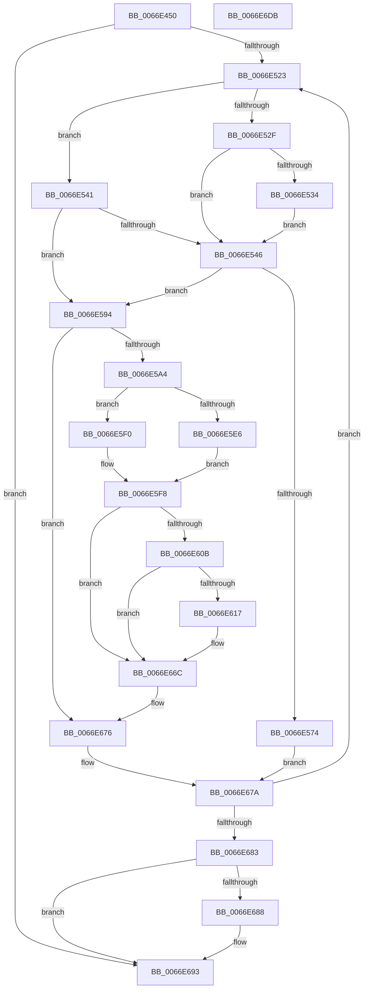

# MiDeleteBootRange

- RVA: `0x0066E450`–`0x0066E6DC` (길이 `652` bytes)
- VA: `0x000000014066E450`
- 실행 섹션: `.text`
- PDB 이름 있음: `예`; PDB Function 태그: `아니요`
- unwind 정보 RVA: `0x000D76AC`
- 디코드: `167`개 명령, `652/652` bytes 표시
- 미해석 바이트: `0` (있으면 어셈블리에 `.byte`로 보존)

> 이 문서는 커널 이미지의 기계어와 PDB 기호를 분석해 생성했습니다. 4번과 5번은 함수 원형과 자료형을 바이너리 사용 방식에서 추정한 C 해석이며 원본 소스 복구 결과는 아닙니다.

## 1. Dependencies

- 직접 호출 지점: **18**; 고유 호출 대상: **11**
- 직접 호출자로 확인된 함수: **2**
- RIP 상대 이미지 참조: **2**

### Outgoing calls
- `0x0066E4BB` → [MiGetAnyMultiplexedVm](../44/MiGetAnyMultiplexedVm_function_00448BD0.md) (function, `0x00448BD0`)
- `0x0066E4EA` → [MiDecommitPages](../24/MiDecommitPages_function_00241BD0.md) (function, `0x00241BD0`)
- `0x0066E512` → [MiLockWorkingSetShared](../27/MiLockWorkingSetShared_function_0027CBF0.md) (function, `0x0027CBF0`)
- `0x0066E53A` → [MiUnlockPageTable](../21/MiUnlockPageTable_function_00216EC0.md) (function, `0x00216EC0`)
- `0x0066E557` → [MiLockLowestValidPageTableEx](../28/MiLockLowestValidPageTableEx_function_00280D10.md) (function, `0x00280D10`)
- `0x0066E57A` → [MiUnlockPageTable](../21/MiUnlockPageTable_function_00216EC0.md) (function, `0x00216EC0`)
- `0x0066E597` → [MI_READ_PTE_LOCK_FREE](../28/MI_READ_PTE_LOCK_FREE_function_002828A0.md) (function, `0x002828A0`)
- `0x0066E5AA` → [MiLockNestedPageTable](../23/MiLockNestedPageTable_function_0023E890.md) (function, `0x0023E890`)
- `0x0066E5B2` → [MI_READ_PTE_LOCK_FREE](../28/MI_READ_PTE_LOCK_FREE_function_002828A0.md) (function, `0x002828A0`)
- `0x0066E5FE` → [MiUnlockPageTable](../21/MiUnlockPageTable_function_00216EC0.md) (function, `0x00216EC0`)
- `0x0066E60E` → [MiDriverPdeOkToDelete](MiDriverPdeOkToDelete_function_0066E6E4.md) (function, `0x0066E6E4`)
- `0x0066E61D` → [MiUnlockPageTable](../21/MiUnlockPageTable_function_00216EC0.md) (function, `0x00216EC0`)
- `0x0066E628` → [MiUnlockWorkingSetShared](../27/MiUnlockWorkingSetShared_function_0027D690.md) (function, `0x0027D690`)
- `0x0066E65A` → [MiReturnSystemVa](../23/MiReturnSystemVa_function_002394C4.md) (function, `0x002394C4`)
- `0x0066E664` → [MiLockWorkingSetShared](../27/MiLockWorkingSetShared_function_0027CBF0.md) (function, `0x0027CBF0`)
- `0x0066E68E` → [MiUnlockPageTable](../21/MiUnlockPageTable_function_00216EC0.md) (function, `0x00216EC0`)
- `0x0066E699` → [MiUnlockWorkingSetShared](../27/MiUnlockWorkingSetShared_function_0027D690.md) (function, `0x0027D690`)
- `0x0066E6AA` → [MiUnmapReturnCharges](../../page/AA/MiUnmapReturnCharges_function_00AA6C40.md) (function, `0x00AA6C40`)

### Direct callers
- [MmFreeBootRegistry](../../page/7F/MmFreeBootRegistry_function_007F7C50.md) at `0x007F7CDF`
- [MmFreeLoaderBlock](../../init/C5/MmFreeLoaderBlock_function_00C5F2F0.md) at `0x00C5F4DF`
- [MmFreeLoaderBlock](../../init/C5/MmFreeLoaderBlock_function_00C5F2F0.md) at `0x00C5F50C`

### Static image references
- `0x0066E6A3` → RVA `0x00E38D00` (`.data`; read)
- `0x0066E6B2` → RVA `0x00E376D8` (`.data`; read/write)

## 2. Other-region calls and transfers

- 다른 실행 섹션으로 향하는 call: **1**
  - `0x0066E6AA` → [MiUnmapReturnCharges](../../page/AA/MiUnmapReturnCharges_function_00AA6C40.md) (`.text` → `PAGE`)
- 별도 외부 분기/꼬리 이동을 확인하지 못했습니다.

## 3. Assembly (complete function range)

```asm
0066E450  4C 8B DC                        mov r11, rsp
0066E453  49 89 5B 10                     mov qword ptr [r11 + 0x10], rbx
0066E457  49 89 6B 18                     mov qword ptr [r11 + 0x18], rbp
0066E45B  49 89 73 20                     mov qword ptr [r11 + 0x20], rsi
0066E45F  57                              push rdi
0066E460  41 54                           push r12
0066E462  41 55                           push r13
0066E464  41 56                           push r14
0066E466  41 57                           push r15
0066E468  48 81 EC 80 00 00 00            sub rsp, 0x80
0066E46F  0F 57 C0                        xorps xmm0, xmm0
0066E472  49 BD 00 00 00 00 80 F6 FF FF   movabs r13, 0xfffff68000000000
0066E47C  4C 8D 79 F8                     lea r15, [rcx - 8]
0066E480  33 C0                           xor eax, eax
0066E482  4D 8D 3C D7                     lea r15, [r15 + rdx*8]
0066E486  48 BD F8 FF FF FF 7F 00 00 00   movabs rbp, 0x7ffffffff8
0066E490  49 C1 EF 09                     shr r15, 9
0066E494  4C 8B F2                        mov r14, rdx
0066E497  0F 11 44 24 40                  movups xmmword ptr [rsp + 0x40], xmm0
0066E49C  4C 23 FD                        and r15, rbp
0066E49F  48 8B D9                        mov rbx, rcx
0066E4A2  0F 11 44 24 50                  movups xmmword ptr [rsp + 0x50], xmm0
0066E4A7  0F 11 44 24 60                  movups xmmword ptr [rsp + 0x60], xmm0
0066E4AC  49 89 43 C8                     mov qword ptr [r11 - 0x38], rax
0066E4B0  49 8B C5                        mov rax, r13
0066E4B3  B9 01 00 00 00                  mov ecx, 1
0066E4B8  4C 03 F8                        add r15, rax
0066E4BB  E8 10 A7 DD FF                  call 0x140448bd0
0066E4C0  48 8B F0                        mov rsi, rax
0066E4C3  45 33 C9                        xor r9d, r9d
0066E4C6  48 8D 44 24 40                  lea rax, [rsp + 0x40]
0066E4CB  45 33 C0                        xor r8d, r8d
0066E4CE  48 89 44 24 38                  mov qword ptr [rsp + 0x38], rax
0066E4D3  48 8B CB                        mov rcx, rbx
0066E4D6  48 83 64 24 30 00               and qword ptr [rsp + 0x30], 0
0066E4DC  C7 44 24 28 20 00 00 00         mov dword ptr [rsp + 0x28], 0x20
0066E4E4  48 83 64 24 20 00               and qword ptr [rsp + 0x20], 0
0066E4EA  E8 E1 36 BD FF                  call 0x140241bd0
0066E4EF  48 8B 4C 24 40                  mov rcx, qword ptr [rsp + 0x40]
0066E4F4  49 3B CE                        cmp rcx, r14
0066E4F7  49 0F 45 CE                     cmovne rcx, r14
0066E4FB  48 C1 EB 09                     shr rbx, 9
0066E4FF  48 23 DD                        and rbx, rbp
0066E502  48 89 4C 24 40                  mov qword ptr [rsp + 0x40], rcx
0066E507  33 FF                           xor edi, edi
0066E509  49 8B C5                        mov rax, r13
0066E50C  48 8B CE                        mov rcx, rsi
0066E50F  48 03 D8                        add rbx, rax
0066E512  E8 D9 E6 C0 FF                  call 0x14027cbf0
0066E517  44 8A E0                        mov r12b, al
0066E51A  49 3B DF                        cmp rbx, r15
0066E51D  0F 87 70 01 00 00               ja 0x14066e693
0066E523  48 8B CF                        mov rcx, rdi
0066E526  48 F7 C3 FF 0F 00 00            test rbx, 0xfff
0066E52D  75 12                           jne 0x14066e541
0066E52F  48 85 FF                        test rdi, rdi
0066E532  74 12                           je 0x14066e546
0066E534  48 8B D7                        mov rdx, rdi
0066E537  48 8B CE                        mov rcx, rsi
0066E53A  E8 81 89 BA FF                  call 0x140216ec0
0066E53F  EB 05                           jmp 0x14066e546
0066E541  48 85 C9                        test rcx, rcx
0066E544  75 4E                           jne 0x14066e594
0066E546  45 33 C9                        xor r9d, r9d
0066E549  4C 8D 84 24 B0 00 00 00         lea r8, [rsp + 0xb0]
0066E551  48 8B D3                        mov rdx, rbx
0066E554  48 8B CE                        mov rcx, rsi
0066E557  E8 B4 27 C1 FF                  call 0x140280d10
0066E55C  48 8B CB                        mov rcx, rbx
0066E55F  48 8B F8                        mov rdi, rax
0066E562  48 C1 E9 09                     shr rcx, 9
0066E566  48 23 CD                        and rcx, rbp
0066E569  49 8B C5                        mov rax, r13
0066E56C  48 03 C8                        add rcx, rax
0066E56F  48 3B F9                        cmp rdi, rcx
0066E572  74 20                           je 0x14066e594
0066E574  48 8B D7                        mov rdx, rdi
0066E577  48 8B CE                        mov rcx, rsi
0066E57A  E8 41 89 BA FF                  call 0x140216ec0
0066E57F  33 FF                           xor edi, edi
0066E581  48 81 E3 00 F0 FF FF            and rbx, 0xfffffffffffff000
0066E588  48 81 C3 00 10 00 00            add rbx, 0x1000
0066E58F  E9 E6 00 00 00                  jmp 0x14066e67a
0066E594  48 8B CB                        mov rcx, rbx
0066E597  E8 04 43 C1 FF                  call 0x1402828a0
0066E59C  A8 01                           test al, 1
0066E59E  0F 84 D2 00 00 00               je 0x14066e676
0066E5A4  48 8B D3                        mov rdx, rbx
0066E5A7  48 8B CE                        mov rcx, rsi
0066E5AA  E8 E1 02 BD FF                  call 0x14023e890
0066E5AF  48 8B CB                        mov rcx, rbx
0066E5B2  E8 E9 42 C1 FF                  call 0x1402828a0
0066E5B7  48 C1 E8 0C                     shr rax, 0xc
0066E5BB  48 B9 FF FF FF FF FF 00 00 00   movabs rcx, 0xffffffffff
0066E5C5  48 23 C1                        and rax, rcx
0066E5C8  48 8D 2C 40                     lea rbp, [rax + rax*2]
0066E5CC  48 C1 E5 04                     shl rbp, 4
0066E5D0  48 B8 00 00 00 00 00 DE FF FF   movabs rax, 0xffffde0000000000
0066E5DA  48 03 E8                        add rbp, rax
0066E5DD  8B 45 24                        mov eax, dword ptr [rbp + 0x24]
0066E5E0  0F BA E0 1A                     bt eax, 0x1a
0066E5E4  73 0A                           jae 0x14066e5f0
0066E5E6  48 8B 6D 00                     mov rbp, qword ptr [rbp]
0066E5EA  48 C1 ED 20                     shr rbp, 0x20
0066E5EE  EB 08                           jmp 0x14066e5f8
0066E5F0  48 8B 6D 10                     mov rbp, qword ptr [rbp + 0x10]
0066E5F4  48 C1 ED 10                     shr rbp, 0x10
0066E5F8  48 8B D3                        mov rdx, rbx
0066E5FB  48 8B CE                        mov rcx, rsi
0066E5FE  E8 BD 88 BA FF                  call 0x140216ec0
0066E603  F7 C5 FF 03 00 00               test ebp, 0x3ff
0066E609  75 61                           jne 0x14066e66c
0066E60B  48 8B CB                        mov rcx, rbx
0066E60E  E8 D1 00 00 00                  call 0x14066e6e4
0066E613  85 C0                           test eax, eax
0066E615  74 55                           je 0x14066e66c
0066E617  48 8B D7                        mov rdx, rdi
0066E61A  48 8B CE                        mov rcx, rsi
0066E61D  E8 9E 88 BA FF                  call 0x140216ec0
0066E622  41 8A D4                        mov dl, r12b
0066E625  48 8B CE                        mov rcx, rsi
0066E628  E8 63 F0 C0 FF                  call 0x14027d690
0066E62D  49 8B C5                        mov rax, r13
0066E630  48 C1 E0 19                     shl rax, 0x19
0066E634  48 8B CB                        mov rcx, rbx
0066E637  48 C1 E1 19                     shl rcx, 0x19
0066E63B  41 B8 0B 00 00 00               mov r8d, 0xb
0066E641  48 2B C8                        sub rcx, rax
0066E644  48 C1 F9 10                     sar rcx, 0x10
0066E648  48 C1 E1 19                     shl rcx, 0x19
0066E64C  48 2B C8                        sub rcx, rax
0066E64F  48 C1 F9 10                     sar rcx, 0x10
0066E653  48 8D 91 00 00 20 00            lea rdx, [rcx + 0x200000]
0066E65A  E8 65 AE BC FF                  call 0x1402394c4
0066E65F  48 8B CE                        mov rcx, rsi
0066E662  33 FF                           xor edi, edi
0066E664  E8 87 E5 C0 FF                  call 0x14027cbf0
0066E669  44 8A E0                        mov r12b, al
0066E66C  48 BD F8 FF FF FF 7F 00 00 00   movabs rbp, 0x7ffffffff8
0066E676  48 83 C3 08                     add rbx, 8
0066E67A  49 3B DF                        cmp rbx, r15
0066E67D  0F 86 A0 FE FF FF               jbe 0x14066e523
0066E683  48 85 FF                        test rdi, rdi
0066E686  74 0B                           je 0x14066e693
0066E688  48 8B D7                        mov rdx, rdi
0066E68B  48 8B CE                        mov rcx, rsi
0066E68E  E8 2D 88 BA FF                  call 0x140216ec0
0066E693  41 8A D4                        mov dl, r12b
0066E696  48 8B CE                        mov rcx, rsi
0066E699  E8 F2 EF C0 FF                  call 0x14027d690
0066E69E  48 8D 54 24 40                  lea rdx, [rsp + 0x40]
0066E6A3  48 8D 0D 56 A6 7C 00            lea rcx, [rip + 0x7ca656]
0066E6AA  E8 91 85 43 00                  call 0x140aa6c40
0066E6AF  49 F7 DE                        neg r14
0066E6B2  F0 4C 01 35 1E 90 7C 00         lock add qword ptr [rip + 0x7c901e], r14
0066E6BA  4C 8D 9C 24 80 00 00 00         lea r11, [rsp + 0x80]
0066E6C2  49 8B 5B 38                     mov rbx, qword ptr [r11 + 0x38]
0066E6C6  49 8B 6B 40                     mov rbp, qword ptr [r11 + 0x40]
0066E6CA  49 8B 73 48                     mov rsi, qword ptr [r11 + 0x48]
0066E6CE  49 8B E3                        mov rsp, r11
0066E6D1  41 5F                           pop r15
0066E6D3  41 5E                           pop r14
0066E6D5  41 5D                           pop r13
0066E6D7  41 5C                           pop r12
0066E6D9  5F                              pop rdi
0066E6DA  C3                              ret
0066E6DB  CC                              int3
```

## 4. C-style interpretation (structured pseudocode)

```c
__int64 __fastcall MiDeleteBootRange(__int64 a1, __int64 a2, int a3, int a4)
{
    __int64 result;
    __int64 v_r12;
    __int64 v_r14;
    __int64 v_r15;
    __int64 v_rbp;
    __int64 v_rbx;
    __int64 v_rdi;
    __int64 v_rsp;
    unsigned __int64 v_stack_m28;
    unsigned __int64 v_stack_m48;
    unsigned __int64 v_stack_m58;
    unsigned __int64 v_stack_m68;
    unsigned __int64 v_stack_m70;
    unsigned __int64 v_stack_m78;
    unsigned int v_stack_m80;
    unsigned __int64 v_stack_m88;
    unsigned __int64 v_stack_p8;

    *(unsigned __int64 *)(v_rsp + 16) = v_rbx;
    *(unsigned __int64 *)(v_rsp + 24) = v_rbp;
    *(unsigned __int64 *)(v_rsp + 32) = v_rsi;
    v_rsp = (v_rsp) - (128);
    result = 0;
    v_r15 = (a1 - 8 + a2 * 8) >> (9);
    v_stack_m68 = v_xmm0;
    v_r15 = (v_r15) & (v_rbp);
    v_stack_m58 = v_xmm0;
    v_stack_m48 = v_xmm0;
    *(unsigned __int64 *)(v_rsp - 56) = 0;
    v_r15 = (v_r15) + (v_r13);
    result = MiGetAnyMultiplexedVm(1, a2, a3, a4);
    a4 = 0;
    a3 = 0;
    v_stack_m70 = v_stack_m68;
    v_stack_m80 = 32;
    result = MiDecommitPages(a1, a2, a3, a4);
    a1 = v_stack_m68;
    if (v_stack_m68 != a2) { a1 = a2; }
    v_rbx = (a1) >> (9);
    v_rbx = (v_rbx) & (v_rbp);
    v_stack_m68 = a1;
    v_rdi = 0;
    v_rbx = (v_rbx) + (v_r13);
    result = MiLockWorkingSetShared(result, a2, a3, a4);
    if (v_rbx > v_r15) goto loc_0066E693;
loc_0066E523:
    if (((v_rbx) & (0xFFFULL)) != 0) goto loc_0066E541;
    if (0 == 0) goto loc_0066E546;
    result = MiUnlockPageTable(result, 0, a3, a4);
    goto loc_0066E546;
loc_0066E541:
    if (result != 0) goto loc_0066E594;
loc_0066E546:
    a4 = 0;
    result = MiLockLowestValidPageTableEx(result, v_rbx, v_stack_p8, a4);
    a1 = (v_rbx) >> (9);
    a1 = (a1) & (v_rbp);
    a1 = (a1) + (v_r13);
    if (result == a1) goto loc_0066E594;
    result = MiUnlockPageTable(result, result, v_stack_p8, a4);
    v_rdi = 0;
    v_rbx = (v_rbx) & (0xFFFFFFFFFFFFF000ULL);
    v_rbx = (v_rbx) + (0x1000ULL);
    goto loc_0066E67A;
loc_0066E594:
    result = MI_READ_PTE_LOCK_FREE(v_rbx, result, v_stack_p8, a4);
    if ((((unsigned __int8)(result)) & (1)) == 0) goto loc_0066E676;
    result = MiLockNestedPageTable(result, v_rbx, v_stack_p8, a4);
    result = MI_READ_PTE_LOCK_FREE(v_rbx, v_rbx, v_stack_p8, a4);
    result = (result) >> (12);
    result = (result) & (v_rbx);
    v_rbp = (result + result * 2) << (4);
    v_rbp = (v_rbp) + (result);
    if (condition_is_above_or_equal) goto loc_0066E5F0;
    v_rbp = (*(unsigned __int64 *)(v_rbp)) >> (32);
    goto loc_0066E5F8;
loc_0066E5F0:
    v_rbp = (*(unsigned __int64 *)(v_rbp + 16)) >> (16);
loc_0066E5F8:
    result = MiUnlockPageTable(result, v_rbx, v_stack_p8, a4);
    if ((((unsigned int)(v_rbp)) & (0x3FFULL)) != 0) goto loc_0066E66C;
    result = MiDriverPdeOkToDelete(v_rbx, v_rbx, v_stack_p8, a4);
    v_r12 = (unsigned __int8)(result);
    if ((unsigned int)(result) != 0) {
        a2 = 0;
        a1 = result;
        result = MiUnlockPageTable(a1, a2, v_stack_p8, a4);
        a2 = (unsigned __int8)((unsigned __int8)(result));
        a1 = result;
        result = MiUnlockWorkingSetShared(a1, a2, v_stack_p8, a4);
        result = v_r13;
        result = (result) << (25);
        a1 = v_rbx;
        a1 = (a1) << (25);
        a3 = 11;
        a1 = (a1) - (result);
        a1 = (a1) >> (16);
        a1 = (a1) << (25);
        a1 = (a1) - (result);
        a1 = (a1) >> (16);
        a2 = a1 + 2097152;
        result = MiReturnSystemVa(a1, a2, a3, a4);
        a1 = result;
        v_rdi = 0;
        result = MiLockWorkingSetShared(a1, a2, a3, a4);
        v_r12 = (unsigned __int8)(result);
    }
loc_0066E676:
    v_rbx = (v_rbx) + (8);
loc_0066E67A:
    if (v_rbx <= v_r15) goto loc_0066E523;
    if (0 != 0) {
        a2 = 0;
        a1 = result;
        result = MiUnlockPageTable(a1, a2, a3, a4);
    }
    result = MiUnlockWorkingSetShared(result, (unsigned __int8)(v_r12), a3, a4);
    result = MiUnmapReturnCharges(v_rip + 8169046, v_stack_m68, a3, a4);
    v_r14 = -(a2);
    return result;
}
```

## 5. (Beta) C Style

```c
int64_t MiDeleteBootRange(void *Arg1, int64_t Arg2, int32_t Arg3, int32_t Arg4)
{
    uint8_t *arg1 = (uint8_t *)Arg1;

    int64_t result;
    int64_t local_r12;
    int64_t local_r14;
    int64_t local_r15;
    int64_t local_rbp;
    int64_t local_rbx;
    int64_t local_rdi;
    int64_t local_rsp;
    uint64_t v_stack_m28;
    uint64_t v_stack_m48;
    uint64_t v_stack_m58;
    uint64_t v_stack_m68;
    uint64_t v_stack_m70;
    uint64_t v_stack_m78;
    uint32_t v_stack_m80;
    uint64_t v_stack_m88;
    uint64_t v_stack_p8;

    *(uint64_t *)(local_rsp + 0x10) = local_rbx;
    *(uint64_t *)(local_rsp + 0x18) = local_rbp;
    *(uint64_t *)(local_rsp + 0x20) = local_rsi;
    local_rsp = (local_rsp) - (128);
    result = 0;
    local_r15 = (Arg1 - 8 + Arg2 * 8) >> (9);
    v_stack_m68 = v_xmm0;
    local_r15 = (local_r15) & (local_rbp);
    v_stack_m58 = v_xmm0;
    v_stack_m48 = v_xmm0;
    *(uint64_t *)(local_rsp - 0x38) = 0;
    local_r15 = (local_r15) + (local_r13);
    result = MiGetAnyMultiplexedVm(1, Arg2, Arg3, Arg4);
    Arg4 = 0;
    Arg3 = 0;
    v_stack_m70 = v_stack_m68;
    v_stack_m80 = 32;
    result = MiDecommitPages(Arg1, Arg2, Arg3, Arg4);
    Arg1 = v_stack_m68;
    if (v_stack_m68 != Arg2) { Arg1 = Arg2; }
    local_rbx = (Arg1) >> (9);
    local_rbx = (local_rbx) & (local_rbp);
    v_stack_m68 = Arg1;
    local_rdi = 0;
    local_rbx = (local_rbx) + (local_r13);
    result = MiLockWorkingSetShared(result, Arg2, Arg3, Arg4);
    if (local_rbx > local_r15) goto loc_0066E693;
loc_0066E523:
    if (((local_rbx) & (0xFFFULL)) != 0) goto loc_0066E541;
    if (0 == 0) goto loc_0066E546;
    result = MiUnlockPageTable(result, 0, Arg3, Arg4);
    goto loc_0066E546;
loc_0066E541:
    if (result != 0) goto loc_0066E594;
loc_0066E546:
    Arg4 = 0;
    result = MiLockLowestValidPageTableEx(result, local_rbx, v_stack_p8, Arg4);
    Arg1 = (local_rbx) >> (9);
    Arg1 = (Arg1) & (local_rbp);
    Arg1 = (Arg1) + (local_r13);
    if (result == Arg1) goto loc_0066E594;
    result = MiUnlockPageTable(result, result, v_stack_p8, Arg4);
    local_rdi = 0;
    local_rbx = (local_rbx) & (0xFFFFFFFFFFFFF000ULL);
    local_rbx = (local_rbx) + (0x1000ULL);
    goto loc_0066E67A;
loc_0066E594:
    result = MI_READ_PTE_LOCK_FREE(local_rbx, result, v_stack_p8, Arg4);
    if ((((uint8_t)(result)) & (1)) == 0) goto loc_0066E676;
    result = MiLockNestedPageTable(result, local_rbx, v_stack_p8, Arg4);
    result = MI_READ_PTE_LOCK_FREE(local_rbx, local_rbx, v_stack_p8, Arg4);
    result = (result) >> (12);
    result = (result) & (local_rbx);
    local_rbp = (result + result * 2) << (4);
    local_rbp = (local_rbp) + (result);
    if (condition_is_above_or_equal) goto loc_0066E5F0;
    local_rbp = (*(uint64_t *)(local_rbp)) >> (32);
    goto loc_0066E5F8;
loc_0066E5F0:
    local_rbp = (*(uint64_t *)(local_rbp + 0x10)) >> (16);
loc_0066E5F8:
    result = MiUnlockPageTable(result, local_rbx, v_stack_p8, Arg4);
    if ((((uint32_t)(local_rbp)) & (0x3FFULL)) != 0) goto loc_0066E66C;
    result = MiDriverPdeOkToDelete(local_rbx, local_rbx, v_stack_p8, Arg4);
    local_r12 = (uint8_t)(result);
    if ((uint32_t)(result) != 0) {
        Arg2 = 0;
        Arg1 = result;
        result = MiUnlockPageTable(Arg1, Arg2, v_stack_p8, Arg4);
        Arg2 = (uint8_t)((uint8_t)(result));
        Arg1 = result;
        result = MiUnlockWorkingSetShared(Arg1, Arg2, v_stack_p8, Arg4);
        result = local_r13;
        result = (result) << (25);
        Arg1 = local_rbx;
        Arg1 = (Arg1) << (25);
        Arg3 = 11;
        Arg1 = (Arg1) - (result);
        Arg1 = (Arg1) >> (16);
        Arg1 = (Arg1) << (25);
        Arg1 = (Arg1) - (result);
        Arg1 = (Arg1) >> (16);
        Arg2 = Arg1 + 2097152;
        result = MiReturnSystemVa(Arg1, Arg2, Arg3, Arg4);
        Arg1 = result;
        local_rdi = 0;
        result = MiLockWorkingSetShared(Arg1, Arg2, Arg3, Arg4);
        local_r12 = (uint8_t)(result);
    }
loc_0066E676:
    local_rbx = (local_rbx) + (8);
loc_0066E67A:
    if (local_rbx <= local_r15) goto loc_0066E523;
    if (0 != 0) {
        Arg2 = 0;
        Arg1 = result;
        result = MiUnlockPageTable(Arg1, Arg2, Arg3, Arg4);
    }
    result = MiUnlockWorkingSetShared(result, (uint8_t)(local_r12), Arg3, Arg4);
    result = MiUnmapReturnCharges(v_rip + 8169046, v_stack_m68, Arg3, Arg4);
    local_r14 = -(Arg2);
    return result;
}
```

### 관측된 메모리 오프셋

구조체 형식이 확인되지 않은 접근은 인자 기준의 오프셋으로만 기록했습니다.

| 기준 인자 | 오프셋 표현 | 폭 (bit) | 접근 |
|---|---:|---:|---|
| `Arg1` | `- 0x8` | `64` | `R` |
| `Arg1` | `+ 0x0 + rdx*8` | `64` | `R` |

## 6. Execution-region graph

[열기: 2D/3D 그래프와 함수 탐색 컨트롤 패널](../../../control-panel.html?section=text&rva=0x0066E450&view=graph)

- 2D 그래프는 위에서 아래로 흐르고, 3D 그래프는 빈 공간을 드래그해 회전합니다. Shift+드래그는 이동, 휠은 확대·축소, 함수 노드 선택은 대상 보고서 이동입니다.

### Static fallback


