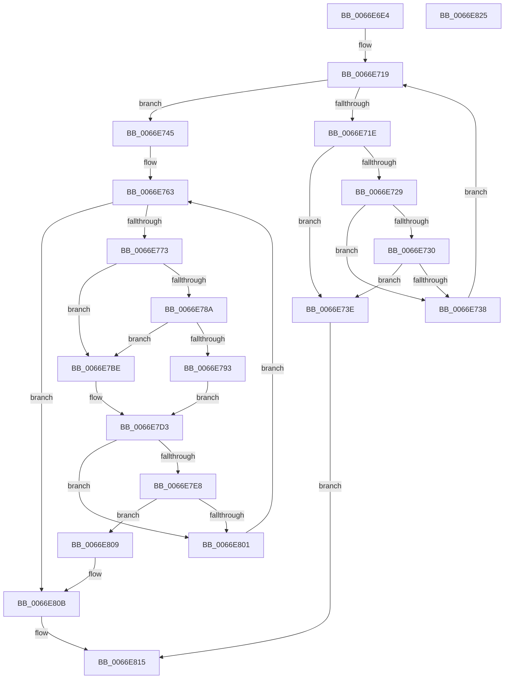

# MiDriverPdeOkToDelete

- RVA: `0x0066E6E4`–`0x0066E826` (길이 `322` bytes)
- VA: `0x000000014066E6E4`
- 실행 섹션: `.text`
- PDB 이름 있음: `예`; PDB Function 태그: `아니요`
- unwind 정보 RVA: `0x000927D0`
- 디코드: `77`개 명령, `322/322` bytes 표시
- 미해석 바이트: `0` (있으면 어셈블리에 `.byte`로 보존)

> 이 문서는 커널 이미지의 기계어와 PDB 기호를 분석해 생성했습니다. 4번과 5번은 함수 원형과 자료형을 바이너리 사용 방식에서 추정한 C 해석이며 원본 소스 복구 결과는 아닙니다.

## 1. Dependencies

- 직접 호출 지점: **2**; 고유 호출 대상: **2**
- 직접 호출자로 확인된 함수: **1**
- RIP 상대 이미지 참조: **6**

### Outgoing calls
- `0x0066E74A` → [MmLockLoadedModuleListShared](../2F/MmLockLoadedModuleListShared_function_002F21E4.md) (function, `0x002F21E4`)
- `0x0066E80E` → [MmUnlockLoadedModuleListShared](../2F/MmUnlockLoadedModuleListShared_function_002F2230.md) (function, `0x002F2230`)

### Direct callers
- [MiDeleteBootRange](MiDeleteBootRange_function_0066E450.md) at `0x0066E60E`

### Static image references
- `0x0066E74F` → RVA `0x00EF54C0` (`.data`; read)
- `0x0066E781` → RVA `0x00FC6B28` (`ALMOSTRO`; read)
- `0x0066E78A` → RVA `0x00FC6B98` (`ALMOSTRO`; read)
- `0x0066E793` → RVA `0x00E375AC` (`.data`; read)
- `0x0066E79A` → RVA `0x00E375B0` (`.data`; read)
- `0x0066E7A1` → RVA `0x00E2D838` (`.data`; read)

## 2. Other-region calls and transfers

- 다른 실행 섹션으로 향하는 call: **0**
- 별도 외부 분기/꼬리 이동을 확인하지 못했습니다.

## 3. Assembly (complete function range)

```asm
0066E6E4  48 89 5C 24 08                  mov qword ptr [rsp + 8], rbx
0066E6E9  48 89 6C 24 10                  mov qword ptr [rsp + 0x10], rbp
0066E6EE  57                              push rdi
0066E6EF  48 83 EC 20                     sub rsp, 0x20
0066E6F3  48 8B D1                        mov rdx, rcx
0066E6F6  48 8B F9                        mov rdi, rcx
0066E6F9  48 C1 E2 19                     shl rdx, 0x19
0066E6FD  48 B8 00 00 00 00 80 F6 FF FF   movabs rax, 0xfffff68000000000
0066E707  48 C1 E0 19                     shl rax, 0x19
0066E70B  48 2B D0                        sub rdx, rax
0066E70E  48 C1 FA 10                     sar rdx, 0x10
0066E712  4C 8D 82 00 10 00 00            lea r8, [rdx + 0x1000]
0066E719  49 3B D0                        cmp rdx, r8
0066E71C  73 27                           jae 0x14066e745
0066E71E  48 8B 02                        mov rax, qword ptr [rdx]
0066E721  48 A9 01 0C 00 00               test rax, 0xc01
0066E727  75 15                           jne 0x14066e73e
0066E729  25 E0 03 00 00                  and eax, 0x3e0
0066E72E  74 08                           je 0x14066e738
0066E730  48 3D 00 03 00 00               cmp rax, 0x300
0066E736  75 06                           jne 0x14066e73e
0066E738  48 83 C2 08                     add rdx, 8
0066E73C  EB DB                           jmp 0x14066e719
0066E73E  33 C0                           xor eax, eax
0066E740  E9 D0 00 00 00                  jmp 0x14066e815
0066E745  BB 01 00 00 00                  mov ebx, 1
0066E74A  E8 95 3A C8 FF                  call 0x1402f21e4
0066E74F  4C 8B 0D 6A 6D 88 00            mov r9, qword ptr [rip + 0x886d6a]
0066E756  44 8A D0                        mov r10b, al
0066E759  48 BD 00 00 00 40 FB F6 FF FF   movabs rbp, 0xfffff6fb40000000
0066E763  48 8D 05 56 6D 88 00            lea rax, [rip + 0x886d56]
0066E76A  4C 3B C8                        cmp r9, rax
0066E76D  0F 84 98 00 00 00               je 0x14066e80b
0066E773  45 8B 59 40                     mov r11d, dword ptr [r9 + 0x40]
0066E777  49 8B 51 30                     mov rdx, qword ptr [r9 + 0x30]
0066E77B  44 2B DB                        sub r11d, ebx
0066E77E  4C 03 DA                        add r11, rdx
0066E781  48 3B 15 A0 83 95 00            cmp rdx, qword ptr [rip + 0x9583a0]
0066E788  74 34                           je 0x14066e7be
0066E78A  48 3B 15 07 84 95 00            cmp rdx, qword ptr [rip + 0x958407]
0066E791  74 2B                           je 0x14066e7be
0066E793  44 8B 05 12 8E 7C 00            mov r8d, dword ptr [rip + 0x7c8e12]
0066E79A  44 03 05 0F 8E 7C 00            add r8d, dword ptr [rip + 0x7c8e0f]
0066E7A1  8B 05 91 F0 7B 00               mov eax, dword ptr [rip + 0x7bf091]
0066E7A7  49 81 C0 FF 0F 00 00            add r8, 0xfff
0066E7AE  49 81 E0 00 F0 FF FF            and r8, 0xfffffffffffff000
0066E7B5  48 C1 E0 0C                     shl rax, 0xc
0066E7B9  4C 03 C0                        add r8, rax
0066E7BC  EB 15                           jmp 0x14066e7d3
0066E7BE  44 8B 05 E7 8D 7C 00            mov r8d, dword ptr [rip + 0x7c8de7]
0066E7C5  49 81 C0 FF 0F 00 00            add r8, 0xfff
0066E7CC  49 81 E0 00 F0 FF FF            and r8, 0xfffffffffffff000
0066E7D3  48 C1 EA 12                     shr rdx, 0x12
0066E7D7  81 E2 F8 FF FF 3F               and edx, 0x3ffffff8
0066E7DD  48 8B C5                        mov rax, rbp
0066E7E0  48 03 D0                        add rdx, rax
0066E7E3  48 3B FA                        cmp rdi, rdx
0066E7E6  72 19                           jb 0x14066e801
0066E7E8  4B 8D 0C 03                     lea rcx, [r11 + r8]
0066E7EC  48 C1 E9 12                     shr rcx, 0x12
0066E7F0  81 E1 F8 FF FF 3F               and ecx, 0x3ffffff8
0066E7F6  48 8B C5                        mov rax, rbp
0066E7F9  48 03 C8                        add rcx, rax
0066E7FC  48 3B F9                        cmp rdi, rcx
0066E7FF  76 08                           jbe 0x14066e809
0066E801  4D 8B 09                        mov r9, qword ptr [r9]
0066E804  E9 5A FF FF FF                  jmp 0x14066e763
0066E809  33 DB                           xor ebx, ebx
0066E80B  41 8A CA                        mov cl, r10b
0066E80E  E8 1D 3A C8 FF                  call 0x1402f2230
0066E813  8B C3                           mov eax, ebx
0066E815  48 8B 5C 24 30                  mov rbx, qword ptr [rsp + 0x30]
0066E81A  48 8B 6C 24 38                  mov rbp, qword ptr [rsp + 0x38]
0066E81F  48 83 C4 20                     add rsp, 0x20
0066E823  5F                              pop rdi
0066E824  C3                              ret
0066E825  CC                              int3
```

## 4. C-style interpretation (structured pseudocode)

```c
__int64 __fastcall MiDriverPdeOkToDelete(__int64 a1)
{
    __int64 result;
    __int64 v_r11;
    __int64 v_rbx;
    __int64 v_rsp;
    unsigned __int64 v_stack_p10;
    unsigned __int64 v_stack_p8;

    v_stack_p8 = v_rbx;
    v_stack_p10 = v_rbp;
    v_rsp = (v_rsp) - (32);
    a2 = (a1) << (25);
    result = (result) << (25);
    a2 = (a2) - (result);
    a2 = (a2) >> (16);
loc_0066E719:
    if (a2 >= (a2 + 4096)) goto loc_0066E745;
    if (((*(unsigned __int64 *)(a2)) & (0xC01ULL)) != 0) goto loc_0066E73E;
    result = (unsigned int)((*(unsigned __int64 *)(a2)) & (992));
    if (condition_is_equal) goto loc_0066E738;
    if (result != 768) goto loc_0066E73E;
loc_0066E738:
    a2 = (a2) + (8);
    goto loc_0066E719;
loc_0066E73E:
    result = 0;
    goto loc_0066E815;
loc_0066E745:
    result = MmLockLoadedModuleListShared(a1, a2, a2 + 4096, a4);
loc_0066E763:
    if ((*(unsigned __int64 *)(v_rip + 8940906)) == (v_rip + 8940886)) goto loc_0066E80B;
    v_r11 = (unsigned int)(((unsigned int)(*(unsigned int *)(*(unsigned __int64 *)(v_rip + 8940906) + 64))) - (1));
    v_r11 = (v_r11) + (*(unsigned __int64 *)(*(unsigned __int64 *)(v_rip + 8940906) + 48));
    if ((*(unsigned __int64 *)(*(unsigned __int64 *)(v_rip + 8940906) + 48)) == (*(unsigned __int64 *)(v_rip + 9798560))) goto loc_0066E7BE;
    if ((*(unsigned __int64 *)(*(unsigned __int64 *)(v_rip + 8940906) + 48)) == (*(unsigned __int64 *)(v_rip + 9798663))) goto loc_0066E7BE;
    a3 = (unsigned int)(((unsigned int)(*(unsigned int *)(v_rip + 8162834))) + (*(unsigned int *)(v_rip + 8162831)));
    a3 = (a3) + (0xFFFULL);
    a3 = (a3) & (0xFFFFFFFFFFFFF000ULL);
    result = ((unsigned int)(*(unsigned int *)(v_rip + 8122513))) << (12);
    a3 = (a3) + (result);
    goto loc_0066E7D3;
loc_0066E7BE:
    a3 = ((unsigned int)(*(unsigned int *)(v_rip + 8162791))) + (0xFFFULL);
    a3 = (a3) & (0xFFFFFFFFFFFFF000ULL);
loc_0066E7D3:
    a2 = (*(unsigned __int64 *)(*(unsigned __int64 *)(v_rip + 8940906) + 48)) >> (18);
    a2 = (unsigned int)((a2) & (0x3FFFFFF8ULL));
    a2 = (a2) + (v_rbp);
    if (a1 < a2) goto loc_0066E801;
    a1 = (v_r11 + a3 * 1) >> (18);
    a1 = (unsigned int)((a1) & (0x3FFFFFF8ULL));
    a1 = (a1) + (v_rbp);
    if (a1 <= a1) goto loc_0066E809;
loc_0066E801:
    goto loc_0066E763;
loc_0066E809:
    v_rbx = 0;
loc_0066E80B:
    result = MmUnlockLoadedModuleListShared((unsigned __int8)((unsigned __int8)(result)), a2, a3, *(unsigned __int64 *)(*(unsigned __int64 *)(v_rip + 8940906)));
loc_0066E815:
    v_rsp = (v_rsp) + (32);
    return 0;
}
```

## 5. (Beta) C Style

```c
int64_t MiDriverPdeOkToDelete(int64_t Arg1)
{
    int64_t result;
    int64_t local_r11;
    int64_t local_rbx;
    int64_t local_rsp;
    uint64_t v_stack_p10;
    uint64_t v_stack_p8;

    v_stack_p8 = local_rbx;
    v_stack_p10 = local_rbp;
    local_rsp = (local_rsp) - (32);
    a2 = (Arg1) << (25);
    result = (result) << (25);
    a2 = (a2) - (result);
    a2 = (a2) >> (16);
loc_0066E719:
    if (a2 >= (a2 + 4096)) goto loc_0066E745;
    if (((*(uint64_t *)(a2)) & (0xC01ULL)) != 0) goto loc_0066E73E;
    result = (uint32_t)((*(uint64_t *)(a2)) & (992));
    if (condition_is_equal) goto loc_0066E738;
    if (result != 768) goto loc_0066E73E;
loc_0066E738:
    a2 = (a2) + (8);
    goto loc_0066E719;
loc_0066E73E:
    result = 0;
    goto loc_0066E815;
loc_0066E745:
    result = MmLockLoadedModuleListShared(Arg1, a2, a2 + 4096, a4);
loc_0066E763:
    if ((*(uint64_t *)(v_rip + 0x886D6A)) == (v_rip + 8940886)) goto loc_0066E80B;
    local_r11 = (uint32_t)(((uint32_t)(*(uint32_t *)(*(uint64_t *)(v_rip + 0x886D6A) + 0x40))) - (1));
    local_r11 = (local_r11) + (*(uint64_t *)(*(uint64_t *)(v_rip + 0x886D6A) + 0x30));
    if ((*(uint64_t *)(*(uint64_t *)(v_rip + 0x886D6A) + 0x30)) == (*(uint64_t *)(v_rip + 0x9583A0))) goto loc_0066E7BE;
    if ((*(uint64_t *)(*(uint64_t *)(v_rip + 0x886D6A) + 0x30)) == (*(uint64_t *)(v_rip + 0x958407))) goto loc_0066E7BE;
    a3 = (uint32_t)(((uint32_t)(*(uint32_t *)(v_rip + 0x7C8E12))) + (*(uint32_t *)(v_rip + 0x7C8E0F)));
    a3 = (a3) + (0xFFFULL);
    a3 = (a3) & (0xFFFFFFFFFFFFF000ULL);
    result = ((uint32_t)(*(uint32_t *)(v_rip + 0x7BF091))) << (12);
    a3 = (a3) + (result);
    goto loc_0066E7D3;
loc_0066E7BE:
    a3 = ((uint32_t)(*(uint32_t *)(v_rip + 0x7C8DE7))) + (0xFFFULL);
    a3 = (a3) & (0xFFFFFFFFFFFFF000ULL);
loc_0066E7D3:
    a2 = (*(uint64_t *)(*(uint64_t *)(v_rip + 0x886D6A) + 0x30)) >> (18);
    a2 = (uint32_t)((a2) & (0x3FFFFFF8ULL));
    a2 = (a2) + (local_rbp);
    if (Arg1 < a2) goto loc_0066E801;
    Arg1 = (local_r11 + a3 * 1) >> (18);
    Arg1 = (uint32_t)((Arg1) & (0x3FFFFFF8ULL));
    Arg1 = (Arg1) + (local_rbp);
    if (Arg1 <= Arg1) goto loc_0066E809;
loc_0066E801:
    goto loc_0066E763;
loc_0066E809:
    local_rbx = 0;
loc_0066E80B:
    result = MmUnlockLoadedModuleListShared((uint8_t)((uint8_t)(result)), a2, a3, *(uint64_t *)(*(uint64_t *)(v_rip + 0x886D6A)));
loc_0066E815:
    local_rsp = (local_rsp) + (32);
    return 0;
}
```

## 6. Execution-region graph

[열기: 2D/3D 그래프와 함수 탐색 컨트롤 패널](../../../control-panel.html?section=text&rva=0x0066E6E4&view=graph)

- 2D 그래프는 위에서 아래로 흐르고, 3D 그래프는 빈 공간을 드래그해 회전합니다. Shift+드래그는 이동, 휠은 확대·축소, 함수 노드 선택은 대상 보고서 이동입니다.

### Static fallback


