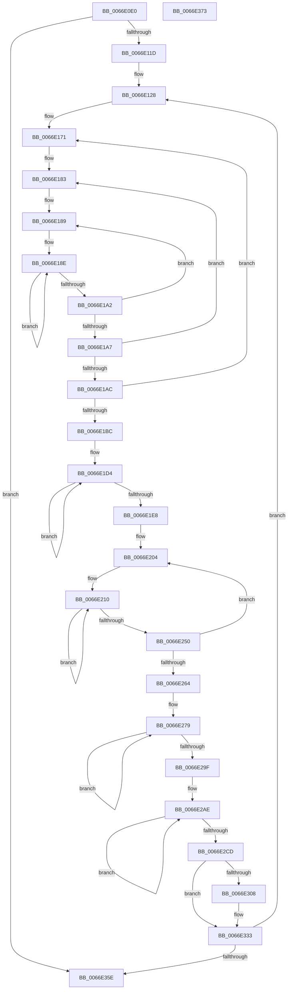

# MiInitializeNuma

- RVA: `0x0066E0E0`–`0x0066E374` (길이 `660` bytes)
- VA: `0x000000014066E0E0`
- 실행 섹션: `.text`
- PDB 이름 있음: `예`; PDB Function 태그: `아니요`
- unwind 정보 RVA: `0x000A9680`
- 디코드: `157`개 명령, `660/660` bytes 표시
- 미해석 바이트: `0` (있으면 어셈블리에 `.byte`로 보존)

> 이 문서는 커널 이미지의 기계어와 PDB 기호를 분석해 생성했습니다. 4번과 5번은 함수 원형과 자료형을 바이너리 사용 방식에서 추정한 C 해석이며 원본 소스 복구 결과는 아닙니다.

## 1. Dependencies

- 직접 호출 지점: **5**; 고유 호출 대상: **5**
- 직접 호출자로 확인된 함수: **1**
- RIP 상대 이미지 참조: **5**

### Outgoing calls
- `0x0066E150` → [MiInitializeChannelOrdering](../../page/80/MiInitializeChannelOrdering_function_00808018.md) (function, `0x00808018`)
- `0x0066E158` → [MiInitializeHugeIoRanges](../../page/7F/MiInitializeHugeIoRanges_function_007FC014.md) (function, `0x007FC014`)
- `0x0066E237` → [memset](../6C/memset_function_006C6C40.md) (function, `0x006C6C40`)
- `0x0066E27C` → [InitializeSListHead](../46/InitializeSListHead_function_00468A90.md) (function, `0x00468A90`)
- `0x0066E2B9` → [MiInitializeSlabAllocator](../68/MiInitializeSlabAllocator_function_0068E85C.md) (function, `0x0068E85C`)

### Direct callers
- [MiInitializePartition](../../page/7F/MiInitializePartition_function_007FD3E8.md) at `0x007FD882`

### Static image references
- `0x0066E100` → RVA `0x00FC5000` (`ALMOSTRO`; read)
- `0x0066E16A` → RVA `0x00E2DCC0` (`.data`; read)
- `0x0066E1BC` → RVA `0x00E2DCCC` (`.data`; read)
- `0x0066E2EA` → RVA `0x00E38D00` (`.data`; read)
- `0x0066E312` → RVA `0x00E38D10` (`.data`; read)

## 2. Other-region calls and transfers

- 다른 실행 섹션으로 향하는 call: **2**
  - `0x0066E150` → [MiInitializeChannelOrdering](../../page/80/MiInitializeChannelOrdering_function_00808018.md) (`.text` → `PAGE`)
  - `0x0066E158` → [MiInitializeHugeIoRanges](../../page/7F/MiInitializeHugeIoRanges_function_007FC014.md) (`.text` → `PAGE`)
- 별도 외부 분기/꼬리 이동을 확인하지 못했습니다.

## 3. Assembly (complete function range)

```asm
0066E0E0  48 89 5C 24 20                  mov qword ptr [rsp + 0x20], rbx
0066E0E5  48 89 4C 24 08                  mov qword ptr [rsp + 8], rcx
0066E0EA  55                              push rbp
0066E0EB  56                              push rsi
0066E0EC  57                              push rdi
0066E0ED  41 54                           push r12
0066E0EF  41 55                           push r13
0066E0F1  41 56                           push r14
0066E0F3  41 57                           push r15
0066E0F5  48 83 EC 20                     sub rsp, 0x20
0066E0F9  48 8B 71 10                     mov rsi, qword ptr [rcx + 0x10]
0066E0FD  45 33 FF                        xor r15d, r15d
0066E100  66 44 3B 3D F8 6E 95 00         cmp r15w, word ptr [rip + 0x956ef8]
0066E108  41 8B DF                        mov ebx, r15d
0066E10B  89 5C 24 68                     mov dword ptr [rsp + 0x68], ebx
0066E10F  4C 8B F1                        mov r14, rcx
0066E112  48 89 74 24 70                  mov qword ptr [rsp + 0x70], rsi
0066E117  0F 83 41 02 00 00               jae 0x14066e35e
0066E11D  48 8D BE CC DE 00 00            lea rdi, [rsi + 0xdecc]
0066E124  45 8D 67 01                     lea r12d, [r15 + 1]
0066E128  48 83 8F C4 5C FF FF FF         or qword ptr [rdi - 0xa33c], 0xffffffffffffffff
0066E130  8B D3                           mov edx, ebx
0066E132  49 8B CE                        mov rcx, r14
0066E135  4C 89 B7 BC 5B FF FF            mov qword ptr [rdi - 0xa444], r14
0066E13C  89 9F 5C 5C FF FF               mov dword ptr [rdi - 0xa3a4], ebx
0066E142  C6 87 74 35 FF FF 08            mov byte ptr [rdi - 0xca8c], 8
0066E149  C6 87 76 35 FF FF 08            mov byte ptr [rdi - 0xca8a], 8
0066E150  E8 C3 9E 19 00                  call 0x140808018
0066E155  48 8B CE                        mov rcx, rsi
0066E158  E8 B7 DE 18 00                  call 0x1407fc014
0066E15D  48 8D 97 B4 21 FF FF            lea rdx, [rdi - 0xde4c]
0066E164  41 BA 04 00 00 00               mov r10d, 4
0066E16A  4C 8D 1D 4F FB 7B 00            lea r11, [rip + 0x7bfb4f]
0066E171  41 8B 2B                        mov ebp, dword ptr [r11]
0066E174  4C 8D 8A 00 01 00 00            lea r9, [rdx + 0x100]
0066E17B  48 8B C2                        mov rax, rdx
0066E17E  BE 02 00 00 00                  mov esi, 2
0066E183  41 B8 04 00 00 00               mov r8d, 4
0066E189  B9 02 00 00 00                  mov ecx, 2
0066E18E  4C 89 48 08                     mov qword ptr [rax + 8], r9
0066E192  49 83 C1 20                     add r9, 0x20
0066E196  48 89 28                        mov qword ptr [rax], rbp
0066E199  48 83 C0 10                     add rax, 0x10
0066E19D  49 2B CC                        sub rcx, r12
0066E1A0  75 EC                           jne 0x14066e18e
0066E1A2  4D 2B C4                        sub r8, r12
0066E1A5  75 E2                           jne 0x14066e189
0066E1A7  49 2B F4                        sub rsi, r12
0066E1AA  75 D7                           jne 0x14066e183
0066E1AC  48 81 C2 00 05 00 00            add rdx, 0x500
0066E1B3  49 83 C3 04                     add r11, 4
0066E1B7  4D 2B D4                        sub r10, r12
0066E1BA  75 B5                           jne 0x14066e171
0066E1BC  44 8B 05 09 FB 7B 00            mov r8d, dword ptr [rip + 0x7bfb09]
0066E1C3  48 8D 8F 54 5B FF FF            lea rcx, [rdi - 0xa4ac]
0066E1CA  48 8D 87 34 5B FF FF            lea rax, [rdi - 0xa4cc]
0066E1D1  8D 56 02                        lea edx, [rsi + 2]
0066E1D4  48 89 48 08                     mov qword ptr [rax + 8], rcx
0066E1D8  48 83 C1 20                     add rcx, 0x20
0066E1DC  4C 89 00                        mov qword ptr [rax], r8
0066E1DF  48 8D 40 10                     lea rax, [rax + 0x10]
0066E1E3  49 2B D4                        sub rdx, r12
0066E1E6  75 EC                           jne 0x14066e1d4
0066E1E8  48 8D AF 8C 35 FF FF            lea rbp, [rdi - 0xca74]
0066E1EF  48 BB FF FF FF FF 3F 00 00 00   movabs rbx, 0x3fffffffff
0066E1F9  4C 8D B7 34 3B FF FF            lea r14, [rdi - 0xc4cc]
0066E200  44 8D 7A 08                     lea r15d, [rdx + 8]
0066E204  4D 8B E6                        mov r12, r14
0066E207  48 8B F5                        mov rsi, rbp
0066E20A  41 BD 02 00 00 00               mov r13d, 2
0066E210  48 83 66 F0 00                  and qword ptr [rsi - 0x10], 0
0066E215  41 B8 00 02 00 00               mov r8d, 0x200
0066E21B  C7 46 FC 02 00 00 00            mov dword ptr [rsi - 4], 2
0066E222  48 83 CA FF                     or rdx, 0xffffffffffffffff
0066E226  48 89 1E                        mov qword ptr [rsi], rbx
0066E229  49 8B CC                        mov rcx, r12
0066E22C  48 89 5E 08                     mov qword ptr [rsi + 8], rbx
0066E230  C7 46 10 00 00 00 00            mov dword ptr [rsi + 0x10], 0
0066E237  E8 04 8A 05 00                  call 0x1406c6c40
0066E23C  49 81 C4 00 10 00 00            add r12, 0x1000
0066E243  48 8D B6 C0 02 00 00            lea rsi, [rsi + 0x2c0]
0066E24A  49 83 ED 01                     sub r13, 1
0066E24E  75 C0                           jne 0x14066e210
0066E250  49 81 C6 00 02 00 00            add r14, 0x200
0066E257  45 8D 65 01                     lea r12d, [r13 + 1]
0066E25B  48 83 C5 58                     add rbp, 0x58
0066E25F  4D 2B FC                        sub r15, r12
0066E262  75 A0                           jne 0x14066e204
0066E264  8B 5C 24 68                     mov ebx, dword ptr [rsp + 0x68]
0066E268  4C 8D B7 2C 5D FF FF            lea r14, [rdi - 0xa2d4]
0066E26F  41 8B F7                        mov esi, r15d
0066E272  48 8D AF 04 5D FF FF            lea rbp, [rdi - 0xa2fc]
0066E279  48 8B CD                        mov rcx, rbp
0066E27C  E8 0F A8 DF FF                  call 0x140468a90
0066E281  8D 46 FF                        lea eax, [rsi - 1]
0066E284  44 3B E0                        cmp r12d, eax
0066E287  1B C0                           sbb eax, eax
0066E289  41 03 F4                        add esi, r12d
0066E28C  83 E0 05                        and eax, 5
0066E28F  48 83 C5 30                     add rbp, 0x30
0066E293  41 89 06                        mov dword ptr [r14], eax
0066E296  4D 8D 76 30                     lea r14, [r14 + 0x30]
0066E29A  83 FE 08                        cmp esi, 8
0066E29D  72 DA                           jb 0x14066e279
0066E29F  4C 8B 74 24 60                  mov r14, qword ptr [rsp + 0x60]
0066E2A4  48 8D AF 84 5E FF FF            lea rbp, [rdi - 0xa17c]
0066E2AB  41 8B F7                        mov esi, r15d
0066E2AE  4D 8B CE                        mov r9, r14
0066E2B1  44 8B C3                        mov r8d, ebx
0066E2B4  8B D6                           mov edx, esi
0066E2B6  48 8B CD                        mov rcx, rbp
0066E2B9  E8 9E 05 02 00                  call 0x14068e85c
0066E2BE  41 03 F4                        add esi, r12d
0066E2C1  48 81 C5 E8 00 00 00            add rbp, 0xe8
0066E2C8  83 FE 09                        cmp esi, 9
0066E2CB  72 E1                           jb 0x14066e2ae
0066E2CD  C7 47 CC 08 00 00 00            mov dword ptr [rdi - 0x34], 8
0066E2D4  48 8D 47 DC                     lea rax, [rdi - 0x24]
0066E2D8  48 89 47 D4                     mov qword ptr [rdi - 0x2c], rax
0066E2DC  48 BD FF FF FF FF 3F 00 00 00   movabs rbp, 0x3fffffffff
0066E2E6  4C 89 7F F4                     mov qword ptr [rdi - 0xc], r15
0066E2EA  48 8D 05 0F AA 7C 00            lea rax, [rip + 0x7caa0f]
0066E2F1  C7 07 05 00 00 00               mov dword ptr [rdi], 5
0066E2F7  48 89 6F 04                     mov qword ptr [rdi + 4], rbp
0066E2FB  48 89 6F 0C                     mov qword ptr [rdi + 0xc], rbp
0066E2FF  44 89 7F 14                     mov dword ptr [rdi + 0x14], r15d
0066E303  4C 3B F0                        cmp r14, rax
0066E306  74 2B                           je 0x14066e333
0066E308  44 8B 87 84 5C FF FF            mov r8d, dword ptr [rdi - 0xa37c]
0066E30F  41 8B D0                        mov edx, r8d
0066E312  48 8B 05 F7 A9 7C 00            mov rax, qword ptr [rip + 0x7ca9f7]
0066E319  48 69 CB 80 DF 00 00            imul rcx, rbx, 0xdf80
0066E320  33 94 01 50 3B 00 00            xor edx, dword ptr [rcx + rax + 0x3b50]
0066E327  83 E2 02                        and edx, 2
0066E32A  41 33 D0                        xor edx, r8d
0066E32D  89 97 84 5C FF FF               mov dword ptr [rdi - 0xa37c], edx
0066E333  48 8B 74 24 70                  mov rsi, qword ptr [rsp + 0x70]
0066E338  BD 80 DF 00 00                  mov ebp, 0xdf80
0066E33D  0F B7 05 BC 6C 95 00            movzx eax, word ptr [rip + 0x956cbc]
0066E344  48 03 F5                        add rsi, rbp
0066E347  41 03 DC                        add ebx, r12d
0066E34A  48 89 74 24 70                  mov qword ptr [rsp + 0x70], rsi
0066E34F  48 03 FD                        add rdi, rbp
0066E352  89 5C 24 68                     mov dword ptr [rsp + 0x68], ebx
0066E356  3B D8                           cmp ebx, eax
0066E358  0F 82 CA FD FF FF               jb 0x14066e128
0066E35E  48 8B 5C 24 78                  mov rbx, qword ptr [rsp + 0x78]
0066E363  48 83 C4 20                     add rsp, 0x20
0066E367  41 5F                           pop r15
0066E369  41 5E                           pop r14
0066E36B  41 5D                           pop r13
0066E36D  41 5C                           pop r12
0066E36F  5F                              pop rdi
0066E370  5E                              pop rsi
0066E371  5D                              pop rbp
0066E372  C3                              ret
0066E373  CC                              int3
```

## 4. C-style interpretation (structured pseudocode)

```c
__int64 __fastcall MiInitializeNuma(__int64 a1)
{
    __int64 result;
    __int64 v_r10;
    __int64 v_r11;
    __int64 v_r12;
    __int64 v_r13;
    __int64 v_r14;
    __int64 v_r15;
    __int64 v_rbp;
    __int64 v_rbx;
    __int64 v_rdi;
    __int64 v_rsi;
    __int64 v_rsp;
    unsigned int v_stack_p10;
    unsigned __int64 v_stack_p18;
    unsigned __int64 v_stack_p20;
    unsigned __int64 v_stack_p8;

    v_stack_p20 = v_rbx;
    v_stack_p8 = a1;
    v_rsp = (v_rsp) - (32);
    v_r15 = 0;
    v_stack_p10 = 0;
    v_stack_p18 = *(unsigned __int64 *)(a1 + 16);
    if (0 >= (*(unsigned __int16 *)(v_rip + 9793272))) goto loc_0066E35E;
loc_0066E128:
    *(unsigned __int64 *)(*(unsigned __int64 *)(a1 + 16) + 57036 - 42052) = a1;
    *(unsigned int *)(*(unsigned __int64 *)(a1 + 16) + 57036 - 41892) = 0;
    *(unsigned __int8 *)(*(unsigned __int64 *)(a1 + 16) + 57036 - 51852) = 8;
    *(unsigned __int8 *)(*(unsigned __int64 *)(a1 + 16) + 57036 - 51850) = 8;
    result = MiInitializeChannelOrdering(a1, 0, a3, a4);
    result = MiInitializeHugeIoRanges(*(unsigned __int64 *)(a1 + 16), 0, a3, a4);
loc_0066E171:
loc_0066E183:
loc_0066E189:
loc_0066E18E:
    *(unsigned __int64 *)(*(unsigned __int64 *)(a1 + 16) + 57036 - 56908 + 8) = *(unsigned __int64 *)(a1 + 16) + 57036 - 56908 + 256;
    a4 = (*(unsigned __int64 *)(a1 + 16) + 57036 - 56908 + 256) + (32);
    *(unsigned __int64 *)(*(unsigned __int64 *)(a1 + 16) + 57036 - 56908) = (unsigned int)(*(unsigned int *)(v_rip + 8125263));
    result = (*(unsigned __int64 *)(a1 + 16) + 57036 - 56908) + (16);
    a1 = (2) - (v_r15 + 1);
    if (condition_is_not_equal) goto loc_0066E18E;
    a3 = (4) - (v_r15 + 1);
    if (condition_is_not_equal) goto loc_0066E189;
    v_rsi = (2) - (v_r15 + 1);
    if (condition_is_not_equal) goto loc_0066E183;
    a2 = (*(unsigned __int64 *)(a1 + 16) + 57036 - 56908) + (0x500ULL);
    v_r11 = (v_rip + 8125263) + (4);
    v_r10 = (4) - (v_r15 + 1);
    if (condition_is_not_equal) goto loc_0066E171;
loc_0066E1D4:
    *(unsigned __int64 *)(*(unsigned __int64 *)(a1 + 16) + 57036 - 42188 + 8) = *(unsigned __int64 *)(a1 + 16) + 57036 - 42156;
    a1 = (*(unsigned __int64 *)(a1 + 16) + 57036 - 42156) + (32);
    *(unsigned __int64 *)(*(unsigned __int64 *)(a1 + 16) + 57036 - 42188) = (unsigned int)(*(unsigned int *)(v_rip + 8125193));
    a2 = (v_rsi + 2) - (v_r15 + 1);
    if (condition_is_not_equal) goto loc_0066E1D4;
loc_0066E204:
loc_0066E210:
    *(unsigned int *)(*(unsigned __int64 *)(a1 + 16) + 57036 - 51828 - 4) = 2;
    a2 = (a2) | (-1);
    *(unsigned __int64 *)(*(unsigned __int64 *)(a1 + 16) + 57036 - 51828) = 0;
    *(unsigned __int64 *)(*(unsigned __int64 *)(a1 + 16) + 57036 - 51828 + 8) = 0;
    *(unsigned int *)(*(unsigned __int64 *)(a1 + 16) + 57036 - 51828 + 16) = 0;
    result = memset(*(unsigned __int64 *)(a1 + 16) + 57036 - 50380, a2, 512, a4);
    v_r12 = (*(unsigned __int64 *)(a1 + 16) + 57036 - 50380) + (0x1000ULL);
    v_r13 = (2) - (1);
    if (condition_is_not_equal) goto loc_0066E210;
    v_r14 = (*(unsigned __int64 *)(a1 + 16) + 57036 - 50380) + (512);
    v_rbp = (*(unsigned __int64 *)(a1 + 16) + 57036 - 51828) + (88);
    v_r15 = (a2 + 8) - (v_r13 + 1);
    if (condition_is_not_equal) goto loc_0066E204;
loc_0066E279:
    result = InitializeSListHead(*(unsigned __int64 *)(a1 + 16) + 57036 - 41724, a2, 512, a4);
    v_rsi = (unsigned int)(((unsigned int)((unsigned int)(v_r15))) + ((unsigned int)(v_r13 + 1)));
    result = (unsigned int)(((unsigned int)((unsigned int)(v_r15)) - 1) & (5));
    v_rbp = (*(unsigned __int64 *)(a1 + 16) + 57036 - 41724) + (48);
    *(unsigned int *)(*(unsigned __int64 *)(a1 + 16) + 57036 - 41684) = (unsigned int)(result);
    if (((unsigned int)(v_rsi)) < 8) goto loc_0066E279;
loc_0066E2AE:
    result = MiInitializeSlabAllocator(*(unsigned __int64 *)(a1 + 16) + 57036 - 41340, (unsigned int)((unsigned int)((unsigned int)((unsigned int)(v_r15)))), (unsigned int)((unsigned int)((unsigned int)(v_stack_p10))), v_stack_p8);
    v_rsi = (unsigned int)(((unsigned int)((unsigned int)(v_r15))) + ((unsigned int)(v_r13 + 1)));
    v_rbp = (*(unsigned __int64 *)(a1 + 16) + 57036 - 41340) + (232);
    if (((unsigned int)(v_rsi)) < 9) goto loc_0066E2AE;
    *(unsigned int *)(*(unsigned __int64 *)(a1 + 16) + 57036 - 52) = 8;
    *(unsigned __int64 *)(*(unsigned __int64 *)(a1 + 16) + 57036 - 44) = *(unsigned __int64 *)(a1 + 16) + 57036 - 36;
    *(unsigned __int64 *)(*(unsigned __int64 *)(a1 + 16) + 57036 - 12) = v_r15;
    *(unsigned int *)(*(unsigned __int64 *)(a1 + 16) + 57036) = 5;
    *(unsigned __int64 *)(*(unsigned __int64 *)(a1 + 16) + 57036 + 4) = v_rbp;
    *(unsigned __int64 *)(*(unsigned __int64 *)(a1 + 16) + 57036 + 12) = v_rbp;
    *(unsigned int *)(*(unsigned __int64 *)(a1 + 16) + 57036 + 20) = (unsigned int)(v_r15);
    result = v_rip + 8169999;
    if (v_stack_p8 != (v_rip + 8169999)) {
        a3 = *(unsigned int *)(*(unsigned __int64 *)(a1 + 16) + 57036 - 41852);
        a2 = (unsigned int)(a3);
        result = *(unsigned __int64 *)(v_rip + 8169975);
        a1 = (*(unsigned __int64 *)(a1 + 16) + 57036 - 41340) * ((unsigned int)(v_stack_p10));
        a2 = (unsigned int)((a2) ^ (*(unsigned int *)(a1 + result * 1 + 15184)));
        a2 = (unsigned int)((a2) & (2));
        a2 = (unsigned int)((a2) ^ ((unsigned int)(a3)));
        *(unsigned int *)(*(unsigned __int64 *)(a1 + 16) + 57036 - 41852) = (unsigned int)(a2);
    }
    v_rsi = (v_stack_p18) + ((unsigned int)(0xDF80ULL));
    v_rbx = (unsigned int)(((unsigned int)(v_stack_p10)) + ((unsigned int)(v_r13 + 1)));
    v_stack_p18 = v_rsi;
    v_rdi = (*(unsigned __int64 *)(a1 + 16) + 57036) + ((unsigned int)(0xDF80ULL));
    v_stack_p10 = (unsigned int)(v_rbx);
    if (((unsigned int)(v_rbx)) < ((unsigned int)(*(unsigned __int16 *)(v_rip + 9792700)))) goto loc_0066E128;
loc_0066E35E:
    v_rsp = (v_rsp) + (32);
    return *(unsigned __int16 *)(v_rip + 9792700);
}
```

## 5. (Beta) C Style

```c
int64_t MiInitializeNuma(void *Arg1)
{
    uint8_t *arg1 = (uint8_t *)Arg1;

    int64_t result;
    int64_t local_r10;
    int64_t local_r11;
    int64_t local_r12;
    int64_t local_r13;
    int64_t local_r14;
    int64_t local_r15;
    int64_t local_rbp;
    int64_t local_rbx;
    int64_t local_rdi;
    int64_t local_rsi;
    int64_t local_rsp;
    uint32_t v_stack_p10;
    uint64_t v_stack_p18;
    uint64_t v_stack_p20;
    uint64_t v_stack_p8;

    v_stack_p20 = local_rbx;
    v_stack_p8 = Arg1;
    local_rsp = (local_rsp) - (32);
    local_r15 = 0;
    v_stack_p10 = 0;
    v_stack_p18 = *(uint64_t *)(arg1 + 0x10);
    if (0 >= (*(uint16_t *)(v_rip + 0x956EF8))) goto loc_0066E35E;
loc_0066E128:
    *(void **)(*(uint64_t *)(arg1 + 0x10) + 0xDECC - 0xA444) = Arg1;
    *(uint32_t *)(*(uint64_t *)(arg1 + 0x10) + 0xDECC - 0xA3A4) = 0;
    *(uint8_t *)(*(uint64_t *)(arg1 + 0x10) + 0xDECC - 0xCA8C) = 8;
    *(uint8_t *)(*(uint64_t *)(arg1 + 0x10) + 0xDECC - 0xCA8A) = 8;
    result = MiInitializeChannelOrdering(Arg1, 0, a3, a4);
    result = MiInitializeHugeIoRanges(*(uint64_t *)(arg1 + 0x10), 0, a3, a4);
loc_0066E171:
loc_0066E183:
loc_0066E189:
loc_0066E18E:
    *(uint64_t *)(*(uint64_t *)(arg1 + 0x10) + 0xDECC - 0xDE4C + 0x8) = *(uint64_t *)(arg1 + 0x10) + 57036 - 56908 + 256;
    a4 = (*(uint64_t *)(arg1 + 0x10) + 57036 - 56908 + 256) + (32);
    *(uint64_t *)(*(uint64_t *)(arg1 + 0x10) + 0xDECC - 0xDE4C) = (uint32_t)(*(uint32_t *)(v_rip + 0x7BFB4F));
    result = (*(uint64_t *)(arg1 + 0x10) + 57036 - 56908) + (16);
    Arg1 = (2) - (local_r15 + 1);
    if (condition_is_not_equal) goto loc_0066E18E;
    a3 = (4) - (local_r15 + 1);
    if (condition_is_not_equal) goto loc_0066E189;
    local_rsi = (2) - (local_r15 + 1);
    if (condition_is_not_equal) goto loc_0066E183;
    a2 = (*(uint64_t *)(arg1 + 0x10) + 57036 - 56908) + (0x500ULL);
    local_r11 = (v_rip + 8125263) + (4);
    local_r10 = (4) - (local_r15 + 1);
    if (condition_is_not_equal) goto loc_0066E171;
loc_0066E1D4:
    *(uint64_t *)(*(uint64_t *)(arg1 + 0x10) + 0xDECC - 0xA4CC + 0x8) = *(uint64_t *)(arg1 + 0x10) + 57036 - 42156;
    Arg1 = (*(uint64_t *)(arg1 + 0x10) + 57036 - 42156) + (32);
    *(uint64_t *)(*(uint64_t *)(arg1 + 0x10) + 0xDECC - 0xA4CC) = (uint32_t)(*(uint32_t *)(v_rip + 0x7BFB09));
    a2 = (local_rsi + 2) - (local_r15 + 1);
    if (condition_is_not_equal) goto loc_0066E1D4;
loc_0066E204:
loc_0066E210:
    *(uint32_t *)(*(uint64_t *)(arg1 + 0x10) + 0xDECC - 0xCA74 - 0x4) = 2;
    a2 = (a2) | (-1);
    *(uint64_t *)(*(uint64_t *)(arg1 + 0x10) + 0xDECC - 0xCA74) = 0;
    *(uint64_t *)(*(uint64_t *)(arg1 + 0x10) + 0xDECC - 0xCA74 + 0x8) = 0;
    *(uint32_t *)(*(uint64_t *)(arg1 + 0x10) + 0xDECC - 0xCA74 + 0x10) = 0;
    result = memset(*(uint64_t *)(arg1 + 0x10) + 57036 - 50380, a2, 512, a4);
    local_r12 = (*(uint64_t *)(arg1 + 0x10) + 57036 - 50380) + (0x1000ULL);
    local_r13 = (2) - (1);
    if (condition_is_not_equal) goto loc_0066E210;
    local_r14 = (*(uint64_t *)(arg1 + 0x10) + 57036 - 50380) + (512);
    local_rbp = (*(uint64_t *)(arg1 + 0x10) + 57036 - 51828) + (88);
    local_r15 = (a2 + 8) - (local_r13 + 1);
    if (condition_is_not_equal) goto loc_0066E204;
loc_0066E279:
    result = InitializeSListHead(*(uint64_t *)(arg1 + 0x10) + 57036 - 41724, a2, 512, a4);
    local_rsi = (uint32_t)(((uint32_t)((uint32_t)(local_r15))) + ((uint32_t)(local_r13 + 1)));
    result = (uint32_t)(((uint32_t)((uint32_t)(local_r15)) - 1) & (5));
    local_rbp = (*(uint64_t *)(arg1 + 0x10) + 57036 - 41724) + (48);
    *(uint32_t *)(*(uint64_t *)(arg1 + 0x10) + 0xDECC - 0xA2D4) = (uint32_t)(result);
    if (((uint32_t)(local_rsi)) < 8) goto loc_0066E279;
loc_0066E2AE:
    result = MiInitializeSlabAllocator(*(uint64_t *)(arg1 + 0x10) + 57036 - 41340, (uint32_t)((uint32_t)((uint32_t)((uint32_t)(local_r15)))), (uint32_t)((uint32_t)((uint32_t)(v_stack_p10))), v_stack_p8);
    local_rsi = (uint32_t)(((uint32_t)((uint32_t)(local_r15))) + ((uint32_t)(local_r13 + 1)));
    local_rbp = (*(uint64_t *)(arg1 + 0x10) + 57036 - 41340) + (232);
    if (((uint32_t)(local_rsi)) < 9) goto loc_0066E2AE;
    *(uint32_t *)(*(uint64_t *)(arg1 + 0x10) + 0xDECC - 0x34) = 8;
    *(uint64_t *)(*(uint64_t *)(arg1 + 0x10) + 0xDECC - 0x2C) = *(uint64_t *)(arg1 + 0x10) + 57036 - 36;
    *(uint64_t *)(*(uint64_t *)(arg1 + 0x10) + 0xDECC - 0xC) = local_r15;
    *(uint32_t *)(*(uint64_t *)(arg1 + 0x10) + 0xDECC) = 5;
    *(uint64_t *)(*(uint64_t *)(arg1 + 0x10) + 0xDECC + 0x4) = local_rbp;
    *(uint64_t *)(*(uint64_t *)(arg1 + 0x10) + 0xDECC + 0xC) = local_rbp;
    *(uint32_t *)(*(uint64_t *)(arg1 + 0x10) + 0xDECC + 0x14) = (uint32_t)(local_r15);
    result = v_rip + 8169999;
    if (v_stack_p8 != (v_rip + 8169999)) {
        a3 = *(uint32_t *)(*(uint64_t *)(arg1 + 0x10) + 0xDECC - 0xA37C);
        a2 = (uint32_t)(a3);
        result = *(uint64_t *)(v_rip + 0x7CA9F7);
        Arg1 = (*(uint64_t *)(arg1 + 0x10) + 57036 - 41340) * ((uint32_t)(v_stack_p10));
        a2 = (uint32_t)((a2) ^ (*(uint32_t *)(arg1 + result * 1 + 0x3B50)));
        a2 = (uint32_t)((a2) & (2));
        a2 = (uint32_t)((a2) ^ ((uint32_t)(a3)));
        *(uint32_t *)(*(uint64_t *)(arg1 + 0x10) + 0xDECC - 0xA37C) = (uint32_t)(a2);
    }
    local_rsi = (v_stack_p18) + ((uint32_t)(0xDF80ULL));
    local_rbx = (uint32_t)(((uint32_t)(v_stack_p10)) + ((uint32_t)(local_r13 + 1)));
    v_stack_p18 = local_rsi;
    local_rdi = (*(uint64_t *)(arg1 + 0x10) + 57036) + ((uint32_t)(0xDF80ULL));
    v_stack_p10 = (uint32_t)(local_rbx);
    if (((uint32_t)(local_rbx)) < ((uint32_t)(*(uint16_t *)(v_rip + 0x956CBC)))) goto loc_0066E128;
loc_0066E35E:
    local_rsp = (local_rsp) + (32);
    return *(uint16_t *)(v_rip + 0x956CBC);
}
```

### 관측된 메모리 오프셋

구조체 형식이 확인되지 않은 접근은 인자 기준의 오프셋으로만 기록했습니다.

| 기준 인자 | 오프셋 표현 | 폭 (bit) | 접근 |
|---|---:|---:|---|
| `Arg1` | `+ 0x10` | `64` | `R` |

## 6. Execution-region graph

[열기: 2D/3D 그래프와 함수 탐색 컨트롤 패널](../../../control-panel.html?section=text&rva=0x0066E0E0&view=graph)

- 2D 그래프는 위에서 아래로 흐르고, 3D 그래프는 빈 공간을 드래그해 회전합니다. Shift+드래그는 이동, 휠은 확대·축소, 함수 노드 선택은 대상 보고서 이동입니다.

### Static fallback


