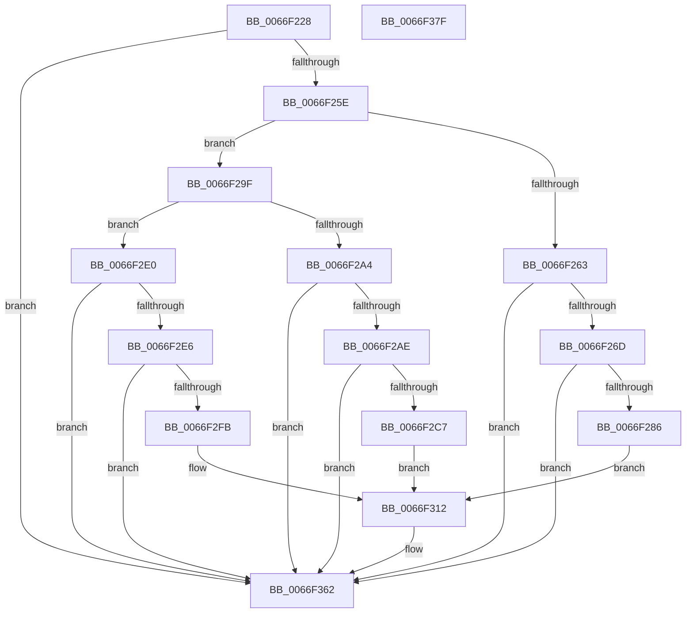

# MiLogOutswappedProcessCommitReacquire

- RVA: `0x0066F228`–`0x0066F380` (길이 `344` bytes)
- VA: `0x000000014066F228`
- 실행 섹션: `.text`
- PDB 이름 있음: `예`; PDB Function 태그: `아니요`
- unwind 정보 RVA: `0x000C9230`
- 디코드: `79`개 명령, `344/344` bytes 표시
- 미해석 바이트: `0` (있으면 어셈블리에 `.byte`로 보존)

> 이 문서는 커널 이미지의 기계어와 PDB 기호를 분석해 생성했습니다. 4번과 5번은 함수 원형과 자료형을 바이너리 사용 방식에서 추정한 C 해석이며 원본 소스 복구 결과는 아닙니다.

## 1. Dependencies

- 직접 호출 지점: **8**; 고유 호출 대상: **4**
- 직접 호출자로 확인된 함수: **1**
- RIP 상대 이미지 참조: **5**

### Outgoing calls
- `0x0066F279` → [tlgKeywordOn](../42/tlgKeywordOn_function_0042EAA0.md) (function, `0x0042EAA0`)
- `0x0066F291` → [tlgCreate1Sz_char](../42/tlgCreate1Sz_char_function_00427304.md) (function, `0x00427304`)
- `0x0066F2BA` → [tlgKeywordOn](../42/tlgKeywordOn_function_0042EAA0.md) (function, `0x0042EAA0`)
- `0x0066F2D2` → [tlgCreate1Sz_char](../42/tlgCreate1Sz_char_function_00427304.md) (function, `0x00427304`)
- `0x0066F2F2` → [tlgKeywordOn](../42/tlgKeywordOn_function_0042EAA0.md) (function, `0x0042EAA0`)
- `0x0066F306` → [tlgCreate1Sz_char](../42/tlgCreate1Sz_char_function_00427304.md) (function, `0x00427304`)
- `0x0066F35D` → [tlgWriteEx_EtwWriteEx](../4A/tlgWriteEx_EtwWriteEx_function_004AA348.md) (function, `0x004AA348`)
- `0x0066F369` → [_security_check_cookie](../6A/_security_check_cookie_function_006AC640.md) (function, `0x006AC640`)

### Direct callers
- [MiReAcquireOutSwappedProcessCommit](MiReAcquireOutSwappedProcessCommit_function_0066F598.md) at `0x0066F651`
- [MiReAcquireOutSwappedProcessCommit](MiReAcquireOutSwappedProcessCommit_function_0066F598.md) at `0x0066F66C`

### Static image references
- `0x0066F23A` → RVA `0x00E0A740` (`.data`; read)
- `0x0066F248` → RVA `0x00E37618` (`.data`; read)
- `0x0066F296` → RVA `0x00057B72` (`.rdata`; read)
- `0x0066F2D7` → RVA `0x00057B1E` (`.rdata`; read)
- `0x0066F30B` → RVA `0x00057ACA` (`.rdata`; read)

## 2. Other-region calls and transfers

- 다른 실행 섹션으로 향하는 call: **0**
- 별도 외부 분기/꼬리 이동을 확인하지 못했습니다.

## 3. Assembly (complete function range)

```asm
0066F228  48 89 5C 24 10                  mov qword ptr [rsp + 0x10], rbx
0066F22D  55                              push rbp
0066F22E  48 8D 6C 24 A9                  lea rbp, [rsp - 0x57]
0066F233  48 81 EC B0 00 00 00            sub rsp, 0xb0
0066F23A  48 8B 05 FF B4 79 00            mov rax, qword ptr [rip + 0x79b4ff]
0066F241  48 33 C4                        xor rax, rsp
0066F244  48 89 45 47                     mov qword ptr [rbp + 0x47], rax
0066F248  4C 8B 15 C9 83 7C 00            mov r10, qword ptr [rip + 0x7c83c9]
0066F24F  48 8B DA                        mov rbx, rdx
0066F252  4C 8B D9                        mov r11, rcx
0066F255  4D 85 D2                        test r10, r10
0066F258  0F 84 04 01 00 00               je 0x14066f362
0066F25E  45 85 C0                        test r8d, r8d
0066F261  75 3C                           jne 0x14066f29f
0066F263  41 83 3A 05                     cmp dword ptr [r10], 5
0066F267  0F 86 F5 00 00 00               jbe 0x14066f362
0066F26D  41 B8 04 00 00 00               mov r8d, 4
0066F273  49 8B CA                        mov rcx, r10
0066F276  41 8B D0                        mov edx, r8d
0066F279  E8 22 F8 DB FF                  call 0x14042eaa0
0066F27E  84 C0                           test al, al
0066F280  0F 84 DC 00 00 00               je 0x14066f362
0066F286  49 8D 93 38 03 00 00            lea rdx, [r11 + 0x338]
0066F28D  48 8D 4D 17                     lea rcx, [rbp + 0x17]
0066F291  E8 6E 80 DB FF                  call 0x140427304
0066F296  48 8D 15 D5 88 9E FF            lea rdx, [rip - 0x61772b]
0066F29D  EB 73                           jmp 0x14066f312
0066F29F  45 85 C9                        test r9d, r9d
0066F2A2  74 3C                           je 0x14066f2e0
0066F2A4  41 83 3A 05                     cmp dword ptr [r10], 5
0066F2A8  0F 86 B4 00 00 00               jbe 0x14066f362
0066F2AE  41 B8 04 00 00 00               mov r8d, 4
0066F2B4  49 8B CA                        mov rcx, r10
0066F2B7  41 8B D0                        mov edx, r8d
0066F2BA  E8 E1 F7 DB FF                  call 0x14042eaa0
0066F2BF  84 C0                           test al, al
0066F2C1  0F 84 9B 00 00 00               je 0x14066f362
0066F2C7  49 8D 93 38 03 00 00            lea rdx, [r11 + 0x338]
0066F2CE  48 8D 4D 17                     lea rcx, [rbp + 0x17]
0066F2D2  E8 2D 80 DB FF                  call 0x140427304
0066F2D7  48 8D 15 40 88 9E FF            lea rdx, [rip - 0x6177c0]
0066F2DE  EB 32                           jmp 0x14066f312
0066F2E0  41 83 3A 05                     cmp dword ptr [r10], 5
0066F2E4  76 7C                           jbe 0x14066f362
0066F2E6  41 B8 04 00 00 00               mov r8d, 4
0066F2EC  49 8B CA                        mov rcx, r10
0066F2EF  41 8B D0                        mov edx, r8d
0066F2F2  E8 A9 F7 DB FF                  call 0x14042eaa0
0066F2F7  84 C0                           test al, al
0066F2F9  74 67                           je 0x14066f362
0066F2FB  49 8D 93 38 03 00 00            lea rdx, [r11 + 0x338]
0066F302  48 8D 4D 17                     lea rcx, [rbp + 0x17]
0066F306  E8 F9 7F DB FF                  call 0x140427304
0066F30B  48 8D 15 B8 87 9E FF            lea rdx, [rip - 0x617848]
0066F312  41 8B 8B D0 01 00 00            mov ecx, dword ptr [r11 + 0x1d0]
0066F319  48 8D 45 E7                     lea rax, [rbp - 0x19]
0066F31D  83 65 33 00                     and dword ptr [rbp + 0x33], 0
0066F321  41 B9 01 00 00 00               mov r9d, 1
0066F327  83 65 43 00                     and dword ptr [rbp + 0x43], 0
0066F32B  48 89 45 27                     mov qword ptr [rbp + 0x27], rax
0066F32F  48 8D 45 EF                     lea rax, [rbp - 0x11]
0066F333  48 89 45 37                     mov qword ptr [rbp + 0x37], rax
0066F337  48 8D 45 F7                     lea rax, [rbp - 9]
0066F33B  89 4D E7                        mov dword ptr [rbp - 0x19], ecx
0066F33E  49 8B CA                        mov rcx, r10
0066F341  48 89 44 24 38                  mov qword ptr [rsp + 0x38], rax
0066F346  C7 44 24 30 05 00 00 00         mov dword ptr [rsp + 0x30], 5
0066F34E  44 89 45 2F                     mov dword ptr [rbp + 0x2f], r8d
0066F352  48 89 5D EF                     mov qword ptr [rbp - 0x11], rbx
0066F356  C7 45 3F 08 00 00 00            mov dword ptr [rbp + 0x3f], 8
0066F35D  E8 E6 AF E3 FF                  call 0x1404aa348
0066F362  48 8B 4D 47                     mov rcx, qword ptr [rbp + 0x47]
0066F366  48 33 CC                        xor rcx, rsp
0066F369  E8 D2 D2 03 00                  call 0x1406ac640
0066F36E  48 8B 9C 24 C8 00 00 00         mov rbx, qword ptr [rsp + 0xc8]
0066F376  48 81 C4 B0 00 00 00            add rsp, 0xb0
0066F37D  5D                              pop rbp
0066F37E  C3                              ret
0066F37F  CC                              int3
```

## 4. C-style interpretation (structured pseudocode)

```c
__int64 __fastcall MiLogOutswappedProcessCommitReacquire(__int64 a1, __int64 a2, int a3, int a4)
{
    __int64 result;
    __int64 v_rsp;
    unsigned __int64 v_stack_m18;
    unsigned int v_stack_m1C;
    unsigned int v_stack_m20;
    unsigned __int64 v_stack_m28;
    unsigned int v_stack_m2C;
    unsigned int v_stack_m30;
    unsigned __int64 v_stack_m38;
    unsigned __int64 v_stack_m48;
    unsigned __int64 v_stack_m5F;
    unsigned __int64 v_stack_m68;
    unsigned __int64 v_stack_m70;
    unsigned __int64 v_stack_m78;
    unsigned __int64 v_stack_m80;
    unsigned int v_stack_m88;
    unsigned __int64 v_stack_p10;

    v_stack_p10 = v_rbx;
    v_rsp = (v_rsp) - (176);
    result = (*(unsigned __int64 *)(v_rip + 7976191)) ^ (v_rsp);
    v_stack_m18 = result;
    if (*(unsigned __int64 *)(v_rip + 8160201) == 0) goto loc_0066F362;
    if (a3 != 0) goto loc_0066F29F;
    if ((*(unsigned int *)(*(unsigned __int64 *)(v_rip + 8160201))) <= 5) goto loc_0066F362;
    result = tlgKeywordOn(*(unsigned __int64 *)(v_rip + 8160201), 4, 4, a4);
    if ((unsigned __int8)(result) == 0) goto loc_0066F362;
    result = tlgCreate1Sz_char(v_stack_m48, a1 + 824, 4, a4);
    goto loc_0066F312;
loc_0066F29F:
    if (a4 == 0) goto loc_0066F2E0;
    if ((*(unsigned int *)(*(unsigned __int64 *)(v_rip + 8160201))) <= 5) goto loc_0066F362;
    result = tlgKeywordOn(*(unsigned __int64 *)(v_rip + 8160201), 4, 4, a4);
    if ((unsigned __int8)(result) == 0) goto loc_0066F362;
    result = tlgCreate1Sz_char(v_stack_m48, a1 + 824, 4, a4);
    goto loc_0066F312;
loc_0066F2E0:
    if ((*(unsigned int *)(*(unsigned __int64 *)(v_rip + 8160201))) <= 5) goto loc_0066F362;
    result = tlgKeywordOn(*(unsigned __int64 *)(v_rip + 8160201), 4, 4, a4);
    if ((unsigned __int8)(result) == 0) goto loc_0066F362;
    result = tlgCreate1Sz_char(v_stack_m48, a1 + 824, 4, a4);
loc_0066F312:
    v_stack_m38 = v_stack_m78;
    v_stack_m28 = v_stack_m70;
    v_stack_m78 = (unsigned int)((unsigned int)(*(unsigned int *)(a1 + 464)));
    v_stack_m80 = v_stack_m68;
    v_stack_m88 = 5;
    v_stack_m30 = 4;
    v_stack_m70 = a2;
    v_stack_m20 = 8;
    result = tlgWriteEx_EtwWriteEx(*(unsigned __int64 *)(v_rip + 8160201), v_rip - 6387784, 4, 1);
loc_0066F362:
    a1 = (v_stack_m18) ^ (v_rsp);
    result = _security_check_cookie(a1, v_rip - 6387784, 4, 1);
    v_rsp = (v_rsp) + (176);
    return result;
}
```

## 5. (Beta) C Style

```c
int64_t MiLogOutswappedProcessCommitReacquire(int64_t Arg1, int64_t Arg2, int32_t Arg3, int32_t Arg4)
{
    int64_t result;
    int64_t local_rsp;
    uint64_t v_stack_m18;
    uint32_t v_stack_m1C;
    uint32_t v_stack_m20;
    uint64_t v_stack_m28;
    uint32_t v_stack_m2C;
    uint32_t v_stack_m30;
    uint64_t v_stack_m38;
    uint64_t v_stack_m48;
    uint64_t v_stack_m5F;
    uint64_t v_stack_m68;
    uint64_t v_stack_m70;
    uint64_t v_stack_m78;
    uint64_t v_stack_m80;
    uint32_t v_stack_m88;
    uint64_t v_stack_p10;

    v_stack_p10 = local_rbx;
    local_rsp = (local_rsp) - (176);
    result = (*(uint64_t *)(v_rip + 0x79B4FF)) ^ (local_rsp);
    v_stack_m18 = result;
    if (*(uint64_t *)(v_rip + 0x7C83C9) == 0) goto loc_0066F362;
    if (Arg3 != 0) goto loc_0066F29F;
    if ((*(uint32_t *)(*(uint64_t *)(v_rip + 0x7C83C9))) <= 5) goto loc_0066F362;
    result = tlgKeywordOn(*(uint64_t *)(v_rip + 0x7C83C9), 4, 4, Arg4);
    if ((uint8_t)(result) == 0) goto loc_0066F362;
    result = tlgCreate1Sz_char(v_stack_m48, Arg1 + 824, 4, Arg4);
    goto loc_0066F312;
loc_0066F29F:
    if (Arg4 == 0) goto loc_0066F2E0;
    if ((*(uint32_t *)(*(uint64_t *)(v_rip + 0x7C83C9))) <= 5) goto loc_0066F362;
    result = tlgKeywordOn(*(uint64_t *)(v_rip + 0x7C83C9), 4, 4, Arg4);
    if ((uint8_t)(result) == 0) goto loc_0066F362;
    result = tlgCreate1Sz_char(v_stack_m48, Arg1 + 824, 4, Arg4);
    goto loc_0066F312;
loc_0066F2E0:
    if ((*(uint32_t *)(*(uint64_t *)(v_rip + 0x7C83C9))) <= 5) goto loc_0066F362;
    result = tlgKeywordOn(*(uint64_t *)(v_rip + 0x7C83C9), 4, 4, Arg4);
    if ((uint8_t)(result) == 0) goto loc_0066F362;
    result = tlgCreate1Sz_char(v_stack_m48, Arg1 + 824, 4, Arg4);
loc_0066F312:
    v_stack_m38 = v_stack_m78;
    v_stack_m28 = v_stack_m70;
    v_stack_m78 = (uint32_t)((uint32_t)(*(uint32_t *)(Arg1 + 0x1D0)));
    v_stack_m80 = v_stack_m68;
    v_stack_m88 = 5;
    v_stack_m30 = 4;
    v_stack_m70 = Arg2;
    v_stack_m20 = 8;
    result = tlgWriteEx_EtwWriteEx(*(uint64_t *)(v_rip + 0x7C83C9), v_rip - 6387784, 4, 1);
loc_0066F362:
    Arg1 = (v_stack_m18) ^ (local_rsp);
    result = _security_check_cookie(Arg1, v_rip - 6387784, 4, 1);
    local_rsp = (local_rsp) + (176);
    return result;
}
```

## 6. Execution-region graph

[열기: 2D/3D 그래프와 함수 탐색 컨트롤 패널](../../../control-panel.html?section=text&rva=0x0066F228&view=graph)

- 2D 그래프는 위에서 아래로 흐르고, 3D 그래프는 빈 공간을 드래그해 회전합니다. Shift+드래그는 이동, 휠은 확대·축소, 함수 노드 선택은 대상 보고서 이동입니다.

### Static fallback


