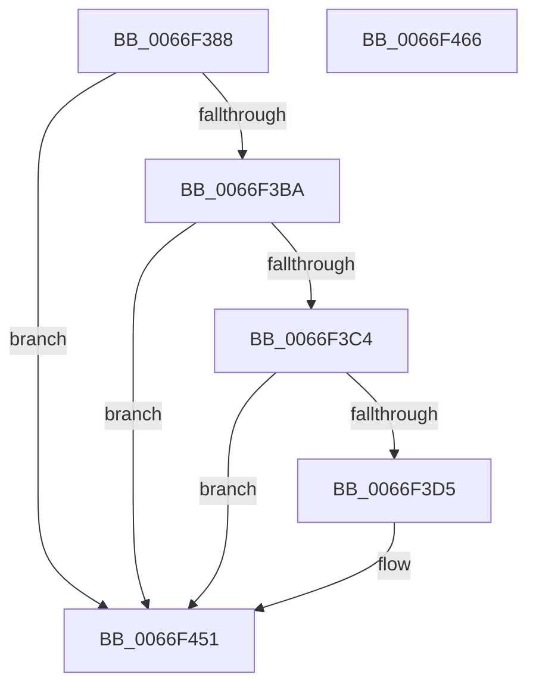

# MiLogOutswappedProcessCommitRelease

- RVA: `0x0066F388`–`0x0066F467` (길이 `223` bytes)
- VA: `0x000000014066F388`
- 실행 섹션: `.text`
- PDB 이름 있음: `예`; PDB Function 태그: `아니요`
- unwind 정보 RVA: `0x000BAEE4`
- 디코드: `52`개 명령, `223/223` bytes 표시
- 미해석 바이트: `0` (있으면 어셈블리에 `.byte`로 보존)

> 이 문서는 커널 이미지의 기계어와 PDB 기호를 분석해 생성했습니다. 4번과 5번은 함수 원형과 자료형을 바이너리 사용 방식에서 추정한 C 해석이며 원본 소스 복구 결과는 아닙니다.

## 1. Dependencies

- 직접 호출 지점: **4**; 고유 호출 대상: **4**
- 직접 호출자로 확인된 함수: **1**
- RIP 상대 이미지 참조: **3**

### Outgoing calls
- `0x0066F3CC` → [tlgKeywordOn](../42/tlgKeywordOn_function_0042EAA0.md) (function, `0x0042EAA0`)
- `0x0066F3E0` → [tlgCreate1Sz_char](../42/tlgCreate1Sz_char_function_00427304.md) (function, `0x00427304`)
- `0x0066F44C` → [tlgWriteEx_EtwWriteEx](../4A/tlgWriteEx_EtwWriteEx_function_004AA348.md) (function, `0x004AA348`)
- `0x0066F458` → [_security_check_cookie](../6A/_security_check_cookie_function_006AC640.md) (function, `0x006AC640`)

### Direct callers
- [MiReleaseOutSwappedProcessCommit](../3C/MiReleaseOutSwappedProcessCommit_function_003C8320.md) at `0x003C85AB`

### Static image references
- `0x0066F396` → RVA `0x00E0A740` (`.data`; read)
- `0x0066F3A4` → RVA `0x00E37618` (`.data`; read)
- `0x0066F3F4` → RVA `0x00057C28` (`.rdata`; read)

## 2. Other-region calls and transfers

- 다른 실행 섹션으로 향하는 call: **0**
- 별도 외부 분기/꼬리 이동을 확인하지 못했습니다.

## 3. Assembly (complete function range)

```asm
0066F388  40 55                           push rbp
0066F38A  48 8D 6C 24 A9                  lea rbp, [rsp - 0x57]
0066F38F  48 81 EC D0 00 00 00            sub rsp, 0xd0
0066F396  48 8B 05 A3 B3 79 00            mov rax, qword ptr [rip + 0x79b3a3]
0066F39D  48 33 C4                        xor rax, rsp
0066F3A0  48 89 45 47                     mov qword ptr [rbp + 0x47], rax
0066F3A4  4C 8B 15 6D 82 7C 00            mov r10, qword ptr [rip + 0x7c826d]
0066F3AB  4C 8B DA                        mov r11, rdx
0066F3AE  4C 8B C9                        mov r9, rcx
0066F3B1  4D 85 D2                        test r10, r10
0066F3B4  0F 84 97 00 00 00               je 0x14066f451
0066F3BA  41 83 3A 05                     cmp dword ptr [r10], 5
0066F3BE  0F 86 8D 00 00 00               jbe 0x14066f451
0066F3C4  BA 04 00 00 00                  mov edx, 4
0066F3C9  49 8B CA                        mov rcx, r10
0066F3CC  E8 CF F6 DB FF                  call 0x14042eaa0
0066F3D1  84 C0                           test al, al
0066F3D3  74 7C                           je 0x14066f451
0066F3D5  49 8D 91 38 03 00 00            lea rdx, [r9 + 0x338]
0066F3DC  48 8D 4D 07                     lea rcx, [rbp + 7]
0066F3E0  E8 1F 7F DB FF                  call 0x140427304
0066F3E5  41 8B 89 D0 01 00 00            mov ecx, dword ptr [r9 + 0x1d0]
0066F3EC  48 8D 45 C7                     lea rax, [rbp - 0x39]
0066F3F0  83 65 23 00                     and dword ptr [rbp + 0x23], 0
0066F3F4  48 8D 15 2D 88 9E FF            lea rdx, [rip - 0x6177d3]
0066F3FB  83 65 33 00                     and dword ptr [rbp + 0x33], 0
0066F3FF  83 65 43 00                     and dword ptr [rbp + 0x43], 0
0066F403  48 89 45 17                     mov qword ptr [rbp + 0x17], rax
0066F407  48 8D 45 CF                     lea rax, [rbp - 0x31]
0066F40B  89 4D C7                        mov dword ptr [rbp - 0x39], ecx
0066F40E  B9 08 00 00 00                  mov ecx, 8
0066F413  48 89 45 27                     mov qword ptr [rbp + 0x27], rax
0066F417  48 8D 45 D7                     lea rax, [rbp - 0x29]
0066F41B  48 89 45 37                     mov qword ptr [rbp + 0x37], rax
0066F41F  48 8D 45 E7                     lea rax, [rbp - 0x19]
0066F423  89 4D 2F                        mov dword ptr [rbp + 0x2f], ecx
0066F426  89 4D 3F                        mov dword ptr [rbp + 0x3f], ecx
0066F429  44 8D 49 F9                     lea r9d, [rcx - 7]
0066F42D  48 89 44 24 38                  mov qword ptr [rsp + 0x38], rax
0066F432  49 8B CA                        mov rcx, r10
0066F435  C7 44 24 30 06 00 00 00         mov dword ptr [rsp + 0x30], 6
0066F43D  C7 45 1F 04 00 00 00            mov dword ptr [rbp + 0x1f], 4
0066F444  4C 89 5D CF                     mov qword ptr [rbp - 0x31], r11
0066F448  4C 89 45 D7                     mov qword ptr [rbp - 0x29], r8
0066F44C  E8 F7 AE E3 FF                  call 0x1404aa348
0066F451  48 8B 4D 47                     mov rcx, qword ptr [rbp + 0x47]
0066F455  48 33 CC                        xor rcx, rsp
0066F458  E8 E3 D1 03 00                  call 0x1406ac640
0066F45D  48 81 C4 D0 00 00 00            add rsp, 0xd0
0066F464  5D                              pop rbp
0066F465  C3                              ret
0066F466  CC                              int3
```

## 4. C-style interpretation (structured pseudocode)

```c
__int64 __fastcall MiLogOutswappedProcessCommitRelease(__int64 a1, __int64 a2, __int64 a3)
{
    __int64 result;
    __int64 v_rsp;
    unsigned __int64 v_stack_m18;
    unsigned int v_stack_m1C;
    unsigned int v_stack_m20;
    unsigned __int64 v_stack_m28;
    unsigned int v_stack_m2C;
    unsigned int v_stack_m30;
    unsigned __int64 v_stack_m38;
    unsigned int v_stack_m3C;
    unsigned int v_stack_m40;
    unsigned __int64 v_stack_m48;
    unsigned __int64 v_stack_m58;
    unsigned __int64 v_stack_m5F;
    unsigned __int64 v_stack_m78;
    unsigned __int64 v_stack_m88;
    unsigned __int64 v_stack_m90;
    unsigned __int64 v_stack_m98;
    unsigned __int64 v_stack_mA0;
    unsigned int v_stack_mA8;

    v_rsp = (v_rsp) - (208);
    result = (*(unsigned __int64 *)(v_rip + 7975843)) ^ (v_rsp);
    v_stack_m18 = result;
    if (*(unsigned __int64 *)(v_rip + 8159853) == 0) goto loc_0066F451;
    if ((*(unsigned int *)(*(unsigned __int64 *)(v_rip + 8159853))) <= 5) goto loc_0066F451;
    result = tlgKeywordOn(*(unsigned __int64 *)(v_rip + 8159853), 4, a3, a1);
    if ((unsigned __int8)(result) != 0) {
        a2 = a1 + 824;
        a1 = v_stack_m58;
        result = tlgCreate1Sz_char(a1, a2, a3, a1);
        a1 = *(unsigned int *)(a1 + 464);
        result = v_stack_m98;
        a2 = v_rip - 6387667;
        v_stack_m48 = result;
        result = v_stack_m90;
        v_stack_m98 = (unsigned int)(a1);
        a1 = 8;
        v_stack_m38 = result;
        result = v_stack_m88;
        v_stack_m28 = result;
        result = v_stack_m78;
        v_stack_m30 = (unsigned int)(a1);
        v_stack_m20 = (unsigned int)(a1);
        a4 = a1 - 7;
        v_stack_mA0 = result;
        a1 = *(unsigned __int64 *)(v_rip + 8159853);
        v_stack_mA8 = 6;
        v_stack_m40 = 4;
        v_stack_m90 = a2;
        v_stack_m88 = a3;
        result = tlgWriteEx_EtwWriteEx(a1, a2, a3, a4);
    }
    a1 = (v_stack_m18) ^ (v_rsp);
    result = _security_check_cookie(a1, a2, a3, a4);
    v_rsp = (v_rsp) + (208);
    return result;
}
```

## 5. (Beta) C Style

```c
int64_t MiLogOutswappedProcessCommitRelease(int64_t Arg1, int64_t Arg2, int64_t Arg3)
{
    int64_t result;
    int64_t local_rsp;
    uint64_t v_stack_m18;
    uint32_t v_stack_m1C;
    uint32_t v_stack_m20;
    uint64_t v_stack_m28;
    uint32_t v_stack_m2C;
    uint32_t v_stack_m30;
    uint64_t v_stack_m38;
    uint32_t v_stack_m3C;
    uint32_t v_stack_m40;
    uint64_t v_stack_m48;
    uint64_t v_stack_m58;
    uint64_t v_stack_m5F;
    uint64_t v_stack_m78;
    uint64_t v_stack_m88;
    uint64_t v_stack_m90;
    uint64_t v_stack_m98;
    uint64_t v_stack_mA0;
    uint32_t v_stack_mA8;

    local_rsp = (local_rsp) - (208);
    result = (*(uint64_t *)(v_rip + 0x79B3A3)) ^ (local_rsp);
    v_stack_m18 = result;
    if (*(uint64_t *)(v_rip + 0x7C826D) == 0) goto loc_0066F451;
    if ((*(uint32_t *)(*(uint64_t *)(v_rip + 0x7C826D))) <= 5) goto loc_0066F451;
    result = tlgKeywordOn(*(uint64_t *)(v_rip + 0x7C826D), 4, Arg3, Arg1);
    if ((uint8_t)(result) != 0) {
        Arg2 = Arg1 + 824;
        Arg1 = v_stack_m58;
        result = tlgCreate1Sz_char(Arg1, Arg2, Arg3, Arg1);
        Arg1 = *(uint32_t *)(Arg1 + 0x1D0);
        result = v_stack_m98;
        Arg2 = v_rip - 6387667;
        v_stack_m48 = result;
        result = v_stack_m90;
        v_stack_m98 = (uint32_t)(Arg1);
        Arg1 = 8;
        v_stack_m38 = result;
        result = v_stack_m88;
        v_stack_m28 = result;
        result = v_stack_m78;
        v_stack_m30 = (uint32_t)(Arg1);
        v_stack_m20 = (uint32_t)(Arg1);
        a4 = Arg1 - 7;
        v_stack_mA0 = result;
        Arg1 = *(uint64_t *)(v_rip + 0x7C826D);
        v_stack_mA8 = 6;
        v_stack_m40 = 4;
        v_stack_m90 = Arg2;
        v_stack_m88 = Arg3;
        result = tlgWriteEx_EtwWriteEx(Arg1, Arg2, Arg3, a4);
    }
    Arg1 = (v_stack_m18) ^ (local_rsp);
    result = _security_check_cookie(Arg1, Arg2, Arg3, a4);
    local_rsp = (local_rsp) + (208);
    return result;
}
```

## 6. Execution-region graph

[열기: 2D/3D 그래프와 함수 탐색 컨트롤 패널](../../../control-panel.html?section=text&rva=0x0066F388&view=graph)

- 2D 그래프는 위에서 아래로 흐르고, 3D 그래프는 빈 공간을 드래그해 회전합니다. Shift+드래그는 이동, 휠은 확대·축소, 함수 노드 선택은 대상 보고서 이동입니다.

### Static fallback


