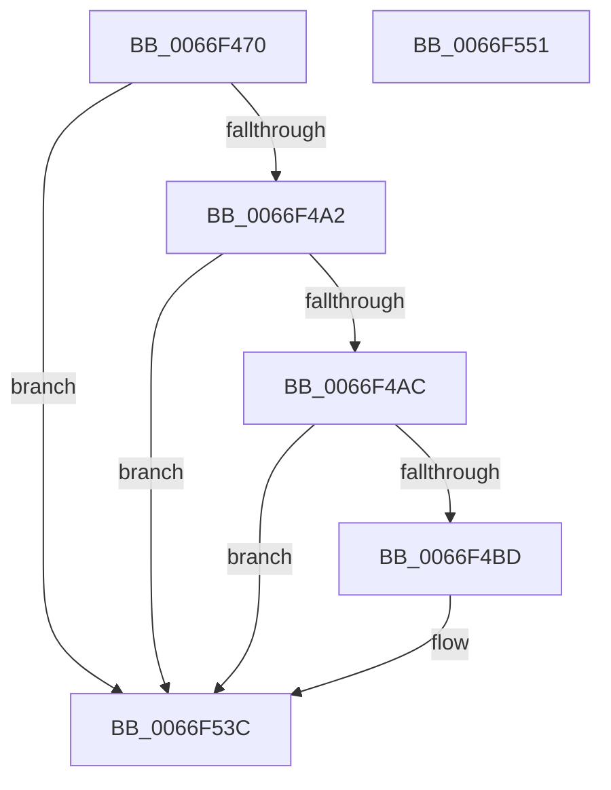

# MiLogResetPagesCommitRelease

- RVA: `0x0066F470`–`0x0066F552` (길이 `226` bytes)
- VA: `0x000000014066F470`
- 실행 섹션: `.text`
- PDB 이름 있음: `예`; PDB Function 태그: `아니요`
- unwind 정보 RVA: `0x000BAEE4`
- 디코드: `49`개 명령, `226/226` bytes 표시
- 미해석 바이트: `0` (있으면 어셈블리에 `.byte`로 보존)

> 이 문서는 커널 이미지의 기계어와 PDB 기호를 분석해 생성했습니다. 4번과 5번은 함수 원형과 자료형을 바이너리 사용 방식에서 추정한 C 해석이며 원본 소스 복구 결과는 아닙니다.

## 1. Dependencies

- 직접 호출 지점: **4**; 고유 호출 대상: **4**
- 직접 호출자로 확인된 함수: **1**
- RIP 상대 이미지 참조: **3**

### Outgoing calls
- `0x0066F4B4` → [tlgKeywordOn](../42/tlgKeywordOn_function_0042EAA0.md) (function, `0x0042EAA0`)
- `0x0066F4C8` → [tlgCreate1Sz_char](../42/tlgCreate1Sz_char_function_00427304.md) (function, `0x00427304`)
- `0x0066F537` → [tlgWriteEx_EtwWriteEx](../4A/tlgWriteEx_EtwWriteEx_function_004AA348.md) (function, `0x004AA348`)
- `0x0066F543` → [_security_check_cookie](../6A/_security_check_cookie_function_006AC640.md) (function, `0x006AC640`)

### Direct callers
- [MiReleaseCommitForResetPages](MiReleaseCommitForResetPages_function_0066FAF8.md) at `0x0066FC1C`

### Static image references
- `0x0066F47E` → RVA `0x00E0A740` (`.data`; read)
- `0x0066F48C` → RVA `0x00E37618` (`.data`; read)
- `0x0066F4DC` → RVA `0x00057BC2` (`.rdata`; read)

## 2. Other-region calls and transfers

- 다른 실행 섹션으로 향하는 call: **0**
- 별도 외부 분기/꼬리 이동을 확인하지 못했습니다.

## 3. Assembly (complete function range)

```asm
0066F470  40 55                           push rbp
0066F472  48 8D 6C 24 A9                  lea rbp, [rsp - 0x57]
0066F477  48 81 EC D0 00 00 00            sub rsp, 0xd0
0066F47E  48 8B 05 BB B2 79 00            mov rax, qword ptr [rip + 0x79b2bb]
0066F485  48 33 C4                        xor rax, rsp
0066F488  48 89 45 47                     mov qword ptr [rbp + 0x47], rax
0066F48C  4C 8B 05 85 81 7C 00            mov r8, qword ptr [rip + 0x7c8185]
0066F493  4C 8B D2                        mov r10, rdx
0066F496  4C 8B C9                        mov r9, rcx
0066F499  4D 85 C0                        test r8, r8
0066F49C  0F 84 9A 00 00 00               je 0x14066f53c
0066F4A2  41 83 38 05                     cmp dword ptr [r8], 5
0066F4A6  0F 86 90 00 00 00               jbe 0x14066f53c
0066F4AC  BA 04 00 00 00                  mov edx, 4
0066F4B1  49 8B C8                        mov rcx, r8
0066F4B4  E8 E7 F5 DB FF                  call 0x14042eaa0
0066F4B9  84 C0                           test al, al
0066F4BB  74 7F                           je 0x14066f53c
0066F4BD  49 8D 91 38 03 00 00            lea rdx, [r9 + 0x338]
0066F4C4  48 8D 4D 07                     lea rcx, [rbp + 7]
0066F4C8  E8 37 7E DB FF                  call 0x140427304
0066F4CD  41 8B 89 D0 01 00 00            mov ecx, dword ptr [r9 + 0x1d0]
0066F4D4  48 8D 45 C7                     lea rax, [rbp - 0x39]
0066F4D8  48 89 45 17                     mov qword ptr [rbp + 0x17], rax
0066F4DC  48 8D 15 DF 86 9E FF            lea rdx, [rip - 0x617921]
0066F4E3  48 8D 45 CF                     lea rax, [rbp - 0x31]
0066F4E7  89 4D C7                        mov dword ptr [rbp - 0x39], ecx
0066F4EA  48 89 45 27                     mov qword ptr [rbp + 0x27], rax
0066F4EE  49 8B C8                        mov rcx, r8
0066F4F1  49 8B 81 C8 04 00 00            mov rax, qword ptr [r9 + 0x4c8]
0066F4F8  41 B9 01 00 00 00               mov r9d, 1
0066F4FE  48 89 45 D7                     mov qword ptr [rbp - 0x29], rax
0066F502  48 8D 45 D7                     lea rax, [rbp - 0x29]
0066F506  48 89 45 37                     mov qword ptr [rbp + 0x37], rax
0066F50A  48 8D 45 E7                     lea rax, [rbp - 0x19]
0066F50E  48 89 44 24 38                  mov qword ptr [rsp + 0x38], rax
0066F513  C7 44 24 30 06 00 00 00         mov dword ptr [rsp + 0x30], 6
0066F51B  48 C7 45 1F 04 00 00 00         mov qword ptr [rbp + 0x1f], 4
0066F523  4C 89 55 CF                     mov qword ptr [rbp - 0x31], r10
0066F527  48 C7 45 2F 08 00 00 00         mov qword ptr [rbp + 0x2f], 8
0066F52F  48 C7 45 3F 08 00 00 00         mov qword ptr [rbp + 0x3f], 8
0066F537  E8 0C AE E3 FF                  call 0x1404aa348
0066F53C  48 8B 4D 47                     mov rcx, qword ptr [rbp + 0x47]
0066F540  48 33 CC                        xor rcx, rsp
0066F543  E8 F8 D0 03 00                  call 0x1406ac640
0066F548  48 81 C4 D0 00 00 00            add rsp, 0xd0
0066F54F  5D                              pop rbp
0066F550  C3                              ret
0066F551  CC                              int3
```

## 4. C-style interpretation (structured pseudocode)

```c
__int64 __fastcall MiLogResetPagesCommitRelease(__int64 a1, __int64 a2)
{
    __int64 result;
    __int64 v_rsp;
    unsigned __int64 v_stack_m18;
    unsigned __int64 v_stack_m20;
    unsigned __int64 v_stack_m28;
    unsigned __int64 v_stack_m30;
    unsigned __int64 v_stack_m38;
    unsigned __int64 v_stack_m40;
    unsigned __int64 v_stack_m48;
    unsigned __int64 v_stack_m58;
    unsigned __int64 v_stack_m5F;
    unsigned __int64 v_stack_m78;
    unsigned __int64 v_stack_m88;
    unsigned __int64 v_stack_m90;
    unsigned __int64 v_stack_m98;
    unsigned __int64 v_stack_mA0;
    unsigned int v_stack_mA8;

    v_rsp = (v_rsp) - (208);
    result = (*(unsigned __int64 *)(v_rip + 7975611)) ^ (v_rsp);
    v_stack_m18 = result;
    if (*(unsigned __int64 *)(v_rip + 8159621) == 0) goto loc_0066F53C;
    if ((*(unsigned int *)(*(unsigned __int64 *)(v_rip + 8159621))) <= 5) goto loc_0066F53C;
    result = tlgKeywordOn(*(unsigned __int64 *)(v_rip + 8159621), 4, *(unsigned __int64 *)(v_rip + 8159621), a1);
    if ((unsigned __int8)(result) != 0) {
        a2 = a1 + 824;
        a1 = v_stack_m58;
        result = tlgCreate1Sz_char(a1, a2, *(unsigned __int64 *)(v_rip + 8159621), a1);
        a1 = *(unsigned int *)(a1 + 464);
        result = v_stack_m98;
        v_stack_m48 = result;
        a2 = v_rip - 6388001;
        result = v_stack_m90;
        v_stack_m98 = (unsigned int)(a1);
        v_stack_m38 = result;
        a1 = *(unsigned __int64 *)(v_rip + 8159621);
        result = *(unsigned __int64 *)(a1 + 1224);
        a4 = 1;
        v_stack_m88 = result;
        result = v_stack_m88;
        v_stack_m28 = result;
        result = v_stack_m78;
        v_stack_mA0 = result;
        v_stack_mA8 = 6;
        v_stack_m40 = 4;
        v_stack_m90 = a2;
        v_stack_m30 = 8;
        v_stack_m20 = 8;
        result = tlgWriteEx_EtwWriteEx(a1, a2, *(unsigned __int64 *)(v_rip + 8159621), a4);
    }
    a1 = (v_stack_m18) ^ (v_rsp);
    result = _security_check_cookie(a1, a2, *(unsigned __int64 *)(v_rip + 8159621), a4);
    v_rsp = (v_rsp) + (208);
    return result;
}
```

## 5. (Beta) C Style

```c
int64_t MiLogResetPagesCommitRelease(int64_t Arg1, int64_t Arg2)
{
    int64_t result;
    int64_t local_rsp;
    uint64_t v_stack_m18;
    uint64_t v_stack_m20;
    uint64_t v_stack_m28;
    uint64_t v_stack_m30;
    uint64_t v_stack_m38;
    uint64_t v_stack_m40;
    uint64_t v_stack_m48;
    uint64_t v_stack_m58;
    uint64_t v_stack_m5F;
    uint64_t v_stack_m78;
    uint64_t v_stack_m88;
    uint64_t v_stack_m90;
    uint64_t v_stack_m98;
    uint64_t v_stack_mA0;
    uint32_t v_stack_mA8;

    local_rsp = (local_rsp) - (208);
    result = (*(uint64_t *)(v_rip + 0x79B2BB)) ^ (local_rsp);
    v_stack_m18 = result;
    if (*(uint64_t *)(v_rip + 0x7C8185) == 0) goto loc_0066F53C;
    if ((*(uint32_t *)(*(uint64_t *)(v_rip + 0x7C8185))) <= 5) goto loc_0066F53C;
    result = tlgKeywordOn(*(uint64_t *)(v_rip + 0x7C8185), 4, *(uint64_t *)(v_rip + 0x7C8185), Arg1);
    if ((uint8_t)(result) != 0) {
        Arg2 = Arg1 + 824;
        Arg1 = v_stack_m58;
        result = tlgCreate1Sz_char(Arg1, Arg2, *(uint64_t *)(v_rip + 0x7C8185), Arg1);
        Arg1 = *(uint32_t *)(Arg1 + 0x1D0);
        result = v_stack_m98;
        v_stack_m48 = result;
        Arg2 = v_rip - 6388001;
        result = v_stack_m90;
        v_stack_m98 = (uint32_t)(Arg1);
        v_stack_m38 = result;
        Arg1 = *(uint64_t *)(v_rip + 0x7C8185);
        result = *(uint64_t *)(Arg1 + 0x4C8);
        a4 = 1;
        v_stack_m88 = result;
        result = v_stack_m88;
        v_stack_m28 = result;
        result = v_stack_m78;
        v_stack_mA0 = result;
        v_stack_mA8 = 6;
        v_stack_m40 = 4;
        v_stack_m90 = Arg2;
        v_stack_m30 = 8;
        v_stack_m20 = 8;
        result = tlgWriteEx_EtwWriteEx(Arg1, Arg2, *(uint64_t *)(v_rip + 0x7C8185), a4);
    }
    Arg1 = (v_stack_m18) ^ (local_rsp);
    result = _security_check_cookie(Arg1, Arg2, *(uint64_t *)(v_rip + 0x7C8185), a4);
    local_rsp = (local_rsp) + (208);
    return result;
}
```

## 6. Execution-region graph

[열기: 2D/3D 그래프와 함수 탐색 컨트롤 패널](../../../control-panel.html?section=text&rva=0x0066F470&view=graph)

- 2D 그래프는 위에서 아래로 흐르고, 3D 그래프는 빈 공간을 드래그해 회전합니다. Shift+드래그는 이동, 휠은 확대·축소, 함수 노드 선택은 대상 보고서 이동입니다.

### Static fallback


