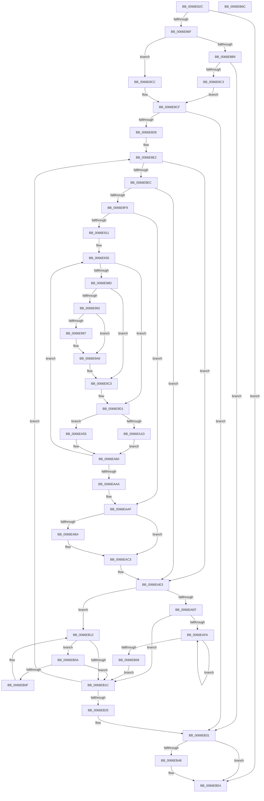

# MiPageBootRegistry

- RVA: `0x0066E82C`–`0x0066EB6D` (길이 `833` bytes)
- VA: `0x000000014066E82C`
- 실행 섹션: `.text`
- PDB 이름 있음: `예`; PDB Function 태그: `아니요`
- unwind 정보 RVA: `0x000D4000`
- 디코드: `209`개 명령, `833/833` bytes 표시
- 미해석 바이트: `0` (있으면 어셈블리에 `.byte`로 보존)

> 이 문서는 커널 이미지의 기계어와 PDB 기호를 분석해 생성했습니다. 4번과 5번은 함수 원형과 자료형을 바이너리 사용 방식에서 추정한 C 해석이며 원본 소스 복구 결과는 아닙니다.

## 1. Dependencies

- 직접 호출 지점: **21**; 고유 호출 대상: **17**
- 직접 호출자로 확인된 함수: **1**
- RIP 상대 이미지 참조: **2**

### Outgoing calls
- `0x0066E859` → [MiAllocatePool](../35/MiAllocatePool_function_0035B540.md) (function, `0x0035B540`)
- `0x0066E892` → [MiGetAnyMultiplexedVm](../44/MiGetAnyMultiplexedVm_function_00448BD0.md) (function, `0x00448BD0`)
- `0x0066E89D` → [MiLockWorkingSetShared](../27/MiLockWorkingSetShared_function_0027CBF0.md) (function, `0x0027CBF0`)
- `0x0066E99A` → [MiFlushTbList](../31/MiFlushTbList_function_00311FC0.md) (function, `0x00311FC0`)
- `0x0066E99F` → [MiReleaseProcessorFlushList](../31/MiReleaseProcessorFlushList_function_00313C70.md) (function, `0x00313C70`)
- `0x0066E9AE` → [MiInsertRegistryPageInModifiedList](../../init/C7/MiInsertRegistryPageInModifiedList_function_00C76010.md) (function, `0x00C76010`)
- `0x0066E9B9` → [MiUnlockPageTable](../21/MiUnlockPageTable_function_00216EC0.md) (function, `0x00216EC0`)
- `0x0066E9CC` → [MiLockNestedPageTable](../23/MiLockNestedPageTable_function_0023E890.md) (function, `0x0023E890`)
- `0x0066E9D6` → [MI_READ_PTE_LOCK_FREE](../28/MI_READ_PTE_LOCK_FREE_function_002828A0.md) (function, `0x002828A0`)
- `0x0066E9E1` → [MiGetWsleContents](../31/MiGetWsleContents_function_00316540.md) (function, `0x00316540`)
- `0x0066E9F0` → [MiWriteWsle](../29/MiWriteWsle_function_00292CA0.md) (function, `0x00292CA0`)
- `0x0066EA0B` → [MiMakeTransitionPte](../36/MiMakeTransitionPte_function_00363F70.md) (function, `0x00363F70`)
- `0x0066EA1D` → [MiGetProcessorFlushList](../24/MiGetProcessorFlushList_function_00242C90.md) (function, `0x00242C90`)
- `0x0066EA3A` → [MiInitializeTbFlushList](../29/MiInitializeTbFlushList_function_00294F00.md) (function, `0x00294F00`)
- `0x0066EA75` → [MiInsertTbFlushEntry](../29/MiInsertTbFlushEntry_function_00293670.md) (function, `0x00293670`)
- `0x0066EAB7` → [MiFlushTbList](../31/MiFlushTbList_function_00311FC0.md) (function, `0x00311FC0`)
- `0x0066EABC` → [MiReleaseProcessorFlushList](../31/MiReleaseProcessorFlushList_function_00313C70.md) (function, `0x00313C70`)
- `0x0066EAC9` → [MiInsertRegistryPageInModifiedList](../../init/C7/MiInsertRegistryPageInModifiedList_function_00C76010.md) (function, `0x00C76010`)
- `0x0066EAD4` → [MiUnlockPageTable](../21/MiUnlockPageTable_function_00216EC0.md) (function, `0x00216EC0`)
- `0x0066EB36` → [MiUnlockWorkingSetShared](../27/MiUnlockWorkingSetShared_function_0027D690.md) (function, `0x0027D690`)
- `0x0066EB4F` → [MmFreeBootRegistry](../../page/7F/MmFreeBootRegistry_function_007F7C50.md) (function, `0x007F7C50`)

### Direct callers
- [MmFreeLoaderBlock](../../init/C5/MmFreeLoaderBlock_function_00C5F2F0.md) at `0x00C5F3AB`

### Static image references
- `0x0066EB3D` → RVA `0x00E37608` (`.data`; read)
- `0x0066EB48` → RVA `0x00E37608` (`.data`; write)

## 2. Other-region calls and transfers

- 다른 실행 섹션으로 향하는 call: **3**
  - `0x0066E9AE` → [MiInsertRegistryPageInModifiedList](../../init/C7/MiInsertRegistryPageInModifiedList_function_00C76010.md) (`.text` → `INIT`)
  - `0x0066EAC9` → [MiInsertRegistryPageInModifiedList](../../init/C7/MiInsertRegistryPageInModifiedList_function_00C76010.md) (`.text` → `INIT`)
  - `0x0066EB4F` → [MmFreeBootRegistry](../../page/7F/MmFreeBootRegistry_function_007F7C50.md) (`.text` → `PAGE`)
- 별도 외부 분기/꼬리 이동을 확인하지 못했습니다.

## 3. Assembly (complete function range)

```asm
0066E82C  48 89 5C 24 08                  mov qword ptr [rsp + 8], rbx
0066E831  55                              push rbp
0066E832  56                              push rsi
0066E833  57                              push rdi
0066E834  41 54                           push r12
0066E836  41 55                           push r13
0066E838  41 56                           push r14
0066E83A  41 57                           push r15
0066E83C  48 83 EC 60                     sub rsp, 0x60
0066E840  48 8B DA                        mov rbx, rdx
0066E843  48 8B F9                        mov rdi, rcx
0066E846  48 8D 14 D5 08 00 00 00         lea rdx, [rdx*8 + 8]
0066E84E  B9 40 00 00 00                  mov ecx, 0x40
0066E853  41 B8 4D 6D 4D 62               mov r8d, 0x624d6d4d
0066E859  E8 E2 CC CE FF                  call 0x14035b540
0066E85E  48 89 44 24 58                  mov qword ptr [rsp + 0x58], rax
0066E863  4C 8B F8                        mov r15, rax
0066E866  48 85 C0                        test rax, rax
0066E869  0F 84 E5 02 00 00               je 0x14066eb54
0066E86F  48 89 18                        mov qword ptr [rax], rbx
0066E872  45 33 F6                        xor r14d, r14d
0066E875  33 DB                           xor ebx, ebx
0066E877  4C 89 74 24 30                  mov qword ptr [rsp + 0x30], r14
0066E87C  48 83 C0 08                     add rax, 8
0066E880  48 89 9C 24 B0 00 00 00         mov qword ptr [rsp + 0xb0], rbx
0066E888  48 89 44 24 38                  mov qword ptr [rsp + 0x38], rax
0066E88D  33 F6                           xor esi, esi
0066E88F  8D 4B 01                        lea ecx, [rbx + 1]
0066E892  E8 39 A3 DD FF                  call 0x140448bd0
0066E897  48 8B C8                        mov rcx, rax
0066E89A  4C 8B E8                        mov r13, rax
0066E89D  E8 4E E3 C0 FF                  call 0x14027cbf0
0066E8A2  48 81 C7 60 01 00 00            add rdi, 0x160
0066E8A9  88 84 24 A8 00 00 00            mov byte ptr [rsp + 0xa8], al
0066E8B0  48 8B 4F 08                     mov rcx, qword ptr [rdi + 8]
0066E8B4  F6 C1 01                        test cl, 1
0066E8B7  74 13                           je 0x14066e8cc
0066E8B9  48 83 F9 01                     cmp rcx, 1
0066E8BD  0F 84 6E 02 00 00               je 0x14066eb31
0066E8C3  48 83 CF 01                     or rdi, 1
0066E8C7  48 33 F9                        xor rdi, rcx
0066E8CA  EB 03                           jmp 0x14066e8cf
0066E8CC  48 8B F9                        mov rdi, rcx
0066E8CF  48 85 FF                        test rdi, rdi
0066E8D2  0F 84 59 02 00 00               je 0x14066eb31
0066E8D8  49 B8 00 00 00 00 80 F6 FF FF   movabs r8, 0xfffff68000000000
0066E8E2  83 7F 18 13                     cmp dword ptr [rdi + 0x18], 0x13
0066E8E6  0F 85 F7 01 00 00               jne 0x14066eae3
0066E8EC  48 8B 47 28                     mov rax, qword ptr [rdi + 0x28]
0066E8F0  48 85 C0                        test rax, rax
0066E8F3  0F 84 EA 01 00 00               je 0x14066eae3
0066E8F9  48 83 A4 24 B8 00 00 00 00      and qword ptr [rsp + 0xb8], 0
0066E902  33 ED                           xor ebp, ebp
0066E904  48 8B 4F 20                     mov rcx, qword ptr [rdi + 0x20]
0066E908  48 85 C0                        test rax, rax
0066E90B  0F 84 9E 01 00 00               je 0x14066eaaf
0066E911  49 8B D0                        mov rdx, r8
0066E914  48 C1 E2 19                     shl rdx, 0x19
0066E918  4C 8D 34 49                     lea r14, [rcx + rcx*2]
0066E91C  48 89 54 24 50                  mov qword ptr [rsp + 0x50], rdx
0066E921  49 C1 E6 04                     shl r14, 4
0066E925  48 B8 08 00 00 00 00 DE FF FF   movabs rax, 0xffffde0000000008
0066E92F  4C 03 F0                        add r14, rax
0066E932  4C 8B F9                        mov r15, rcx
0066E935  49 8B 06                        mov rax, qword ptr [r14]
0066E938  48 B9 00 00 00 00 00 00 00 80   movabs rcx, 0x8000000000000000
0066E942  48 0B C1                        or rax, rcx
0066E945  48 8B 4C 24 38                  mov rcx, qword ptr [rsp + 0x38]
0066E94A  4C 8B E0                        mov r12, rax
0066E94D  48 89 44 24 40                  mov qword ptr [rsp + 0x40], rax
0066E952  49 C1 E4 19                     shl r12, 0x19
0066E956  4C 2B E2                        sub r12, rdx
0066E959  48 8B D0                        mov rdx, rax
0066E95C  49 C1 FC 10                     sar r12, 0x10
0066E960  48 B8 F8 FF FF FF 7F 00 00 00   movabs rax, 0x7ffffffff8
0066E96A  4C 89 21                        mov qword ptr [rcx], r12
0066E96D  48 83 C1 08                     add rcx, 8
0066E971  48 C1 EA 09                     shr rdx, 9
0066E975  48 89 4C 24 38                  mov qword ptr [rsp + 0x38], rcx
0066E97A  48 23 D0                        and rdx, rax
0066E97D  49 8B C0                        mov rax, r8
0066E980  48 03 C2                        add rax, rdx
0066E983  48 89 44 24 48                  mov qword ptr [rsp + 0x48], rax
0066E988  48 3B E8                        cmp rbp, rax
0066E98B  74 44                           je 0x14066e9d1
0066E98D  48 85 ED                        test rbp, rbp
0066E990  74 31                           je 0x14066e9c3
0066E992  48 85 F6                        test rsi, rsi
0066E995  74 0F                           je 0x14066e9a6
0066E997  48 8B CE                        mov rcx, rsi
0066E99A  E8 21 36 CA FF                  call 0x140311fc0
0066E99F  E8 CC 52 CA FF                  call 0x140313c70
0066E9A4  33 F6                           xor esi, esi
0066E9A6  48 8B 4C 24 30                  mov rcx, qword ptr [rsp + 0x30]
0066E9AB  48 8B D3                        mov rdx, rbx
0066E9AE  E8 5D 76 60 00                  call 0x140c76010
0066E9B3  48 8B D5                        mov rdx, rbp
0066E9B6  49 8B CD                        mov rcx, r13
0066E9B9  E8 02 85 BA FF                  call 0x140216ec0
0066E9BE  48 8B 44 24 48                  mov rax, qword ptr [rsp + 0x48]
0066E9C3  48 8B D0                        mov rdx, rax
0066E9C6  49 8B CD                        mov rcx, r13
0066E9C9  48 8B E8                        mov rbp, rax
0066E9CC  E8 BF FE BC FF                  call 0x14023e890
0066E9D1  48 8B 4C 24 40                  mov rcx, qword ptr [rsp + 0x40]
0066E9D6  E8 C5 3E C1 FF                  call 0x1402828a0
0066E9DB  49 8B D4                        mov rdx, r12
0066E9DE  48 8B D8                        mov rbx, rax
0066E9E1  E8 5A 7B CA FF                  call 0x140316540
0066E9E6  24 FA                           and al, 0xfa
0066E9E8  49 8B D4                        mov rdx, r12
0066E9EB  0C 0A                           or al, 0xa
0066E9ED  44 8A C0                        mov r8b, al
0066E9F0  E8 AB 42 C2 FF                  call 0x140292ca0
0066E9F5  48 B9 FF FF FF FF FF 00 00 00   movabs rcx, 0xffffffffff
0066E9FF  48 C1 EB 0C                     shr rbx, 0xc
0066EA03  48 23 CB                        and rcx, rbx
0066EA06  BA 04 00 00 00                  mov edx, 4
0066EA0B  E8 60 55 CF FF                  call 0x140363f70
0066EA10  48 8B 4C 24 40                  mov rcx, qword ptr [rsp + 0x40]
0066EA15  48 89 01                        mov qword ptr [rcx], rax
0066EA18  48 85 F6                        test rsi, rsi
0066EA1B  75 38                           jne 0x14066ea55
0066EA1D  E8 6E 42 BD FF                  call 0x140242c90
0066EA22  45 33 C9                        xor r9d, r9d
0066EA25  C7 44 24 20 01 00 00 00         mov dword ptr [rsp + 0x20], 1
0066EA2D  49 8B D5                        mov rdx, r13
0066EA30  48 8B C8                        mov rcx, rax
0066EA33  48 8B F0                        mov rsi, rax
0066EA36  44 8B 40 0C                     mov r8d, dword ptr [rax + 0xc]
0066EA3A  E8 C1 64 C2 FF                  call 0x140294f00
0066EA3F  48 8B 84 24 B8 00 00 00         mov rax, qword ptr [rsp + 0xb8]
0066EA47  41 8D 59 01                     lea ebx, [r9 + 1]
0066EA4B  49 03 C7                        add rax, r15
0066EA4E  48 89 44 24 30                  mov qword ptr [rsp + 0x30], rax
0066EA53  EB 0B                           jmp 0x14066ea60
0066EA55  48 8B 9C 24 B0 00 00 00         mov rbx, qword ptr [rsp + 0xb0]
0066EA5D  48 FF C3                        inc rbx
0066EA60  45 33 C9                        xor r9d, r9d
0066EA63  48 89 9C 24 B0 00 00 00         mov qword ptr [rsp + 0xb0], rbx
0066EA6B  49 8B D4                        mov rdx, r12
0066EA6E  48 8B CE                        mov rcx, rsi
0066EA71  45 8D 41 01                     lea r8d, [r9 + 1]
0066EA75  E8 F6 4B C2 FF                  call 0x140293670
0066EA7A  48 8B 8C 24 B8 00 00 00         mov rcx, qword ptr [rsp + 0xb8]
0066EA82  49 83 C6 30                     add r14, 0x30
0066EA86  48 8B 54 24 50                  mov rdx, qword ptr [rsp + 0x50]
0066EA8B  48 FF C1                        inc rcx
0066EA8E  48 89 8C 24 B8 00 00 00         mov qword ptr [rsp + 0xb8], rcx
0066EA96  49 B8 00 00 00 00 80 F6 FF FF   movabs r8, 0xfffff68000000000
0066EAA0  48 3B 4F 28                     cmp rcx, qword ptr [rdi + 0x28]
0066EAA4  0F 82 8B FE FF FF               jb 0x14066e935
0066EAAA  4C 8B 74 24 30                  mov r14, qword ptr [rsp + 0x30]
0066EAAF  48 85 F6                        test rsi, rsi
0066EAB2  74 0F                           je 0x14066eac3
0066EAB4  48 8B CE                        mov rcx, rsi
0066EAB7  E8 04 35 CA FF                  call 0x140311fc0
0066EABC  E8 AF 51 CA FF                  call 0x140313c70
0066EAC1  33 F6                           xor esi, esi
0066EAC3  48 8B D3                        mov rdx, rbx
0066EAC6  49 8B CE                        mov rcx, r14
0066EAC9  E8 42 75 60 00                  call 0x140c76010
0066EACE  48 8B D5                        mov rdx, rbp
0066EAD1  49 8B CD                        mov rcx, r13
0066EAD4  E8 E7 83 BA FF                  call 0x140216ec0
0066EAD9  49 B8 00 00 00 00 80 F6 FF FF   movabs r8, 0xfffff68000000000
0066EAE3  48 8B 47 08                     mov rax, qword ptr [rdi + 8]
0066EAE7  48 8B CF                        mov rcx, rdi
0066EAEA  48 85 C0                        test rax, rax
0066EAED  74 23                           je 0x14066eb12
0066EAEF  48 8B 08                        mov rcx, qword ptr [rax]
0066EAF2  48 8B F8                        mov rdi, rax
0066EAF5  48 85 C9                        test rcx, rcx
0066EAF8  74 22                           je 0x14066eb1c
0066EAFA  48 8B 01                        mov rax, qword ptr [rcx]
0066EAFD  48 8B F9                        mov rdi, rcx
0066EB00  48 8B C8                        mov rcx, rax
0066EB03  48 85 C0                        test rax, rax
0066EB06  75 F2                           jne 0x14066eafa
0066EB08  EB 12                           jmp 0x14066eb1c
0066EB0A  48 39 0F                        cmp qword ptr [rdi], rcx
0066EB0D  74 0D                           je 0x14066eb1c
0066EB0F  48 8B CF                        mov rcx, rdi
0066EB12  48 8B 7F 10                     mov rdi, qword ptr [rdi + 0x10]
0066EB16  48 83 E7 FC                     and rdi, 0xfffffffffffffffc
0066EB1A  75 EE                           jne 0x14066eb0a
0066EB1C  48 85 FF                        test rdi, rdi
0066EB1F  0F 85 BD FD FF FF               jne 0x14066e8e2
0066EB25  4C 8B 7C 24 58                  mov r15, qword ptr [rsp + 0x58]
0066EB2A  8A 84 24 A8 00 00 00            mov al, byte ptr [rsp + 0xa8]
0066EB31  8A D0                           mov dl, al
0066EB33  49 8B CD                        mov rcx, r13
0066EB36  E8 55 EB C0 FF                  call 0x14027d690
0066EB3B  33 C0                           xor eax, eax
0066EB3D  F0 4C 0F B1 3D C2 8A 7C 00      lock cmpxchg qword ptr [rip + 0x7c8ac2], r15
0066EB46  74 0C                           je 0x14066eb54
0066EB48  4C 89 3D B9 8A 7C 00            mov qword ptr [rip + 0x7c8ab9], r15
0066EB4F  E8 FC 90 18 00                  call 0x1407f7c50
0066EB54  48 8B 9C 24 A0 00 00 00         mov rbx, qword ptr [rsp + 0xa0]
0066EB5C  48 83 C4 60                     add rsp, 0x60
0066EB60  41 5F                           pop r15
0066EB62  41 5E                           pop r14
0066EB64  41 5D                           pop r13
0066EB66  41 5C                           pop r12
0066EB68  5F                              pop rdi
0066EB69  5E                              pop rsi
0066EB6A  5D                              pop rbp
0066EB6B  C3                              ret
0066EB6C  CC                              int3
```

## 4. C-style interpretation (structured pseudocode)

```c
__int64 __fastcall MiPageBootRegistry(__int64 a1, __int64 a2, __int64 a3, int a4)
{
    __int64 result;
    __int64 v_r12;
    __int64 v_r14;
    __int64 v_rbp;
    __int64 v_rbx;
    __int64 v_rdi;
    __int64 v_rsi;
    __int64 v_rsp;
    unsigned __int64 v_stack_m40;
    unsigned __int64 v_stack_m48;
    unsigned __int64 v_stack_m50;
    unsigned __int64 v_stack_m58;
    unsigned __int64 v_stack_m60;
    unsigned __int64 v_stack_m68;
    unsigned int v_stack_m78;
    unsigned __int8 v_stack_p10;
    unsigned __int64 v_stack_p18;
    unsigned __int64 v_stack_p20;
    unsigned __int64 v_stack_p8;

    v_stack_p8 = v_rbx;
    v_rsp = (v_rsp) - (96);
    result = MiAllocatePool(64, a2 * 8 + 8, (unsigned int)(0x624D6D4DULL), a4);
    v_stack_m40 = result;
    if (result == 0) goto loc_0066EB54;
    *(unsigned __int64 *)(result) = a2;
    v_r14 = 0;
    v_rbx = 0;
    v_stack_m68 = 0;
    result = (result) + (8);
    v_stack_p18 = 0;
    v_stack_m60 = result;
    v_rsi = 0;
    result = MiGetAnyMultiplexedVm(v_rbx + 1, a2 * 8 + 8, (unsigned int)(0x624D6D4DULL), a4);
    result = MiLockWorkingSetShared(result, a2 * 8 + 8, (unsigned int)(0x624D6D4DULL), a4);
    v_rdi = (a1) + (352);
    v_stack_p10 = (unsigned __int8)(result);
    if ((((unsigned __int8)(*(unsigned __int64 *)(v_rdi + 8))) & (1)) == 0) goto loc_0066E8CC;
    if ((*(unsigned __int64 *)(v_rdi + 8)) == 1) goto loc_0066EB31;
    v_rdi = (v_rdi) | (1);
    v_rdi = (v_rdi) ^ (*(unsigned __int64 *)(v_rdi + 8));
    goto loc_0066E8CF;
loc_0066E8CC:
loc_0066E8CF:
    if (*(unsigned __int64 *)(v_rdi + 8) == 0) goto loc_0066EB31;
loc_0066E8E2:
    if ((*(unsigned int *)(*(unsigned __int64 *)(v_rdi + 8) + 24)) != 19) goto loc_0066EAE3;
    if (*(unsigned __int64 *)(*(unsigned __int64 *)(v_rdi + 8) + 40) == 0) goto loc_0066EAE3;
    v_rbp = 0;
    if (*(unsigned __int64 *)(*(unsigned __int64 *)(v_rdi + 8) + 40) == 0) goto loc_0066EAAF;
    a2 = ((unsigned int)(0x624D6D4DULL)) << (25);
    v_stack_m48 = a2;
    v_r14 = (*(unsigned __int64 *)(*(unsigned __int64 *)(v_rdi + 8) + 32) + *(unsigned __int64 *)(*(unsigned __int64 *)(v_rdi + 8) + 32) * 2) << (4);
    v_r14 = (v_r14) + (*(unsigned __int64 *)(*(unsigned __int64 *)(v_rdi + 8) + 40));
loc_0066E935:
    result = (*(unsigned __int64 *)(v_r14)) | (*(unsigned __int64 *)(*(unsigned __int64 *)(v_rdi + 8) + 32));
    v_stack_m58 = result;
    v_r12 = (result) << (25);
    v_r12 = (v_r12) - (a2);
    v_r12 = (v_r12) >> (16);
    *(unsigned __int64 *)(v_stack_m60) = v_r12;
    a1 = (v_stack_m60) + (8);
    a2 = (result) >> (9);
    v_stack_m60 = a1;
    a2 = (a2) & (result);
    result = ((unsigned int)(0x624D6D4DULL)) + (a2);
    v_stack_m50 = result;
    if (0 == result) goto loc_0066E9D1;
    if (0 == 0) goto loc_0066E9C3;
    if (0 != 0) {
        a1 = 0;
        result = MiFlushTbList(a1, a2, (unsigned int)(0x624D6D4DULL), a4);
        result = MiReleaseProcessorFlushList(a1, a2, (unsigned int)(0x624D6D4DULL), a4);
        v_rsi = 0;
    }
    result = MiInsertRegistryPageInModifiedList(v_stack_m68, 0, (unsigned int)(0x624D6D4DULL), a4);
    result = MiUnlockPageTable(result, 0, (unsigned int)(0x624D6D4DULL), a4);
loc_0066E9C3:
    result = MiLockNestedPageTable(result, v_stack_m50, (unsigned int)(0x624D6D4DULL), a4);
loc_0066E9D1:
    result = MI_READ_PTE_LOCK_FREE(v_stack_m58, v_stack_m50, (unsigned int)(0x624D6D4DULL), a4);
    result = MiGetWsleContents(v_stack_m58, v_r12, (unsigned int)(0x624D6D4DULL), a4);
    result = (unsigned __int8)((result) & (250));
    result = (unsigned __int8)((result) | (10));
    result = MiWriteWsle(v_stack_m58, v_r12, (unsigned __int8)(result), a4);
    v_rbx = (result) >> (12);
    a1 = (v_stack_m58) & (v_rbx);
    result = MiMakeTransitionPte(a1, 4, (unsigned __int8)(result), a4);
    *(unsigned __int64 *)(v_stack_m58) = result;
    if (0 != 0) goto loc_0066EA55;
    result = MiGetProcessorFlushList(v_stack_m58, 4, (unsigned __int8)(result), a4);
    a4 = 0;
    v_stack_m78 = 1;
    result = MiInitializeTbFlushList(result, result, (unsigned int)(*(unsigned int *)(result + 12)), a4);
    result = (v_stack_p20) + (*(unsigned __int64 *)(*(unsigned __int64 *)(v_rdi + 8) + 32));
    v_stack_m68 = result;
    goto loc_0066EA60;
loc_0066EA55:
    v_rbx = (v_stack_p18) + 1;
loc_0066EA60:
    a4 = 0;
    v_stack_p18 = v_rbx;
    result = MiInsertTbFlushEntry(result, v_r12, a4 + 1, a4);
    v_r14 = (v_r14) + (48);
    a1 = (v_stack_p20) + 1;
    v_stack_p20 = a1;
    if (a1 < (*(unsigned __int64 *)(*(unsigned __int64 *)(v_rdi + 8) + 40))) goto loc_0066E935;
loc_0066EAAF:
    v_rsi = result;
    if (result != 0) {
        a1 = result;
        result = MiFlushTbList(a1, v_stack_m48, a4 + 1, a4);
        result = MiReleaseProcessorFlushList(a1, v_stack_m48, a4 + 1, a4);
        v_rsi = 0;
    }
    result = MiInsertRegistryPageInModifiedList(v_stack_m68, v_rbx, a4 + 1, a4);
    result = MiUnlockPageTable(result, v_stack_m50, a4 + 1, a4);
loc_0066EAE3:
    if (*(unsigned __int64 *)(*(unsigned __int64 *)(v_rdi + 8) + 8) == 0) goto loc_0066EB12;
    if (*(unsigned __int64 *)(*(unsigned __int64 *)(*(unsigned __int64 *)(v_rdi + 8) + 8)) == 0) goto loc_0066EB1C;
loc_0066EAFA:
    if (*(unsigned __int64 *)(*(unsigned __int64 *)(*(unsigned __int64 *)(*(unsigned __int64 *)(v_rdi + 8) + 8))) != 0) goto loc_0066EAFA;
    goto loc_0066EB1C;
loc_0066EB0A:
    if ((*(unsigned __int64 *)(*(unsigned __int64 *)(*(unsigned __int64 *)(*(unsigned __int64 *)(v_rdi + 8) + 8)))) == (*(unsigned __int64 *)(*(unsigned __int64 *)(*(unsigned __int64 *)(*(unsigned __int64 *)(v_rdi + 8) + 8))))) goto loc_0066EB1C;
loc_0066EB12:
    v_rdi = (*(unsigned __int64 *)(*(unsigned __int64 *)(*(unsigned __int64 *)(*(unsigned __int64 *)(v_rdi + 8) + 8)) + 16)) & (-4);
    if (condition_is_not_equal) goto loc_0066EB0A;
loc_0066EB1C:
    if (v_rdi != 0) goto loc_0066E8E2;
loc_0066EB31:
    result = MiUnlockWorkingSetShared(result, (unsigned __int8)(v_stack_p10), a4 + 1, a4);
    result = 0;
    if (!(condition_is_equal)) {
        *(unsigned __int64 *)(v_rip + 8161977) = v_stack_m40;
        result = MmFreeBootRegistry(result, (unsigned __int8)(v_stack_p10), a4 + 1, a4);
    }
    v_rsp = (v_rsp) + (96);
    return result;
}
```

## 5. (Beta) C Style

```c
int64_t MiPageBootRegistry(void *Arg1, int64_t Arg2, int64_t Arg3, int32_t Arg4)
{
    uint8_t *arg1 = (uint8_t *)Arg1;

    int64_t result;
    int64_t local_r12;
    int64_t local_r14;
    int64_t local_rbp;
    int64_t local_rbx;
    int64_t local_rdi;
    int64_t local_rsi;
    int64_t local_rsp;
    uint64_t v_stack_m40;
    uint64_t v_stack_m48;
    uint64_t v_stack_m50;
    uint64_t v_stack_m58;
    uint64_t v_stack_m60;
    uint64_t v_stack_m68;
    uint32_t v_stack_m78;
    uint8_t v_stack_p10;
    uint64_t v_stack_p18;
    uint64_t v_stack_p20;
    uint64_t v_stack_p8;

    v_stack_p8 = local_rbx;
    local_rsp = (local_rsp) - (96);
    result = MiAllocatePool(64, Arg2 * 8 + 8, (uint32_t)(0x624D6D4DULL), Arg4);
    v_stack_m40 = result;
    if (result == 0) goto loc_0066EB54;
    *(uint64_t *)(result) = Arg2;
    local_r14 = 0;
    local_rbx = 0;
    v_stack_m68 = 0;
    result = (result) + (8);
    v_stack_p18 = 0;
    v_stack_m60 = result;
    local_rsi = 0;
    result = MiGetAnyMultiplexedVm(local_rbx + 1, Arg2 * 8 + 8, (uint32_t)(0x624D6D4DULL), Arg4);
    result = MiLockWorkingSetShared(result, Arg2 * 8 + 8, (uint32_t)(0x624D6D4DULL), Arg4);
    local_rdi = (Arg1) + (352);
    v_stack_p10 = (uint8_t)(result);
    if ((((uint8_t)(*(uint64_t *)(local_rdi + 0x8))) & (1)) == 0) goto loc_0066E8CC;
    if ((*(uint64_t *)(local_rdi + 0x8)) == 1) goto loc_0066EB31;
    local_rdi = (local_rdi) | (1);
    local_rdi = (local_rdi) ^ (*(uint64_t *)(local_rdi + 0x8));
    goto loc_0066E8CF;
loc_0066E8CC:
loc_0066E8CF:
    if (*(uint64_t *)(local_rdi + 0x8) == 0) goto loc_0066EB31;
loc_0066E8E2:
    if ((*(uint32_t *)(*(uint64_t *)(local_rdi + 0x8) + 0x18)) != 19) goto loc_0066EAE3;
    if (*(uint64_t *)(*(uint64_t *)(local_rdi + 0x8) + 0x28) == 0) goto loc_0066EAE3;
    local_rbp = 0;
    if (*(uint64_t *)(*(uint64_t *)(local_rdi + 0x8) + 0x28) == 0) goto loc_0066EAAF;
    Arg2 = ((uint32_t)(0x624D6D4DULL)) << (25);
    v_stack_m48 = Arg2;
    local_r14 = (*(uint64_t *)(*(uint64_t *)(local_rdi + 0x8) + 0x20) + *(uint64_t *)(*(uint64_t *)(local_rdi + 0x8) + 0x20) * 2) << (4);
    local_r14 = (local_r14) + (*(uint64_t *)(*(uint64_t *)(local_rdi + 0x8) + 0x28));
loc_0066E935:
    result = (*(uint64_t *)(local_r14)) | (*(uint64_t *)(*(uint64_t *)(local_rdi + 0x8) + 0x20));
    v_stack_m58 = result;
    local_r12 = (result) << (25);
    local_r12 = (local_r12) - (Arg2);
    local_r12 = (local_r12) >> (16);
    *(uint64_t *)(v_stack_m60) = local_r12;
    Arg1 = (v_stack_m60) + (8);
    Arg2 = (result) >> (9);
    v_stack_m60 = Arg1;
    Arg2 = (Arg2) & (result);
    result = ((uint32_t)(0x624D6D4DULL)) + (Arg2);
    v_stack_m50 = result;
    if (0 == result) goto loc_0066E9D1;
    if (0 == 0) goto loc_0066E9C3;
    if (0 != 0) {
        Arg1 = 0;
        result = MiFlushTbList(Arg1, Arg2, (uint32_t)(0x624D6D4DULL), Arg4);
        result = MiReleaseProcessorFlushList(Arg1, Arg2, (uint32_t)(0x624D6D4DULL), Arg4);
        local_rsi = 0;
    }
    result = MiInsertRegistryPageInModifiedList(v_stack_m68, 0, (uint32_t)(0x624D6D4DULL), Arg4);
    result = MiUnlockPageTable(result, 0, (uint32_t)(0x624D6D4DULL), Arg4);
loc_0066E9C3:
    result = MiLockNestedPageTable(result, v_stack_m50, (uint32_t)(0x624D6D4DULL), Arg4);
loc_0066E9D1:
    result = MI_READ_PTE_LOCK_FREE(v_stack_m58, v_stack_m50, (uint32_t)(0x624D6D4DULL), Arg4);
    result = MiGetWsleContents(v_stack_m58, local_r12, (uint32_t)(0x624D6D4DULL), Arg4);
    result = (uint8_t)((result) & (250));
    result = (uint8_t)((result) | (10));
    result = MiWriteWsle(v_stack_m58, local_r12, (uint8_t)(result), Arg4);
    local_rbx = (result) >> (12);
    Arg1 = (v_stack_m58) & (local_rbx);
    result = MiMakeTransitionPte(Arg1, 4, (uint8_t)(result), Arg4);
    *(uint64_t *)(v_stack_m58) = result;
    if (0 != 0) goto loc_0066EA55;
    result = MiGetProcessorFlushList(v_stack_m58, 4, (uint8_t)(result), Arg4);
    Arg4 = 0;
    v_stack_m78 = 1;
    result = MiInitializeTbFlushList(result, result, (uint32_t)(*(uint32_t *)(result + 0xC)), Arg4);
    result = (v_stack_p20) + (*(uint64_t *)(*(uint64_t *)(local_rdi + 0x8) + 0x20));
    v_stack_m68 = result;
    goto loc_0066EA60;
loc_0066EA55:
    local_rbx = (v_stack_p18) + 1;
loc_0066EA60:
    Arg4 = 0;
    v_stack_p18 = local_rbx;
    result = MiInsertTbFlushEntry(result, local_r12, Arg4 + 1, Arg4);
    local_r14 = (local_r14) + (48);
    Arg1 = (v_stack_p20) + 1;
    v_stack_p20 = Arg1;
    if (Arg1 < (*(uint64_t *)(*(uint64_t *)(local_rdi + 0x8) + 0x28))) goto loc_0066E935;
loc_0066EAAF:
    local_rsi = result;
    if (result != 0) {
        Arg1 = result;
        result = MiFlushTbList(Arg1, v_stack_m48, Arg4 + 1, Arg4);
        result = MiReleaseProcessorFlushList(Arg1, v_stack_m48, Arg4 + 1, Arg4);
        local_rsi = 0;
    }
    result = MiInsertRegistryPageInModifiedList(v_stack_m68, local_rbx, Arg4 + 1, Arg4);
    result = MiUnlockPageTable(result, v_stack_m50, Arg4 + 1, Arg4);
loc_0066EAE3:
    if (*(uint64_t *)(*(uint64_t *)(local_rdi + 0x8) + 0x8) == 0) goto loc_0066EB12;
    if (*(uint64_t *)(*(uint64_t *)(*(uint64_t *)(local_rdi + 0x8) + 0x8)) == 0) goto loc_0066EB1C;
loc_0066EAFA:
    if (*(uint64_t *)(*(uint64_t *)(*(uint64_t *)(*(uint64_t *)(local_rdi + 0x8) + 0x8))) != 0) goto loc_0066EAFA;
    goto loc_0066EB1C;
loc_0066EB0A:
    if ((*(uint64_t *)(*(uint64_t *)(*(uint64_t *)(*(uint64_t *)(local_rdi + 0x8) + 0x8)))) == (*(uint64_t *)(*(uint64_t *)(*(uint64_t *)(*(uint64_t *)(local_rdi + 0x8) + 0x8))))) goto loc_0066EB1C;
loc_0066EB12:
    local_rdi = (*(uint64_t *)(*(uint64_t *)(*(uint64_t *)(*(uint64_t *)(local_rdi + 0x8) + 0x8)) + 0x10)) & (-4);
    if (condition_is_not_equal) goto loc_0066EB0A;
loc_0066EB1C:
    if (local_rdi != 0) goto loc_0066E8E2;
loc_0066EB31:
    result = MiUnlockWorkingSetShared(result, (uint8_t)(v_stack_p10), Arg4 + 1, Arg4);
    result = 0;
    if (!(condition_is_equal)) {
        *(uint64_t *)(v_rip + 0x7C8AB9) = v_stack_m40;
        result = MmFreeBootRegistry(result, (uint8_t)(v_stack_p10), Arg4 + 1, Arg4);
    }
    local_rsp = (local_rsp) + (96);
    return result;
}
```

### 관측된 메모리 오프셋

구조체 형식이 확인되지 않은 접근은 인자 기준의 오프셋으로만 기록했습니다.

| 기준 인자 | 오프셋 표현 | 폭 (bit) | 접근 |
|---|---:|---:|---|
| `Arg1` | `+ 0x8` | `64` | `R` |

## 6. Execution-region graph

[열기: 2D/3D 그래프와 함수 탐색 컨트롤 패널](../../../control-panel.html?section=text&rva=0x0066E82C&view=graph)

- 2D 그래프는 위에서 아래로 흐르고, 3D 그래프는 빈 공간을 드래그해 회전합니다. Shift+드래그는 이동, 휠은 확대·축소, 함수 노드 선택은 대상 보고서 이동입니다.

### Static fallback


