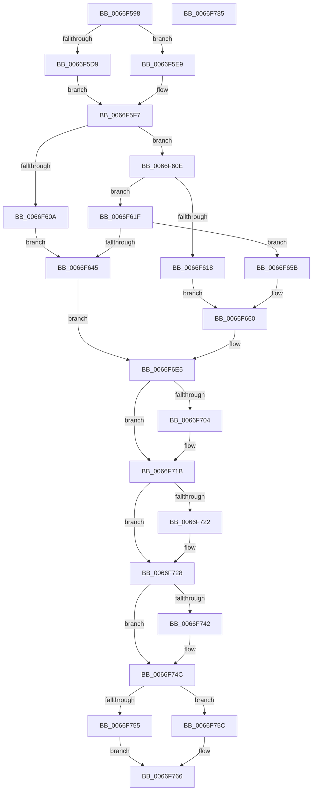

# MiReAcquireOutSwappedProcessCommit

- RVA: `0x0066F598`–`0x0066F786` (길이 `494` bytes)
- VA: `0x000000014066F598`
- 실행 섹션: `.text`
- PDB 이름 있음: `예`; PDB Function 태그: `아니요`
- unwind 정보 RVA: `0x0005D79C`
- 디코드: `138`개 명령, `494/494` bytes 표시
- 미해석 바이트: `0` (있으면 어셈블리에 `.byte`로 보존)

> 이 문서는 커널 이미지의 기계어와 PDB 기호를 분석해 생성했습니다. 4번과 5번은 함수 원형과 자료형을 바이너리 사용 방식에서 추정한 C 해석이며 원본 소스 복구 결과는 아닙니다.

## 1. Dependencies

- 직접 호출 지점: **15**; 고유 호출 대상: **12**
- 직접 호출자로 확인된 함수: **1**
- RIP 상대 이미지 참조: **5**

### Outgoing calls
- `0x0066F5BC` → [KeForceAttachProcess](../21/KeForceAttachProcess_function_00216650.md) (function, `0x00216650`)
- `0x0066F63A` → [MiChargeCommit](../28/MiChargeCommit_function_00286EB0.md) (function, `0x00286EB0`)
- `0x0066F651` → [MiLogOutswappedProcessCommitReacquire](MiLogOutswappedProcessCommitReacquire_function_0066F228.md) (function, `0x0066F228`)
- `0x0066F66C` → [MiLogOutswappedProcessCommitReacquire](MiLogOutswappedProcessCommitReacquire_function_0066F228.md) (function, `0x0066F228`)
- `0x0066F67F` → [MiLockWorkingSetExclusive](../32/MiLockWorkingSetExclusive_function_003238A0.md) (function, `0x003238A0`)
- `0x0066F6A9` → [MiUnlockWorkingSetExclusive](../27/MiUnlockWorkingSetExclusive_function_0027EC70.md) (function, `0x0027EC70`)
- `0x0066F6B4` → [MiBeginProcessClean](../2A/MiBeginProcessClean_function_002A473C.md) (function, `0x002A473C`)
- `0x0066F6BE` → [KeFreezeProcess](../46/KeFreezeProcess_function_0046B774.md) (function, `0x0046B774`)
- `0x0066F6CB` → [ObfReferenceObjectWithTag](../21/ObfReferenceObjectWithTag_function_00210710.md) (function, `0x00210710`)
- `0x0066F6E8` → [MiLockWorkingSetExclusive](../32/MiLockWorkingSetExclusive_function_003238A0.md) (function, `0x003238A0`)
- `0x0066F72B` → [MiUnlockWorkingSetExclusive](../27/MiUnlockWorkingSetExclusive_function_0027EC70.md) (function, `0x0027EC70`)
- `0x0066F734` → [KeForceDetachProcess](../3C/KeForceDetachProcess_function_003C7770.md) (function, `0x003C7770`)
- `0x0066F747` → [KeSetEvent](../33/KeSetEvent_function_0033F310.md) (function, `0x0033F310`)
- `0x0066F755` → [ExFreePoolWithTag](../../poolcode/B8/ExFreePoolWithTag_function_00B82870.md) (function, `0x00B82870`)
- `0x0066F75C` → [ExQueueWorkItem](../2F/ExQueueWorkItem_function_002F9520.md) (function, `0x002F9520`)

### Direct callers
- [MmInSwapProcess](../46/MmInSwapProcess_function_00463308.md) at `0x00463367`

### Static image references
- `0x0066F5D9` → RVA `0x00E38860` (`.data`; read)
- `0x0066F5E0` → RVA `0x00E38848` (`.data`; read)
- `0x0066F602` → RVA `0x00FC5250` (`ALMOSTRO`; read)
- `0x0066F629` → RVA `0x00E30088` (`.data`; read)
- `0x0066F6D3` → RVA `0x0066F560` (`MiReAcquireCommitFailWorker`; read)

## 2. Other-region calls and transfers

- 다른 실행 섹션으로 향하는 call: **1**
  - `0x0066F755` → [ExFreePoolWithTag](../../poolcode/B8/ExFreePoolWithTag_function_00B82870.md) (`.text` → `POOLCODE`)
- 별도 외부 분기/꼬리 이동을 확인하지 못했습니다.

## 3. Assembly (complete function range)

```asm
0066F598  48 89 5C 24 10                  mov qword ptr [rsp + 0x10], rbx
0066F59D  48 89 6C 24 18                  mov qword ptr [rsp + 0x18], rbp
0066F5A2  48 89 74 24 20                  mov qword ptr [rsp + 0x20], rsi
0066F5A7  57                              push rdi
0066F5A8  41 54                           push r12
0066F5AA  41 55                           push r13
0066F5AC  41 56                           push r14
0066F5AE  41 57                           push r15
0066F5B0  48 83 EC 20                     sub rsp, 0x20
0066F5B4  45 33 C0                        xor r8d, r8d
0066F5B7  33 D2                           xor edx, edx
0066F5B9  48 8B F1                        mov rsi, rcx
0066F5BC  E8 8F 70 BA FF                  call 0x140216650
0066F5C1  48 8D BE 00 04 00 00            lea rdi, [rsi + 0x400]
0066F5C8  BA 01 00 00 00                  mov edx, 1
0066F5CD  8B 87 B8 00 00 00               mov eax, dword ptr [rdi + 0xb8]
0066F5D3  24 0F                           and al, 0xf
0066F5D5  3A C2                           cmp al, dl
0066F5D7  75 10                           jne 0x14066f5e9
0066F5D9  4C 8D 3D 80 92 7C 00            lea r15, [rip + 0x7c9280]
0066F5E0  4C 8D 35 61 92 7C 00            lea r14, [rip + 0x7c9261]
0066F5E7  EB 0E                           jmp 0x14066f5f7
0066F5E9  4C 8D BF E0 00 00 00            lea r15, [rdi + 0xe0]
0066F5F0  4C 8D B7 C8 00 00 00            lea r14, [rdi + 0xc8]
0066F5F7  65 4C 8B 2C 25 88 01 00 00      mov r13, qword ptr gs:[0x188]
0066F600  33 DB                           xor ebx, ebx
0066F602  39 15 48 5C 95 00               cmp dword ptr [rip + 0x955c48], edx
0066F608  75 04                           jne 0x14066f60e
0066F60A  8B EA                           mov ebp, edx
0066F60C  EB 37                           jmp 0x14066f645
0066F60E  8B 86 F4 01 00 00               mov eax, dword ptr [rsi + 0x1f4]
0066F614  A8 08                           test al, 8
0066F616  74 07                           je 0x14066f61f
0066F618  44 8B E2                        mov r12d, edx
0066F61B  8B EB                           mov ebp, ebx
0066F61D  EB 41                           jmp 0x14066f660
0066F61F  0F B7 8E AE 04 00 00            movzx ecx, word ptr [rsi + 0x4ae]
0066F626  44 8B C2                        mov r8d, edx
0066F629  48 8B 05 58 0A 7C 00            mov rax, qword ptr [rip + 0x7c0a58]
0066F630  44 8B E3                        mov r12d, ebx
0066F633  49 8B 16                        mov rdx, qword ptr [r14]
0066F636  48 8B 0C C8                     mov rcx, qword ptr [rax + rcx*8]
0066F63A  E8 71 78 C1 FF                  call 0x140286eb0
0066F63F  8B E8                           mov ebp, eax
0066F641  85 C0                           test eax, eax
0066F643  74 16                           je 0x14066f65b
0066F645  49 8B 16                        mov rdx, qword ptr [r14]
0066F648  45 33 C9                        xor r9d, r9d
0066F64B  45 33 C0                        xor r8d, r8d
0066F64E  48 8B CE                        mov rcx, rsi
0066F651  E8 D2 FB FF FF                  call 0x14066f228
0066F656  E9 8A 00 00 00                  jmp 0x14066f6e5
0066F65B  BA 01 00 00 00                  mov edx, 1
0066F660  44 8B C2                        mov r8d, edx
0066F663  45 8B CC                        mov r9d, r12d
0066F666  49 8B 16                        mov rdx, qword ptr [r14]
0066F669  48 8B CE                        mov rcx, rsi
0066F66C  E8 B7 FB FF FF                  call 0x14066f228
0066F671  F0 81 8E FC 05 00 00 00 01 00 00  lock or dword ptr [rsi + 0x5fc], 0x100
0066F67C  48 8B CF                        mov rcx, rdi
0066F67F  E8 1C 42 CB FF                  call 0x1403238a0
0066F684  8A D0                           mov dl, al
0066F686  48 8B CF                        mov rcx, rdi
0066F689  8B 87 B8 00 00 00               mov eax, dword ptr [rdi + 0xb8]
0066F68F  89 44 24 50                     mov dword ptr [rsp + 0x50], eax
0066F693  C1 E8 18                        shr eax, 0x18
0066F696  0C 30                           or al, 0x30
0066F698  88 44 24 53                     mov byte ptr [rsp + 0x53], al
0066F69C  8B 44 24 50                     mov eax, dword ptr [rsp + 0x50]
0066F6A0  C1 E8 18                        shr eax, 0x18
0066F6A3  88 87 BB 00 00 00               mov byte ptr [rdi + 0xbb], al
0066F6A9  E8 C2 F5 C0 FF                  call 0x14027ec70
0066F6AE  48 8B D6                        mov rdx, rsi
0066F6B1  49 8B CD                        mov rcx, r13
0066F6B4  E8 83 50 C3 FF                  call 0x1402a473c
0066F6B9  33 D2                           xor edx, edx
0066F6BB  48 8B CE                        mov rcx, rsi
0066F6BE  E8 B1 C0 DF FF                  call 0x14046b774
0066F6C3  BA 4D 6D 50 72                  mov edx, 0x72506d4d
0066F6C8  48 8B CE                        mov rcx, rsi
0066F6CB  E8 40 10 BA FF                  call 0x140210710
0066F6D0  49 8B 07                        mov rax, qword ptr [r15]
0066F6D3  48 8D 0D 86 FE FF FF            lea rcx, [rip - 0x17a]
0066F6DA  48 89 48 10                     mov qword ptr [rax + 0x10], rcx
0066F6DE  48 89 70 18                     mov qword ptr [rax + 0x18], rsi
0066F6E2  48 89 18                        mov qword ptr [rax], rbx
0066F6E5  48 8B CF                        mov rcx, rdi
0066F6E8  E8 B3 41 CB FF                  call 0x1403238a0
0066F6ED  8B 8F B8 00 00 00               mov ecx, dword ptr [rdi + 0xb8]
0066F6F3  8A D0                           mov dl, al
0066F6F5  89 4C 24 50                     mov dword ptr [rsp + 0x50], ecx
0066F6F9  C1 E9 18                        shr ecx, 0x18
0066F6FC  8A C1                           mov al, cl
0066F6FE  24 30                           and al, 0x30
0066F700  3C 20                           cmp al, 0x20
0066F702  75 17                           jne 0x14066f71b
0066F704  80 E1 DF                        and cl, 0xdf
0066F707  80 C9 10                        or cl, 0x10
0066F70A  88 4C 24 53                     mov byte ptr [rsp + 0x53], cl
0066F70E  8B 44 24 50                     mov eax, dword ptr [rsp + 0x50]
0066F712  C1 E8 18                        shr eax, 0x18
0066F715  88 87 BB 00 00 00               mov byte ptr [rdi + 0xbb], al
0066F71B  49 8B 37                        mov rsi, qword ptr [r15]
0066F71E  85 ED                           test ebp, ebp
0066F720  74 06                           je 0x14066f728
0066F722  49 89 1E                        mov qword ptr [r14], rbx
0066F725  49 89 1F                        mov qword ptr [r15], rbx
0066F728  48 8B CF                        mov rcx, rdi
0066F72B  E8 40 F5 C0 FF                  call 0x14027ec70
0066F730  33 D2                           xor edx, edx
0066F732  33 C9                           xor ecx, ecx
0066F734  E8 37 80 D5 FF                  call 0x1403c7770
0066F739  48 8B 4E 28                     mov rcx, qword ptr [rsi + 0x28]
0066F73D  48 85 C9                        test rcx, rcx
0066F740  74 0A                           je 0x14066f74c
0066F742  45 33 C0                        xor r8d, r8d
0066F745  33 D2                           xor edx, edx
0066F747  E8 C4 FB CC FF                  call 0x14033f310
0066F74C  33 D2                           xor edx, edx
0066F74E  48 8B CE                        mov rcx, rsi
0066F751  85 ED                           test ebp, ebp
0066F753  74 07                           je 0x14066f75c
0066F755  E8 16 31 51 00                  call 0x140b82870
0066F75A  EB 0A                           jmp 0x14066f766
0066F75C  E8 BF 9D C8 FF                  call 0x1402f9520
0066F761  BB 2D 01 00 C0                  mov ebx, 0xc000012d
0066F766  48 8B 6C 24 60                  mov rbp, qword ptr [rsp + 0x60]
0066F76B  8B C3                           mov eax, ebx
0066F76D  48 8B 5C 24 58                  mov rbx, qword ptr [rsp + 0x58]
0066F772  48 8B 74 24 68                  mov rsi, qword ptr [rsp + 0x68]
0066F777  48 83 C4 20                     add rsp, 0x20
0066F77B  41 5F                           pop r15
0066F77D  41 5E                           pop r14
0066F77F  41 5D                           pop r13
0066F781  41 5C                           pop r12
0066F783  5F                              pop rdi
0066F784  C3                              ret
0066F785  CC                              int3
```

## 4. C-style interpretation (structured pseudocode)

```c
__int64 __fastcall MiReAcquireOutSwappedProcessCommit(__int64 a1, int a2, int a3, int a4)
{
    __int64 result;
    __int64 v_rbx;
    __int64 v_rsp;
    unsigned __int64 v_stack_p10;
    unsigned __int64 v_stack_p18;
    unsigned __int64 v_stack_p20;
    unsigned int v_stack_p8;
    unsigned __int8 v_stack_pB;

    v_stack_p10 = v_rbx;
    v_stack_p18 = v_rbp;
    v_stack_p20 = v_rsi;
    v_rsp = (v_rsp) - (32);
    a3 = 0;
    a2 = 0;
    result = KeForceAttachProcess(a1, a2, a3, a4);
    result = (unsigned __int8)(((unsigned int)(*(unsigned int *)(a1 + 1024 + 184))) & (15));
    if (((unsigned __int8)(result)) != 1) goto loc_0066F5E9;
    goto loc_0066F5F7;
loc_0066F5E9:
loc_0066F5F7:
    v_rbx = 0;
    if ((*(unsigned int *)(v_rip + 9788488)) != 1) goto loc_0066F60E;
    goto loc_0066F645;
loc_0066F60E:
    if ((((unsigned __int8)((unsigned int)(*(unsigned int *)(a1 + 500)))) & (8)) == 0) goto loc_0066F61F;
    goto loc_0066F660;
loc_0066F61F:
    result = MiChargeCommit(*(unsigned __int64 *)(*(unsigned __int64 *)(v_rip + 8129112) + *(unsigned __int16 *)(a1 + 1198) * 8), *(unsigned __int64 *)(a1 + 1024 + 200), 1, a4);
    if ((unsigned int)(result) == 0) goto loc_0066F65B;
loc_0066F645:
    a4 = 0;
    a3 = 0;
    result = MiLogOutswappedProcessCommitReacquire(a1, *(unsigned __int64 *)(a1 + 1024 + 200), a3, a4);
    goto loc_0066F6E5;
loc_0066F65B:
loc_0066F660:
    result = MiLogOutswappedProcessCommitReacquire(a1, *(unsigned __int64 *)(a1 + 1024 + 200), 1, 0);
    result = MiLockWorkingSetExclusive(a1 + 1024, *(unsigned __int64 *)(a1 + 1024 + 200), 1, 0);
    v_stack_p8 = (unsigned int)((unsigned int)(*(unsigned int *)(a1 + 1024 + 184)));
    result = (unsigned int)(((unsigned int)(*(unsigned int *)(a1 + 1024 + 184))) >> (24));
    result = (unsigned __int8)((result) | (48));
    v_stack_pB = (unsigned __int8)(result);
    result = (unsigned int)(((unsigned int)(v_stack_p8)) >> (24));
    *(unsigned __int8 *)(a1 + 1024 + 187) = (unsigned __int8)(result);
    result = MiUnlockWorkingSetExclusive(a1 + 1024, (unsigned __int8)(result), 1, 0);
    result = MiBeginProcessClean(*(unsigned __int64 *)(gs_base + (0 + 392)), a1, 1, 0);
    a2 = 0;
    result = KeFreezeProcess(a1, a2, 1, 0);
    result = ObfReferenceObjectWithTag(a1, (unsigned int)(0x72506D4DULL), 1, 0);
    *(unsigned __int64 *)(*(unsigned __int64 *)(a1 + 1024 + 224) + 16) = v_rip - 378;
    *(unsigned __int64 *)(*(unsigned __int64 *)(a1 + 1024 + 224) + 24) = a1;
    *(unsigned __int64 *)(*(unsigned __int64 *)(a1 + 1024 + 224)) = 0;
loc_0066F6E5:
    result = MiLockWorkingSetExclusive(a1 + 1024, (unsigned int)(0x72506D4DULL), 1, 0);
    v_stack_p8 = (unsigned int)((unsigned int)(*(unsigned int *)(a1 + 1024 + 184)));
    a1 = (unsigned int)(((unsigned int)(*(unsigned int *)(a1 + 1024 + 184))) >> (24));
    result = (unsigned __int8)(((unsigned __int8)(a1)) & (48));
    if (((unsigned __int8)(result)) == 32) {
        a1 = (unsigned __int8)((a1) & (223));
        a1 = (unsigned __int8)((a1) | (16));
        v_stack_pB = (unsigned __int8)(a1);
        result = v_stack_p8;
        result = (unsigned int)((result) >> (24));
        *(unsigned __int8 *)(a1 + 1024 + 187) = (unsigned __int8)(result);
    }
    if ((unsigned int)((unsigned int)((unsigned int)(result))) != 0) {
        *(unsigned __int64 *)(a1 + 1024 + 200) = 0;
        *(unsigned __int64 *)(a1 + 1024 + 224) = 0;
    }
    result = MiUnlockWorkingSetExclusive(a1 + 1024, (unsigned __int8)(result), 1, 0);
    a2 = 0;
    a1 = 0;
    result = KeForceDetachProcess(a1, a2, 1, 0);
    if (*(unsigned __int64 *)(*(unsigned __int64 *)(a1 + 1024 + 224) + 40) != 0) {
        a3 = 0;
        a2 = 0;
        result = KeSetEvent(*(unsigned __int64 *)(*(unsigned __int64 *)(a1 + 1024 + 224) + 40), a2, a3, 0);
    }
    a2 = 0;
    if ((unsigned int)((unsigned int)((unsigned int)(result))) == 0) goto loc_0066F75C;
    result = ExFreePoolWithTag(*(unsigned __int64 *)(a1 + 1024 + 224), a2, a3, 0);
    goto loc_0066F766;
loc_0066F75C:
    result = ExQueueWorkItem(*(unsigned __int64 *)(a1 + 1024 + 224), a2, a3, 0);
loc_0066F766:
    v_rsp = (v_rsp) + (32);
    return (unsigned int)((unsigned int)((unsigned int)(0xC000012DULL)));
}
```

## 5. (Beta) C Style

```c
int64_t MiReAcquireOutSwappedProcessCommit(void *Arg1, int32_t Arg2, int32_t Arg3, int32_t Arg4)
{
    uint8_t *arg1 = (uint8_t *)Arg1;

    int64_t result;
    int64_t local_rbx;
    int64_t local_rsp;
    uint64_t v_stack_p10;
    uint64_t v_stack_p18;
    uint64_t v_stack_p20;
    uint32_t v_stack_p8;
    uint8_t v_stack_pB;

    v_stack_p10 = local_rbx;
    v_stack_p18 = local_rbp;
    v_stack_p20 = local_rsi;
    local_rsp = (local_rsp) - (32);
    Arg3 = 0;
    Arg2 = 0;
    result = KeForceAttachProcess(Arg1, Arg2, Arg3, Arg4);
    result = (uint8_t)(((uint32_t)(*(uint32_t *)(arg1 + 0x400 + 0xB8))) & (15));
    if (((uint8_t)(result)) != 1) goto loc_0066F5E9;
    goto loc_0066F5F7;
loc_0066F5E9:
loc_0066F5F7:
    local_rbx = 0;
    if ((*(uint32_t *)(v_rip + 0x955C48)) != 1) goto loc_0066F60E;
    goto loc_0066F645;
loc_0066F60E:
    if ((((uint8_t)((uint32_t)(*(uint32_t *)(arg1 + 0x1F4)))) & (8)) == 0) goto loc_0066F61F;
    goto loc_0066F660;
loc_0066F61F:
    result = MiChargeCommit(*(uint64_t *)(*(uint64_t *)(v_rip + 0x7C0A58) + *(uint16_t *)(arg1 + 0x4AE) * 8), *(uint64_t *)(arg1 + 0x400 + 0xC8), 1, Arg4);
    if ((uint32_t)(result) == 0) goto loc_0066F65B;
loc_0066F645:
    Arg4 = 0;
    Arg3 = 0;
    result = MiLogOutswappedProcessCommitReacquire(Arg1, *(uint64_t *)(arg1 + 0x400 + 0xC8), Arg3, Arg4);
    goto loc_0066F6E5;
loc_0066F65B:
loc_0066F660:
    result = MiLogOutswappedProcessCommitReacquire(Arg1, *(uint64_t *)(arg1 + 0x400 + 0xC8), 1, 0);
    result = MiLockWorkingSetExclusive(Arg1 + 1024, *(uint64_t *)(arg1 + 0x400 + 0xC8), 1, 0);
    v_stack_p8 = (uint32_t)((uint32_t)(*(uint32_t *)(arg1 + 0x400 + 0xB8)));
    result = (uint32_t)(((uint32_t)(*(uint32_t *)(arg1 + 0x400 + 0xB8))) >> (24));
    result = (uint8_t)((result) | (48));
    v_stack_pB = (uint8_t)(result);
    result = (uint32_t)(((uint32_t)(v_stack_p8)) >> (24));
    *(uint8_t *)(arg1 + 0x400 + 0xBB) = (uint8_t)(result);
    result = MiUnlockWorkingSetExclusive(Arg1 + 1024, (uint8_t)(result), 1, 0);
    result = MiBeginProcessClean(*(uint64_t *)(gs_base + (0 + 0x188)), Arg1, 1, 0);
    Arg2 = 0;
    result = KeFreezeProcess(Arg1, Arg2, 1, 0);
    result = ObfReferenceObjectWithTag(Arg1, (uint32_t)(0x72506D4DULL), 1, 0);
    *(uint64_t *)(*(uint64_t *)(arg1 + 0x400 + 0xE0) + 0x10) = v_rip - 378;
    *(void **)(*(uint64_t *)(arg1 + 0x400 + 0xE0) + 0x18) = Arg1;
    *(uint64_t *)(*(uint64_t *)(arg1 + 0x400 + 0xE0)) = 0;
loc_0066F6E5:
    result = MiLockWorkingSetExclusive(Arg1 + 1024, (uint32_t)(0x72506D4DULL), 1, 0);
    v_stack_p8 = (uint32_t)((uint32_t)(*(uint32_t *)(arg1 + 0x400 + 0xB8)));
    Arg1 = (uint32_t)(((uint32_t)(*(uint32_t *)(arg1 + 0x400 + 0xB8))) >> (24));
    result = (uint8_t)(((uint8_t)(Arg1)) & (48));
    if (((uint8_t)(result)) == 32) {
        Arg1 = (uint8_t)((Arg1) & (223));
        Arg1 = (uint8_t)((Arg1) | (16));
        v_stack_pB = (uint8_t)(Arg1);
        result = v_stack_p8;
        result = (uint32_t)((result) >> (24));
        *(uint8_t *)(arg1 + 0x400 + 0xBB) = (uint8_t)(result);
    }
    if ((uint32_t)((uint32_t)((uint32_t)(result))) != 0) {
        *(uint64_t *)(arg1 + 0x400 + 0xC8) = 0;
        *(uint64_t *)(arg1 + 0x400 + 0xE0) = 0;
    }
    result = MiUnlockWorkingSetExclusive(Arg1 + 1024, (uint8_t)(result), 1, 0);
    Arg2 = 0;
    Arg1 = 0;
    result = KeForceDetachProcess(Arg1, Arg2, 1, 0);
    if (*(uint64_t *)(*(uint64_t *)(arg1 + 0x400 + 0xE0) + 0x28) != 0) {
        Arg3 = 0;
        Arg2 = 0;
        result = KeSetEvent(*(uint64_t *)(*(uint64_t *)(arg1 + 0x400 + 0xE0) + 0x28), Arg2, Arg3, 0);
    }
    Arg2 = 0;
    if ((uint32_t)((uint32_t)((uint32_t)(result))) == 0) goto loc_0066F75C;
    result = ExFreePoolWithTag(*(uint64_t *)(arg1 + 0x400 + 0xE0), Arg2, Arg3, 0);
    goto loc_0066F766;
loc_0066F75C:
    result = ExQueueWorkItem(*(uint64_t *)(arg1 + 0x400 + 0xE0), Arg2, Arg3, 0);
loc_0066F766:
    local_rsp = (local_rsp) + (32);
    return (uint32_t)((uint32_t)((uint32_t)(0xC000012DULL)));
}
```

### 관측된 메모리 오프셋

구조체 형식이 확인되지 않은 접근은 인자 기준의 오프셋으로만 기록했습니다.

| 기준 인자 | 오프셋 표현 | 폭 (bit) | 접근 |
|---|---:|---:|---|
| `Arg1` | `+ 0xB8` | `32` | `R` |
| `Arg1` | `+ 0xBB` | `8` | `W` |
| `Arg1` | `+ 0xC8` | `64` | `R` |
| `Arg1` | `+ 0xE0` | `64` | `R` |
| `Arg1` | `+ 0x1F4` | `32` | `R` |
| `Arg1` | `+ 0x400` | `64` | `R` |
| `Arg1` | `+ 0x4AE` | `16` | `R` |
| `Arg1` | `+ 0x5FC` | `32` | `R/W` |

## 6. Execution-region graph

[열기: 2D/3D 그래프와 함수 탐색 컨트롤 패널](../../../control-panel.html?section=text&rva=0x0066F598&view=graph)

- 2D 그래프는 위에서 아래로 흐르고, 3D 그래프는 빈 공간을 드래그해 회전합니다. Shift+드래그는 이동, 휠은 확대·축소, 함수 노드 선택은 대상 보고서 이동입니다.

### Static fallback


