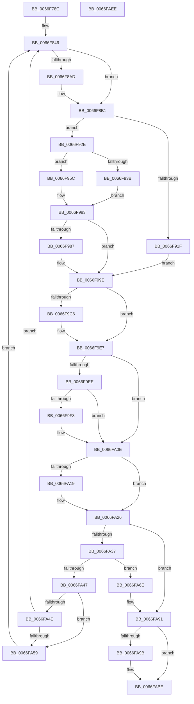

# MiReadPagefilePage

- RVA: `0x0066F78C`–`0x0066FAEF` (길이 `867` bytes)
- VA: `0x000000014066F78C`
- 실행 섹션: `.text`
- PDB 이름 있음: `예`; PDB Function 태그: `아니요`
- unwind 정보 RVA: `0x000D76CC`
- 디코드: `215`개 명령, `867/867` bytes 표시
- 미해석 바이트: `0` (있으면 어셈블리에 `.byte`로 보존)

> 이 문서는 커널 이미지의 기계어와 PDB 기호를 분석해 생성했습니다. 4번과 5번은 함수 원형과 자료형을 바이너리 사용 방식에서 추정한 C 해석이며 원본 소스 복구 결과는 아닙니다.

## 1. Dependencies

- 직접 호출 지점: **23**; 고유 호출 대상: **20**
- 직접 호출자로 확인된 함수: **1**
- RIP 상대 이미지 참조: **3**

### Outgoing calls
- `0x0066F7D6` → [memset](../6C/memset_function_006C6C40.md) (function, `0x006C6C40`)
- `0x0066F868` → [MiInitializeInPageSupport](../36/MiInitializeInPageSupport_function_00362728.md) (function, `0x00362728`)
- `0x0066F878` → [MiIsPteInStore](../36/MiIsPteInStore_function_00362460.md) (function, `0x00362460`)
- `0x0066F8A2` → [MiGetPagingFileOffset](../36/MiGetPagingFileOffset_function_0036F530.md) (function, `0x0036F530`)
- `0x0066F8C5` → [MiSetPageTablePfnBuddy](../4A/MiSetPageTablePfnBuddy_function_004A3394.md) (function, `0x004A3394`)
- `0x0066F927` → [MiReadFromMemoryPagefile](../4D/MiReadFromMemoryPagefile_function_004DB6B0.md) (function, `0x004DB6B0`)
- `0x0066F955` → [IoPageReadEx](../29/IoPageReadEx_function_0029ABF0.md) (function, `0x0029ABF0`)
- `0x0066F97E` → [SmPageRead](../34/SmPageRead_function_0034C1A0.md) (function, `0x0034C1A0`)
- `0x0066F999` → [KeSetEvent](../33/KeSetEvent_function_0033F310.md) (function, `0x0033F310`)
- `0x0066F9B3` → [KeWaitForSingleObject](../20/KeWaitForSingleObject_function_0020E6B0.md) (function, `0x0020E6B0`)
- `0x0066F9D0` → [MiStoreFaultComplete](../38/MiStoreFaultComplete_function_00381240.md) (function, `0x00381240`)
- `0x0066F9D8` → [MiLockPageInline](../31/MiLockPageInline_function_0031A340.md) (function, `0x0031A340`)
- `0x0066F9E2` → [MiUnlockPage](../31/MiUnlockPage_function_0031A3E0.md) (function, `0x0031A3E0`)
- `0x0066FA07` → [MiValidatePagefilePageHash](../38/MiValidatePagefilePageHash_function_003815F0.md) (function, `0x003815F0`)
- `0x0066FA21` → [MmUnmapLockedPages](../24/MmUnmapLockedPages_function_00246E60.md) (function, `0x00246E60`)
- `0x0066FA2E` → [MiSetPageTablePfnBuddy](../4A/MiSetPageTablePfnBuddy_function_004A3394.md) (function, `0x004A3394`)
- `0x0066FA3E` → [MiIsRetryIoStatus](../40/MiIsRetryIoStatus_function_00408640.md) (function, `0x00408640`)
- `0x0066FA64` → [KeDelayExecutionThread](../20/KeDelayExecutionThread_function_00209550.md) (function, `0x00209550`)
- `0x0066FA70` → [MiFlushAllFilesystemPages](../4E/MiFlushAllFilesystemPages_function_004E141C.md) (function, `0x004E141C`)
- `0x0066FA8B` → [KeBugCheckEx](../4F/KeBugCheckEx_function_004FD660.md) (function, `0x004FD660`)
- `0x0066FA9D` → [MiFlushAllFilesystemPages](../4E/MiFlushAllFilesystemPages_function_004E141C.md) (function, `0x004E141C`)
- `0x0066FAB8` → [KeBugCheckEx](../4F/KeBugCheckEx_function_004FD660.md) (function, `0x004FD660`)
- `0x0066FAC8` → [_security_check_cookie](../6A/_security_check_cookie_function_006AC640.md) (function, `0x006AC640`)

### Direct callers
- [MiMakeOutswappedPageResident](../43/MiMakeOutswappedPageResident_function_00431AD0.md) at `0x00431F81`

### Static image references
- `0x0066F7B2` → RVA `0x00E0A740` (`.data`; read)
- `0x0066F84D` → RVA `0x00E30088` (`.data`; read)
- `0x0066FA59` → RVA `0x00014A38` (`.rdata`; read)

## 2. Other-region calls and transfers

- 다른 실행 섹션으로 향하는 call: **0**
- 별도 외부 분기/꼬리 이동을 확인하지 못했습니다.

## 3. Assembly (complete function range)

```asm
0066F78C  48 8B C4                        mov rax, rsp
0066F78F  48 89 58 10                     mov qword ptr [rax + 0x10], rbx
0066F793  48 89 70 18                     mov qword ptr [rax + 0x18], rsi
0066F797  48 89 78 20                     mov qword ptr [rax + 0x20], rdi
0066F79B  55                              push rbp
0066F79C  41 54                           push r12
0066F79E  41 55                           push r13
0066F7A0  41 56                           push r14
0066F7A2  41 57                           push r15
0066F7A4  48 8D A8 B8 FE FF FF            lea rbp, [rax - 0x148]
0066F7AB  48 81 EC 20 02 00 00            sub rsp, 0x220
0066F7B2  48 8B 05 87 AF 79 00            mov rax, qword ptr [rip + 0x79af87]
0066F7B9  48 33 C4                        xor rax, rsp
0066F7BC  48 89 85 10 01 00 00            mov qword ptr [rbp + 0x110], rax
0066F7C3  4C 8B FA                        mov r15, rdx
0066F7C6  4C 8B E9                        mov r13, rcx
0066F7C9  33 D2                           xor edx, edx
0066F7CB  48 8D 4C 24 50                  lea rcx, [rsp + 0x50]
0066F7D0  41 B8 C0 01 00 00               mov r8d, 0x1c0
0066F7D6  E8 65 74 05 00                  call 0x1406c6c40
0066F7DB  4E 8D 34 6D 00 00 00 00         lea r14, [r13*2]
0066F7E3  4D 03 F5                        add r14, r13
0066F7E6  49 C1 E6 04                     shl r14, 4
0066F7EA  48 B8 00 00 00 00 00 DE FF FF   movabs rax, 0xffffde0000000000
0066F7F4  4C 03 F0                        add r14, rax
0066F7F7  49 C1 E7 19                     shl r15, 0x19
0066F7FB  48 B8 00 00 00 00 80 F6 FF FF   movabs rax, 0xfffff68000000000
0066F805  48 C1 E0 19                     shl rax, 0x19
0066F809  B9 FF 0F 00 00                  mov ecx, 0xfff
0066F80E  4C 2B F8                        sub r15, rax
0066F811  B8 FF 1F 00 00                  mov eax, 0x1fff
0066F816  49 C1 FF 10                     sar r15, 0x10
0066F81A  45 0F B7 E7                     movzx r12d, r15w
0066F81E  66 44 23 E1                     and r12w, cx
0066F822  66 44 03 E0                     add r12w, ax
0066F826  49 8B C7                        mov rax, r15
0066F829  66 41 C1 EC 0C                  shr r12w, 0xc
0066F82E  48 25 00 F0 FF FF               and rax, 0xfffffffffffff000
0066F834  66 41 83 C4 06                  add r12w, 6
0066F839  48 89 44 24 48                  mov qword ptr [rsp + 0x48], rax
0066F83E  66 41 C1 E4 03                  shl r12w, 3
0066F843  44 23 F9                        and r15d, ecx
0066F846  49 8B 46 28                     mov rax, qword ptr [r14 + 0x28]
0066F84A  45 33 C0                        xor r8d, r8d
0066F84D  48 8B 0D 34 08 7C 00            mov rcx, qword ptr [rip + 0x7c0834]
0066F854  33 D2                           xor edx, edx
0066F856  48 C1 E8 2B                     shr rax, 0x2b
0066F85A  25 FF 03 00 00                  and eax, 0x3ff
0066F85F  48 8B 3C C1                     mov rdi, qword ptr [rcx + rax*8]
0066F863  48 8D 4C 24 50                  lea rcx, [rsp + 0x50]
0066F868  E8 BB 2E CF FF                  call 0x140362728
0066F86D  44 8B 4D 10                     mov r9d, dword ptr [rbp + 0x10]
0066F871  48 8B CF                        mov rcx, rdi
0066F874  49 8B 56 10                     mov rdx, qword ptr [r14 + 0x10]
0066F878  E8 E3 2B CF FF                  call 0x140362460
0066F87D  49 8B 76 10                     mov rsi, qword ptr [r14 + 0x10]
0066F881  8B D8                           mov ebx, eax
0066F883  83 E3 01                        and ebx, 1
0066F886  48 C1 EE 0C                     shr rsi, 0xc
0066F88A  8B CB                           mov ecx, ebx
0066F88C  41 0F BA F1 0A                  btr r9d, 0xa
0066F891  0F BA E9 0C                     bts ecx, 0xc
0066F895  C1 E1 0A                        shl ecx, 0xa
0066F898  41 0B C9                        or ecx, r9d
0066F89B  89 4D 10                        mov dword ptr [rbp + 0x10], ecx
0066F89E  49 8B 4E 10                     mov rcx, qword ptr [r14 + 0x10]
0066F8A2  E8 89 FC CF FF                  call 0x14036f530
0066F8A7  8B C0                           mov eax, eax
0066F8A9  85 DB                           test ebx, ebx
0066F8AB  75 04                           jne 0x14066f8b1
0066F8AD  48 C1 E0 0C                     shl rax, 0xc
0066F8B1  45 33 C0                        xor r8d, r8d
0066F8B4  48 89 45 B0                     mov qword ptr [rbp - 0x50], rax
0066F8B8  48 BA 00 00 00 00 00 01 00 00   movabs rdx, 0x10000000000
0066F8C2  49 8B CE                        mov rcx, r14
0066F8C5  E8 CA 3A E3 FF                  call 0x1404a3394
0066F8CA  48 8B 44 24 48                  mov rax, qword ptr [rsp + 0x48]
0066F8CF  83 E6 0F                        and esi, 0xf
0066F8D2  48 89 85 80 00 00 00            mov qword ptr [rbp + 0x80], rax
0066F8D9  33 D2                           xor edx, edx
0066F8DB  48 89 55 60                     mov qword ptr [rbp + 0x60], rdx
0066F8DF  B8 02 40 00 00                  mov eax, 0x4002
0066F8E4  66 89 45 6A                     mov word ptr [rbp + 0x6a], ax
0066F8E8  66 44 89 65 68                  mov word ptr [rbp + 0x68], r12w
0066F8ED  44 89 BD 8C 00 00 00            mov dword ptr [rbp + 0x8c], r15d
0066F8F4  C7 85 88 00 00 00 00 10 00 00   mov dword ptr [rbp + 0x88], 0x1000
0066F8FE  C7 45 08 00 10 00 00            mov dword ptr [rbp + 8], 0x1000
0066F905  4C 89 AD 90 00 00 00            mov qword ptr [rbp + 0x90], r13
0066F90C  48 8B BC F7 60 48 00 00         mov rdi, qword ptr [rdi + rsi*8 + 0x4860]
0066F914  66 0F BA A7 AC 00 00 00 0B      bt word ptr [rdi + 0xac], 0xb
0066F91D  73 0F                           jae 0x14066f92e
0066F91F  48 8D 54 24 50                  lea rdx, [rsp + 0x50]
0066F924  48 8B CF                        mov rcx, rdi
0066F927  E8 84 BD E6 FF                  call 0x1404db6b0
0066F92C  EB 70                           jmp 0x14066f99e
0066F92E  48 8D 45 A0                     lea rax, [rbp - 0x60]
0066F932  4C 8D 4C 24 70                  lea r9, [rsp + 0x70]
0066F937  85 DB                           test ebx, ebx
0066F939  75 21                           jne 0x14066f95c
0066F93B  48 8B 4F 18                     mov rcx, qword ptr [rdi + 0x18]
0066F93F  4C 8D 45 B0                     lea r8, [rbp - 0x50]
0066F943  48 89 54 24 30                  mov qword ptr [rsp + 0x30], rdx
0066F948  89 54 24 28                     mov dword ptr [rsp + 0x28], edx
0066F94C  48 8D 55 60                     lea rdx, [rbp + 0x60]
0066F950  48 89 44 24 20                  mov qword ptr [rsp + 0x20], rax
0066F955  E8 96 B2 C2 FF                  call 0x14029abf0
0066F95A  EB 27                           jmp 0x14066f983
0066F95C  89 55 A0                        mov dword ptr [rbp - 0x60], edx
0066F95F  4C 8D 45 60                     lea r8, [rbp + 0x60]
0066F963  48 89 55 A8                     mov qword ptr [rbp - 0x58], rdx
0066F967  48 8D 55 B0                     lea rdx, [rbp - 0x50]
0066F96B  48 8B 8F D8 00 00 00            mov rcx, qword ptr [rdi + 0xd8]
0066F972  48 89 44 24 20                  mov qword ptr [rsp + 0x20], rax
0066F977  48 8B 89 B8 00 00 00            mov rcx, qword ptr [rcx + 0xb8]
0066F97E  E8 1D C8 CD FF                  call 0x14034c1a0
0066F983  85 C0                           test eax, eax
0066F985  79 17                           jns 0x14066f99e
0066F987  48 83 65 A8 00                  and qword ptr [rbp - 0x58], 0
0066F98C  48 8D 4C 24 70                  lea rcx, [rsp + 0x70]
0066F991  45 33 C0                        xor r8d, r8d
0066F994  89 45 A0                        mov dword ptr [rbp - 0x60], eax
0066F997  33 D2                           xor edx, edx
0066F999  E8 72 F9 CC FF                  call 0x14033f310
0066F99E  48 83 64 24 20 00               and qword ptr [rsp + 0x20], 0
0066F9A4  48 8D 4C 24 70                  lea rcx, [rsp + 0x70]
0066F9A9  45 33 C9                        xor r9d, r9d
0066F9AC  45 33 C0                        xor r8d, r8d
0066F9AF  41 8D 51 09                     lea edx, [r9 + 9]
0066F9B3  E8 F8 EC B9 FF                  call 0x14020e6b0
0066F9B8  83 64 24 40 00                  and dword ptr [rsp + 0x40], 0
0066F9BD  8B 45 10                        mov eax, dword ptr [rbp + 0x10]
0066F9C0  0F BA E0 0A                     bt eax, 0xa
0066F9C4  73 21                           jae 0x14066f9e7
0066F9C6  48 8D 54 24 40                  lea rdx, [rsp + 0x40]
0066F9CB  48 8D 4C 24 50                  lea rcx, [rsp + 0x50]
0066F9D0  E8 6B 18 D1 FF                  call 0x140381240
0066F9D5  49 8B CE                        mov rcx, r14
0066F9D8  E8 63 A9 CA FF                  call 0x14031a340
0066F9DD  8A D0                           mov dl, al
0066F9DF  49 8B CE                        mov rcx, r14
0066F9E2  E8 F9 A9 CA FF                  call 0x14031a3e0
0066F9E7  8B 5D A0                        mov ebx, dword ptr [rbp - 0x60]
0066F9EA  85 DB                           test ebx, ebx
0066F9EC  78 20                           js 0x14066fa0e
0066F9EE  48 83 BF B8 00 00 00 00         cmp qword ptr [rdi + 0xb8], 0
0066F9F6  74 16                           je 0x14066fa0e
0066F9F8  8B 45 10                        mov eax, dword ptr [rbp + 0x10]
0066F9FB  48 8D 4C 24 50                  lea rcx, [rsp + 0x50]
0066FA00  0F BA E8 17                     bts eax, 0x17
0066FA04  89 45 10                        mov dword ptr [rbp + 0x10], eax
0066FA07  E8 E4 1B D1 FF                  call 0x1403815f0
0066FA0C  8B D8                           mov ebx, eax
0066FA0E  BF 01 00 00 00                  mov edi, 1
0066FA13  40 84 7D 6A                     test byte ptr [rbp + 0x6a], dil
0066FA17  74 0D                           je 0x14066fa26
0066FA19  48 8B 4D 78                     mov rcx, qword ptr [rbp + 0x78]
0066FA1D  48 8D 55 60                     lea rdx, [rbp + 0x60]
0066FA21  E8 3A 74 BD FF                  call 0x140246e60
0066FA26  45 33 C0                        xor r8d, r8d
0066FA29  33 D2                           xor edx, edx
0066FA2B  49 8B CE                        mov rcx, r14
0066FA2E  E8 61 39 E3 FF                  call 0x1404a3394
0066FA33  85 DB                           test ebx, ebx
0066FA35  79 5A                           jns 0x14066fa91
0066FA37  BA 00 10 00 00                  mov edx, 0x1000
0066FA3C  8B CB                           mov ecx, ebx
0066FA3E  E8 FD 8B D9 FF                  call 0x140408640
0066FA43  85 C0                           test eax, eax
0066FA45  74 27                           je 0x14066fa6e
0066FA47  40 84 7C 24 40                  test byte ptr [rsp + 0x40], dil
0066FA4C  74 0B                           je 0x14066fa59
0066FA4E  F6 44 24 40 02                  test byte ptr [rsp + 0x40], 2
0066FA53  0F 84 ED FD FF FF               je 0x14066f846
0066FA59  4C 8D 05 D8 4F 9A FF            lea r8, [rip - 0x65b028]
0066FA60  33 D2                           xor edx, edx
0066FA62  33 C9                           xor ecx, ecx
0066FA64  E8 E7 9A B9 FF                  call 0x140209550
0066FA69  E9 D8 FD FF FF                  jmp 0x14066f846
0066FA6E  8B CF                           mov ecx, edi
0066FA70  E8 A7 19 E7 FF                  call 0x1404e141c
0066FA75  8B 45 B0                        mov eax, dword ptr [rbp - 0x50]
0066FA78  4C 8B CE                        mov r9, rsi
0066FA7B  48 63 D3                        movsxd rdx, ebx
0066FA7E  B9 77 00 00 00                  mov ecx, 0x77
0066FA83  4C 8B C2                        mov r8, rdx
0066FA86  48 89 44 24 20                  mov qword ptr [rsp + 0x20], rax
0066FA8B  E8 D0 DB E8 FF                  call 0x1404fd660
0066FA90  CC                              int3
0066FA91  48 81 7D A8 00 10 00 00         cmp qword ptr [rbp - 0x58], 0x1000
0066FA99  74 23                           je 0x14066fabe
0066FA9B  8B CF                           mov ecx, edi
0066FA9D  E8 7A 19 E7 FF                  call 0x1404e141c
0066FAA2  8B 45 B0                        mov eax, dword ptr [rbp - 0x50]
0066FAA5  BA 02 00 00 00                  mov edx, 2
0066FAAA  4C 63 C3                        movsxd r8, ebx
0066FAAD  4C 8B CE                        mov r9, rsi
0066FAB0  48 89 44 24 20                  mov qword ptr [rsp + 0x20], rax
0066FAB5  8D 4A 75                        lea ecx, [rdx + 0x75]
0066FAB8  E8 A3 DB E8 FF                  call 0x1404fd660
0066FABD  CC                              int3
0066FABE  48 8B 8D 10 01 00 00            mov rcx, qword ptr [rbp + 0x110]
0066FAC5  48 33 CC                        xor rcx, rsp
0066FAC8  E8 73 CB 03 00                  call 0x1406ac640
0066FACD  4C 8D 9C 24 20 02 00 00         lea r11, [rsp + 0x220]
0066FAD5  49 8B 5B 38                     mov rbx, qword ptr [r11 + 0x38]
0066FAD9  49 8B 73 40                     mov rsi, qword ptr [r11 + 0x40]
0066FADD  49 8B 7B 48                     mov rdi, qword ptr [r11 + 0x48]
0066FAE1  49 8B E3                        mov rsp, r11
0066FAE4  41 5F                           pop r15
0066FAE6  41 5E                           pop r14
0066FAE8  41 5D                           pop r13
0066FAEA  41 5C                           pop r12
0066FAEC  5D                              pop rbp
0066FAED  C3                              ret
0066FAEE  CC                              int3
```

## 4. C-style interpretation (structured pseudocode)

```c
__int64 __fastcall MiReadPagefilePage(__int64 a1, __int64 a2)
{
    __int64 result;
    __int64 v_r12;
    __int64 v_r14;
    __int64 v_r15;
    __int64 v_rbx;
    __int64 v_rsi;
    __int64 v_rsp;
    unsigned __int64 v_stack_m1D8;
    unsigned __int64 v_stack_m1F8;
    unsigned __int64 v_stack_m200;
    unsigned int v_stack_m208;
    unsigned __int64 v_stack_m218;
    unsigned int v_stack_m220;
    unsigned __int64 v_stack_m228;
    unsigned __int64 v_stack_m28;

    *(unsigned __int64 *)(v_rsp + 16) = v_rbx;
    *(unsigned __int64 *)(v_rsp + 24) = v_rsi;
    *(unsigned __int64 *)(v_rsp + 32) = v_rdi;
    v_rsp = (v_rsp) - (544);
    result = (*(unsigned __int64 *)(v_rip + 7974791)) ^ (v_rsp);
    *(unsigned __int64 *)(v_rsp - 328 + 272) = result;
    a2 = 0;
    result = memset(v_stack_m1F8, a2, 448, a4);
    v_r14 = (a1 * 2) + (a1);
    v_r14 = (v_r14) << (4);
    v_r14 = (v_r14) + (result);
    v_r15 = (a2) << (25);
    result = (result) << (25);
    v_r15 = (v_r15) - (result);
    v_r15 = (v_r15) >> (16);
    v_r12 = (unsigned __int16)(((unsigned __int16)(v_r15)) & ((unsigned __int16)((unsigned int)(0xFFFULL))));
    v_r12 = (unsigned __int16)((v_r12) + ((unsigned __int16)((unsigned int)(0x1FFFULL))));
    v_r12 = (unsigned __int16)((v_r12) >> (12));
    result = (v_r15) & (0xFFFFFFFFFFFFF000ULL);
    v_r12 = (unsigned __int16)((v_r12) + (6));
    v_stack_m200 = result;
    v_r12 = (unsigned __int16)((v_r12) << (3));
    v_r15 = (unsigned int)((v_r15) & ((unsigned int)((unsigned int)(0xFFFULL))));
loc_0066F846:
    a3 = 0;
    a2 = 0;
    result = (*(unsigned __int64 *)(v_r14 + 40)) >> (43);
    result = (unsigned int)((result) & (0x3FFULL));
    result = MiInitializeInPageSupport(v_stack_m1F8, a2, a3, a4);
    result = MiIsPteInStore(*(unsigned __int64 *)(*(unsigned __int64 *)(v_rip + 8128564) + result * 8), *(unsigned __int64 *)(v_r14 + 16), a3, (unsigned int)(*(unsigned int *)(v_rsp - 328 + 16)));
    v_rbx = (unsigned int)(((unsigned int)((unsigned int)(result))) & (1));
    v_rsi = (*(unsigned __int64 *)(v_r14 + 16)) >> (12);
    a1 = (unsigned int)(((unsigned int)((unsigned int)(v_rbx))) << (10));
    a1 = (unsigned int)((a1) | ((unsigned int)((unsigned int)(*(unsigned int *)(v_rsp - 328 + 16)))));
    *(unsigned int *)(v_rsp - 328 + 16) = (unsigned int)(a1);
    result = MiGetPagingFileOffset(*(unsigned __int64 *)(v_r14 + 16), *(unsigned __int64 *)(v_r14 + 16), a3, (unsigned int)(*(unsigned int *)(v_rsp - 328 + 16)));
    result = (unsigned int)((unsigned int)(result));
    if ((unsigned int)(v_rbx) == 0) {
        result = ((unsigned int)((unsigned int)(result))) << (12);
    }
    a3 = 0;
    *(unsigned __int64 *)(v_rsp - 328 - 80) = result;
    result = MiSetPageTablePfnBuddy(v_r14, *(unsigned __int64 *)(v_r14 + 16), a3, (unsigned int)(*(unsigned int *)(v_rsp - 328 + 16)));
    v_rsi = (unsigned int)((v_rsi) & (15));
    *(unsigned __int64 *)(v_rsp - 328 + 128) = v_stack_m200;
    a2 = 0;
    *(unsigned __int64 *)(v_rsp - 328 + 96) = 0;
    *(unsigned __int16 *)(v_rsp - 328 + 106) = (unsigned __int16)((unsigned int)(0x4002ULL));
    *(unsigned __int16 *)(v_rsp - 328 + 104) = (unsigned __int16)(v_r12);
    *(unsigned int *)(v_rsp - 328 + 140) = (unsigned int)(v_r15);
    *(unsigned int *)(v_rsp - 328 + 136) = 0x1000ULL;
    *(unsigned int *)(v_rsp - 328 + 8) = 0x1000ULL;
    *(unsigned __int64 *)(v_rsp - 328 + 144) = a1;
    if (condition_is_above_or_equal) goto loc_0066F92E;
    result = MiReadFromMemoryPagefile(*(unsigned __int64 *)(*(unsigned __int64 *)(*(unsigned __int64 *)(v_rip + 8128564) + result * 8) + v_rsi * 8 + 18528), v_stack_m1F8, a3, (unsigned int)(*(unsigned int *)(v_rsp - 328 + 16)));
    goto loc_0066F99E;
loc_0066F92E:
    if ((unsigned int)(v_rbx) != 0) goto loc_0066F95C;
    v_stack_m218 = v_stack_m1F8;
    v_stack_m220 = (unsigned int)(v_stack_m1F8);
    v_stack_m228 = v_rsp - 328 - 96;
    result = IoPageReadEx(*(unsigned __int64 *)(*(unsigned __int64 *)(*(unsigned __int64 *)(*(unsigned __int64 *)(v_rip + 8128564) + result * 8) + v_rsi * 8 + 18528) + 24), v_rsp - 328 + 96, v_rsp - 328 - 80, v_stack_m1D8);
    goto loc_0066F983;
loc_0066F95C:
    *(unsigned int *)(v_rsp - 328 - 96) = (unsigned int)(v_rsp - 328 + 96);
    *(unsigned __int64 *)(v_rsp - 328 - 88) = v_rsp - 328 + 96;
    v_stack_m228 = result;
    result = SmPageRead(*(unsigned __int64 *)(*(unsigned __int64 *)(*(unsigned __int64 *)(*(unsigned __int64 *)(*(unsigned __int64 *)(v_rip + 8128564) + result * 8) + v_rsi * 8 + 18528) + 216) + 184), v_rsp - 328 - 80, v_rsp - 328 + 96, v_stack_m1D8);
loc_0066F983:
    if (sign_flag) {
        a1 = v_stack_m1D8;
        a3 = 0;
        *(unsigned int *)(v_rsp - 328 - 96) = (unsigned int)(result);
        a2 = 0;
        result = KeSetEvent(a1, a2, a3, v_stack_m1D8);
    }
    a4 = 0;
    a3 = 0;
    result = KeWaitForSingleObject(v_stack_m1D8, a4 + 9, a3, a4);
    result = (unsigned int)(*(unsigned int *)(v_rsp - 328 + 16));
    if (!(condition_is_above_or_equal)) {
        a2 = v_stack_m208;
        a1 = v_stack_m1F8;
        result = MiStoreFaultComplete(a1, a2, a3, a4);
        a1 = v_r14;
        result = MiLockPageInline(a1, a2, a3, a4);
        a2 = (unsigned __int8)(result);
        a1 = v_r14;
        result = MiUnlockPage(a1, a2, a3, a4);
    }
    if (sign_flag) goto loc_0066FA0E;
    v_rbx = (unsigned int)(*(unsigned int *)(v_rsp - 328 - 96));
    if ((*(unsigned __int64 *)(*(unsigned __int64 *)(*(unsigned __int64 *)(*(unsigned __int64 *)(v_rip + 8128564) + result * 8) + v_rsi * 8 + 18528) + 184)) != 0) {
        result = *(unsigned int *)(v_rsp - 328 + 16);
        a1 = v_stack_m1F8;
        *(unsigned int *)(v_rsp - 328 + 16) = (unsigned int)(result);
        result = MiValidatePagefilePageHash(a1, a2, a3, a4);
        v_rbx = (unsigned int)(result);
    }
    if (((*(unsigned __int8 *)(v_rsp - 328 + 106)) & (1)) != 0) {
        a1 = *(unsigned __int64 *)(v_rsp - 328 + 120);
        a2 = v_rsp - 328 + 96;
        result = MmUnmapLockedPages(a1, a2, a3, a4);
    }
    a3 = 0;
    a2 = 0;
    result = MiSetPageTablePfnBuddy(v_r14, a2, a3, a4);
    if (!sign_flag) goto loc_0066FA91;
    result = MiIsRetryIoStatus((unsigned int)((unsigned int)(v_rbx)), (unsigned int)(0x1000ULL), a3, a4);
    if ((unsigned int)(result) == 0) goto loc_0066FA6E;
    if (((v_stack_m208) & (1)) == 0) goto loc_0066FA59;
    if (((v_stack_m208) & (2)) == 0) goto loc_0066F846;
loc_0066FA59:
    a2 = 0;
    a1 = 0;
    result = KeDelayExecutionThread(a1, a2, v_rip - 6664232, a4);
    goto loc_0066F846;
loc_0066FA6E:
    result = MiFlushAllFilesystemPages(1, a2, v_rip - 6664232, a4);
    v_stack_m228 = (unsigned int)(*(unsigned int *)(v_rsp - 328 - 80));
    result = KeBugCheckEx(119, (int)((unsigned int)(v_rbx)), (int)((unsigned int)(v_rbx)), v_rsi);
loc_0066FA91:
    if ((*(unsigned __int64 *)(v_rsp - 328 - 88)) != 0x1000ULL) {
        a1 = 1;
        result = MiFlushAllFilesystemPages(a1, (int)((unsigned int)(v_rbx)), (int)((unsigned int)(v_rbx)), v_rsi);
        result = *(unsigned int *)(v_rsp - 328 - 80);
        a2 = 2;
        a3 = (int)((unsigned int)(v_rbx));
        a4 = v_rsi;
        v_stack_m228 = result;
        a1 = a2 + 117;
        result = KeBugCheckEx(a1, a2, a3, a4);
    }
    a1 = (*(unsigned __int64 *)(v_rsp - 328 + 272)) ^ (v_rsp);
    result = _security_check_cookie(a1, a2, a3, a4);
    return result;
}
```

## 5. (Beta) C Style

```c
int64_t MiReadPagefilePage(int64_t Arg1, int64_t Arg2)
{
    int64_t result;
    int64_t local_r12;
    int64_t local_r14;
    int64_t local_r15;
    int64_t local_rbx;
    int64_t local_rsi;
    int64_t local_rsp;
    uint64_t v_stack_m1D8;
    uint64_t v_stack_m1F8;
    uint64_t v_stack_m200;
    uint32_t v_stack_m208;
    uint64_t v_stack_m218;
    uint32_t v_stack_m220;
    uint64_t v_stack_m228;
    uint64_t v_stack_m28;

    *(uint64_t *)(local_rsp + 0x10) = local_rbx;
    *(uint64_t *)(local_rsp + 0x18) = local_rsi;
    *(uint64_t *)(local_rsp + 0x20) = local_rdi;
    local_rsp = (local_rsp) - (544);
    result = (*(uint64_t *)(v_rip + 0x79AF87)) ^ (local_rsp);
    *(uint64_t *)(local_rsp - 0x148 + 0x110) = result;
    Arg2 = 0;
    result = memset(v_stack_m1F8, Arg2, 448, a4);
    local_r14 = (Arg1 * 2) + (Arg1);
    local_r14 = (local_r14) << (4);
    local_r14 = (local_r14) + (result);
    local_r15 = (Arg2) << (25);
    result = (result) << (25);
    local_r15 = (local_r15) - (result);
    local_r15 = (local_r15) >> (16);
    local_r12 = (uint16_t)(((uint16_t)(local_r15)) & ((uint16_t)((uint32_t)(0xFFFULL))));
    local_r12 = (uint16_t)((local_r12) + ((uint16_t)((uint32_t)(0x1FFFULL))));
    local_r12 = (uint16_t)((local_r12) >> (12));
    result = (local_r15) & (0xFFFFFFFFFFFFF000ULL);
    local_r12 = (uint16_t)((local_r12) + (6));
    v_stack_m200 = result;
    local_r12 = (uint16_t)((local_r12) << (3));
    local_r15 = (uint32_t)((local_r15) & ((uint32_t)((uint32_t)(0xFFFULL))));
loc_0066F846:
    a3 = 0;
    Arg2 = 0;
    result = (*(uint64_t *)(local_r14 + 0x28)) >> (43);
    result = (uint32_t)((result) & (0x3FFULL));
    result = MiInitializeInPageSupport(v_stack_m1F8, Arg2, a3, a4);
    result = MiIsPteInStore(*(uint64_t *)(*(uint64_t *)(v_rip + 0x7C0834) + result * 8), *(uint64_t *)(local_r14 + 0x10), a3, (uint32_t)(*(uint32_t *)(local_rsp - 0x148 + 0x10)));
    local_rbx = (uint32_t)(((uint32_t)((uint32_t)(result))) & (1));
    local_rsi = (*(uint64_t *)(local_r14 + 0x10)) >> (12);
    Arg1 = (uint32_t)(((uint32_t)((uint32_t)(local_rbx))) << (10));
    Arg1 = (uint32_t)((Arg1) | ((uint32_t)((uint32_t)(*(uint32_t *)(local_rsp - 0x148 + 0x10)))));
    *(uint32_t *)(local_rsp - 0x148 + 0x10) = (uint32_t)(Arg1);
    result = MiGetPagingFileOffset(*(uint64_t *)(local_r14 + 0x10), *(uint64_t *)(local_r14 + 0x10), a3, (uint32_t)(*(uint32_t *)(local_rsp - 0x148 + 0x10)));
    result = (uint32_t)((uint32_t)(result));
    if ((uint32_t)(local_rbx) == 0) {
        result = ((uint32_t)((uint32_t)(result))) << (12);
    }
    a3 = 0;
    *(uint64_t *)(local_rsp - 0x148 - 0x50) = result;
    result = MiSetPageTablePfnBuddy(local_r14, *(uint64_t *)(local_r14 + 0x10), a3, (uint32_t)(*(uint32_t *)(local_rsp - 0x148 + 0x10)));
    local_rsi = (uint32_t)((local_rsi) & (15));
    *(uint64_t *)(local_rsp - 0x148 + 0x80) = v_stack_m200;
    Arg2 = 0;
    *(uint64_t *)(local_rsp - 0x148 + 0x60) = 0;
    *(uint16_t *)(local_rsp - 0x148 + 0x6A) = (uint16_t)((uint32_t)(0x4002ULL));
    *(uint16_t *)(local_rsp - 0x148 + 0x68) = (uint16_t)(local_r12);
    *(uint32_t *)(local_rsp - 0x148 + 0x8C) = (uint32_t)(local_r15);
    *(uint32_t *)(local_rsp - 0x148 + 0x88) = 0x1000ULL;
    *(uint32_t *)(local_rsp - 0x148 + 0x8) = 0x1000ULL;
    *(uint64_t *)(local_rsp - 0x148 + 0x90) = Arg1;
    if (condition_is_above_or_equal) goto loc_0066F92E;
    result = MiReadFromMemoryPagefile(*(uint64_t *)(*(uint64_t *)(*(uint64_t *)(v_rip + 0x7C0834) + result * 8) + local_rsi * 8 + 0x4860), v_stack_m1F8, a3, (uint32_t)(*(uint32_t *)(local_rsp - 0x148 + 0x10)));
    goto loc_0066F99E;
loc_0066F92E:
    if ((uint32_t)(local_rbx) != 0) goto loc_0066F95C;
    v_stack_m218 = v_stack_m1F8;
    v_stack_m220 = (uint32_t)(v_stack_m1F8);
    v_stack_m228 = local_rsp - 328 - 96;
    result = IoPageReadEx(*(uint64_t *)(*(uint64_t *)(*(uint64_t *)(*(uint64_t *)(v_rip + 0x7C0834) + result * 8) + local_rsi * 8 + 0x4860) + 0x18), local_rsp - 328 + 96, local_rsp - 328 - 80, v_stack_m1D8);
    goto loc_0066F983;
loc_0066F95C:
    *(uint32_t *)(local_rsp - 0x148 - 0x60) = (uint32_t)(local_rsp - 328 + 96);
    *(uint64_t *)(local_rsp - 0x148 - 0x58) = local_rsp - 328 + 96;
    v_stack_m228 = result;
    result = SmPageRead(*(uint64_t *)(*(uint64_t *)(*(uint64_t *)(*(uint64_t *)(*(uint64_t *)(v_rip + 0x7C0834) + result * 8) + local_rsi * 8 + 0x4860) + 0xD8) + 0xB8), local_rsp - 328 - 80, local_rsp - 328 + 96, v_stack_m1D8);
loc_0066F983:
    if (sign_flag) {
        Arg1 = v_stack_m1D8;
        a3 = 0;
        *(uint32_t *)(local_rsp - 0x148 - 0x60) = (uint32_t)(result);
        Arg2 = 0;
        result = KeSetEvent(Arg1, Arg2, a3, v_stack_m1D8);
    }
    a4 = 0;
    a3 = 0;
    result = KeWaitForSingleObject(v_stack_m1D8, a4 + 9, a3, a4);
    result = (uint32_t)(*(uint32_t *)(local_rsp - 0x148 + 0x10));
    if (!(condition_is_above_or_equal)) {
        Arg2 = v_stack_m208;
        Arg1 = v_stack_m1F8;
        result = MiStoreFaultComplete(Arg1, Arg2, a3, a4);
        Arg1 = local_r14;
        result = MiLockPageInline(Arg1, Arg2, a3, a4);
        Arg2 = (uint8_t)(result);
        Arg1 = local_r14;
        result = MiUnlockPage(Arg1, Arg2, a3, a4);
    }
    if (sign_flag) goto loc_0066FA0E;
    local_rbx = (uint32_t)(*(uint32_t *)(local_rsp - 0x148 - 0x60));
    if ((*(uint64_t *)(*(uint64_t *)(*(uint64_t *)(*(uint64_t *)(v_rip + 0x7C0834) + result * 8) + local_rsi * 8 + 0x4860) + 0xB8)) != 0) {
        result = *(uint32_t *)(local_rsp - 0x148 + 0x10);
        Arg1 = v_stack_m1F8;
        *(uint32_t *)(local_rsp - 0x148 + 0x10) = (uint32_t)(result);
        result = MiValidatePagefilePageHash(Arg1, Arg2, a3, a4);
        local_rbx = (uint32_t)(result);
    }
    if (((*(uint8_t *)(local_rsp - 0x148 + 0x6A)) & (1)) != 0) {
        Arg1 = *(uint64_t *)(local_rsp - 0x148 + 0x78);
        Arg2 = local_rsp - 328 + 96;
        result = MmUnmapLockedPages(Arg1, Arg2, a3, a4);
    }
    a3 = 0;
    Arg2 = 0;
    result = MiSetPageTablePfnBuddy(local_r14, Arg2, a3, a4);
    if (!sign_flag) goto loc_0066FA91;
    result = MiIsRetryIoStatus((uint32_t)((uint32_t)(local_rbx)), (uint32_t)(0x1000ULL), a3, a4);
    if ((uint32_t)(result) == 0) goto loc_0066FA6E;
    if (((v_stack_m208) & (1)) == 0) goto loc_0066FA59;
    if (((v_stack_m208) & (2)) == 0) goto loc_0066F846;
loc_0066FA59:
    Arg2 = 0;
    Arg1 = 0;
    result = KeDelayExecutionThread(Arg1, Arg2, v_rip - 6664232, a4);
    goto loc_0066F846;
loc_0066FA6E:
    result = MiFlushAllFilesystemPages(1, Arg2, v_rip - 6664232, a4);
    v_stack_m228 = (uint32_t)(*(uint32_t *)(local_rsp - 0x148 - 0x50));
    result = KeBugCheckEx(119, (int32_t)((uint32_t)(local_rbx)), (int32_t)((uint32_t)(local_rbx)), local_rsi);
loc_0066FA91:
    if ((*(uint64_t *)(local_rsp - 0x148 - 0x58)) != 0x1000ULL) {
        Arg1 = 1;
        result = MiFlushAllFilesystemPages(Arg1, (int32_t)((uint32_t)(local_rbx)), (int32_t)((uint32_t)(local_rbx)), local_rsi);
        result = *(uint32_t *)(local_rsp - 0x148 - 0x50);
        Arg2 = 2;
        a3 = (int32_t)((uint32_t)(local_rbx));
        a4 = local_rsi;
        v_stack_m228 = result;
        Arg1 = Arg2 + 117;
        result = KeBugCheckEx(Arg1, Arg2, a3, a4);
    }
    Arg1 = (*(uint64_t *)(local_rsp - 0x148 + 0x110)) ^ (local_rsp);
    result = _security_check_cookie(Arg1, Arg2, a3, a4);
    return result;
}
```

## 6. Execution-region graph

[열기: 2D/3D 그래프와 함수 탐색 컨트롤 패널](../../../control-panel.html?section=text&rva=0x0066F78C&view=graph)

- 2D 그래프는 위에서 아래로 흐르고, 3D 그래프는 빈 공간을 드래그해 회전합니다. Shift+드래그는 이동, 휠은 확대·축소, 함수 노드 선택은 대상 보고서 이동입니다.

### Static fallback


