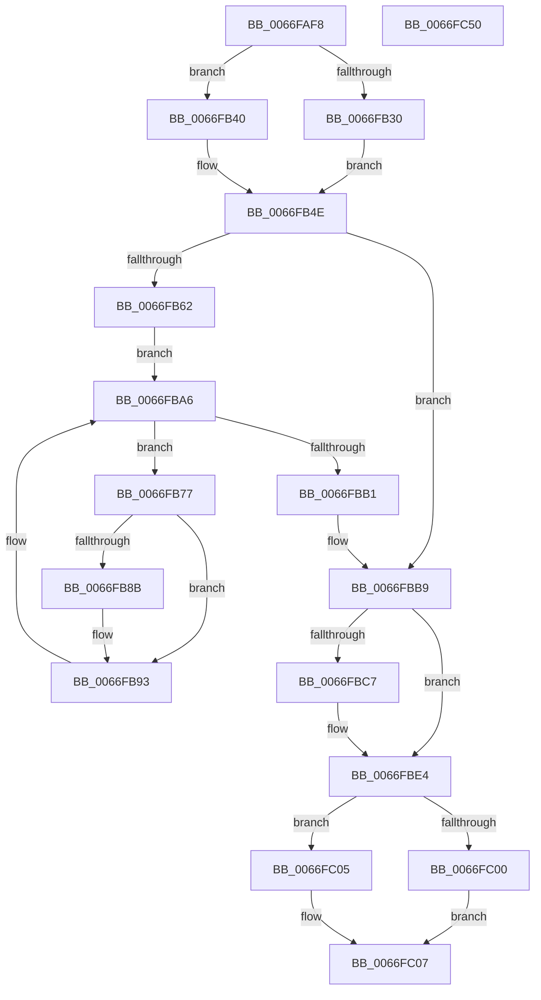

# MiReleaseCommitForResetPages

- RVA: `0x0066FAF8`–`0x0066FC51` (길이 `345` bytes)
- VA: `0x000000014066FAF8`
- 실행 섹션: `.text`
- PDB 이름 있음: `예`; PDB Function 태그: `아니요`
- unwind 정보 RVA: `0x00060300`
- 디코드: `95`개 명령, `345/345` bytes 표시
- 미해석 바이트: `0` (있으면 어셈블리에 `.byte`로 보존)

> 이 문서는 커널 이미지의 기계어와 PDB 기호를 분석해 생성했습니다. 4번과 5번은 함수 원형과 자료형을 바이너리 사용 방식에서 추정한 C 해석이며 원본 소스 복구 결과는 아닙니다.

## 1. Dependencies

- 직접 호출 지점: **15**; 고유 호출 대상: **15**
- 직접 호출자로 확인된 함수: **1**
- RIP 상대 이미지 참조: **3**

### Outgoing calls
- `0x0066FB18` → [KeForceAttachProcess](../21/KeForceAttachProcess_function_00216650.md) (function, `0x00216650`)
- `0x0066FB68` → [LOCK_ADDRESS_SPACE](../2A/LOCK_ADDRESS_SPACE_function_002A4944.md) (function, `0x002A4944`)
- `0x0066FB70` → [MiGetFirstVad](../2A/MiGetFirstVad_function_002A8BBC.md) (function, `0x002A8BBC`)
- `0x0066FB7A` → [MiLockVad](../29/MiLockVad_function_00295810.md) (function, `0x00295810`)
- `0x0066FB82` → [MiIsVadEligibleForCommitRelease](../4F/MiIsVadEligibleForCommitRelease_function_004FB6FC.md) (function, `0x004FB6FC`)
- `0x0066FB8E` → [MiWalkResetCommitPages](MiWalkResetCommitPages_function_0066FC58.md) (function, `0x0066FC58`)
- `0x0066FB99` → [MiUnlockVad](../2A/MiUnlockVad_function_002A59C8.md) (function, `0x002A59C8`)
- `0x0066FBA1` → [MiGetNextVad](../29/MiGetNextVad_function_00297224.md) (function, `0x00297224`)
- `0x0066FBB4` → [UNLOCK_ADDRESS_SPACE](../2A/UNLOCK_ADDRESS_SPACE_function_002A4844.md) (function, `0x002A4844`)
- `0x0066FBDF` → [MiReturnCommit](../24/MiReturnCommit_function_00248410.md) (function, `0x00248410`)
- `0x0066FBE7` → [MiLockWorkingSetExclusive](../32/MiLockWorkingSetExclusive_function_003238A0.md) (function, `0x003238A0`)
- `0x0066FC11` → [MiUnlockWorkingSetExclusive](../27/MiUnlockWorkingSetExclusive_function_0027EC70.md) (function, `0x0027EC70`)
- `0x0066FC1C` → [MiLogResetPagesCommitRelease](MiLogResetPagesCommitRelease_function_0066F470.md) (function, `0x0066F470`)
- `0x0066FC25` → [KeForceDetachProcess](../3C/KeForceDetachProcess_function_003C7770.md) (function, `0x003C7770`)
- `0x0066FC32` → [KeSetEvent](../33/KeSetEvent_function_0033F310.md) (function, `0x0033F310`)

### Direct callers
- [MmOutSwapProcess](../3C/MmOutSwapProcess_function_003C8224.md) at `0x003C82DA`

### Static image references
- `0x0066FB30` → RVA `0x00E38848` (`.data`; read)
- `0x0066FB37` → RVA `0x00E38860` (`.data`; read)
- `0x0066FBD1` → RVA `0x00E30088` (`.data`; read)

## 2. Other-region calls and transfers

- 다른 실행 섹션으로 향하는 call: **0**
- 별도 외부 분기/꼬리 이동을 확인하지 못했습니다.

## 3. Assembly (complete function range)

```asm
0066FAF8  48 89 5C 24 08                  mov qword ptr [rsp + 8], rbx
0066FAFD  48 89 6C 24 10                  mov qword ptr [rsp + 0x10], rbp
0066FB02  48 89 74 24 18                  mov qword ptr [rsp + 0x18], rsi
0066FB07  57                              push rdi
0066FB08  41 56                           push r14
0066FB0A  41 57                           push r15
0066FB0C  48 83 EC 20                     sub rsp, 0x20
0066FB10  45 33 C0                        xor r8d, r8d
0066FB13  33 D2                           xor edx, edx
0066FB15  48 8B F9                        mov rdi, rcx
0066FB18  E8 33 6B BA FF                  call 0x140216650
0066FB1D  48 8D AF 00 04 00 00            lea rbp, [rdi + 0x400]
0066FB24  8B 85 B8 00 00 00               mov eax, dword ptr [rbp + 0xb8]
0066FB2A  24 0F                           and al, 0xf
0066FB2C  3C 01                           cmp al, 1
0066FB2E  75 10                           jne 0x14066fb40
0066FB30  4C 8D 3D 11 8D 7C 00            lea r15, [rip + 0x7c8d11]
0066FB37  48 8D 05 22 8D 7C 00            lea rax, [rip + 0x7c8d22]
0066FB3E  EB 0E                           jmp 0x14066fb4e
0066FB40  4C 8D BD C8 00 00 00            lea r15, [rbp + 0xc8]
0066FB47  48 8D 85 E0 00 00 00            lea rax, [rbp + 0xe0]
0066FB4E  65 48 8B 34 25 88 01 00 00      mov rsi, qword ptr gs:[0x188]
0066FB57  4C 8B 30                        mov r14, qword ptr [rax]
0066FB5A  41 8B 46 30                     mov eax, dword ptr [r14 + 0x30]
0066FB5E  A8 01                           test al, 1
0066FB60  74 57                           je 0x14066fbb9
0066FB62  48 8B D7                        mov rdx, rdi
0066FB65  48 8B CE                        mov rcx, rsi
0066FB68  E8 D7 4D C3 FF                  call 0x1402a4944
0066FB6D  48 8B CF                        mov rcx, rdi
0066FB70  E8 47 90 C3 FF                  call 0x1402a8bbc
0066FB75  EB 2F                           jmp 0x14066fba6
0066FB77  48 8B D3                        mov rdx, rbx
0066FB7A  E8 91 5C C2 FF                  call 0x140295810
0066FB7F  48 8B CB                        mov rcx, rbx
0066FB82  E8 75 BB E8 FF                  call 0x1404fb6fc
0066FB87  85 C0                           test eax, eax
0066FB89  74 08                           je 0x14066fb93
0066FB8B  48 8B CB                        mov rcx, rbx
0066FB8E  E8 C5 00 00 00                  call 0x14066fc58
0066FB93  48 8B D3                        mov rdx, rbx
0066FB96  48 8B CE                        mov rcx, rsi
0066FB99  E8 2A 5E C3 FF                  call 0x1402a59c8
0066FB9E  48 8B CB                        mov rcx, rbx
0066FBA1  E8 7E 76 C2 FF                  call 0x140297224
0066FBA6  48 8B D8                        mov rbx, rax
0066FBA9  48 8B CE                        mov rcx, rsi
0066FBAC  48 85 C0                        test rax, rax
0066FBAF  75 C6                           jne 0x14066fb77
0066FBB1  48 8B D7                        mov rdx, rdi
0066FBB4  E8 8B 4C C3 FF                  call 0x1402a4844
0066FBB9  33 DB                           xor ebx, ebx
0066FBBB  48 87 9F D0 04 00 00            xchg qword ptr [rdi + 0x4d0], rbx
0066FBC2  48 85 DB                        test rbx, rbx
0066FBC5  74 1D                           je 0x14066fbe4
0066FBC7  0F B7 85 AE 00 00 00            movzx eax, word ptr [rbp + 0xae]
0066FBCE  45 33 C0                        xor r8d, r8d
0066FBD1  48 8B 0D B0 04 7C 00            mov rcx, qword ptr [rip + 0x7c04b0]
0066FBD8  48 8B D3                        mov rdx, rbx
0066FBDB  48 8B 0C C1                     mov rcx, qword ptr [rcx + rax*8]
0066FBDF  E8 2C 88 BD FF                  call 0x140248410
0066FBE4  48 8B CD                        mov rcx, rbp
0066FBE7  E8 B4 3C CB FF                  call 0x1403238a0
0066FBEC  49 8B 76 28                     mov rsi, qword ptr [r14 + 0x28]
0066FBF0  8A D0                           mov dl, al
0066FBF2  49 83 66 28 00                  and qword ptr [r14 + 0x28], 0
0066FBF7  49 8B 4E 20                     mov rcx, qword ptr [r14 + 0x20]
0066FBFB  48 3B CB                        cmp rcx, rbx
0066FBFE  76 05                           jbe 0x14066fc05
0066FC00  48 2B CB                        sub rcx, rbx
0066FC03  EB 02                           jmp 0x14066fc07
0066FC05  33 C9                           xor ecx, ecx
0066FC07  49 89 4E 20                     mov qword ptr [r14 + 0x20], rcx
0066FC0B  48 8B CD                        mov rcx, rbp
0066FC0E  49 01 1F                        add qword ptr [r15], rbx
0066FC11  E8 5A F0 C0 FF                  call 0x14027ec70
0066FC16  48 8B D3                        mov rdx, rbx
0066FC19  48 8B CF                        mov rcx, rdi
0066FC1C  E8 4F F8 FF FF                  call 0x14066f470
0066FC21  33 D2                           xor edx, edx
0066FC23  33 C9                           xor ecx, ecx
0066FC25  E8 46 7B D5 FF                  call 0x1403c7770
0066FC2A  45 33 C0                        xor r8d, r8d
0066FC2D  33 D2                           xor edx, edx
0066FC2F  48 8B CE                        mov rcx, rsi
0066FC32  E8 D9 F6 CC FF                  call 0x14033f310
0066FC37  48 8B 5C 24 40                  mov rbx, qword ptr [rsp + 0x40]
0066FC3C  48 8B 6C 24 48                  mov rbp, qword ptr [rsp + 0x48]
0066FC41  48 8B 74 24 50                  mov rsi, qword ptr [rsp + 0x50]
0066FC46  48 83 C4 20                     add rsp, 0x20
0066FC4A  41 5F                           pop r15
0066FC4C  41 5E                           pop r14
0066FC4E  5F                              pop rdi
0066FC4F  C3                              ret
0066FC50  CC                              int3
```

## 4. C-style interpretation (structured pseudocode)

```c
__int64 __fastcall MiReleaseCommitForResetPages(__int64 a1, int a2, int a3)
{
    __int64 result;
    __int64 v_rbx;
    __int64 v_rsp;
    unsigned __int64 v_stack_p10;
    unsigned __int64 v_stack_p18;
    unsigned __int64 v_stack_p8;

    v_stack_p8 = v_rbx;
    v_stack_p10 = v_rbp;
    v_stack_p18 = v_rsi;
    v_rsp = (v_rsp) - (32);
    a3 = 0;
    a2 = 0;
    result = KeForceAttachProcess(a1, a2, a3, a4);
    result = (unsigned __int8)(((unsigned int)(*(unsigned int *)(a1 + 1024 + 184))) & (15));
    if (((unsigned __int8)(result)) != 1) goto loc_0066FB40;
    goto loc_0066FB4E;
loc_0066FB40:
loc_0066FB4E:
    if ((((unsigned __int8)((unsigned int)(*(unsigned int *)(*(unsigned __int64 *)(a1 + 1024 + 224) + 48)))) & (1)) == 0) goto loc_0066FBB9;
    result = LOCK_ADDRESS_SPACE(*(unsigned __int64 *)(gs_base + (0 + 392)), a1, a3, a4);
    result = MiGetFirstVad(a1, a1, a3, a4);
    goto loc_0066FBA6;
loc_0066FB77:
    result = MiLockVad(a1, v_rbx, a3, a4);
    result = MiIsVadEligibleForCommitRelease(v_rbx, v_rbx, a3, a4);
    if ((unsigned int)(result) != 0) {
        a1 = v_rbx;
        result = MiWalkResetCommitPages(a1, v_rbx, a3, a4);
    }
    result = MiUnlockVad(*(unsigned __int64 *)(gs_base + (0 + 392)), v_rbx, a3, a4);
    result = MiGetNextVad(v_rbx, v_rbx, a3, a4);
loc_0066FBA6:
    if (result != 0) goto loc_0066FB77;
    result = UNLOCK_ADDRESS_SPACE(*(unsigned __int64 *)(gs_base + (0 + 392)), a1, a3, a4);
loc_0066FBB9:
    v_rbx = 0;
    if (0 != 0) {
        result = *(unsigned __int16 *)(a1 + 1024 + 174);
        a3 = 0;
        a1 = *(unsigned __int64 *)(v_rip + 8127664);
        a2 = 0;
        a1 = *(unsigned __int64 *)(a1 + result * 8);
        result = MiReturnCommit(a1, a2, a3, a4);
    }
    result = MiLockWorkingSetExclusive(a1 + 1024, a2, a3, a4);
    if ((*(unsigned __int64 *)(*(unsigned __int64 *)(a1 + 1024 + 224) + 32)) <= 0) goto loc_0066FC05;
    a1 = (*(unsigned __int64 *)(*(unsigned __int64 *)(a1 + 1024 + 224) + 32)) - (0);
    goto loc_0066FC07;
loc_0066FC05:
    a1 = 0;
loc_0066FC07:
    *(unsigned __int64 *)(*(unsigned __int64 *)(a1 + 1024 + 224) + 32) = 0;
    result = MiUnlockWorkingSetExclusive(a1 + 1024, (unsigned __int8)(result), a3, a4);
    result = MiLogResetPagesCommitRelease(0, 0, a3, a4);
    a2 = 0;
    a1 = 0;
    result = KeForceDetachProcess(a1, a2, a3, a4);
    a3 = 0;
    a2 = 0;
    result = KeSetEvent(*(unsigned __int64 *)(*(unsigned __int64 *)(a1 + 1024 + 224) + 40), a2, a3, a4);
    v_rsp = (v_rsp) + (32);
    return result;
}
```

## 5. (Beta) C Style

```c
int64_t MiReleaseCommitForResetPages(void *Arg1, int32_t Arg2, int32_t Arg3)
{
    uint8_t *arg1 = (uint8_t *)Arg1;

    int64_t result;
    int64_t local_rbx;
    int64_t local_rsp;
    uint64_t v_stack_p10;
    uint64_t v_stack_p18;
    uint64_t v_stack_p8;

    v_stack_p8 = local_rbx;
    v_stack_p10 = local_rbp;
    v_stack_p18 = local_rsi;
    local_rsp = (local_rsp) - (32);
    Arg3 = 0;
    Arg2 = 0;
    result = KeForceAttachProcess(Arg1, Arg2, Arg3, a4);
    result = (uint8_t)(((uint32_t)(*(uint32_t *)(arg1 + 0x400 + 0xB8))) & (15));
    if (((uint8_t)(result)) != 1) goto loc_0066FB40;
    goto loc_0066FB4E;
loc_0066FB40:
loc_0066FB4E:
    if ((((uint8_t)((uint32_t)(*(uint32_t *)(*(uint64_t *)(arg1 + 0x400 + 0xE0) + 0x30)))) & (1)) == 0) goto loc_0066FBB9;
    result = LOCK_ADDRESS_SPACE(*(uint64_t *)(gs_base + (0 + 0x188)), Arg1, Arg3, a4);
    result = MiGetFirstVad(Arg1, Arg1, Arg3, a4);
    goto loc_0066FBA6;
loc_0066FB77:
    result = MiLockVad(Arg1, local_rbx, Arg3, a4);
    result = MiIsVadEligibleForCommitRelease(local_rbx, local_rbx, Arg3, a4);
    if ((uint32_t)(result) != 0) {
        Arg1 = local_rbx;
        result = MiWalkResetCommitPages(Arg1, local_rbx, Arg3, a4);
    }
    result = MiUnlockVad(*(uint64_t *)(gs_base + (0 + 0x188)), local_rbx, Arg3, a4);
    result = MiGetNextVad(local_rbx, local_rbx, Arg3, a4);
loc_0066FBA6:
    if (result != 0) goto loc_0066FB77;
    result = UNLOCK_ADDRESS_SPACE(*(uint64_t *)(gs_base + (0 + 0x188)), Arg1, Arg3, a4);
loc_0066FBB9:
    local_rbx = 0;
    if (0 != 0) {
        result = *(uint16_t *)(arg1 + 0x400 + 0xAE);
        Arg3 = 0;
        Arg1 = *(uint64_t *)(v_rip + 0x7C04B0);
        Arg2 = 0;
        Arg1 = *(uint64_t *)(arg1 + result * 8);
        result = MiReturnCommit(Arg1, Arg2, Arg3, a4);
    }
    result = MiLockWorkingSetExclusive(Arg1 + 1024, Arg2, Arg3, a4);
    if ((*(uint64_t *)(*(uint64_t *)(arg1 + 0x400 + 0xE0) + 0x20)) <= 0) goto loc_0066FC05;
    Arg1 = (*(uint64_t *)(*(uint64_t *)(arg1 + 0x400 + 0xE0) + 0x20)) - (0);
    goto loc_0066FC07;
loc_0066FC05:
    Arg1 = 0;
loc_0066FC07:
    *(uint64_t *)(*(uint64_t *)(arg1 + 0x400 + 0xE0) + 0x20) = 0;
    result = MiUnlockWorkingSetExclusive(Arg1 + 1024, (uint8_t)(result), Arg3, a4);
    result = MiLogResetPagesCommitRelease(0, 0, Arg3, a4);
    Arg2 = 0;
    Arg1 = 0;
    result = KeForceDetachProcess(Arg1, Arg2, Arg3, a4);
    Arg3 = 0;
    Arg2 = 0;
    result = KeSetEvent(*(uint64_t *)(*(uint64_t *)(arg1 + 0x400 + 0xE0) + 0x28), Arg2, Arg3, a4);
    local_rsp = (local_rsp) + (32);
    return result;
}
```

### 관측된 메모리 오프셋

구조체 형식이 확인되지 않은 접근은 인자 기준의 오프셋으로만 기록했습니다.

| 기준 인자 | 오프셋 표현 | 폭 (bit) | 접근 |
|---|---:|---:|---|
| `Arg1` | `+ 0xAE` | `16` | `R` |
| `Arg1` | `+ 0xB8` | `32` | `R` |
| `Arg1` | `+ 0xC8` | `64` | `R` |
| `Arg1` | `+ 0xE0` | `64` | `R` |
| `Arg1` | `+ 0x400` | `64` | `R` |
| `Arg1` | `+ 0x4D0` | `64` | `R/W` |

## 6. Execution-region graph

[열기: 2D/3D 그래프와 함수 탐색 컨트롤 패널](../../../control-panel.html?section=text&rva=0x0066FAF8&view=graph)

- 2D 그래프는 위에서 아래로 흐르고, 3D 그래프는 빈 공간을 드래그해 회전합니다. Shift+드래그는 이동, 휠은 확대·축소, 함수 노드 선택은 대상 보고서 이동입니다.

### Static fallback


