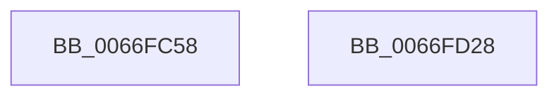

# MiWalkResetCommitPages

- RVA: `0x0066FC58`–`0x0066FD29` (길이 `209` bytes)
- VA: `0x000000014066FC58`
- 실행 섹션: `.text`
- PDB 이름 있음: `예`; PDB Function 태그: `아니요`
- unwind 정보 RVA: `0x000D76F8`
- 디코드: `49`개 명령, `209/209` bytes 표시
- 미해석 바이트: `0` (있으면 어셈블리에 `.byte`로 보존)

> 이 문서는 커널 이미지의 기계어와 PDB 기호를 분석해 생성했습니다. 4번과 5번은 함수 원형과 자료형을 바이너리 사용 방식에서 추정한 C 해석이며 원본 소스 복구 결과는 아닙니다.

## 1. Dependencies

- 직접 호출 지점: **4**; 고유 호출 대상: **4**
- 직접 호출자로 확인된 함수: **1**
- RIP 상대 이미지 참조: **1**

### Outgoing calls
- `0x0066FC83` → [memset](../6C/memset_function_006C6C40.md) (function, `0x006C6C40`)
- `0x0066FCF3` → [MiLockWorkingSetShared](../27/MiLockWorkingSetShared_function_0027CBF0.md) (function, `0x0027CBF0`)
- `0x0066FCFF` → [MiWalkPageTables](../2C/MiWalkPageTables_function_002C2710.md) (function, `0x002C2710`)
- `0x0066FD0A` → [MiUnlockWorkingSetShared](../27/MiUnlockWorkingSetShared_function_0027D690.md) (function, `0x0027D690`)

### Direct callers
- [MiReleaseCommitForResetPages](MiReleaseCommitForResetPages_function_0066FAF8.md) at `0x0066FB8E`

### Static image references
- `0x0066FCB7` → RVA `0x0066FD30` (`MiWalkResetCommitPte`; read)

## 2. Other-region calls and transfers

- 다른 실행 섹션으로 향하는 call: **0**
- 별도 외부 분기/꼬리 이동을 확인하지 못했습니다.

## 3. Assembly (complete function range)

```asm
0066FC58  48 89 5C 24 10                  mov qword ptr [rsp + 0x10], rbx
0066FC5D  48 89 7C 24 18                  mov qword ptr [rsp + 0x18], rdi
0066FC62  55                              push rbp
0066FC63  48 8D 6C 24 A9                  lea rbp, [rsp - 0x57]
0066FC68  48 81 EC E0 00 00 00            sub rsp, 0xe0
0066FC6F  48 83 65 67 00                  and qword ptr [rbp + 0x67], 0
0066FC74  48 8B D9                        mov rbx, rcx
0066FC77  48 8D 4D 97                     lea rcx, [rbp - 0x69]
0066FC7B  33 D2                           xor edx, edx
0066FC7D  41 B8 C0 00 00 00               mov r8d, 0xc0
0066FC83  E8 B8 6F 05 00                  call 0x1406c6c40
0066FC88  65 48 8B 04 25 88 01 00 00      mov rax, qword ptr gs:[0x188]
0066FC91  0F B6 4B 20                     movzx ecx, byte ptr [rbx + 0x20]
0066FC95  0F B6 53 21                     movzx edx, byte ptr [rbx + 0x21]
0066FC99  48 C1 E1 20                     shl rcx, 0x20
0066FC9D  48 8B B8 B8 00 00 00            mov rdi, qword ptr [rax + 0xb8]
0066FCA4  48 8D 45 67                     lea rax, [rbp + 0x67]
0066FCA8  48 89 45 4F                     mov qword ptr [rbp + 0x4f], rax
0066FCAC  48 81 C7 00 04 00 00            add rdi, 0x400
0066FCB3  48 C1 E2 20                     shl rdx, 0x20
0066FCB7  48 8D 05 72 00 00 00            lea rax, [rip + 0x72]
0066FCBE  48 89 45 3F                     mov qword ptr [rbp + 0x3f], rax
0066FCC2  8B 43 18                        mov eax, dword ptr [rbx + 0x18]
0066FCC5  48 0B C8                        or rcx, rax
0066FCC8  C7 45 97 07 00 00 00            mov dword ptr [rbp - 0x69], 7
0066FCCF  8B 43 1C                        mov eax, dword ptr [rbx + 0x1c]
0066FCD2  48 0B D0                        or rdx, rax
0066FCD5  48 C1 E1 0C                     shl rcx, 0xc
0066FCD9  48 C1 E2 0C                     shl rdx, 0xc
0066FCDD  48 81 CA FF 0F 00 00            or rdx, 0xfff
0066FCE4  48 89 4D BF                     mov qword ptr [rbp - 0x41], rcx
0066FCE8  48 8B CF                        mov rcx, rdi
0066FCEB  48 89 55 C7                     mov qword ptr [rbp - 0x39], rdx
0066FCEF  48 89 7D B7                     mov qword ptr [rbp - 0x49], rdi
0066FCF3  E8 F8 CE C0 FF                  call 0x14027cbf0
0066FCF8  48 8D 4D 97                     lea rcx, [rbp - 0x69]
0066FCFC  88 45 A0                        mov byte ptr [rbp - 0x60], al
0066FCFF  E8 0C 2A C5 FF                  call 0x1402c2710
0066FD04  8A 55 A0                        mov dl, byte ptr [rbp - 0x60]
0066FD07  48 8B CF                        mov rcx, rdi
0066FD0A  E8 81 D9 C0 FF                  call 0x14027d690
0066FD0F  48 8B 45 67                     mov rax, qword ptr [rbp + 0x67]
0066FD13  4C 8D 9C 24 E0 00 00 00         lea r11, [rsp + 0xe0]
0066FD1B  49 8B 5B 18                     mov rbx, qword ptr [r11 + 0x18]
0066FD1F  49 8B 7B 20                     mov rdi, qword ptr [r11 + 0x20]
0066FD23  49 8B E3                        mov rsp, r11
0066FD26  5D                              pop rbp
0066FD27  C3                              ret
0066FD28  CC                              int3
```

## 4. C-style interpretation (structured pseudocode)

```c
__int64 __fastcall MiWalkResetCommitPages(__int64 a1, int a2)
{
    __int64 result;
    __int64 v_rdi;
    __int64 v_rsp;
    unsigned __int64 v_stack_m10;
    unsigned __int64 v_stack_m20;
    unsigned __int64 v_stack_m5F;
    unsigned __int64 v_stack_m8;
    unsigned __int64 v_stack_m98;
    unsigned __int64 v_stack_mA0;
    unsigned __int64 v_stack_mA8;
    unsigned __int8 v_stack_mBF;
    unsigned __int64 v_stack_mC8;
    unsigned __int64 v_stack_p10;
    unsigned __int64 v_stack_p18;
    unsigned __int64 v_stack_p8;

    v_stack_p10 = v_rbx;
    v_stack_p18 = v_rdi;
    v_rsp = (v_rsp) - (224);
    a2 = 0;
    result = memset(v_stack_mC8, a2, 192, a4);
    a1 = (*(unsigned __int8 *)(a1 + 32)) << (32);
    v_stack_m10 = v_stack_p8;
    v_rdi = (*(unsigned __int64 *)(*(unsigned __int64 *)(gs_base + (0 + 392)) + 184)) + (0x400ULL);
    a2 = (*(unsigned __int8 *)(a1 + 33)) << (32);
    v_stack_m20 = v_rip + 114;
    a1 = (a1) | ((unsigned int)(*(unsigned int *)(a1 + 24)));
    v_stack_mC8 = 7;
    a2 = (a2) | ((unsigned int)(*(unsigned int *)(a1 + 28)));
    a1 = (a1) << (12);
    a2 = (a2) << (12);
    a2 = (a2) | (0xFFFULL);
    v_stack_mA0 = a1;
    v_stack_m98 = a2;
    v_stack_mA8 = v_rdi;
    result = MiLockWorkingSetShared(v_rdi, a2, 192, a4);
    v_stack_mBF = (unsigned __int8)(result);
    result = MiWalkPageTables(v_stack_mC8, a2, 192, a4);
    result = MiUnlockWorkingSetShared(v_rdi, v_stack_mBF, 192, a4);
    return v_stack_p8;
}
```

## 5. (Beta) C Style

```c
int64_t MiWalkResetCommitPages(void *Arg1, int32_t Arg2)
{
    uint8_t *arg1 = (uint8_t *)Arg1;

    int64_t result;
    int64_t local_rdi;
    int64_t local_rsp;
    uint64_t v_stack_m10;
    uint64_t v_stack_m20;
    uint64_t v_stack_m5F;
    uint64_t v_stack_m8;
    uint64_t v_stack_m98;
    uint64_t v_stack_mA0;
    uint64_t v_stack_mA8;
    uint8_t v_stack_mBF;
    uint64_t v_stack_mC8;
    uint64_t v_stack_p10;
    uint64_t v_stack_p18;
    uint64_t v_stack_p8;

    v_stack_p10 = local_rbx;
    v_stack_p18 = local_rdi;
    local_rsp = (local_rsp) - (224);
    Arg2 = 0;
    result = memset(v_stack_mC8, Arg2, 192, a4);
    Arg1 = (*(uint8_t *)(arg1 + 0x20)) << (32);
    v_stack_m10 = v_stack_p8;
    local_rdi = (*(uint64_t *)(*(uint64_t *)(gs_base + (0 + 0x188)) + 0xB8)) + (0x400ULL);
    Arg2 = (*(uint8_t *)(arg1 + 0x21)) << (32);
    v_stack_m20 = v_rip + 114;
    Arg1 = (Arg1) | ((uint32_t)(*(uint32_t *)(arg1 + 0x18)));
    v_stack_mC8 = 7;
    Arg2 = (Arg2) | ((uint32_t)(*(uint32_t *)(arg1 + 0x1C)));
    Arg1 = (Arg1) << (12);
    Arg2 = (Arg2) << (12);
    Arg2 = (Arg2) | (0xFFFULL);
    v_stack_mA0 = Arg1;
    v_stack_m98 = Arg2;
    v_stack_mA8 = local_rdi;
    result = MiLockWorkingSetShared(local_rdi, Arg2, 192, a4);
    v_stack_mBF = (uint8_t)(result);
    result = MiWalkPageTables(v_stack_mC8, Arg2, 192, a4);
    result = MiUnlockWorkingSetShared(local_rdi, v_stack_mBF, 192, a4);
    return v_stack_p8;
}
```

### 관측된 메모리 오프셋

구조체 형식이 확인되지 않은 접근은 인자 기준의 오프셋으로만 기록했습니다.

| 기준 인자 | 오프셋 표현 | 폭 (bit) | 접근 |
|---|---:|---:|---|
| `Arg1` | `+ 0x18` | `32` | `R` |
| `Arg1` | `+ 0x1C` | `32` | `R` |
| `Arg1` | `+ 0x20` | `8` | `R` |
| `Arg1` | `+ 0x21` | `8` | `R` |

## 6. Execution-region graph

[열기: 2D/3D 그래프와 함수 탐색 컨트롤 패널](../../../control-panel.html?section=text&rva=0x0066FC58&view=graph)

- 2D 그래프는 위에서 아래로 흐르고, 3D 그래프는 빈 공간을 드래그해 회전합니다. Shift+드래그는 이동, 휠은 확대·축소, 함수 노드 선택은 대상 보고서 이동입니다.

### Static fallback


