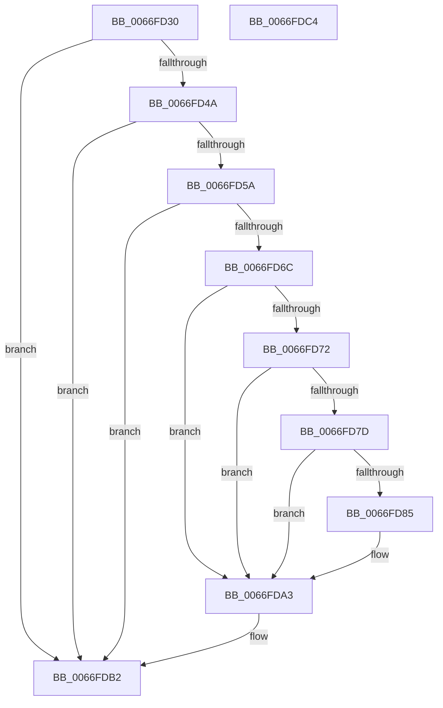

# MiWalkResetCommitPte

- RVA: `0x0066FD30`–`0x0066FDC5` (길이 `149` bytes)
- VA: `0x000000014066FD30`
- 실행 섹션: `.text`
- PDB 이름 있음: `예`; PDB Function 태그: `아니요`
- unwind 정보 RVA: `0x00060BC4`
- 디코드: `44`개 명령, `149/149` bytes 표시
- 미해석 바이트: `0` (있으면 어셈블리에 `.byte`로 보존)

> 이 문서는 커널 이미지의 기계어와 PDB 기호를 분석해 생성했습니다. 4번과 5번은 함수 원형과 자료형을 바이너리 사용 방식에서 추정한 C 해석이며 원본 소스 복구 결과는 아닙니다.

## 1. Dependencies

- 직접 호출 지점: **3**; 고유 호출 대상: **3**
- 직접 호출자로 확인된 함수: **0**
- RIP 상대 이미지 참조: **0**

### Outgoing calls
- `0x0066FD5F` → [MiLockTransitionLeafPageEx](../40/MiLockTransitionLeafPageEx_function_00405884.md) (function, `0x00405884`)
- `0x0066FD8A` → [MiUnlinkPageFromListEx](../28/MiUnlinkPageFromListEx_function_00287590.md) (function, `0x00287590`)
- `0x0066FD94` → [MiDiscardTransitionPteEx](../37/MiDiscardTransitionPteEx_function_00375954.md) (function, `0x00375954`)

### Direct callers
- 이 함수 시작 RVA로 연결되는 직접 call은 확인되지 않았습니다. 간접 호출은 완전히 역산할 수 없습니다.

### Static image references
- 디코드된 RIP-relative 메모리 참조가 없습니다.

## 2. Other-region calls and transfers

- 다른 실행 섹션으로 향하는 call: **0**
- 별도 외부 분기/꼬리 이동을 확인하지 못했습니다.

## 3. Assembly (complete function range)

```asm
0066FD30  48 89 5C 24 08                  mov qword ptr [rsp + 8], rbx
0066FD35  48 89 74 24 10                  mov qword ptr [rsp + 0x10], rsi
0066FD3A  57                              push rdi
0066FD3B  48 83 EC 20                     sub rsp, 0x20
0066FD3F  4C 8B CA                        mov r9, rdx
0066FD42  48 8B F9                        mov rdi, rcx
0066FD45  45 85 C0                        test r8d, r8d
0066FD48  75 68                           jne 0x14066fdb2
0066FD4A  48 8B 02                        mov rax, qword ptr [rdx]
0066FD4D  25 01 0C 00 00                  and eax, 0xc01
0066FD52  48 3D 00 08 00 00               cmp rax, 0x800
0066FD58  75 58                           jne 0x14066fdb2
0066FD5A  33 D2                           xor edx, edx
0066FD5C  49 8B C9                        mov rcx, r9
0066FD5F  E8 20 5B D9 FF                  call 0x140405884
0066FD64  48 8B D8                        mov rbx, rax
0066FD67  48 85 C0                        test rax, rax
0066FD6A  74 46                           je 0x14066fdb2
0066FD6C  F6 40 22 10                     test byte ptr [rax + 0x22], 0x10
0066FD70  75 31                           jne 0x14066fda3
0066FD72  8B 48 10                        mov ecx, dword ptr [rax + 0x10]
0066FD75  C0 E9 02                        shr cl, 2
0066FD78  F6 C1 01                        test cl, 1
0066FD7B  75 26                           jne 0x14066fda3
0066FD7D  8B 40 20                        mov eax, dword ptr [rax + 0x20]
0066FD80  66 85 C0                        test ax, ax
0066FD83  75 1E                           jne 0x14066fda3
0066FD85  33 D2                           xor edx, edx
0066FD87  48 8B CB                        mov rcx, rbx
0066FD8A  E8 01 78 C1 FF                  call 0x140287590
0066FD8F  33 D2                           xor edx, edx
0066FD91  48 8B CB                        mov rcx, rbx
0066FD94  E8 BB 5B D0 FF                  call 0x140375954
0066FD99  48 8B 87 B8 00 00 00            mov rax, qword ptr [rdi + 0xb8]
0066FDA0  48 FF 00                        inc qword ptr [rax]
0066FDA3  48 B8 FF FF FF FF FF FF FF 7F   movabs rax, 0x7fffffffffffffff
0066FDAD  F0 48 21 43 18                  lock and qword ptr [rbx + 0x18], rax
0066FDB2  48 8B 5C 24 30                  mov rbx, qword ptr [rsp + 0x30]
0066FDB7  33 C0                           xor eax, eax
0066FDB9  48 8B 74 24 38                  mov rsi, qword ptr [rsp + 0x38]
0066FDBE  48 83 C4 20                     add rsp, 0x20
0066FDC2  5F                              pop rdi
0066FDC3  C3                              ret
0066FDC4  CC                              int3
```

## 4. C-style interpretation (structured pseudocode)

```c
__int64 __fastcall MiWalkResetCommitPte(__int64 a1, __int64 a2, int a3)
{
    __int64 result;
    __int64 v_rsp;
    unsigned __int64 v_stack_p10;
    unsigned __int64 v_stack_p8;

    v_stack_p8 = v_rbx;
    v_stack_p10 = v_rsi;
    v_rsp = (v_rsp) - (32);
    if (a3 != 0) goto loc_0066FDB2;
    result = (unsigned int)((*(unsigned __int64 *)(a2)) & (0xC01ULL));
    if (result != 0x800ULL) goto loc_0066FDB2;
    a2 = 0;
    result = MiLockTransitionLeafPageEx(0, a2, a3, a2);
    if (result == 0) goto loc_0066FDB2;
    if (((*(unsigned __int8 *)(result + 34)) & (16)) != 0) goto loc_0066FDA3;
    a1 = (unsigned __int8)(((unsigned int)(*(unsigned int *)(result + 16))) >> (2));
    if ((((unsigned __int8)(a1)) & (1)) != 0) goto loc_0066FDA3;
    result = (unsigned int)(*(unsigned int *)(result + 32));
    if ((unsigned __int16)((unsigned int)(*(unsigned int *)(result + 32))) == 0) {
        a2 = 0;
        a1 = result;
        result = MiUnlinkPageFromListEx(a1, a2, a3, a2);
        a2 = 0;
        a1 = result;
        result = MiDiscardTransitionPteEx(a1, a2, a3, a2);
        result = *(unsigned __int64 *)(a1 + 184);
    }
loc_0066FDB2:
    result = 0;
    v_rsp = (v_rsp) + (32);
    return result;
}
```

## 5. (Beta) C Style

```c
int64_t MiWalkResetCommitPte(void *Arg1, void *Arg2, int32_t Arg3)
{
    uint8_t *arg1 = (uint8_t *)Arg1;
    uint8_t *arg2 = (uint8_t *)Arg2;

    int64_t result;
    int64_t local_rsp;
    uint64_t v_stack_p10;
    uint64_t v_stack_p8;

    v_stack_p8 = local_rbx;
    v_stack_p10 = local_rsi;
    local_rsp = (local_rsp) - (32);
    if (Arg3 != 0) goto loc_0066FDB2;
    result = (uint32_t)((*(uint64_t *)(arg2)) & (0xC01ULL));
    if (result != 0x800ULL) goto loc_0066FDB2;
    Arg2 = 0;
    result = MiLockTransitionLeafPageEx(0, Arg2, Arg3, Arg2);
    if (result == 0) goto loc_0066FDB2;
    if (((*(uint8_t *)(result + 0x22)) & (16)) != 0) goto loc_0066FDA3;
    Arg1 = (uint8_t)(((uint32_t)(*(uint32_t *)(result + 0x10))) >> (2));
    if ((((uint8_t)(Arg1)) & (1)) != 0) goto loc_0066FDA3;
    result = (uint32_t)(*(uint32_t *)(result + 0x20));
    if ((uint16_t)((uint32_t)(*(uint32_t *)(result + 0x20))) == 0) {
        Arg2 = 0;
        Arg1 = result;
        result = MiUnlinkPageFromListEx(Arg1, Arg2, Arg3, Arg2);
        Arg2 = 0;
        Arg1 = result;
        result = MiDiscardTransitionPteEx(Arg1, Arg2, Arg3, Arg2);
        result = *(uint64_t *)(arg1 + 0xB8);
    }
loc_0066FDB2:
    result = 0;
    local_rsp = (local_rsp) + (32);
    return result;
}
```

### 관측된 메모리 오프셋

구조체 형식이 확인되지 않은 접근은 인자 기준의 오프셋으로만 기록했습니다.

| 기준 인자 | 오프셋 표현 | 폭 (bit) | 접근 |
|---|---:|---:|---|
| `Arg1` | `+ 0xB8` | `64` | `R` |
| `Arg2` | `+ 0x0` | `64` | `R` |

## 6. Execution-region graph

[열기: 2D/3D 그래프와 함수 탐색 컨트롤 패널](../../../control-panel.html?section=text&rva=0x0066FD30&view=graph)

- 2D 그래프는 위에서 아래로 흐르고, 3D 그래프는 빈 공간을 드래그해 회전합니다. Shift+드래그는 이동, 휠은 확대·축소, 함수 노드 선택은 대상 보고서 이동입니다.

### Static fallback


