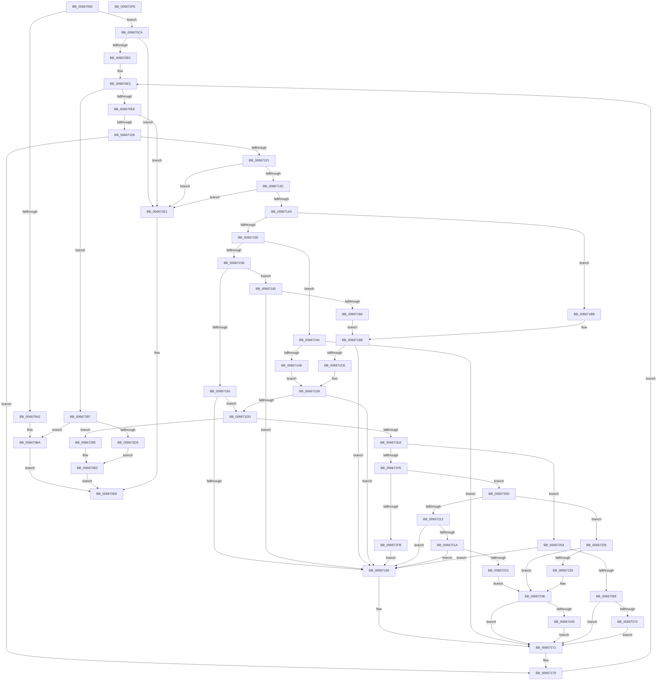

# MicrocodeGetRecord

- RVA: `0x00667060`–`0x006672FF` (길이 `671` bytes)
- VA: `0x0000000140667060`
- 실행 섹션: `.text`
- PDB 이름 있음: `예`; PDB Function 태그: `아니요`
- unwind 정보 RVA: `0x000D620C`
- 디코드: `181`개 명령, `671/671` bytes 표시
- 미해석 바이트: `0` (있으면 어셈블리에 `.byte`로 보존)

> 이 문서는 커널 이미지의 기계어와 PDB 기호를 분석해 생성했습니다. 4번과 5번은 함수 원형과 자료형을 바이너리 사용 방식에서 추정한 C 해석이며 원본 소스 복구 결과는 아닙니다.

## 1. Dependencies

- 직접 호출 지점: **8**; 고유 호출 대상: **7**
- 직접 호출자로 확인된 함수: **1**
- RIP 상대 이미지 참조: **4**

### Outgoing calls
- `0x006670D3` → [DrpGetRecordCount](DrpGetRecordCount_function_00667BD4.md) (function, `0x00667BD4`)
- `0x006670FC` → [DrpGetSectionAtIndex](DrpGetSectionAtIndex_function_00667C00.md) (function, `0x00667C00`)
- `0x0066712F` → [DrpGetRecord](DrpGetRecord_function_00667B98.md) (function, `0x00667B98`)
- `0x00667160` → [Feature_Microcode_Client_CD__private_IsEnabledDeviceUsageNoInline](Feature_Microcode_Client_CD__private_IsEnabledDeviceUsageNoInline_function_00666A18.md) (function, `0x00666A18`)
- `0x00667181` → [Feature_Microcode_Client_CD__private_IsEnabledDeviceUsageNoInline](Feature_Microcode_Client_CD__private_IsEnabledDeviceUsageNoInline_function_00666A18.md) (function, `0x00666A18`)
- `0x006671B4` → [IntelMicrocodeMetaDataCheck](IntelMicrocodeMetaDataCheck_function_00667998.md) (function, `0x00667998`)
- `0x006671C5` → [AMDMicrocodeRecordSizeCheck](AMDMicrocodeRecordSizeCheck_function_00667E2C.md) (function, `0x00667E2C`)
- `0x006671D4` → [AMDMicrocodeMetaDataCheck](AMDMicrocodeMetaDataCheck_function_00667D40.md) (function, `0x00667D40`)

### Direct callers
- [PrExtGetRecord](PrExtGetRecord_function_00666CE8.md) at `0x00666D6A`

### Static image references
- `0x006671DD` → RVA `0x00EF7CE0` (`.data`; read)
- `0x006671EA` → RVA `0x00EF7CCD` (`.data`; read)
- `0x006672A4` → RVA `0x00EF7CBC` (`.data`; write)
- `0x006672AA` → RVA `0x00EF7CC0` (`.data`; write)

## 2. Other-region calls and transfers

- 다른 실행 섹션으로 향하는 call: **0**
- 별도 외부 분기/꼬리 이동을 확인하지 못했습니다.

## 3. Assembly (complete function range)

```asm
00667060  48 8B C4                        mov rax, rsp
00667063  48 89 58 20                     mov qword ptr [rax + 0x20], rbx
00667067  4C 89 40 18                     mov qword ptr [rax + 0x18], r8
0066706B  48 89 50 10                     mov qword ptr [rax + 0x10], rdx
0066706F  89 48 08                        mov dword ptr [rax + 8], ecx
00667072  55                              push rbp
00667073  56                              push rsi
00667074  57                              push rdi
00667075  41 54                           push r12
00667077  41 55                           push r13
00667079  41 56                           push r14
0066707B  41 57                           push r15
0066707D  48 83 EC 40                     sub rsp, 0x40
00667081  48 83 60 B8 00                  and qword ptr [rax - 0x48], 0
00667086  33 F6                           xor esi, esi
00667088  48 21 70 C0                     and qword ptr [rax - 0x40], rsi
0066708C  33 ED                           xor ebp, ebp
0066708E  45 33 F6                        xor r14d, r14d
00667091  45 32 FF                        xor r15b, r15b
00667094  4D 8B E1                        mov r12, r9
00667097  4D 8B D8                        mov r11, r8
0066709A  48 8B FA                        mov rdi, rdx
0066709D  48 85 D2                        test rdx, rdx
006670A0  75 22                           jne 0x1406670c4
006670A2  48 8B 84 24 A0 00 00 00         mov rax, qword ptr [rsp + 0xa0]
006670AA  49 21 31                        and qword ptr [r9], rsi
006670AD  48 21 30                        and qword ptr [rax], rsi
006670B0  48 8B 84 24 A8 00 00 00         mov rax, qword ptr [rsp + 0xa8]
006670B8  21 30                           and dword ptr [rax], esi
006670BA  B8 25 02 00 C0                  mov eax, 0xc0000225
006670BF  E9 22 02 00 00                  jmp 0x1406672e6
006670C4  21 74 24 24                     and dword ptr [rsp + 0x24], esi
006670C8  4C 8D 44 24 24                  lea r8, [rsp + 0x24]
006670CD  49 8B D3                        mov rdx, r11
006670D0  48 8B CF                        mov rcx, rdi
006670D3  E8 FC 0A 00 00                  call 0x140667bd4
006670D8  85 C0                           test eax, eax
006670DA  0F 88 01 02 00 00               js 0x1406672e1
006670E0  45 33 ED                        xor r13d, r13d
006670E3  44 3B 6C 24 24                  cmp r13d, dword ptr [rsp + 0x24]
006670E8  0F 83 C9 01 00 00               jae 0x1406672b7
006670EE  4C 8D 4C 24 30                  lea r9, [rsp + 0x30]
006670F3  45 8B C5                        mov r8d, r13d
006670F6  49 8B D3                        mov rdx, r11
006670F9  48 8B CF                        mov rcx, rdi
006670FC  E8 FF 0A 00 00                  call 0x140667c00
00667101  85 C0                           test eax, eax
00667103  0F 88 D8 01 00 00               js 0x1406672e1
00667109  48 8B 5C 24 30                  mov rbx, qword ptr [rsp + 0x30]
0066710E  8B 84 24 80 00 00 00            mov eax, dword ptr [rsp + 0x80]
00667115  4C 8B 9C 24 90 00 00 00         mov r11, qword ptr [rsp + 0x90]
0066711D  39 03                           cmp dword ptr [rbx], eax
0066711F  75 58                           jne 0x140667179
00667121  4C 8D 4C 24 38                  lea r9, [rsp + 0x38]
00667126  4C 8B C3                        mov r8, rbx
00667129  49 8B D3                        mov rdx, r11
0066712C  48 8B CF                        mov rcx, rdi
0066712F  E8 64 0A 00 00                  call 0x140667b98
00667134  85 C0                           test eax, eax
00667136  0F 88 A5 01 00 00               js 0x1406672e1
0066713C  48 8B 7C 24 38                  mov rdi, qword ptr [rsp + 0x38]
00667141  48 85 FF                        test rdi, rdi
00667144  0F 84 97 01 00 00               je 0x1406672e1
0066714A  8B 8C 24 80 00 00 00            mov ecx, dword ptr [rsp + 0x80]
00667151  83 E9 01                        sub ecx, 1
00667154  74 65                           je 0x1406671bb
00667156  83 E9 01                        sub ecx, 1
00667159  74 39                           je 0x140667194
0066715B  83 F9 0B                        cmp ecx, 0xb
0066715E  74 21                           je 0x140667181
00667160  E8 B3 F8 FF FF                  call 0x140666a18
00667165  85 C0                           test eax, eax
00667167  74 74                           je 0x1406671dd
00667169  4C 8B 9C 24 90 00 00 00         mov r11, qword ptr [rsp + 0x90]
00667171  48 8B BC 24 88 00 00 00         mov rdi, qword ptr [rsp + 0x88]
00667179  41 FF C5                        inc r13d
0066717C  E9 62 FF FF FF                  jmp 0x1406670e3
00667181  E8 92 F8 FF FF                  call 0x140666a18
00667186  85 C0                           test eax, eax
00667188  74 DF                           je 0x140667169
0066718A  4C 8B 84 24 90 00 00 00         mov r8, qword ptr [rsp + 0x90]
00667192  EB 2A                           jmp 0x1406671be
00667194  8B 47 1C                        mov eax, dword ptr [rdi + 0x1c]
00667197  8D 04 85 20 00 00 00            lea eax, [rax*4 + 0x20]
0066719E  48 63 C8                        movsxd rcx, eax
006671A1  48 03 4F 08                     add rcx, qword ptr [rdi + 8]
006671A5  48 03 4B 18                     add rcx, qword ptr [rbx + 0x18]
006671A9  49 3B CB                        cmp rcx, r11
006671AC  77 C3                           ja 0x140667171
006671AE  8B 53 08                        mov edx, dword ptr [rbx + 8]
006671B1  48 8B CF                        mov rcx, rdi
006671B4  E8 DF 07 00 00                  call 0x140667998
006671B9  EB 1E                           jmp 0x1406671d9
006671BB  4D 8B C3                        mov r8, r11
006671BE  48 8B 53 18                     mov rdx, qword ptr [rbx + 0x18]
006671C2  48 8B CF                        mov rcx, rdi
006671C5  E8 62 0C 00 00                  call 0x140667e2c
006671CA  85 C0                           test eax, eax
006671CC  78 9B                           js 0x140667169
006671CE  8B 53 08                        mov edx, dword ptr [rbx + 8]
006671D1  48 8B CF                        mov rcx, rdi
006671D4  E8 67 0B 00 00                  call 0x140667d40
006671D9  85 C0                           test eax, eax
006671DB  78 8C                           js 0x140667169
006671DD  80 3D FC 0A 89 00 00            cmp byte ptr [rip + 0x890afc], 0
006671E4  0F 85 9C 00 00 00               jne 0x140667286
006671EA  80 3D DC 0A 89 00 00            cmp byte ptr [rip + 0x890adc], 0
006671F1  8A 47 04                        mov al, byte ptr [rdi + 4]
006671F4  74 64                           je 0x14066725a
006671F6  48 85 ED                        test rbp, rbp
006671F9  75 12                           jne 0x14066720d
006671FB  4C 8B 73 10                     mov r14, qword ptr [rbx + 0x10]
006671FF  48 8B EF                        mov rbp, rdi
00667202  8B 73 08                        mov esi, dword ptr [rbx + 8]
00667205  44 8A F8                        mov r15b, al
00667208  E9 5C FF FF FF                  jmp 0x140667169
0066720D  45 84 FF                        test r15b, r15b
00667210  74 13                           je 0x140667225
00667212  84 C0                           test al, al
00667214  0F 84 4F FF FF FF               je 0x140667169
0066721A  44 3A F8                        cmp r15b, al
0066721D  0F 85 46 FF FF FF               jne 0x140667169
00667223  EB 11                           jmp 0x140667236
00667225  84 C0                           test al, al
00667227  74 0D                           je 0x140667236
00667229  4C 8B 73 10                     mov r14, qword ptr [rbx + 0x10]
0066722D  48 8B EF                        mov rbp, rdi
00667230  8B 73 08                        mov esi, dword ptr [rbx + 8]
00667233  44 8A F8                        mov r15b, al
00667236  8B 4B 08                        mov ecx, dword ptr [rbx + 8]
00667239  4C 8B 9C 24 90 00 00 00         mov r11, qword ptr [rsp + 0x90]
00667241  3B F1                           cmp esi, ecx
00667243  0F 83 28 FF FF FF               jae 0x140667171
00667249  4C 8B 73 10                     mov r14, qword ptr [rbx + 0x10]
0066724D  48 8B EF                        mov rbp, rdi
00667250  8B F1                           mov esi, ecx
00667252  44 8A F8                        mov r15b, al
00667255  E9 17 FF FF FF                  jmp 0x140667171
0066725A  8B 4B 08                        mov ecx, dword ptr [rbx + 8]
0066725D  3B F1                           cmp esi, ecx
0066725F  0F 83 04 FF FF FF               jae 0x140667169
00667265  4C 8B 9C 24 90 00 00 00         mov r11, qword ptr [rsp + 0x90]
0066726D  84 C0                           test al, al
0066726F  0F 85 FC FE FF FF               jne 0x140667171
00667275  4C 8B 73 10                     mov r14, qword ptr [rbx + 0x10]
00667279  48 8B EF                        mov rbp, rdi
0066727C  8B F1                           mov esi, ecx
0066727E  45 32 FF                        xor r15b, r15b
00667281  E9 EB FE FF FF                  jmp 0x140667171
00667286  48 8B 4B 10                     mov rcx, qword ptr [rbx + 0x10]
0066728A  48 8B 84 24 A0 00 00 00         mov rax, qword ptr [rsp + 0xa0]
00667292  49 89 3C 24                     mov qword ptr [r12], rdi
00667296  48 89 08                        mov qword ptr [rax], rcx
00667299  8B 4B 08                        mov ecx, dword ptr [rbx + 8]
0066729C  48 8B 84 24 A8 00 00 00         mov rax, qword ptr [rsp + 0xa8]
006672A4  89 0D 12 0A 89 00               mov dword ptr [rip + 0x890a12], ecx
006672AA  C6 05 0F 0A 89 00 01            mov byte ptr [rip + 0x890a0f], 1
006672B1  89 08                           mov dword ptr [rax], ecx
006672B3  33 C0                           xor eax, eax
006672B5  EB 2F                           jmp 0x1406672e6
006672B7  48 8B 84 24 A0 00 00 00         mov rax, qword ptr [rsp + 0xa0]
006672BF  49 89 2C 24                     mov qword ptr [r12], rbp
006672C3  4C 89 30                        mov qword ptr [rax], r14
006672C6  48 8B 84 24 A8 00 00 00         mov rax, qword ptr [rsp + 0xa8]
006672CE  89 30                           mov dword ptr [rax], esi
006672D0  48 85 ED                        test rbp, rbp
006672D3  0F 84 E1 FD FF FF               je 0x1406670ba
006672D9  89 35 DD 09 89 00               mov dword ptr [rip + 0x8909dd], esi
006672DF  EB D2                           jmp 0x1406672b3
006672E1  B8 0D 00 00 C0                  mov eax, 0xc000000d
006672E6  48 8B 9C 24 98 00 00 00         mov rbx, qword ptr [rsp + 0x98]
006672EE  48 83 C4 40                     add rsp, 0x40
006672F2  41 5F                           pop r15
006672F4  41 5E                           pop r14
006672F6  41 5D                           pop r13
006672F8  41 5C                           pop r12
006672FA  5F                              pop rdi
006672FB  5E                              pop rsi
006672FC  5D                              pop rbp
006672FD  C3                              ret
006672FE  CC                              int3
```

## 4. C-style interpretation (structured pseudocode)

```c
__int64 __fastcall MicrocodeGetRecord(int a1, __int64 a2, __int64 a3, __int64 a4, __int64 a5, __int64 a6)
{
    __int64 result;
    __int64 v_r13;
    __int64 v_r14;
    __int64 v_r15;
    __int64 v_rbp;
    __int64 v_rsi;
    __int64 v_rsp;
    unsigned __int64 v_stack_m40;
    unsigned __int64 v_stack_m48;
    unsigned int v_stack_m54;
    unsigned __int64 v_stack_p10;
    unsigned __int64 v_stack_p18;
    unsigned __int64 v_stack_p20;
    unsigned int v_stack_p8;

    *(unsigned __int64 *)(v_rsp + 32) = v_rbx;
    *(unsigned __int64 *)(v_rsp + 24) = a3;
    *(unsigned __int64 *)(v_rsp + 16) = a2;
    *(unsigned int *)(v_rsp + 8) = a1;
    v_rsp = (v_rsp) - (64);
    v_rsi = 0;
    v_rbp = 0;
    v_r14 = 0;
    v_r15 = 0;
    if (a2 != 0) goto loc_006670C4;
loc_006670BA:
    goto loc_006672E6;
loc_006670C4:
    result = DrpGetRecordCount(a2, a3, v_stack_m54, a4);
    if (sign_flag) goto loc_006672E1;
    v_r13 = 0;
loc_006670E3:
    if (0 >= v_stack_m54) goto loc_006672B7;
    result = DrpGetSectionAtIndex(a2, a3, 0, v_stack_m48);
    if (sign_flag) goto loc_006672E1;
    if ((*(unsigned int *)(v_stack_m48)) != ((unsigned int)((unsigned int)(v_stack_p8)))) goto loc_00667179;
    result = DrpGetRecord(a2, v_stack_p18, v_stack_m48, v_stack_m40);
    if (sign_flag) goto loc_006672E1;
    if (v_stack_m40 == 0) goto loc_006672E1;
    a1 = (unsigned int)(((unsigned int)(v_stack_p8)) - (1));
    if (condition_is_equal) goto loc_006671BB;
    a1 = (unsigned int)((a1) - (1));
    if (condition_is_equal) goto loc_00667194;
    if (a1 == 11) goto loc_00667181;
    result = Feature_Microcode_Client_CD__private_IsEnabledDeviceUsageNoInline(a1, v_stack_p18, v_stack_m48, v_stack_m40);
    if ((unsigned int)(result) == 0) goto loc_006671DD;
loc_00667169:
loc_00667171:
loc_00667179:
    v_r13 = (unsigned int)((v_r13) + 1);
    goto loc_006670E3;
loc_00667181:
    result = Feature_Microcode_Client_CD__private_IsEnabledDeviceUsageNoInline(a1, v_stack_p18, v_stack_m48, v_stack_m40);
    if ((unsigned int)(result) == 0) goto loc_00667169;
    goto loc_006671BE;
loc_00667194:
    a1 = ((int)((unsigned int)((unsigned int)(*(unsigned int *)(v_stack_p10 + 28)) * 4 + 32))) + (*(unsigned __int64 *)(v_stack_p10 + 8));
    a1 = (a1) + (*(unsigned __int64 *)(v_stack_m48 + 24));
    if (a1 > v_stack_p18) goto loc_00667171;
    result = IntelMicrocodeMetaDataCheck(v_stack_p10, (unsigned int)(*(unsigned int *)(v_stack_m48 + 8)), v_stack_p18, v_stack_m40);
    goto loc_006671D9;
loc_006671BB:
loc_006671BE:
    result = AMDMicrocodeRecordSizeCheck(v_stack_p10, *(unsigned __int64 *)(v_stack_m48 + 24), v_stack_p18, v_stack_m40);
    if (sign_flag) goto loc_00667169;
    result = AMDMicrocodeMetaDataCheck(v_stack_p10, (unsigned int)(*(unsigned int *)(v_stack_m48 + 8)), v_stack_p18, v_stack_m40);
loc_006671D9:
    if (sign_flag) goto loc_00667169;
loc_006671DD:
    if ((*(unsigned __int8 *)(v_rip + 8981244)) != 0) goto loc_00667286;
    if ((*(unsigned __int8 *)(v_rip + 8981212)) == 0) goto loc_0066725A;
    if (0 != 0) goto loc_0066720D;
    goto loc_00667169;
loc_0066720D:
    if ((unsigned __int8)((unsigned __int8)(*(unsigned __int8 *)(v_stack_p10 + 4))) == 0) goto loc_00667225;
    if ((unsigned __int8)(*(unsigned __int8 *)(v_stack_p10 + 4)) == 0) goto loc_00667169;
    if (((unsigned __int8)((unsigned __int8)(*(unsigned __int8 *)(v_stack_p10 + 4)))) != ((unsigned __int8)(*(unsigned __int8 *)(v_stack_p10 + 4)))) goto loc_00667169;
    goto loc_00667236;
loc_00667225:
    v_rsi = (unsigned int)(*(unsigned int *)(v_stack_m48 + 8));
    v_rbp = v_stack_p10;
    v_r14 = *(unsigned __int64 *)(v_stack_m48 + 16);
    v_r15 = (unsigned __int8)(*(unsigned __int8 *)(v_stack_p10 + 4));
    if ((unsigned __int8)(*(unsigned __int8 *)(v_stack_p10 + 4)) != 0) {
        v_r14 = *(unsigned __int64 *)(v_stack_m48 + 16);
        v_rbp = v_stack_p10;
        v_rsi = *(unsigned int *)(v_stack_m48 + 8);
        v_r15 = (unsigned __int8)(*(unsigned __int8 *)(v_stack_p10 + 4));
    }
    if (((unsigned int)(v_rsi)) >= ((unsigned int)((unsigned int)(*(unsigned int *)(v_stack_m48 + 8))))) goto loc_00667171;
    goto loc_00667171;
loc_0066725A:
    if (((unsigned int)((unsigned int)((unsigned int)((unsigned int)(*(unsigned int *)(v_stack_m48 + 8)))))) >= ((unsigned int)((unsigned int)(*(unsigned int *)(v_stack_m48 + 8))))) goto loc_00667169;
    if ((unsigned __int8)(*(unsigned __int8 *)(v_stack_p10 + 4)) != 0) goto loc_00667171;
    v_r15 = 0;
    goto loc_00667171;
loc_00667286:
    *(unsigned __int64 *)(a4) = v_stack_p10;
    *(unsigned __int64 *)(a5) = *(unsigned __int64 *)(v_stack_m48 + 16);
    *(unsigned int *)(v_rip + 8981010) = (unsigned int)((unsigned int)(*(unsigned int *)(v_stack_m48 + 8)));
    *(unsigned __int8 *)(v_rip + 8981007) = 1;
    *(unsigned int *)(a6) = (unsigned int)((unsigned int)(*(unsigned int *)(v_stack_m48 + 8)));
loc_006672B3:
    result = 0;
    goto loc_006672E6;
loc_006672B7:
    *(unsigned __int64 *)(a4) = v_stack_p10;
    *(unsigned __int64 *)(a5) = *(unsigned __int64 *)(v_stack_m48 + 16);
    *(unsigned int *)(a6) = (unsigned int)((unsigned int)((unsigned int)((unsigned int)(*(unsigned int *)(v_stack_m48 + 8)))));
    if (v_stack_p10 == 0) goto loc_006670BA;
    *(unsigned int *)(v_rip + 8980957) = (unsigned int)((unsigned int)((unsigned int)((unsigned int)(*(unsigned int *)(v_stack_m48 + 8)))));
    goto loc_006672B3;
loc_006672E1:
loc_006672E6:
    v_rsp = (v_rsp) + (64);
    return (unsigned int)(0xC000000DULL);
}
```

## 5. (Beta) C Style

```c
int64_t MicrocodeGetRecord(int32_t Arg1, int64_t Arg2, int64_t Arg3, void *Arg4, void *Arg5, void *Arg6)
{
    uint8_t *arg4 = (uint8_t *)Arg4;
    uint8_t *arg5 = (uint8_t *)Arg5;
    uint8_t *arg6 = (uint8_t *)Arg6;

    int64_t result;
    int64_t local_r13;
    int64_t local_r14;
    int64_t local_r15;
    int64_t local_rbp;
    int64_t local_rsi;
    int64_t local_rsp;
    uint64_t v_stack_m40;
    uint64_t v_stack_m48;
    uint32_t v_stack_m54;
    uint64_t v_stack_p10;
    uint64_t v_stack_p18;
    uint64_t v_stack_p20;
    uint32_t v_stack_p8;

    *(uint64_t *)(local_rsp + 0x20) = local_rbx;
    *(uint64_t *)(local_rsp + 0x18) = Arg3;
    *(uint64_t *)(local_rsp + 0x10) = Arg2;
    *(uint32_t *)(local_rsp + 0x8) = Arg1;
    local_rsp = (local_rsp) - (64);
    local_rsi = 0;
    local_rbp = 0;
    local_r14 = 0;
    local_r15 = 0;
    if (Arg2 != 0) goto loc_006670C4;
loc_006670BA:
    goto loc_006672E6;
loc_006670C4:
    result = DrpGetRecordCount(Arg2, Arg3, v_stack_m54, Arg4);
    if (sign_flag) goto loc_006672E1;
    local_r13 = 0;
loc_006670E3:
    if (0 >= v_stack_m54) goto loc_006672B7;
    result = DrpGetSectionAtIndex(Arg2, Arg3, 0, v_stack_m48);
    if (sign_flag) goto loc_006672E1;
    if ((*(uint32_t *)(v_stack_m48)) != ((uint32_t)((uint32_t)(v_stack_p8)))) goto loc_00667179;
    result = DrpGetRecord(Arg2, v_stack_p18, v_stack_m48, v_stack_m40);
    if (sign_flag) goto loc_006672E1;
    if (v_stack_m40 == 0) goto loc_006672E1;
    Arg1 = (uint32_t)(((uint32_t)(v_stack_p8)) - (1));
    if (condition_is_equal) goto loc_006671BB;
    Arg1 = (uint32_t)((Arg1) - (1));
    if (condition_is_equal) goto loc_00667194;
    if (Arg1 == 11) goto loc_00667181;
    result = Feature_Microcode_Client_CD__private_IsEnabledDeviceUsageNoInline(Arg1, v_stack_p18, v_stack_m48, v_stack_m40);
    if ((uint32_t)(result) == 0) goto loc_006671DD;
loc_00667169:
loc_00667171:
loc_00667179:
    local_r13 = (uint32_t)((local_r13) + 1);
    goto loc_006670E3;
loc_00667181:
    result = Feature_Microcode_Client_CD__private_IsEnabledDeviceUsageNoInline(Arg1, v_stack_p18, v_stack_m48, v_stack_m40);
    if ((uint32_t)(result) == 0) goto loc_00667169;
    goto loc_006671BE;
loc_00667194:
    Arg1 = ((int32_t)((uint32_t)((uint32_t)(*(uint32_t *)(v_stack_p10 + 0x1C)) * 4 + 32))) + (*(uint64_t *)(v_stack_p10 + 0x8));
    Arg1 = (Arg1) + (*(uint64_t *)(v_stack_m48 + 0x18));
    if (Arg1 > v_stack_p18) goto loc_00667171;
    result = IntelMicrocodeMetaDataCheck(v_stack_p10, (uint32_t)(*(uint32_t *)(v_stack_m48 + 0x8)), v_stack_p18, v_stack_m40);
    goto loc_006671D9;
loc_006671BB:
loc_006671BE:
    result = AMDMicrocodeRecordSizeCheck(v_stack_p10, *(uint64_t *)(v_stack_m48 + 0x18), v_stack_p18, v_stack_m40);
    if (sign_flag) goto loc_00667169;
    result = AMDMicrocodeMetaDataCheck(v_stack_p10, (uint32_t)(*(uint32_t *)(v_stack_m48 + 0x8)), v_stack_p18, v_stack_m40);
loc_006671D9:
    if (sign_flag) goto loc_00667169;
loc_006671DD:
    if ((*(uint8_t *)(v_rip + 0x890AFC)) != 0) goto loc_00667286;
    if ((*(uint8_t *)(v_rip + 0x890ADC)) == 0) goto loc_0066725A;
    if (0 != 0) goto loc_0066720D;
    goto loc_00667169;
loc_0066720D:
    if ((uint8_t)((uint8_t)(*(uint8_t *)(v_stack_p10 + 0x4))) == 0) goto loc_00667225;
    if ((uint8_t)(*(uint8_t *)(v_stack_p10 + 0x4)) == 0) goto loc_00667169;
    if (((uint8_t)((uint8_t)(*(uint8_t *)(v_stack_p10 + 0x4)))) != ((uint8_t)(*(uint8_t *)(v_stack_p10 + 0x4)))) goto loc_00667169;
    goto loc_00667236;
loc_00667225:
    local_rsi = (uint32_t)(*(uint32_t *)(v_stack_m48 + 0x8));
    local_rbp = v_stack_p10;
    local_r14 = *(uint64_t *)(v_stack_m48 + 0x10);
    local_r15 = (uint8_t)(*(uint8_t *)(v_stack_p10 + 0x4));
    if ((uint8_t)(*(uint8_t *)(v_stack_p10 + 0x4)) != 0) {
        local_r14 = *(uint64_t *)(v_stack_m48 + 0x10);
        local_rbp = v_stack_p10;
        local_rsi = *(uint32_t *)(v_stack_m48 + 0x8);
        local_r15 = (uint8_t)(*(uint8_t *)(v_stack_p10 + 0x4));
    }
    if (((uint32_t)(local_rsi)) >= ((uint32_t)((uint32_t)(*(uint32_t *)(v_stack_m48 + 0x8))))) goto loc_00667171;
    goto loc_00667171;
loc_0066725A:
    if (((uint32_t)((uint32_t)((uint32_t)((uint32_t)(*(uint32_t *)(v_stack_m48 + 0x8)))))) >= ((uint32_t)((uint32_t)(*(uint32_t *)(v_stack_m48 + 0x8))))) goto loc_00667169;
    if ((uint8_t)(*(uint8_t *)(v_stack_p10 + 0x4)) != 0) goto loc_00667171;
    local_r15 = 0;
    goto loc_00667171;
loc_00667286:
    *(uint64_t *)(arg4) = v_stack_p10;
    *(uint64_t *)(arg5) = *(uint64_t *)(v_stack_m48 + 0x10);
    *(uint32_t *)(v_rip + 0x890A12) = (uint32_t)((uint32_t)(*(uint32_t *)(v_stack_m48 + 0x8)));
    *(uint8_t *)(v_rip + 0x890A0F) = 1;
    *(uint32_t *)(arg6) = (uint32_t)((uint32_t)(*(uint32_t *)(v_stack_m48 + 0x8)));
loc_006672B3:
    result = 0;
    goto loc_006672E6;
loc_006672B7:
    *(uint64_t *)(arg4) = v_stack_p10;
    *(uint64_t *)(arg5) = *(uint64_t *)(v_stack_m48 + 0x10);
    *(uint32_t *)(arg6) = (uint32_t)((uint32_t)((uint32_t)((uint32_t)(*(uint32_t *)(v_stack_m48 + 0x8)))));
    if (v_stack_p10 == 0) goto loc_006670BA;
    *(uint32_t *)(v_rip + 0x8909DD) = (uint32_t)((uint32_t)((uint32_t)((uint32_t)(*(uint32_t *)(v_stack_m48 + 0x8)))));
    goto loc_006672B3;
loc_006672E1:
loc_006672E6:
    local_rsp = (local_rsp) + (64);
    return (uint32_t)(0xC000000DULL);
}
```

### 관측된 메모리 오프셋

구조체 형식이 확인되지 않은 접근은 인자 기준의 오프셋으로만 기록했습니다.

| 기준 인자 | 오프셋 표현 | 폭 (bit) | 접근 |
|---|---:|---:|---|
| `Arg4` | `+ 0x0` | `64` | `R/W` |
| `Arg4` | `+ 0x0` | `64` | `W` |
| `Arg5` | `+ 0x0` | `64` | `R/W` |
| `Arg5` | `+ 0x0` | `64` | `W` |
| `Arg6` | `+ 0x0` | `32` | `R/W` |
| `Arg6` | `+ 0x0` | `32` | `W` |

## 6. Execution-region graph

[열기: 2D/3D 그래프와 함수 탐색 컨트롤 패널](../../../control-panel.html?section=text&rva=0x00667060&view=graph)

- 2D 그래프는 위에서 아래로 흐르고, 3D 그래프는 빈 공간을 드래그해 회전합니다. Shift+드래그는 이동, 휠은 확대·축소, 함수 노드 선택은 대상 보고서 이동입니다.

### Static fallback


