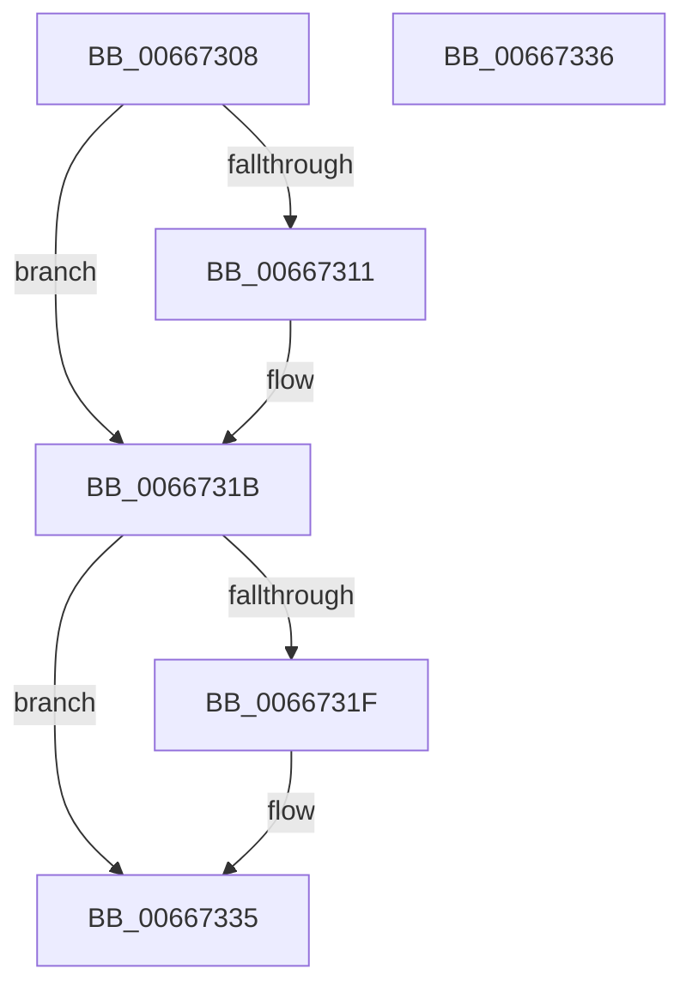

# MicrocodeInitLogging

- RVA: `0x00667308`–`0x00667337` (길이 `47` bytes)
- VA: `0x0000000140667308`
- 실행 섹션: `.text`
- PDB 이름 있음: `예`; PDB Function 태그: `아니요`
- unwind 정보 RVA: `0x000DB714`
- 디코드: `10`개 명령, `47/47` bytes 표시
- 미해석 바이트: `0` (있으면 어셈블리에 `.byte`로 보존)

> 이 문서는 커널 이미지의 기계어와 PDB 기호를 분석해 생성했습니다. 4번과 5번은 함수 원형과 자료형을 바이너리 사용 방식에서 추정한 C 해석이며 원본 소스 복구 결과는 아닙니다.

## 1. Dependencies

- 직접 호출 지점: **0**; 고유 호출 대상: **0**
- 직접 호출자로 확인된 함수: **2**
- RIP 상대 이미지 참조: **5**

### Outgoing calls
- 직접 디코드된 call 명령이 없습니다.

### Direct callers
- [GetMicrocodePatchData](GetMicrocodePatchData_function_00666E48.md) at `0x00666F1D`
- [MicrocodeUpdate](MicrocodeUpdate_function_00667480.md) at `0x006674CF`

### Static image references
- `0x00667308` → RVA `0x00EF7CA0` (`.data`; read)
- `0x00667311` → RVA `0x00EF7CA0` (`.data`; write)
- `0x0066731F` → RVA `0x00EF7CA8` (`.data`; write)
- `0x00667325` → RVA `0x00EF7CA4` (`.data`; write)
- `0x0066732B` → RVA `0x00EF7CC8` (`.data`; write)

## 2. Other-region calls and transfers

- 다른 실행 섹션으로 향하는 call: **0**
- 별도 외부 분기/꼬리 이동을 확인하지 못했습니다.

## 3. Assembly (complete function range)

```asm
00667308  83 3D 91 09 89 00 00            cmp dword ptr [rip + 0x890991], 0
0066730F  75 0A                           jne 0x14066731b
00667311  C7 05 85 09 89 00 01 00 00 00   mov dword ptr [rip + 0x890985], 1
0066731B  85 C9                           test ecx, ecx
0066731D  74 16                           je 0x140667335
0066731F  89 0D 83 09 89 00               mov dword ptr [rip + 0x890983], ecx
00667325  89 15 79 09 89 00               mov dword ptr [rip + 0x890979], edx
0066732B  C7 05 93 09 89 00 02 00 00 00   mov dword ptr [rip + 0x890993], 2
00667335  C3                              ret
00667336  CC                              int3
```

## 4. C-style interpretation (structured pseudocode)

```c
void __fastcall MicrocodeInitLogging(int a1, int a2)
{
    if ((*(unsigned int *)(v_rip + 8980881)) == 0) {
        *(unsigned int *)(v_rip + 8980869) = 1;
    }
    if (a1 != 0) {
        *(unsigned int *)(v_rip + 8980867) = a1;
        *(unsigned int *)(v_rip + 8980857) = a2;
        *(unsigned int *)(v_rip + 8980883) = 2;
    }
    return;
}
```

## 5. (Beta) C Style

```c
void MicrocodeInitLogging(int32_t Arg1, int32_t Arg2)
{
    if ((*(uint32_t *)(v_rip + 0x890991)) == 0) {
        *(uint32_t *)(v_rip + 0x890985) = 1;
    }
    if (Arg1 != 0) {
        *(uint32_t *)(v_rip + 0x890983) = Arg1;
        *(uint32_t *)(v_rip + 0x890979) = Arg2;
        *(uint32_t *)(v_rip + 0x890993) = 2;
    }
    return;
}
```

## 6. Execution-region graph

[열기: 2D/3D 그래프와 함수 탐색 컨트롤 패널](../../../control-panel.html?section=text&rva=0x00667308&view=graph)

- 2D 그래프는 위에서 아래로 흐르고, 3D 그래프는 빈 공간을 드래그해 회전합니다. Shift+드래그는 이동, 휠은 확대·축소, 함수 노드 선택은 대상 보고서 이동입니다.

### Static fallback


