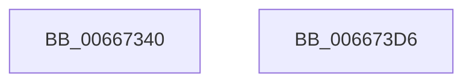

# MicrocodeLogRegistry

- RVA: `0x00667340`–`0x006673D7` (길이 `151` bytes)
- VA: `0x0000000140667340`
- 실행 섹션: `.text`
- PDB 이름 있음: `예`; PDB Function 태그: `아니요`
- unwind 정보 RVA: `0x000BF024`
- 디코드: `34`개 명령, `151/151` bytes 표시
- 미해석 바이트: `0` (있으면 어셈블리에 `.byte`로 보존)

> 이 문서는 커널 이미지의 기계어와 PDB 기호를 분석해 생성했습니다. 4번과 5번은 함수 원형과 자료형을 바이너리 사용 방식에서 추정한 C 해석이며 원본 소스 복구 결과는 아닙니다.

## 1. Dependencies

- 직접 호출 지점: **4**; 고유 호출 대상: **4**
- 직접 호출자로 확인된 함수: **1**
- RIP 상대 이미지 참조: **2**

### Outgoing calls
- `0x00667389` → [RtlInitUnicodeString](../42/RtlInitUnicodeString_function_0042A780.md) (function, `0x0042A780`)
- `0x00667398` → [RtlCopyUnicodeString](../3F/RtlCopyUnicodeString_function_003FEF30.md) (function, `0x003FEF30`)
- `0x006673AD` → [PrpWriteLogsToRegistry](../4C/PrpWriteLogsToRegistry_function_004CC288.md) (function, `0x004CC288`)
- `0x006673C0` → [_security_check_cookie](../6A/_security_check_cookie_function_006AC640.md) (function, `0x006AC640`)

### Direct callers
- [HalpMcUpdatePostUpdate](../4D/HalpMcUpdatePostUpdate_function_004D6670.md) at `0x004D6699`

### Static image references
- `0x00667352` → RVA `0x00E0A740` (`.data`; read)
- `0x00667373` → RVA `0x0003A010` (`.rdata`; read)

## 2. Other-region calls and transfers

- 다른 실행 섹션으로 향하는 call: **0**
- 별도 외부 분기/꼬리 이동을 확인하지 못했습니다.

## 3. Assembly (complete function range)

```asm
00667340  48 89 5C 24 08                  mov qword ptr [rsp + 8], rbx
00667345  55                              push rbp
00667346  48 8D 6C 24 B0                  lea rbp, [rsp - 0x50]
0066734B  48 81 EC 50 01 00 00            sub rsp, 0x150
00667352  48 8B 05 E7 33 7A 00            mov rax, qword ptr [rip + 0x7a33e7]
00667359  48 33 C4                        xor rax, rsp
0066735C  48 89 45 40                     mov qword ptr [rbp + 0x40], rax
00667360  0F 57 C0                        xorps xmm0, xmm0
00667363  48 C7 44 24 20 00 00 00 01      mov qword ptr [rsp + 0x20], 0x1000000
0066736C  48 8D 44 24 40                  lea rax, [rsp + 0x40]
00667371  33 DB                           xor ebx, ebx
00667373  48 8D 15 96 2C 9D FF            lea rdx, [rip - 0x62d36a]
0066737A  48 89 44 24 28                  mov qword ptr [rsp + 0x28], rax
0066737F  48 8D 4C 24 30                  lea rcx, [rsp + 0x30]
00667384  0F 11 44 24 30                  movups xmmword ptr [rsp + 0x30], xmm0
00667389  E8 F2 33 DC FF                  call 0x14042a780
0066738E  48 8D 54 24 30                  lea rdx, [rsp + 0x30]
00667393  48 8D 4C 24 20                  lea rcx, [rsp + 0x20]
00667398  E8 93 7B D9 FF                  call 0x1403fef30
0066739D  0F 28 44 24 20                  movaps xmm0, xmmword ptr [rsp + 0x20]
006673A2  48 8D 54 24 30                  lea rdx, [rsp + 0x30]
006673A7  66 0F 7F 44 24 30               movdqa xmmword ptr [rsp + 0x30], xmm0
006673AD  E8 D6 4E E6 FF                  call 0x1404cc288
006673B2  85 C0                           test eax, eax
006673B4  0F 48 D8                        cmovs ebx, eax
006673B7  8B C3                           mov eax, ebx
006673B9  48 8B 4D 40                     mov rcx, qword ptr [rbp + 0x40]
006673BD  48 33 CC                        xor rcx, rsp
006673C0  E8 7B 52 04 00                  call 0x1406ac640
006673C5  48 8B 9C 24 60 01 00 00         mov rbx, qword ptr [rsp + 0x160]
006673CD  48 81 C4 50 01 00 00            add rsp, 0x150
006673D4  5D                              pop rbp
006673D5  C3                              ret
006673D6  CC                              int3
```

## 4. C-style interpretation (structured pseudocode)

```c
__int64 __fastcall MicrocodeLogRegistry(void)
{
    __int64 result;
    __int64 v_rbx;
    __int64 v_rsp;
    unsigned __int64 v_stack_m118;
    unsigned __int64 v_stack_m128;
    unsigned __int64 v_stack_m130;
    unsigned __int64 v_stack_m138;
    unsigned __int64 v_stack_m18;
    unsigned __int64 v_stack_m58;
    unsigned __int64 v_stack_p8;

    v_stack_p8 = v_rbx;
    v_rsp = (v_rsp) - (336);
    result = (*(unsigned __int64 *)(v_rip + 8008679)) ^ (v_rsp);
    v_stack_m18 = result;
    v_stack_m138 = 0x1000000ULL;
    v_rbx = 0;
    v_stack_m130 = v_stack_m118;
    v_stack_m128 = v_xmm0;
    result = RtlInitUnicodeString(v_stack_m128, v_rip - 6476650, a3, a4);
    result = RtlCopyUnicodeString(v_stack_m138, v_stack_m128, a3, a4);
    v_stack_m128 = v_xmm0;
    result = PrpWriteLogsToRegistry(v_stack_m138, v_stack_m128, a3, a4);
    if (sign_flag) { v_rbx = (unsigned int)(result); }
    a1 = (v_stack_m18) ^ (v_rsp);
    result = _security_check_cookie(a1, v_stack_m128, a3, a4);
    v_rsp = (v_rsp) + (336);
    return result;
}
```

## 5. (Beta) C Style

```c
void MicrocodeLogRegistry(void)
{
    int64_t result;
    int64_t local_rbx;
    int64_t local_rsp;
    uint64_t v_stack_m118;
    uint64_t v_stack_m128;
    uint64_t v_stack_m130;
    uint64_t v_stack_m138;
    uint64_t v_stack_m18;
    uint64_t v_stack_m58;
    uint64_t v_stack_p8;

    v_stack_p8 = local_rbx;
    local_rsp = (local_rsp) - (336);
    result = (*(uint64_t *)(v_rip + 0x7A33E7)) ^ (local_rsp);
    v_stack_m18 = result;
    v_stack_m138 = 0x1000000ULL;
    local_rbx = 0;
    v_stack_m130 = v_stack_m118;
    v_stack_m128 = v_xmm0;
    result = RtlInitUnicodeString(v_stack_m128, v_rip - 6476650, a3, a4);
    result = RtlCopyUnicodeString(v_stack_m138, v_stack_m128, a3, a4);
    v_stack_m128 = v_xmm0;
    result = PrpWriteLogsToRegistry(v_stack_m138, v_stack_m128, a3, a4);
    if (sign_flag) { local_rbx = (uint32_t)(result); }
    a1 = (v_stack_m18) ^ (local_rsp);
    result = _security_check_cookie(a1, v_stack_m128, a3, a4);
    local_rsp = (local_rsp) + (336);
    return result;
}
```

## 6. Execution-region graph

[열기: 2D/3D 그래프와 함수 탐색 컨트롤 패널](../../../control-panel.html?section=text&rva=0x00667340&view=graph)

- 2D 그래프는 위에서 아래로 흐르고, 3D 그래프는 빈 공간을 드래그해 회전합니다. Shift+드래그는 이동, 휠은 확대·축소, 함수 노드 선택은 대상 보고서 이동입니다.

### Static fallback


