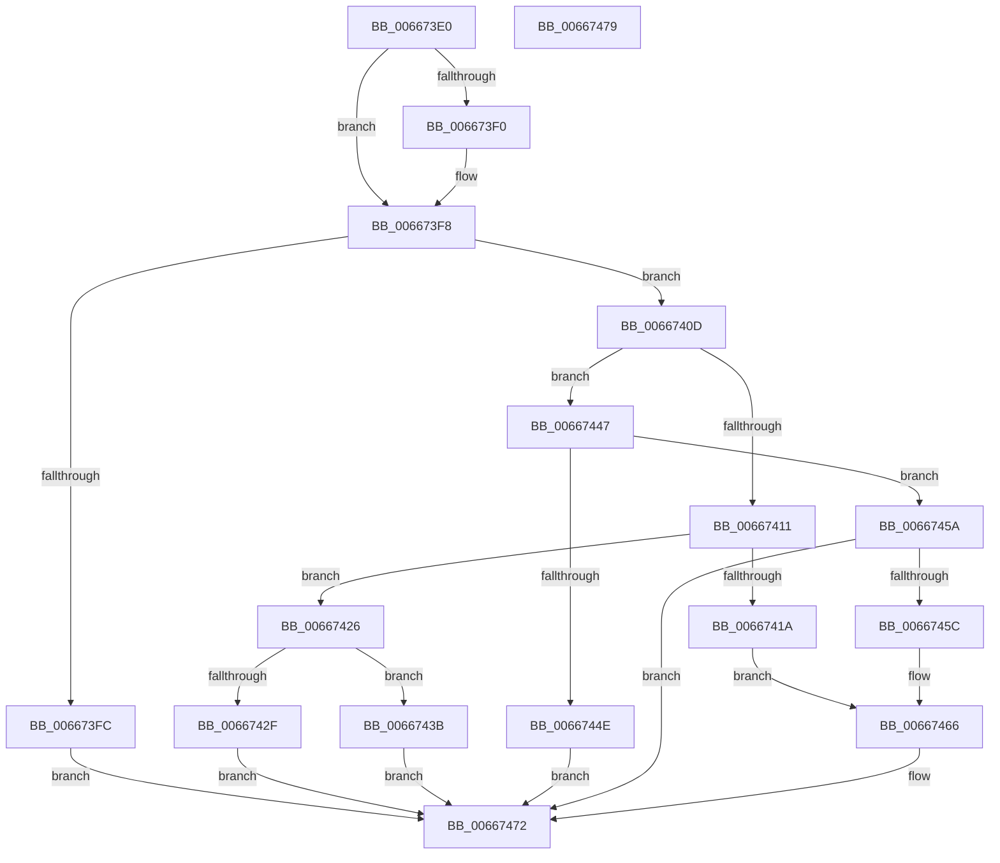

# MicrocodePrePatchCheckAndLogging

- RVA: `0x006673E0`–`0x0066747A` (길이 `154` bytes)
- VA: `0x00000001406673E0`
- 실행 섹션: `.text`
- PDB 이름 있음: `예`; PDB Function 태그: `아니요`
- unwind 정보 RVA: `0x000DB714`
- 디코드: `35`개 명령, `154/154` bytes 표시
- 미해석 바이트: `0` (있으면 어셈블리에 `.byte`로 보존)

> 이 문서는 커널 이미지의 기계어와 PDB 기호를 분석해 생성했습니다. 4번과 5번은 함수 원형과 자료형을 바이너리 사용 방식에서 추정한 C 해석이며 원본 소스 복구 결과는 아닙니다.

## 1. Dependencies

- 직접 호출 지점: **0**; 고유 호출 대상: **0**
- 직접 호출자로 확인된 함수: **2**
- RIP 상대 이미지 참조: **7**

### Outgoing calls
- 직접 디코드된 call 명령이 없습니다.

### Direct callers
- [GetMicrocodePatchData](GetMicrocodePatchData_function_00666E48.md) at `0x00666F9C`
- [MicrocodeUpdate](MicrocodeUpdate_function_00667480.md) at `0x00667557`
- [MicrocodeUpdate](MicrocodeUpdate_function_00667480.md) at `0x0066760F`

### Static image references
- `0x006673E0` → RVA `0x00EF7CB0` (`.data`; read)
- `0x006673E6` → RVA `0x00EF7CB4` (`.data`; write)
- `0x006673F2` → RVA `0x00EF7CB0` (`.data`; write)
- `0x006673FC` → RVA `0x00EF7CC4` (`.data`; write)
- `0x00667411` → RVA `0x00EF7CCC` (`.data`; read)
- `0x00667468` → RVA `0x00EF7CA0` (`.data`; write)
- `0x00667472` → RVA `0x00EF7CB8` (`.data`; write)

## 2. Other-region calls and transfers

- 다른 실행 섹션으로 향하는 call: **0**
- 별도 외부 분기/꼬리 이동을 확인하지 못했습니다.

## 3. Assembly (complete function range)

```asm
006673E0  8B 05 CA 08 89 00               mov eax, dword ptr [rip + 0x8908ca]
006673E6  89 0D C8 08 89 00               mov dword ptr [rip + 0x8908c8], ecx
006673EC  85 C0                           test eax, eax
006673EE  75 08                           jne 0x1406673f8
006673F0  8B C1                           mov eax, ecx
006673F2  89 0D B8 08 89 00               mov dword ptr [rip + 0x8908b8], ecx
006673F8  85 D2                           test edx, edx
006673FA  75 11                           jne 0x14066740d
006673FC  C7 05 BE 08 89 00 06 00 00 00   mov dword ptr [rip + 0x8908be], 6
00667406  B8 01 00 00 C0                  mov eax, 0xc0000001
0066740B  EB 65                           jmp 0x140667472
0066740D  3B D1                           cmp edx, ecx
0066740F  73 36                           jae 0x140667447
00667411  80 3D B4 08 89 00 00            cmp byte ptr [rip + 0x8908b4], 0
00667418  74 0C                           je 0x140667426
0066741A  C7 05 A0 08 89 00 0A 00 00 00   mov dword ptr [rip + 0x8908a0], 0xa
00667424  EB 40                           jmp 0x140667466
00667426  3B C1                           cmp eax, ecx
00667428  B8 01 00 00 C0                  mov eax, 0xc0000001
0066742D  75 0C                           jne 0x14066743b
0066742F  C7 05 8B 08 89 00 07 00 00 00   mov dword ptr [rip + 0x89088b], 7
00667439  EB 37                           jmp 0x140667472
0066743B  C7 05 7F 08 89 00 01 00 00 00   mov dword ptr [rip + 0x89087f], 1
00667445  EB 2B                           jmp 0x140667472
00667447  B8 01 00 00 C0                  mov eax, 0xc0000001
0066744C  75 0C                           jne 0x14066745a
0066744E  C7 05 6C 08 89 00 02 00 00 00   mov dword ptr [rip + 0x89086c], 2
00667458  EB 18                           jmp 0x140667472
0066745A  76 16                           jbe 0x140667472
0066745C  C7 05 5E 08 89 00 04 00 00 00   mov dword ptr [rip + 0x89085e], 4
00667466  33 C0                           xor eax, eax
00667468  C7 05 2E 08 89 00 02 00 00 00   mov dword ptr [rip + 0x89082e], 2
00667472  89 0D 40 08 89 00               mov dword ptr [rip + 0x890840], ecx
00667478  C3                              ret
00667479  CC                              int3
```

## 4. C-style interpretation (structured pseudocode)

```c
__int64 __fastcall MicrocodePrePatchCheckAndLogging(int a1, int a2)
{
    __int64 result;

    *(unsigned int *)(v_rip + 8980680) = a1;
    result = (unsigned int)(*(unsigned int *)(v_rip + 8980682));
    if ((unsigned int)((unsigned int)(*(unsigned int *)(v_rip + 8980682))) == 0) {
        result = a1;
        *(unsigned int *)(v_rip + 8980664) = a1;
    }
    if (a2 != 0) goto loc_0066740D;
    *(unsigned int *)(v_rip + 8980670) = 6;
    goto loc_00667472;
loc_0066740D:
    if (a2 >= a1) goto loc_00667447;
    if ((*(unsigned __int8 *)(v_rip + 8980660)) == 0) goto loc_00667426;
    *(unsigned int *)(v_rip + 8980640) = 10;
    goto loc_00667466;
loc_00667426:
    if (((unsigned int)((unsigned int)(0xC0000001ULL))) != a1) goto loc_0066743B;
    *(unsigned int *)(v_rip + 8980619) = 7;
    goto loc_00667472;
loc_0066743B:
    *(unsigned int *)(v_rip + 8980607) = 1;
    goto loc_00667472;
loc_00667447:
    if (((unsigned int)((unsigned int)(0xC0000001ULL))) != a1) goto loc_0066745A;
    *(unsigned int *)(v_rip + 8980588) = 2;
    goto loc_00667472;
loc_0066745A:
    if (((unsigned int)((unsigned int)(0xC0000001ULL))) <= a1) goto loc_00667472;
    *(unsigned int *)(v_rip + 8980574) = 4;
loc_00667466:
    result = 0;
    *(unsigned int *)(v_rip + 8980526) = 2;
loc_00667472:
    *(unsigned int *)(v_rip + 8980544) = a1;
    return result;
}
```

## 5. (Beta) C Style

```c
int64_t MicrocodePrePatchCheckAndLogging(int32_t Arg1, int32_t Arg2)
{
    int64_t result;

    *(uint32_t *)(v_rip + 0x8908C8) = Arg1;
    result = (uint32_t)(*(uint32_t *)(v_rip + 0x8908CA));
    if ((uint32_t)((uint32_t)(*(uint32_t *)(v_rip + 0x8908CA))) == 0) {
        result = Arg1;
        *(uint32_t *)(v_rip + 0x8908B8) = Arg1;
    }
    if (Arg2 != 0) goto loc_0066740D;
    *(uint32_t *)(v_rip + 0x8908BE) = 6;
    goto loc_00667472;
loc_0066740D:
    if (Arg2 >= Arg1) goto loc_00667447;
    if ((*(uint8_t *)(v_rip + 0x8908B4)) == 0) goto loc_00667426;
    *(uint32_t *)(v_rip + 0x8908A0) = 10;
    goto loc_00667466;
loc_00667426:
    if (((uint32_t)((uint32_t)(0xC0000001ULL))) != Arg1) goto loc_0066743B;
    *(uint32_t *)(v_rip + 0x89088B) = 7;
    goto loc_00667472;
loc_0066743B:
    *(uint32_t *)(v_rip + 0x89087F) = 1;
    goto loc_00667472;
loc_00667447:
    if (((uint32_t)((uint32_t)(0xC0000001ULL))) != Arg1) goto loc_0066745A;
    *(uint32_t *)(v_rip + 0x89086C) = 2;
    goto loc_00667472;
loc_0066745A:
    if (((uint32_t)((uint32_t)(0xC0000001ULL))) <= Arg1) goto loc_00667472;
    *(uint32_t *)(v_rip + 0x89085E) = 4;
loc_00667466:
    result = 0;
    *(uint32_t *)(v_rip + 0x89082E) = 2;
loc_00667472:
    *(uint32_t *)(v_rip + 0x890840) = Arg1;
    return result;
}
```

## 6. Execution-region graph

[열기: 2D/3D 그래프와 함수 탐색 컨트롤 패널](../../../control-panel.html?section=text&rva=0x006673E0&view=graph)

- 2D 그래프는 위에서 아래로 흐르고, 3D 그래프는 빈 공간을 드래그해 회전합니다. Shift+드래그는 이동, 휠은 확대·축소, 함수 노드 선택은 대상 보고서 이동입니다.

### Static fallback


