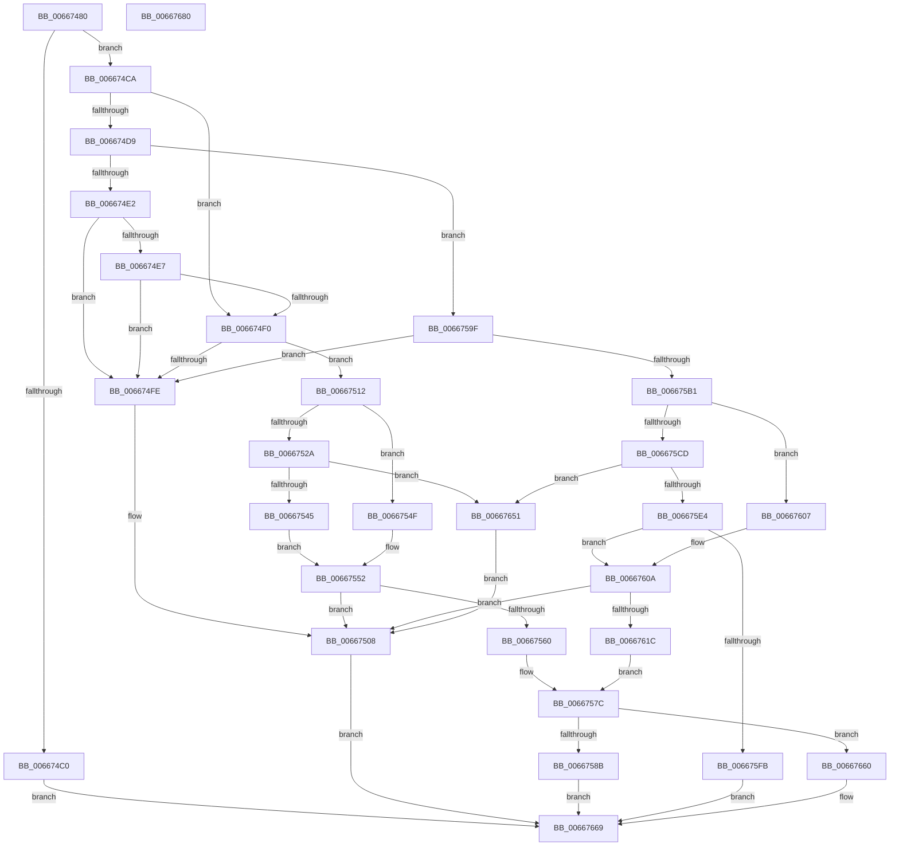

# MicrocodeUpdate

- RVA: `0x00667480`–`0x00667681` (길이 `513` bytes)
- VA: `0x0000000140667480`
- 실행 섹션: `.text`
- PDB 이름 있음: `예`; PDB Function 태그: `아니요`
- unwind 정보 RVA: `0x000D6228`
- 디코드: `149`개 명령, `513/513` bytes 표시
- 미해석 바이트: `0` (있으면 어셈블리에 `.byte`로 보존)

> 이 문서는 커널 이미지의 기계어와 PDB 기호를 분석해 생성했습니다. 4번과 5번은 함수 원형과 자료형을 바이너리 사용 방식에서 추정한 C 해석이며 원본 소스 복구 결과는 아닙니다.

## 1. Dependencies

- 직접 호출 지점: **10**; 고유 호출 대상: **8**
- 직접 호출자로 확인된 함수: **1**
- RIP 상대 이미지 참조: **3**

### Outgoing calls
- `0x006674B7` → [HviIsHypervisorVendorMicrosoft](HviIsHypervisorVendorMicrosoft_function_00666920.md) (function, `0x00666920`)
- `0x006674CF` → [MicrocodeInitLogging](MicrocodeInitLogging_function_00667308.md) (function, `0x00667308`)
- `0x006674E7` → [Feature_Microcode_Client_CD__private_IsEnabledDeviceUsageNoInline](Feature_Microcode_Client_CD__private_IsEnabledDeviceUsageNoInline_function_00666A18.md) (function, `0x00666A18`)
- `0x006674F5` → [GetCpuManufacturer](GetCpuManufacturer_function_00667B34.md) (function, `0x00667B34`)
- `0x00667538` → [AMDMicrocodeGetRecordData](AMDMicrocodeGetRecordData_function_00667CA0.md) (function, `0x00667CA0`)
- `0x00667557` → [MicrocodePrePatchCheckAndLogging](MicrocodePrePatchCheckAndLogging_function_006673E0.md) (function, `0x006673E0`)
- `0x006675A4` → [GetCpuManufacturer](GetCpuManufacturer_function_00667B34.md) (function, `0x00667B34`)
- `0x006675DB` → [IntelMicrocodeGetRecordData](IntelMicrocodeGetRecordData_function_00667954.md) (function, `0x00667954`)
- `0x006675F2` → [IntelMicrocodeChecksumValidate](IntelMicrocodeChecksumValidate_function_00667908.md) (function, `0x00667908`)
- `0x0066760F` → [MicrocodePrePatchCheckAndLogging](MicrocodePrePatchCheckAndLogging_function_006673E0.md) (function, `0x006673E0`)

### Direct callers
- [PrExtApplyPatch](../4F/PrExtApplyPatch_function_004FB058.md) at `0x004FB0A1`

### Static image references
- `0x006674FE` → RVA `0x00EF7CC4` (`.data`; write)
- `0x0066757C` → RVA `0x00EF7CB8` (`.data`; write)
- `0x00667660` → RVA `0x00EF7CC4` (`.data`; read/write)

## 2. Other-region calls and transfers

- 다른 실행 섹션으로 향하는 call: **0**
- 별도 외부 분기/꼬리 이동을 확인하지 못했습니다.

## 3. Assembly (complete function range)

```asm
00667480  48 89 5C 24 08                  mov qword ptr [rsp + 8], rbx
00667485  48 89 74 24 10                  mov qword ptr [rsp + 0x10], rsi
0066748A  55                              push rbp
0066748B  57                              push rdi
0066748C  41 54                           push r12
0066748E  41 56                           push r14
00667490  41 57                           push r15
00667492  48 8B EC                        mov rbp, rsp
00667495  48 83 EC 40                     sub rsp, 0x40
00667499  48 83 65 E0 00                  and qword ptr [rbp - 0x20], 0
0066749E  4C 8B F1                        mov r14, rcx
006674A1  33 FF                           xor edi, edi
006674A3  33 C9                           xor ecx, ecx
006674A5  4C 8B FA                        mov r15, rdx
006674A8  48 89 7D 48                     mov qword ptr [rbp + 0x48], rdi
006674AC  41 8B F0                        mov esi, r8d
006674AF  8D 47 01                        lea eax, [rdi + 1]
006674B2  0F A2                           cpuid
006674B4  44 8B E0                        mov r12d, eax
006674B7  E8 64 F4 FF FF                  call 0x140666920
006674BC  84 C0                           test al, al
006674BE  74 0A                           je 0x1406674ca
006674C0  B8 06 00 35 C0                  mov eax, 0xc0350006
006674C5  E9 9F 01 00 00                  jmp 0x140667669
006674CA  8B D6                           mov edx, esi
006674CC  41 8B CC                        mov ecx, r12d
006674CF  E8 34 FE FF FF                  call 0x140667308
006674D4  83 EE 01                        sub esi, 1
006674D7  74 17                           je 0x1406674f0
006674D9  83 EE 01                        sub esi, 1
006674DC  0F 84 BD 00 00 00               je 0x14066759f
006674E2  83 FE 0B                        cmp esi, 0xb
006674E5  75 17                           jne 0x1406674fe
006674E7  E8 2C F5 FF FF                  call 0x140666a18
006674EC  85 C0                           test eax, eax
006674EE  74 0E                           je 0x1406674fe
006674F0  B9 02 00 00 00                  mov ecx, 2
006674F5  E8 3A 06 00 00                  call 0x140667b34
006674FA  84 C0                           test al, al
006674FC  75 14                           jne 0x140667512
006674FE  C7 05 BC 07 89 00 08 00 00 00   mov dword ptr [rip + 0x8907bc], 8
00667508  B8 BB 00 00 C0                  mov eax, 0xc00000bb
0066750D  E9 57 01 00 00                  jmp 0x140667669
00667512  BE 8B 00 00 00                  mov esi, 0x8b
00667517  8B CE                           mov ecx, esi
00667519  0F 32                           rdmsr
0066751B  48 C1 E2 20                     shl rdx, 0x20
0066751F  48 0B C2                        or rax, rdx
00667522  48 8B D8                        mov rbx, rax
00667525  4D 85 F6                        test r14, r14
00667528  74 25                           je 0x14066754f
0066752A  4C 8D 4D 48                     lea r9, [rbp + 0x48]
0066752E  49 8B D7                        mov rdx, r15
00667531  4C 8D 45 E0                     lea r8, [rbp - 0x20]
00667535  49 8B CE                        mov rcx, r14
00667538  E8 63 07 00 00                  call 0x140667ca0
0066753D  85 C0                           test eax, eax
0066753F  0F 88 0C 01 00 00               js 0x140667651
00667545  48 8B 7D 48                     mov rdi, qword ptr [rbp + 0x48]
00667549  44 8B 4F 04                     mov r9d, dword ptr [rdi + 4]
0066754D  EB 03                           jmp 0x140667552
0066754F  45 33 C9                        xor r9d, r9d
00667552  41 8B D1                        mov edx, r9d
00667555  8B CB                           mov ecx, ebx
00667557  E8 84 FE FF FF                  call 0x1406673e0
0066755C  85 C0                           test eax, eax
0066755E  78 A8                           js 0x140667508
00667560  48 8B D7                        mov rdx, rdi
00667563  48 8B C7                        mov rax, rdi
00667566  48 C1 EA 20                     shr rdx, 0x20
0066756A  B9 20 00 01 C0                  mov ecx, 0xc0010020
0066756F  0F 30                           wrmsr
00667571  8B CE                           mov ecx, esi
00667573  0F 32                           rdmsr
00667575  48 C1 E2 20                     shl rdx, 0x20
00667579  48 0B C2                        or rax, rdx
0066757C  89 05 36 07 89 00               mov dword ptr [rip + 0x890736], eax
00667582  44 3B C8                        cmp r9d, eax
00667585  0F 84 D5 00 00 00               je 0x140667660
0066758B  C7 05 2F 07 89 00 03 00 00 00   mov dword ptr [rip + 0x89072f], 3
00667595  B8 3E 00 00 C0                  mov eax, 0xc000003e
0066759A  E9 CA 00 00 00                  jmp 0x140667669
0066759F  B9 01 00 00 00                  mov ecx, 1
006675A4  E8 8B 05 00 00                  call 0x140667b34
006675A9  84 C0                           test al, al
006675AB  0F 84 4D FF FF FF               je 0x1406674fe
006675B1  BE 8B 00 00 00                  mov esi, 0x8b
006675B6  8B CE                           mov ecx, esi
006675B8  0F 32                           rdmsr
006675BA  48 C1 E2 20                     shl rdx, 0x20
006675BE  48 0B C2                        or rax, rdx
006675C1  48 8B D8                        mov rbx, rax
006675C4  48 C1 EB 20                     shr rbx, 0x20
006675C8  4D 85 F6                        test r14, r14
006675CB  74 3A                           je 0x140667607
006675CD  4C 8D 4D 48                     lea r9, [rbp + 0x48]
006675D1  49 8B D7                        mov rdx, r15
006675D4  4C 8D 45 E0                     lea r8, [rbp - 0x20]
006675D8  49 8B CE                        mov rcx, r14
006675DB  E8 74 03 00 00                  call 0x140667954
006675E0  85 C0                           test eax, eax
006675E2  78 6D                           js 0x140667651
006675E4  48 8B 7D 48                     mov rdi, qword ptr [rbp + 0x48]
006675E8  8B 55 E0                        mov edx, dword ptr [rbp - 0x20]
006675EB  48 8B CF                        mov rcx, rdi
006675EE  44 8B 4F 04                     mov r9d, dword ptr [rdi + 4]
006675F2  E8 11 03 00 00                  call 0x140667908
006675F7  85 C0                           test eax, eax
006675F9  79 0F                           jns 0x14066760a
006675FB  C7 05 BF 06 89 00 08 00 00 00   mov dword ptr [rip + 0x8906bf], 8
00667605  EB 62                           jmp 0x140667669
00667607  45 33 C9                        xor r9d, r9d
0066760A  41 8B D1                        mov edx, r9d
0066760D  8B CB                           mov ecx, ebx
0066760F  E8 CC FD FF FF                  call 0x1406673e0
00667614  85 C0                           test eax, eax
00667616  0F 88 EC FE FF FF               js 0x140667508
0066761C  48 8D 57 30                     lea rdx, [rdi + 0x30]
00667620  B9 79 00 00 00                  mov ecx, 0x79
00667625  48 8B C2                        mov rax, rdx
00667628  48 C1 EA 20                     shr rdx, 0x20
0066762C  0F 30                           wrmsr
0066762E  33 C0                           xor eax, eax
00667630  8B CE                           mov ecx, esi
00667632  33 D2                           xor edx, edx
00667634  0F 30                           wrmsr
00667636  33 C9                           xor ecx, ecx
00667638  8D 42 01                        lea eax, [rdx + 1]
0066763B  0F A2                           cpuid
0066763D  8B CE                           mov ecx, esi
0066763F  0F 32                           rdmsr
00667641  48 C1 E2 20                     shl rdx, 0x20
00667645  48 0B C2                        or rax, rdx
00667648  48 C1 E8 20                     shr rax, 0x20
0066764C  E9 2B FF FF FF                  jmp 0x14066757c
00667651  C7 05 69 06 89 00 09 00 00 00   mov dword ptr [rip + 0x890669], 9
0066765B  E9 A8 FE FF FF                  jmp 0x140667508
00667660  83 25 5D 06 89 00 00            and dword ptr [rip + 0x89065d], 0
00667667  33 C0                           xor eax, eax
00667669  48 8B 5C 24 70                  mov rbx, qword ptr [rsp + 0x70]
0066766E  48 8B 74 24 78                  mov rsi, qword ptr [rsp + 0x78]
00667673  48 83 C4 40                     add rsp, 0x40
00667677  41 5F                           pop r15
00667679  41 5E                           pop r14
0066767B  41 5C                           pop r12
0066767D  5F                              pop rdi
0066767E  5D                              pop rbp
0066767F  C3                              ret
00667680  CC                              int3
```

## 4. C-style interpretation (structured pseudocode)

```c
__int64 __fastcall MicrocodeUpdate(__int64 a1, __int64 a2, int a3)
{
    __int64 result;
    __int64 v_rbx;
    __int64 v_rdi;
    __int64 v_rsi;
    __int64 v_rsp;
    unsigned __int64 v_stack_m48;
    unsigned __int64 v_stack_p10;
    unsigned __int64 v_stack_p20;
    unsigned __int64 v_stack_p8;

    v_stack_p8 = v_rbx;
    v_stack_p10 = v_rsi;
    v_rsp = (v_rsp) - (64);
    v_rdi = 0;
    a1 = 0;
    v_stack_p20 = 0;
    result = HviIsHypervisorVendorMicrosoft(a1, a2, a3, a4);
    if ((unsigned __int8)(result) == 0) goto loc_006674CA;
    goto loc_00667669;
loc_006674CA:
    result = MicrocodeInitLogging((unsigned int)((unsigned int)((unsigned int)((unsigned int)(v_rdi + 1)))), (unsigned int)((unsigned int)((unsigned int)(a3))), a3, a4);
    v_rsi = (unsigned int)(((unsigned int)(a3)) - (1));
    if (condition_is_equal) goto loc_006674F0;
    v_rsi = (unsigned int)((v_rsi) - (1));
    if (condition_is_equal) goto loc_0066759F;
    if (((unsigned int)(v_rsi)) != 11) goto loc_006674FE;
    result = Feature_Microcode_Client_CD__private_IsEnabledDeviceUsageNoInline((unsigned int)((unsigned int)((unsigned int)((unsigned int)(v_rdi + 1)))), (unsigned int)((unsigned int)((unsigned int)(a3))), a3, a4);
    if ((unsigned int)(result) == 0) goto loc_006674FE;
loc_006674F0:
    result = GetCpuManufacturer(2, (unsigned int)((unsigned int)((unsigned int)(a3))), a3, a4);
    if ((unsigned __int8)(result) != 0) goto loc_00667512;
loc_006674FE:
    *(unsigned int *)(v_rip + 8980412) = 8;
loc_00667508:
    goto loc_00667669;
loc_00667512:
    a2 = ((unsigned int)((unsigned int)((unsigned int)(a3)))) << (32);
    result = ((unsigned int)(0xC00000BBULL)) | (a2);
    if (0 == 0) goto loc_0066754F;
    result = AMDMicrocodeGetRecordData(0, a2, v_stack_m48, v_stack_p20);
    if (sign_flag) goto loc_00667651;
    goto loc_00667552;
loc_0066754F:
    a4 = 0;
loc_00667552:
    result = MicrocodePrePatchCheckAndLogging((unsigned int)((unsigned int)(result)), 0, v_stack_m48, a4);
    if (sign_flag) goto loc_00667508;
    a2 = (v_stack_p20) >> (32);
    a2 = (a2) << (32);
    result = (v_stack_p20) | (a2);
loc_0066757C:
    *(unsigned int *)(v_rip + 8980278) = (unsigned int)(result);
    if (0 == ((unsigned int)(result))) goto loc_00667660;
    *(unsigned int *)(v_rip + 8980271) = 3;
    goto loc_00667669;
loc_0066759F:
    result = GetCpuManufacturer(1, a2, v_stack_m48, a4);
    if ((unsigned __int8)(result) == 0) goto loc_006674FE;
    a2 = (a2) << (32);
    result = (result) | (a2);
    v_rbx = (result) >> (32);
    if (0 == 0) goto loc_00667607;
    result = IntelMicrocodeGetRecordData(0, a2, v_stack_m48, v_stack_p20);
    if (sign_flag) goto loc_00667651;
    result = IntelMicrocodeChecksumValidate(v_stack_p20, (unsigned int)(v_stack_m48), v_stack_m48, (unsigned int)(*(unsigned int *)(v_stack_p20 + 4)));
    if (!sign_flag) goto loc_0066760A;
    *(unsigned int *)(v_rip + 8980159) = 8;
    goto loc_00667669;
loc_00667607:
    a4 = 0;
loc_0066760A:
    result = MicrocodePrePatchCheckAndLogging((unsigned int)((unsigned int)(v_rbx)), 0, v_stack_m48, a4);
    if (sign_flag) goto loc_00667508;
    a2 = (v_stack_p20 + 48) >> (32);
    result = 0;
    a2 = 0;
    a1 = 0;
    a2 = (a2) << (32);
    result = (a2 + 1) | (a2);
    result = (result) >> (32);
    goto loc_0066757C;
loc_00667651:
    *(unsigned int *)(v_rip + 8980073) = 9;
    goto loc_00667508;
loc_00667660:
    result = 0;
loc_00667669:
    v_rsp = (v_rsp) + (64);
    return result;
}
```

## 5. (Beta) C Style

```c
int64_t MicrocodeUpdate(int64_t Arg1, int64_t Arg2, int32_t Arg3)
{
    int64_t result;
    int64_t local_rbx;
    int64_t local_rdi;
    int64_t local_rsi;
    int64_t local_rsp;
    uint64_t v_stack_m48;
    uint64_t v_stack_p10;
    uint64_t v_stack_p20;
    uint64_t v_stack_p8;

    v_stack_p8 = local_rbx;
    v_stack_p10 = local_rsi;
    local_rsp = (local_rsp) - (64);
    local_rdi = 0;
    Arg1 = 0;
    v_stack_p20 = 0;
    result = HviIsHypervisorVendorMicrosoft(Arg1, Arg2, Arg3, a4);
    if ((uint8_t)(result) == 0) goto loc_006674CA;
    goto loc_00667669;
loc_006674CA:
    result = MicrocodeInitLogging((uint32_t)((uint32_t)((uint32_t)((uint32_t)(local_rdi + 1)))), (uint32_t)((uint32_t)((uint32_t)(Arg3))), Arg3, a4);
    local_rsi = (uint32_t)(((uint32_t)(Arg3)) - (1));
    if (condition_is_equal) goto loc_006674F0;
    local_rsi = (uint32_t)((local_rsi) - (1));
    if (condition_is_equal) goto loc_0066759F;
    if (((uint32_t)(local_rsi)) != 11) goto loc_006674FE;
    result = Feature_Microcode_Client_CD__private_IsEnabledDeviceUsageNoInline((uint32_t)((uint32_t)((uint32_t)((uint32_t)(local_rdi + 1)))), (uint32_t)((uint32_t)((uint32_t)(Arg3))), Arg3, a4);
    if ((uint32_t)(result) == 0) goto loc_006674FE;
loc_006674F0:
    result = GetCpuManufacturer(2, (uint32_t)((uint32_t)((uint32_t)(Arg3))), Arg3, a4);
    if ((uint8_t)(result) != 0) goto loc_00667512;
loc_006674FE:
    *(uint32_t *)(v_rip + 0x8907BC) = 8;
loc_00667508:
    goto loc_00667669;
loc_00667512:
    Arg2 = ((uint32_t)((uint32_t)((uint32_t)(Arg3)))) << (32);
    result = ((uint32_t)(0xC00000BBULL)) | (Arg2);
    if (0 == 0) goto loc_0066754F;
    result = AMDMicrocodeGetRecordData(0, Arg2, v_stack_m48, v_stack_p20);
    if (sign_flag) goto loc_00667651;
    goto loc_00667552;
loc_0066754F:
    a4 = 0;
loc_00667552:
    result = MicrocodePrePatchCheckAndLogging((uint32_t)((uint32_t)(result)), 0, v_stack_m48, a4);
    if (sign_flag) goto loc_00667508;
    Arg2 = (v_stack_p20) >> (32);
    Arg2 = (Arg2) << (32);
    result = (v_stack_p20) | (Arg2);
loc_0066757C:
    *(uint32_t *)(v_rip + 0x890736) = (uint32_t)(result);
    if (0 == ((uint32_t)(result))) goto loc_00667660;
    *(uint32_t *)(v_rip + 0x89072F) = 3;
    goto loc_00667669;
loc_0066759F:
    result = GetCpuManufacturer(1, Arg2, v_stack_m48, a4);
    if ((uint8_t)(result) == 0) goto loc_006674FE;
    Arg2 = (Arg2) << (32);
    result = (result) | (Arg2);
    local_rbx = (result) >> (32);
    if (0 == 0) goto loc_00667607;
    result = IntelMicrocodeGetRecordData(0, Arg2, v_stack_m48, v_stack_p20);
    if (sign_flag) goto loc_00667651;
    result = IntelMicrocodeChecksumValidate(v_stack_p20, (uint32_t)(v_stack_m48), v_stack_m48, (uint32_t)(*(uint32_t *)(v_stack_p20 + 0x4)));
    if (!sign_flag) goto loc_0066760A;
    *(uint32_t *)(v_rip + 0x8906BF) = 8;
    goto loc_00667669;
loc_00667607:
    a4 = 0;
loc_0066760A:
    result = MicrocodePrePatchCheckAndLogging((uint32_t)((uint32_t)(local_rbx)), 0, v_stack_m48, a4);
    if (sign_flag) goto loc_00667508;
    Arg2 = (v_stack_p20 + 48) >> (32);
    result = 0;
    Arg2 = 0;
    Arg1 = 0;
    Arg2 = (Arg2) << (32);
    result = (Arg2 + 1) | (Arg2);
    result = (result) >> (32);
    goto loc_0066757C;
loc_00667651:
    *(uint32_t *)(v_rip + 0x890669) = 9;
    goto loc_00667508;
loc_00667660:
    result = 0;
loc_00667669:
    local_rsp = (local_rsp) + (64);
    return result;
}
```

## 6. Execution-region graph

[열기: 2D/3D 그래프와 함수 탐색 컨트롤 패널](../../../control-panel.html?section=text&rva=0x00667480&view=graph)

- 2D 그래프는 위에서 아래로 흐르고, 3D 그래프는 빈 공간을 드래그해 회전합니다. Shift+드래그는 이동, 휠은 확대·축소, 함수 노드 선택은 대상 보고서 이동입니다.

### Static fallback


