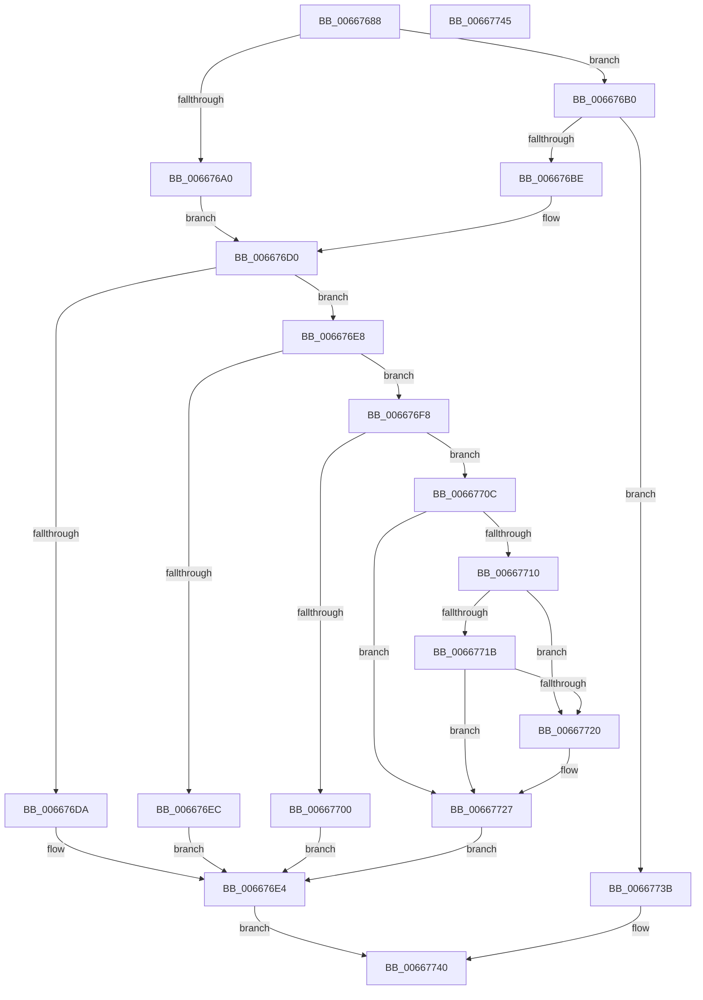

# MicrocodeValidate

- RVA: `0x00667688`–`0x00667746` (길이 `190` bytes)
- VA: `0x0000000140667688`
- 실행 섹션: `.text`
- PDB 이름 있음: `예`; PDB Function 태그: `아니요`
- unwind 정보 RVA: `0x0005C788`
- 디코드: `50`개 명령, `190/190` bytes 표시
- 미해석 바이트: `0` (있으면 어셈블리에 `.byte`로 보존)

> 이 문서는 커널 이미지의 기계어와 PDB 기호를 분석해 생성했습니다. 4번과 5번은 함수 원형과 자료형을 바이너리 사용 방식에서 추정한 C 해석이며 원본 소스 복구 결과는 아닙니다.

## 1. Dependencies

- 직접 호출 지점: **2**; 고유 호출 대상: **1**
- 직접 호출자로 확인된 함수: **1**
- RIP 상대 이미지 참조: **9**

### Outgoing calls
- `0x00667697` → [GetCpuManufacturer](GetCpuManufacturer_function_00667B34.md) (function, `0x00667B34`)
- `0x006676B5` → [GetCpuManufacturer](GetCpuManufacturer_function_00667B34.md) (function, `0x00667B34`)

### Direct callers
- [PrExtControlOperations](PrExtControlOperations_function_00666A6C.md) at `0x00666ACA`

### Static image references
- `0x0066768C` → RVA `0x00EF7CC8` (`.data`; write)
- `0x006676D0` → RVA `0x00EF7CBC` (`.data`; read)
- `0x006676DA` → RVA `0x00EF7CC4` (`.data`; write)
- `0x006676F8` → RVA `0x00EF7CB0` (`.data`; read)
- `0x00667710` → RVA `0x00EF7CC4` (`.data`; read)
- `0x00667720` → RVA `0x00EF7CC4` (`.data`; read/write)
- `0x00667727` → RVA `0x00EF7CB8` (`.data`; read)
- `0x0066772D` → RVA `0x00EF7CB4` (`.data`; write)
- `0x00667733` → RVA `0x00EF7CB8` (`.data`; write)

## 2. Other-region calls and transfers

- 다른 실행 섹션으로 향하는 call: **0**
- 별도 외부 분기/꼬리 이동을 확인하지 못했습니다.

## 3. Assembly (complete function range)

```asm
00667688  48 83 EC 28                     sub rsp, 0x28
0066768C  89 0D 36 06 89 00               mov dword ptr [rip + 0x890636], ecx
00667692  B9 02 00 00 00                  mov ecx, 2
00667697  E8 98 04 00 00                  call 0x140667b34
0066769C  84 C0                           test al, al
0066769E  74 10                           je 0x1406676b0
006676A0  B9 8B 00 00 00                  mov ecx, 0x8b
006676A5  0F 32                           rdmsr
006676A7  48 C1 E2 20                     shl rdx, 0x20
006676AB  48 0B C2                        or rax, rdx
006676AE  EB 20                           jmp 0x1406676d0
006676B0  B9 01 00 00 00                  mov ecx, 1
006676B5  E8 7A 04 00 00                  call 0x140667b34
006676BA  84 C0                           test al, al
006676BC  74 7D                           je 0x14066773b
006676BE  B9 8B 00 00 00                  mov ecx, 0x8b
006676C3  0F 32                           rdmsr
006676C5  48 C1 E2 20                     shl rdx, 0x20
006676C9  48 0B C2                        or rax, rdx
006676CC  48 C1 E8 20                     shr rax, 0x20
006676D0  8B 0D E6 05 89 00               mov ecx, dword ptr [rip + 0x8905e6]
006676D6  85 C9                           test ecx, ecx
006676D8  75 0E                           jne 0x1406676e8
006676DA  C7 05 E0 05 89 00 06 00 00 00   mov dword ptr [rip + 0x8905e0], 6
006676E4  33 C0                           xor eax, eax
006676E6  EB 58                           jmp 0x140667740
006676E8  3B C8                           cmp ecx, eax
006676EA  76 0C                           jbe 0x1406676f8
006676EC  C7 05 CE 05 89 00 03 00 00 00   mov dword ptr [rip + 0x8905ce], 3
006676F6  EB EC                           jmp 0x1406676e4
006676F8  39 05 B2 05 89 00               cmp dword ptr [rip + 0x8905b2], eax
006676FE  75 0C                           jne 0x14066770c
00667700  C7 05 BA 05 89 00 07 00 00 00   mov dword ptr [rip + 0x8905ba], 7
0066770A  EB D8                           jmp 0x1406676e4
0066770C  3B C8                           cmp ecx, eax
0066770E  75 17                           jne 0x140667727
00667710  8B 05 AE 05 89 00               mov eax, dword ptr [rip + 0x8905ae]
00667716  83 F8 04                        cmp eax, 4
00667719  74 05                           je 0x140667720
0066771B  83 F8 0A                        cmp eax, 0xa
0066771E  75 07                           jne 0x140667727
00667720  83 25 9D 05 89 00 00            and dword ptr [rip + 0x89059d], 0
00667727  8B 05 8B 05 89 00               mov eax, dword ptr [rip + 0x89058b]
0066772D  89 05 81 05 89 00               mov dword ptr [rip + 0x890581], eax
00667733  89 0D 7F 05 89 00               mov dword ptr [rip + 0x89057f], ecx
00667739  EB A9                           jmp 0x1406676e4
0066773B  B8 BB 00 00 C0                  mov eax, 0xc00000bb
00667740  48 83 C4 28                     add rsp, 0x28
00667744  C3                              ret
00667745  CC                              int3
```

## 4. C-style interpretation (structured pseudocode)

```c
__int64 __fastcall MicrocodeValidate(int a1, __int64 a2)
{
    __int64 result;
    __int64 v_rsp;

    v_rsp = (v_rsp) - (40);
    *(unsigned int *)(v_rip + 8980022) = a1;
    result = GetCpuManufacturer(2, a2, a3, a4);
    if ((unsigned __int8)(result) == 0) goto loc_006676B0;
    a2 = (a2) << (32);
    result = (result) | (a2);
    goto loc_006676D0;
loc_006676B0:
    result = GetCpuManufacturer(1, a2, a3, a4);
    if ((unsigned __int8)(result) == 0) goto loc_0066773B;
    a2 = (a2) << (32);
    result = (result) | (a2);
    result = (result) >> (32);
loc_006676D0:
    if ((unsigned int)((unsigned int)(*(unsigned int *)(v_rip + 8979942))) != 0) goto loc_006676E8;
    *(unsigned int *)(v_rip + 8979936) = 6;
loc_006676E4:
    result = 0;
    goto loc_00667740;
loc_006676E8:
    if (((unsigned int)((unsigned int)(*(unsigned int *)(v_rip + 8979942)))) <= 0) goto loc_006676F8;
    *(unsigned int *)(v_rip + 8979918) = 3;
    goto loc_006676E4;
loc_006676F8:
    if ((*(unsigned int *)(v_rip + 8979890)) != 0) goto loc_0066770C;
    *(unsigned int *)(v_rip + 8979898) = 7;
    goto loc_006676E4;
loc_0066770C:
    if (((unsigned int)((unsigned int)(*(unsigned int *)(v_rip + 8979942)))) != 0) goto loc_00667727;
    if (((unsigned int)((unsigned int)(*(unsigned int *)(v_rip + 8979886)))) == 4) goto loc_00667720;
    if (((unsigned int)((unsigned int)(*(unsigned int *)(v_rip + 8979886)))) == 10) {
    }
    *(unsigned int *)(v_rip + 8979841) = (unsigned int)((unsigned int)(*(unsigned int *)(v_rip + 8979851)));
    *(unsigned int *)(v_rip + 8979839) = (unsigned int)((unsigned int)(*(unsigned int *)(v_rip + 8979942)));
    goto loc_006676E4;
loc_0066773B:
loc_00667740:
    v_rsp = (v_rsp) + (40);
    return (unsigned int)(0xC00000BBULL);
}
```

## 5. (Beta) C Style

```c
int64_t MicrocodeValidate(int32_t Arg1, int64_t Arg2)
{
    int64_t result;
    int64_t local_rsp;

    local_rsp = (local_rsp) - (40);
    *(uint32_t *)(v_rip + 0x890636) = Arg1;
    result = GetCpuManufacturer(2, Arg2, a3, a4);
    if ((uint8_t)(result) == 0) goto loc_006676B0;
    Arg2 = (Arg2) << (32);
    result = (result) | (Arg2);
    goto loc_006676D0;
loc_006676B0:
    result = GetCpuManufacturer(1, Arg2, a3, a4);
    if ((uint8_t)(result) == 0) goto loc_0066773B;
    Arg2 = (Arg2) << (32);
    result = (result) | (Arg2);
    result = (result) >> (32);
loc_006676D0:
    if ((uint32_t)((uint32_t)(*(uint32_t *)(v_rip + 0x8905E6))) != 0) goto loc_006676E8;
    *(uint32_t *)(v_rip + 0x8905E0) = 6;
loc_006676E4:
    result = 0;
    goto loc_00667740;
loc_006676E8:
    if (((uint32_t)((uint32_t)(*(uint32_t *)(v_rip + 0x8905E6)))) <= 0) goto loc_006676F8;
    *(uint32_t *)(v_rip + 0x8905CE) = 3;
    goto loc_006676E4;
loc_006676F8:
    if ((*(uint32_t *)(v_rip + 0x8905B2)) != 0) goto loc_0066770C;
    *(uint32_t *)(v_rip + 0x8905BA) = 7;
    goto loc_006676E4;
loc_0066770C:
    if (((uint32_t)((uint32_t)(*(uint32_t *)(v_rip + 0x8905E6)))) != 0) goto loc_00667727;
    if (((uint32_t)((uint32_t)(*(uint32_t *)(v_rip + 0x8905AE)))) == 4) goto loc_00667720;
    if (((uint32_t)((uint32_t)(*(uint32_t *)(v_rip + 0x8905AE)))) == 10) {
    }
    *(uint32_t *)(v_rip + 0x890581) = (uint32_t)((uint32_t)(*(uint32_t *)(v_rip + 0x89058B)));
    *(uint32_t *)(v_rip + 0x89057F) = (uint32_t)((uint32_t)(*(uint32_t *)(v_rip + 0x8905E6)));
    goto loc_006676E4;
loc_0066773B:
loc_00667740:
    local_rsp = (local_rsp) + (40);
    return (uint32_t)(0xC00000BBULL);
}
```

## 6. Execution-region graph

[열기: 2D/3D 그래프와 함수 탐색 컨트롤 패널](../../../control-panel.html?section=text&rva=0x00667688&view=graph)

- 2D 그래프는 위에서 아래로 흐르고, 3D 그래프는 빈 공간을 드래그해 회전합니다. Shift+드래그는 이동, 휠은 확대·축소, 함수 노드 선택은 대상 보고서 이동입니다.

### Static fallback


