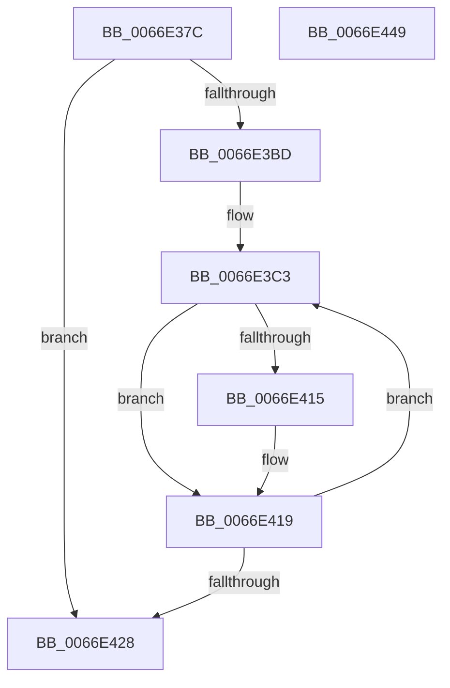

# MmFillEtwHugeIoSpaceInformation

- RVA: `0x0066E37C`–`0x0066E44A` (길이 `206` bytes)
- VA: `0x000000014066E37C`
- 실행 섹션: `.text`
- PDB 이름 있음: `예`; PDB Function 태그: `아니요`
- unwind 정보 RVA: `0x000D7640`
- 디코드: `63`개 명령, `206/206` bytes 표시
- 미해석 바이트: `0` (있으면 어셈블리에 `.byte`로 보존)

> 이 문서는 커널 이미지의 기계어와 PDB 기호를 분석해 생성했습니다. 4번과 5번은 함수 원형과 자료형을 바이너리 사용 방식에서 추정한 C 해석이며 원본 소스 복구 결과는 아닙니다.

## 1. Dependencies

- 직접 호출 지점: **1**; 고유 호출 대상: **1**
- 직접 호출자로 확인된 함수: **1**
- RIP 상대 이미지 참조: **1**

### Outgoing calls
- `0x0066E3F1` → [MiGetNodeHugeRangeCounts](../4F/MiGetNodeHugeRangeCounts_function_004FB248.md) (function, `0x004FB248`)

### Direct callers
- [sub_006E7A84](../6E/Unknown_function_006E7A84.md) at `0x006E7AA1`

### Static image references
- `0x0066E3A3` → RVA `0x00FC5000` (`ALMOSTRO`; read)

## 2. Other-region calls and transfers

- 다른 실행 섹션으로 향하는 call: **0**
- 별도 외부 분기/꼬리 이동을 확인하지 못했습니다.

## 3. Assembly (complete function range)

```asm
0066E37C  48 8B C4                        mov rax, rsp
0066E37F  48 89 58 10                     mov qword ptr [rax + 0x10], rbx
0066E383  55                              push rbp
0066E384  56                              push rsi
0066E385  57                              push rdi
0066E386  41 56                           push r14
0066E388  41 57                           push r15
0066E38A  48 83 EC 30                     sub rsp, 0x30
0066E38E  48 83 60 08 00                  and qword ptr [rax + 8], 0
0066E393  41 8B F8                        mov edi, r8d
0066E396  48 83 60 20 00                  and qword ptr [rax + 0x20], 0
0066E39B  4D 8B F1                        mov r14, r9
0066E39E  48 83 60 C8 00                  and qword ptr [rax - 0x38], 0
0066E3A3  0F B7 05 56 6C 95 00            movzx eax, word ptr [rip + 0x956c56]
0066E3AA  4C 8B 39                        mov r15, qword ptr [rcx]
0066E3AD  44 3B C0                        cmp r8d, eax
0066E3B0  41 C6 01 00                     mov byte ptr [r9], 0
0066E3B4  0F 47 F8                        cmova edi, eax
0066E3B7  33 ED                           xor ebp, ebp
0066E3B9  85 FF                           test edi, edi
0066E3BB  74 6B                           je 0x14066e428
0066E3BD  33 F6                           xor esi, esi
0066E3BF  48 8D 5A 14                     lea rbx, [rdx + 0x14]
0066E3C3  33 C0                           xor eax, eax
0066E3C5  4C 8D 4C 24 20                  lea r9, [rsp + 0x20]
0066E3CA  0F 57 C0                        xorps xmm0, xmm0
0066E3CD  4C 8D 44 24 78                  lea r8, [rsp + 0x78]
0066E3D2  0F 11 43 EC                     movups xmmword ptr [rbx - 0x14], xmm0
0066E3D6  48 89 43 FC                     mov qword ptr [rbx - 4], rax
0066E3DA  48 8D 54 24 60                  lea rdx, [rsp + 0x60]
0066E3DF  89 43 04                        mov dword ptr [rbx + 4], eax
0066E3E2  8D 45 01                        lea eax, [rbp + 1]
0066E3E5  49 8B 4F 10                     mov rcx, qword ptr [r15 + 0x10]
0066E3E9  8B E8                           mov ebp, eax
0066E3EB  48 03 CE                        add rcx, rsi
0066E3EE  89 43 EC                        mov dword ptr [rbx - 0x14], eax
0066E3F1  E8 52 CE E8 FF                  call 0x1404fb248
0066E3F6  48 8B 44 24 78                  mov rax, qword ptr [rsp + 0x78]
0066E3FB  48 8B 4C 24 60                  mov rcx, qword ptr [rsp + 0x60]
0066E400  48 89 03                        mov qword ptr [rbx], rax
0066E403  48 8B 44 24 20                  mov rax, qword ptr [rsp + 0x20]
0066E408  48 89 43 F8                     mov qword ptr [rbx - 8], rax
0066E40C  48 89 4B F0                     mov qword ptr [rbx - 0x10], rcx
0066E410  48 85 C9                        test rcx, rcx
0066E413  74 04                           je 0x14066e419
0066E415  41 C6 06 01                     mov byte ptr [r14], 1
0066E419  48 81 C6 80 DF 00 00            add rsi, 0xdf80
0066E420  48 83 C3 1C                     add rbx, 0x1c
0066E424  3B EF                           cmp ebp, edi
0066E426  72 9B                           jb 0x14066e3c3
0066E428  48 8B 8C 24 80 00 00 00         mov rcx, qword ptr [rsp + 0x80]
0066E430  8B C5                           mov eax, ebp
0066E432  41 0F B7 17                     movzx edx, word ptr [r15]
0066E436  48 8B 5C 24 68                  mov rbx, qword ptr [rsp + 0x68]
0066E43B  89 11                           mov dword ptr [rcx], edx
0066E43D  48 83 C4 30                     add rsp, 0x30
0066E441  41 5F                           pop r15
0066E443  41 5E                           pop r14
0066E445  5F                              pop rdi
0066E446  5E                              pop rsi
0066E447  5D                              pop rbp
0066E448  C3                              ret
0066E449  CC                              int3
```

## 4. C-style interpretation (structured pseudocode)

```c
__int64 __fastcall MmFillEtwHugeIoSpaceInformation(__int64 a1, __int64 a2, int a3, __int64 a4, __int64 a5)
{
    __int64 result;
    __int64 v_rbp;
    __int64 v_rbx;
    __int64 v_rdi;
    __int64 v_rsi;
    __int64 v_rsp;
    unsigned __int64 v_stack_m38;
    unsigned __int64 v_stack_p10;
    unsigned __int64 v_stack_p20;
    unsigned __int64 v_stack_p8;

    *(unsigned __int64 *)(v_rsp + 16) = v_rbx;
    v_rsp = (v_rsp) - (48);
    *(unsigned __int8 *)(a4) = 0;
    v_rdi = (unsigned int)(a3);
    if (a3 > ((unsigned int)(*(unsigned __int16 *)(v_rip + 9792598)))) { v_rdi = (unsigned int)(*(unsigned __int16 *)(v_rip + 9792598)); }
    v_rbp = 0;
    if ((unsigned int)(v_rdi) == 0) goto loc_0066E428;
    v_rsi = 0;
loc_0066E3C3:
    result = 0;
    *(unsigned __int64 *)(a2 + 20 - 20) = v_xmm0;
    *(unsigned __int64 *)(a2 + 20 - 4) = 0;
    *(unsigned int *)(a2 + 20 + 4) = 0;
    a1 = (*(unsigned __int64 *)(*(unsigned __int64 *)(a1) + 16)) + (0);
    *(unsigned int *)(a2 + 20 - 20) = (unsigned int)(v_rbp + 1);
    result = MiGetNodeHugeRangeCounts(a1, v_stack_p8, v_stack_p20, v_stack_m38);
    *(unsigned __int64 *)(a2 + 20) = v_stack_p20;
    *(unsigned __int64 *)(a2 + 20 - 8) = v_stack_m38;
    *(unsigned __int64 *)(a2 + 20 - 16) = v_stack_p8;
    if (v_stack_p8 != 0) {
        *(unsigned __int8 *)(a4) = 1;
    }
    v_rsi = (v_rsi) + (0xDF80ULL);
    v_rbx = (a2 + 20) + (28);
    if (((unsigned int)((unsigned int)((unsigned int)(v_rbp + 1)))) < ((unsigned int)(v_rdi))) goto loc_0066E3C3;
loc_0066E428:
    *(unsigned int *)(a5) = (unsigned int)(*(unsigned __int16 *)(*(unsigned __int64 *)(a1)));
    v_rsp = (v_rsp) + (48);
    return (unsigned int)((unsigned int)((unsigned int)((unsigned int)(v_rbp + 1))));
}
```

## 5. (Beta) C Style

```c
int64_t MmFillEtwHugeIoSpaceInformation(void *Arg1, void *Arg2, int32_t Arg3, void *Arg4, void *Arg5)
{
    uint8_t *arg1 = (uint8_t *)Arg1;
    uint8_t *arg2 = (uint8_t *)Arg2;
    uint8_t *arg4 = (uint8_t *)Arg4;
    uint8_t *arg5 = (uint8_t *)Arg5;

    int64_t result;
    int64_t local_rbp;
    int64_t local_rbx;
    int64_t local_rdi;
    int64_t local_rsi;
    int64_t local_rsp;
    uint64_t v_stack_m38;
    uint64_t v_stack_p10;
    uint64_t v_stack_p20;
    uint64_t v_stack_p8;

    *(uint64_t *)(local_rsp + 0x10) = local_rbx;
    local_rsp = (local_rsp) - (48);
    *(uint8_t *)(arg4) = 0;
    local_rdi = (uint32_t)(Arg3);
    if (Arg3 > ((uint32_t)(*(uint16_t *)(v_rip + 0x956C56)))) { local_rdi = (uint32_t)(*(uint16_t *)(v_rip + 0x956C56)); }
    local_rbp = 0;
    if ((uint32_t)(local_rdi) == 0) goto loc_0066E428;
    local_rsi = 0;
loc_0066E3C3:
    result = 0;
    *(uint64_t *)(arg2 + 0x14 - 0x14) = v_xmm0;
    *(uint64_t *)(arg2 + 0x14 - 0x4) = 0;
    *(uint32_t *)(arg2 + 0x14 + 0x4) = 0;
    Arg1 = (*(uint64_t *)(*(uint64_t *)(arg1) + 0x10)) + (0);
    *(uint32_t *)(arg2 + 0x14 - 0x14) = (uint32_t)(local_rbp + 1);
    result = MiGetNodeHugeRangeCounts(Arg1, v_stack_p8, v_stack_p20, v_stack_m38);
    *(uint64_t *)(arg2 + 0x14) = v_stack_p20;
    *(uint64_t *)(arg2 + 0x14 - 0x8) = v_stack_m38;
    *(uint64_t *)(arg2 + 0x14 - 0x10) = v_stack_p8;
    if (v_stack_p8 != 0) {
        *(uint8_t *)(arg4) = 1;
    }
    local_rsi = (local_rsi) + (0xDF80ULL);
    local_rbx = (Arg2 + 20) + (28);
    if (((uint32_t)((uint32_t)((uint32_t)(local_rbp + 1)))) < ((uint32_t)(local_rdi))) goto loc_0066E3C3;
loc_0066E428:
    *(uint32_t *)(arg5) = (uint32_t)(*(uint16_t *)(*(uint64_t *)(arg1)));
    local_rsp = (local_rsp) + (48);
    return (uint32_t)((uint32_t)((uint32_t)((uint32_t)(local_rbp + 1))));
}
```

### 관측된 메모리 오프셋

구조체 형식이 확인되지 않은 접근은 인자 기준의 오프셋으로만 기록했습니다.

| 기준 인자 | 오프셋 표현 | 폭 (bit) | 접근 |
|---|---:|---:|---|
| `Arg1` | `+ 0x0` | `64` | `R` |
| `Arg2` | `- 0x14` | `32` | `W` |
| `Arg2` | `- 0x14` | `128` | `R` |
| `Arg2` | `- 0x10` | `64` | `W` |
| `Arg2` | `- 0x8` | `64` | `W` |
| `Arg2` | `- 0x4` | `64` | `W` |
| `Arg2` | `+ 0x0` | `64` | `W` |
| `Arg2` | `+ 0x4` | `32` | `W` |
| `Arg2` | `+ 0x14` | `64` | `R` |
| `Arg4` | `+ 0x0` | `8` | `W` |
| `Arg5` | `+ 0x0` | `32` | `W` |

## 6. Execution-region graph

[열기: 2D/3D 그래프와 함수 탐색 컨트롤 패널](../../../control-panel.html?section=text&rva=0x0066E37C&view=graph)

- 2D 그래프는 위에서 아래로 흐르고, 3D 그래프는 빈 공간을 드래그해 회전합니다. Shift+드래그는 이동, 휠은 확대·축소, 함수 노드 선택은 대상 보고서 이동입니다.

### Static fallback


