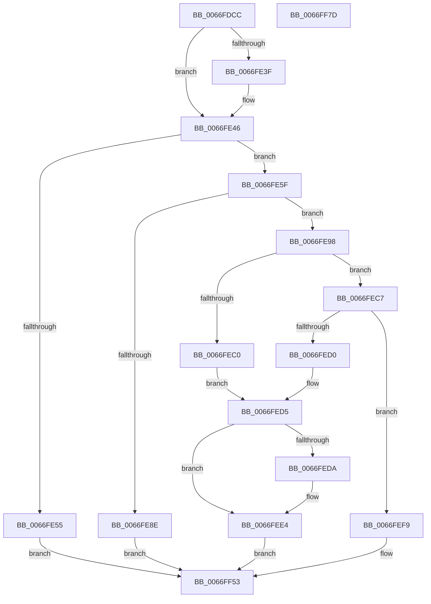

# MmReleaseCommitForMemResetPages

- RVA: `0x0066FDCC`–`0x0066FF7E` (길이 `434` bytes)
- VA: `0x000000014066FDCC`
- 실행 섹션: `.text`
- PDB 이름 있음: `예`; PDB Function 태그: `아니요`
- unwind 정보 RVA: `0x000D7710`
- 디코드: `121`개 명령, `434/434` bytes 표시
- 미해석 바이트: `0` (있으면 어셈블리에 `.byte`로 보존)

> 이 문서는 커널 이미지의 기계어와 PDB 기호를 분석해 생성했습니다. 4번과 5번은 함수 원형과 자료형을 바이너리 사용 방식에서 추정한 C 해석이며 원본 소스 복구 결과는 아닙니다.

## 1. Dependencies

- 직접 호출 지점: **14**; 고유 호출 대상: **11**
- 직접 호출자로 확인된 함수: **1**
- RIP 상대 이미지 참조: **3**

### Outgoing calls
- `0x0066FE66` → [ExAcquireSpinLockExclusive](../24/ExAcquireSpinLockExclusive_function_00248690.md) (function, `0x00248690`)
- `0x0066FE74` → [MiPrepareAttachThread](../2B/MiPrepareAttachThread_function_002B4650.md) (function, `0x002B4650`)
- `0x0066FE85` → [MiReleaseSpinLockExclusive](../24/MiReleaseSpinLockExclusive_function_002482C0.md) (function, `0x002482C0`)
- `0x0066FEA2` → [KeForceAttachProcess](../21/KeForceAttachProcess_function_00216650.md) (function, `0x00216650`)
- `0x0066FEAA` → [MiLockWorkingSetExclusive](../32/MiLockWorkingSetExclusive_function_003238A0.md) (function, `0x003238A0`)
- `0x0066FEDF` → [MiUnlockWorkingSetExclusive](../27/MiUnlockWorkingSetExclusive_function_0027EC70.md) (function, `0x0027EC70`)
- `0x0066FEEA` → [KeForceDetachProcess](../3C/KeForceDetachProcess_function_003C7770.md) (function, `0x003C7770`)
- `0x0066FEF2` → [MiAttachThreadDone](../28/MiAttachThreadDone_function_0028F3E0.md) (function, `0x0028F3E0`)
- `0x0066FF1B` → [MiUnlockWorkingSetExclusive](../27/MiUnlockWorkingSetExclusive_function_0027EC70.md) (function, `0x0027EC70`)
- `0x0066FF23` → [KeRetryOutswapProcess](../4A/KeRetryOutswapProcess_function_004A2E20.md) (function, `0x004A2E20`)
- `0x0066FF2E` → [KeForceDetachProcess](../3C/KeForceDetachProcess_function_003C7770.md) (function, `0x003C7770`)
- `0x0066FF36` → [MiAttachThreadDone](../28/MiAttachThreadDone_function_0028F3E0.md) (function, `0x0028F3E0`)
- `0x0066FF4E` → [KeWaitForSingleObject](../20/KeWaitForSingleObject_function_0020E6B0.md) (function, `0x0020E6B0`)
- `0x0066FF5C` → [_security_check_cookie](../6A/_security_check_cookie_function_006AC640.md) (function, `0x006AC640`)

### Direct callers
- [NtSetInformationProcess](../../page/AE/NtSetInformationProcess_function_00AE5370.md) at `0x00AE8EBC`

### Static image references
- `0x0066FDE8` → RVA `0x00E0A740` (`.data`; read)
- `0x0066FE1D` → RVA `0x00E38860` (`.data`; read)
- `0x0066FE5F` → RVA `0x00E374C0` (`.data`; read)

## 2. Other-region calls and transfers

- 다른 실행 섹션으로 향하는 call: **0**
- 별도 외부 분기/꼬리 이동을 확인하지 못했습니다.

## 3. Assembly (complete function range)

```asm
0066FDCC  48 89 5C 24 10                  mov qword ptr [rsp + 0x10], rbx
0066FDD1  48 89 74 24 18                  mov qword ptr [rsp + 0x18], rsi
0066FDD6  55                              push rbp
0066FDD7  57                              push rdi
0066FDD8  41 54                           push r12
0066FDDA  41 56                           push r14
0066FDDC  41 57                           push r15
0066FDDE  48 8B EC                        mov rbp, rsp
0066FDE1  48 81 EC 80 00 00 00            sub rsp, 0x80
0066FDE8  48 8B 05 51 A9 79 00            mov rax, qword ptr [rip + 0x79a951]
0066FDEF  48 33 C4                        xor rax, rsp
0066FDF2  48 89 45 F8                     mov qword ptr [rbp - 8], rax
0066FDF6  0F 57 C0                        xorps xmm0, xmm0
0066FDF9  48 C7 45 B0 00 00 06 00         mov qword ptr [rbp - 0x50], 0x60000
0066FE01  48 8D 45 B8                     lea rax, [rbp - 0x48]
0066FE05  33 FF                           xor edi, edi
0066FE07  48 89 45 C0                     mov qword ptr [rbp - 0x40], rax
0066FE0B  48 8D B1 00 04 00 00            lea rsi, [rcx + 0x400]
0066FE12  48 8D 45 B8                     lea rax, [rbp - 0x48]
0066FE16  44 8B E2                        mov r12d, edx
0066FE19  48 89 45 B8                     mov qword ptr [rbp - 0x48], rax
0066FE1D  4C 8D 35 3C 8A 7C 00            lea r14, [rip + 0x7c8a3c]
0066FE24  8B 86 B8 00 00 00               mov eax, dword ptr [rsi + 0xb8]
0066FE2A  4C 8B F9                        mov r15, rcx
0066FE2D  24 0F                           and al, 0xf
0066FE2F  0F 11 45 C8                     movups xmmword ptr [rbp - 0x38], xmm0
0066FE33  0F 11 45 D8                     movups xmmword ptr [rbp - 0x28], xmm0
0066FE37  0F 11 45 E8                     movups xmmword ptr [rbp - 0x18], xmm0
0066FE3B  3C 01                           cmp al, 1
0066FE3D  74 07                           je 0x14066fe46
0066FE3F  4C 8D B6 E0 00 00 00            lea r14, [rsi + 0xe0]
0066FE46  8B 86 B8 00 00 00               mov eax, dword ptr [rsi + 0xb8]
0066FE4C  C1 E8 18                        shr eax, 0x18
0066FE4F  24 30                           and al, 0x30
0066FE51  3C 20                           cmp al, 0x20
0066FE53  74 0A                           je 0x14066fe5f
0066FE55  BF 89 01 00 C0                  mov edi, 0xc0000189
0066FE5A  E9 F4 00 00 00                  jmp 0x14066ff53
0066FE5F  48 8D 0D 5A 76 7C 00            lea rcx, [rip + 0x7c765a]
0066FE66  E8 25 88 BD FF                  call 0x140248690
0066FE6B  48 8B D6                        mov rdx, rsi
0066FE6E  49 8B CF                        mov rcx, r15
0066FE71  44 8A C8                        mov r9b, al
0066FE74  E8 D7 47 C4 FF                  call 0x1402b4650
0066FE79  41 8A D1                        mov dl, r9b
0066FE7C  48 8D 0D 3D 76 7C 00            lea rcx, [rip + 0x7c763d]
0066FE83  8B D8                           mov ebx, eax
0066FE85  E8 36 84 BD FF                  call 0x1402482c0
0066FE8A  85 DB                           test ebx, ebx
0066FE8C  75 0A                           jne 0x14066fe98
0066FE8E  BF 03 A0 00 C0                  mov edi, 0xc000a003
0066FE93  E9 BB 00 00 00                  jmp 0x14066ff53
0066FE98  45 33 C0                        xor r8d, r8d
0066FE9B  48 8D 55 C8                     lea rdx, [rbp - 0x38]
0066FE9F  49 8B CF                        mov rcx, r15
0066FEA2  E8 A9 67 BA FF                  call 0x140216650
0066FEA7  48 8B CE                        mov rcx, rsi
0066FEAA  E8 F1 39 CB FF                  call 0x1403238a0
0066FEAF  8A C8                           mov cl, al
0066FEB1  8B 86 B8 00 00 00               mov eax, dword ptr [rsi + 0xb8]
0066FEB7  C1 E8 18                        shr eax, 0x18
0066FEBA  24 30                           and al, 0x30
0066FEBC  3C 20                           cmp al, 0x20
0066FEBE  74 07                           je 0x14066fec7
0066FEC0  BF 89 01 00 C0                  mov edi, 0xc0000189
0066FEC5  EB 0E                           jmp 0x14066fed5
0066FEC7  4D 8B 06                        mov r8, qword ptr [r14]
0066FECA  49 39 78 28                     cmp qword ptr [r8 + 0x28], rdi
0066FECE  74 29                           je 0x14066fef9
0066FED0  BF 76 04 00 C0                  mov edi, 0xc0000476
0066FED5  80 F9 11                        cmp cl, 0x11
0066FED8  74 0A                           je 0x14066fee4
0066FEDA  8A D1                           mov dl, cl
0066FEDC  48 8B CE                        mov rcx, rsi
0066FEDF  E8 8C ED C0 FF                  call 0x14027ec70
0066FEE4  33 D2                           xor edx, edx
0066FEE6  48 8D 4D C8                     lea rcx, [rbp - 0x38]
0066FEEA  E8 81 78 D5 FF                  call 0x1403c7770
0066FEEF  48 8B CE                        mov rcx, rsi
0066FEF2  E8 E9 F4 C1 FF                  call 0x14028f3e0
0066FEF7  EB 5A                           jmp 0x14066ff53
0066FEF9  48 8D 45 B0                     lea rax, [rbp - 0x50]
0066FEFD  8B D7                           mov edx, edi
0066FEFF  49 89 40 28                     mov qword ptr [r8 + 0x28], rax
0066FF03  45 85 E4                        test r12d, r12d
0066FF06  41 8B 40 30                     mov eax, dword ptr [r8 + 0x30]
0066FF0A  0F 95 C2                        setne dl
0066FF0D  83 E0 FE                        and eax, 0xfffffffe
0066FF10  0B D0                           or edx, eax
0066FF12  41 89 50 30                     mov dword ptr [r8 + 0x30], edx
0066FF16  8A D1                           mov dl, cl
0066FF18  48 8B CE                        mov rcx, rsi
0066FF1B  E8 50 ED C0 FF                  call 0x14027ec70
0066FF20  49 8B CF                        mov rcx, r15
0066FF23  E8 F8 2E E3 FF                  call 0x1404a2e20
0066FF28  33 D2                           xor edx, edx
0066FF2A  48 8D 4D C8                     lea rcx, [rbp - 0x38]
0066FF2E  E8 3D 78 D5 FF                  call 0x1403c7770
0066FF33  48 8B CE                        mov rcx, rsi
0066FF36  E8 A5 F4 C1 FF                  call 0x14028f3e0
0066FF3B  45 33 C9                        xor r9d, r9d
0066FF3E  48 89 7C 24 20                  mov qword ptr [rsp + 0x20], rdi
0066FF43  45 33 C0                        xor r8d, r8d
0066FF46  48 8D 4D B0                     lea rcx, [rbp - 0x50]
0066FF4A  41 8D 51 1A                     lea edx, [r9 + 0x1a]
0066FF4E  E8 5D E7 B9 FF                  call 0x14020e6b0
0066FF53  8B C7                           mov eax, edi
0066FF55  48 8B 4D F8                     mov rcx, qword ptr [rbp - 8]
0066FF59  48 33 CC                        xor rcx, rsp
0066FF5C  E8 DF C6 03 00                  call 0x1406ac640
0066FF61  4C 8D 9C 24 80 00 00 00         lea r11, [rsp + 0x80]
0066FF69  49 8B 5B 38                     mov rbx, qword ptr [r11 + 0x38]
0066FF6D  49 8B 73 40                     mov rsi, qword ptr [r11 + 0x40]
0066FF71  49 8B E3                        mov rsp, r11
0066FF74  41 5F                           pop r15
0066FF76  41 5E                           pop r14
0066FF78  41 5C                           pop r12
0066FF7A  5F                              pop rdi
0066FF7B  5D                              pop rbp
0066FF7C  C3                              ret
0066FF7D  CC                              int3
```

## 4. C-style interpretation (structured pseudocode)

```c
__int64 __fastcall MmReleaseCommitForMemResetPages(__int64 a1, int a2, int a3)
{
    __int64 result;
    __int64 v_r14;
    __int64 v_rdi;
    __int64 v_rsp;
    unsigned __int64 v_stack_m28;
    unsigned __int64 v_stack_m30;
    unsigned __int64 v_stack_m40;
    unsigned __int64 v_stack_m50;
    unsigned __int64 v_stack_m60;
    unsigned __int64 v_stack_m68;
    unsigned __int64 v_stack_m70;
    unsigned __int64 v_stack_m78;
    unsigned __int64 v_stack_m88;
    unsigned __int64 v_stack_p10;
    unsigned __int64 v_stack_p18;

    v_stack_p10 = v_rbx;
    v_stack_p18 = v_rsi;
    v_rsp = (v_rsp) - (128);
    result = (*(unsigned __int64 *)(v_rip + 7973201)) ^ (v_rsp);
    v_stack_m30 = result;
    v_stack_m78 = 0x60000ULL;
    v_rdi = 0;
    v_stack_m68 = v_stack_m70;
    v_stack_m70 = v_stack_m70;
    result = (unsigned __int8)(((unsigned int)(*(unsigned int *)(a1 + 1024 + 184))) & (15));
    v_stack_m60 = v_xmm0;
    v_stack_m50 = v_xmm0;
    v_stack_m40 = v_xmm0;
    v_r14 = v_rip + 8161852;
    if (((unsigned __int8)(result)) != 1) {
        v_r14 = a1 + 1024 + 224;
    }
    result = (unsigned int)(((unsigned int)(*(unsigned int *)(a1 + 1024 + 184))) >> (24));
    result = (unsigned __int8)((result) & (48));
    if (((unsigned __int8)(result)) == 32) goto loc_0066FE5F;
    goto loc_0066FF53;
loc_0066FE5F:
    result = ExAcquireSpinLockExclusive(v_rip + 8156762, a2, a3, a4);
    result = MiPrepareAttachThread(a1, a1 + 1024, a3, (unsigned __int8)(result));
    result = MiReleaseSpinLockExclusive(v_rip + 8156733, (unsigned __int8)((unsigned __int8)(result)), a3, (unsigned __int8)(result));
    if ((unsigned int)((unsigned int)((unsigned int)(result))) != 0) goto loc_0066FE98;
    goto loc_0066FF53;
loc_0066FE98:
    a3 = 0;
    result = KeForceAttachProcess(a1, v_stack_m60, a3, (unsigned __int8)(result));
    result = MiLockWorkingSetExclusive(a1 + 1024, v_stack_m60, a3, (unsigned __int8)(result));
    result = (unsigned int)(((unsigned int)(*(unsigned int *)(a1 + 1024 + 184))) >> (24));
    result = (unsigned __int8)((result) & (48));
    if (((unsigned __int8)(result)) == 32) goto loc_0066FEC7;
    goto loc_0066FED5;
loc_0066FEC7:
    if ((*(unsigned __int64 *)(*(unsigned __int64 *)(v_r14) + 40)) == ((unsigned int)(0xC0000189ULL))) goto loc_0066FEF9;
loc_0066FED5:
    if (((unsigned __int8)((unsigned __int8)(result))) != 17) {
        a2 = (unsigned __int8)((unsigned __int8)(result));
        a1 = a1 + 1024;
        result = MiUnlockWorkingSetExclusive(a1, a2, *(unsigned __int64 *)(v_r14), (unsigned __int8)(result));
    }
    a2 = 0;
    result = KeForceDetachProcess(v_stack_m60, a2, *(unsigned __int64 *)(v_r14), (unsigned __int8)(result));
    result = MiAttachThreadDone(a1 + 1024, a2, *(unsigned __int64 *)(v_r14), (unsigned __int8)(result));
    goto loc_0066FF53;
loc_0066FEF9:
    *(unsigned __int64 *)(*(unsigned __int64 *)(v_r14) + 40) = v_stack_m78;
    a2 = ((unsigned int)((unsigned int)(a2)) != 0) ? 1 : 0;
    result = (unsigned int)(((unsigned int)(*(unsigned int *)(*(unsigned __int64 *)(v_r14) + 48))) & (0xFFFFFFFEULL));
    a2 = (unsigned int)((a2) | ((unsigned int)(result)));
    *(unsigned int *)(*(unsigned __int64 *)(v_r14) + 48) = a2;
    result = MiUnlockWorkingSetExclusive(a1 + 1024, (unsigned __int8)(a1 + 1024), *(unsigned __int64 *)(v_r14), (unsigned __int8)(result));
    result = KeRetryOutswapProcess(a1, (unsigned __int8)(a1 + 1024), *(unsigned __int64 *)(v_r14), (unsigned __int8)(result));
    a2 = 0;
    result = KeForceDetachProcess(v_stack_m60, a2, *(unsigned __int64 *)(v_r14), (unsigned __int8)(result));
    result = MiAttachThreadDone(a1 + 1024, a2, *(unsigned __int64 *)(v_r14), (unsigned __int8)(result));
    a4 = 0;
    v_stack_m88 = (unsigned int)(0xC0000476ULL);
    a3 = 0;
    result = KeWaitForSingleObject(v_stack_m78, a4 + 26, a3, a4);
loc_0066FF53:
    a1 = (v_stack_m30) ^ (v_rsp);
    result = _security_check_cookie(a1, a4 + 26, a3, a4);
    return result;
}
```

## 5. (Beta) C Style

```c
int64_t MmReleaseCommitForMemResetPages(void *Arg1, int32_t Arg2, int32_t Arg3)
{
    uint8_t *arg1 = (uint8_t *)Arg1;

    int64_t result;
    int64_t local_r14;
    int64_t local_rdi;
    int64_t local_rsp;
    uint64_t v_stack_m28;
    uint64_t v_stack_m30;
    uint64_t v_stack_m40;
    uint64_t v_stack_m50;
    uint64_t v_stack_m60;
    uint64_t v_stack_m68;
    uint64_t v_stack_m70;
    uint64_t v_stack_m78;
    uint64_t v_stack_m88;
    uint64_t v_stack_p10;
    uint64_t v_stack_p18;

    v_stack_p10 = local_rbx;
    v_stack_p18 = local_rsi;
    local_rsp = (local_rsp) - (128);
    result = (*(uint64_t *)(v_rip + 0x79A951)) ^ (local_rsp);
    v_stack_m30 = result;
    v_stack_m78 = 0x60000ULL;
    local_rdi = 0;
    v_stack_m68 = v_stack_m70;
    v_stack_m70 = v_stack_m70;
    result = (uint8_t)(((uint32_t)(*(uint32_t *)(arg1 + 0x400 + 0xB8))) & (15));
    v_stack_m60 = v_xmm0;
    v_stack_m50 = v_xmm0;
    v_stack_m40 = v_xmm0;
    local_r14 = v_rip + 8161852;
    if (((uint8_t)(result)) != 1) {
        local_r14 = Arg1 + 1024 + 224;
    }
    result = (uint32_t)(((uint32_t)(*(uint32_t *)(arg1 + 0x400 + 0xB8))) >> (24));
    result = (uint8_t)((result) & (48));
    if (((uint8_t)(result)) == 32) goto loc_0066FE5F;
    goto loc_0066FF53;
loc_0066FE5F:
    result = ExAcquireSpinLockExclusive(v_rip + 8156762, Arg2, Arg3, a4);
    result = MiPrepareAttachThread(Arg1, Arg1 + 1024, Arg3, (uint8_t)(result));
    result = MiReleaseSpinLockExclusive(v_rip + 8156733, (uint8_t)((uint8_t)(result)), Arg3, (uint8_t)(result));
    if ((uint32_t)((uint32_t)((uint32_t)(result))) != 0) goto loc_0066FE98;
    goto loc_0066FF53;
loc_0066FE98:
    Arg3 = 0;
    result = KeForceAttachProcess(Arg1, v_stack_m60, Arg3, (uint8_t)(result));
    result = MiLockWorkingSetExclusive(Arg1 + 1024, v_stack_m60, Arg3, (uint8_t)(result));
    result = (uint32_t)(((uint32_t)(*(uint32_t *)(arg1 + 0x400 + 0xB8))) >> (24));
    result = (uint8_t)((result) & (48));
    if (((uint8_t)(result)) == 32) goto loc_0066FEC7;
    goto loc_0066FED5;
loc_0066FEC7:
    if ((*(uint64_t *)(*(uint64_t *)(local_r14) + 0x28)) == ((uint32_t)(0xC0000189ULL))) goto loc_0066FEF9;
loc_0066FED5:
    if (((uint8_t)((uint8_t)(result))) != 17) {
        Arg2 = (uint8_t)((uint8_t)(result));
        Arg1 = Arg1 + 1024;
        result = MiUnlockWorkingSetExclusive(Arg1, Arg2, *(uint64_t *)(local_r14), (uint8_t)(result));
    }
    Arg2 = 0;
    result = KeForceDetachProcess(v_stack_m60, Arg2, *(uint64_t *)(local_r14), (uint8_t)(result));
    result = MiAttachThreadDone(Arg1 + 1024, Arg2, *(uint64_t *)(local_r14), (uint8_t)(result));
    goto loc_0066FF53;
loc_0066FEF9:
    *(uint64_t *)(*(uint64_t *)(local_r14) + 0x28) = v_stack_m78;
    Arg2 = ((uint32_t)((uint32_t)(Arg2)) != 0) ? 1 : 0;
    result = (uint32_t)(((uint32_t)(*(uint32_t *)(*(uint64_t *)(local_r14) + 0x30))) & (0xFFFFFFFEULL));
    Arg2 = (uint32_t)((Arg2) | ((uint32_t)(result)));
    *(uint32_t *)(*(uint64_t *)(local_r14) + 0x30) = Arg2;
    result = MiUnlockWorkingSetExclusive(Arg1 + 1024, (uint8_t)(Arg1 + 1024), *(uint64_t *)(local_r14), (uint8_t)(result));
    result = KeRetryOutswapProcess(Arg1, (uint8_t)(Arg1 + 1024), *(uint64_t *)(local_r14), (uint8_t)(result));
    Arg2 = 0;
    result = KeForceDetachProcess(v_stack_m60, Arg2, *(uint64_t *)(local_r14), (uint8_t)(result));
    result = MiAttachThreadDone(Arg1 + 1024, Arg2, *(uint64_t *)(local_r14), (uint8_t)(result));
    a4 = 0;
    v_stack_m88 = (uint32_t)(0xC0000476ULL);
    Arg3 = 0;
    result = KeWaitForSingleObject(v_stack_m78, a4 + 26, Arg3, a4);
loc_0066FF53:
    Arg1 = (v_stack_m30) ^ (local_rsp);
    result = _security_check_cookie(Arg1, a4 + 26, Arg3, a4);
    return result;
}
```

### 관측된 메모리 오프셋

구조체 형식이 확인되지 않은 접근은 인자 기준의 오프셋으로만 기록했습니다.

| 기준 인자 | 오프셋 표현 | 폭 (bit) | 접근 |
|---|---:|---:|---|
| `Arg1` | `+ 0xB8` | `32` | `R` |
| `Arg1` | `+ 0xE0` | `64` | `R` |
| `Arg1` | `+ 0x400` | `64` | `R` |

## 6. Execution-region graph

[열기: 2D/3D 그래프와 함수 탐색 컨트롤 패널](../../../control-panel.html?section=text&rva=0x0066FDCC&view=graph)

- 2D 그래프는 위에서 아래로 흐르고, 3D 그래프는 빈 공간을 드래그해 회전합니다. Shift+드래그는 이동, 휠은 확대·축소, 함수 노드 선택은 대상 보고서 이동입니다.

### Static fallback


