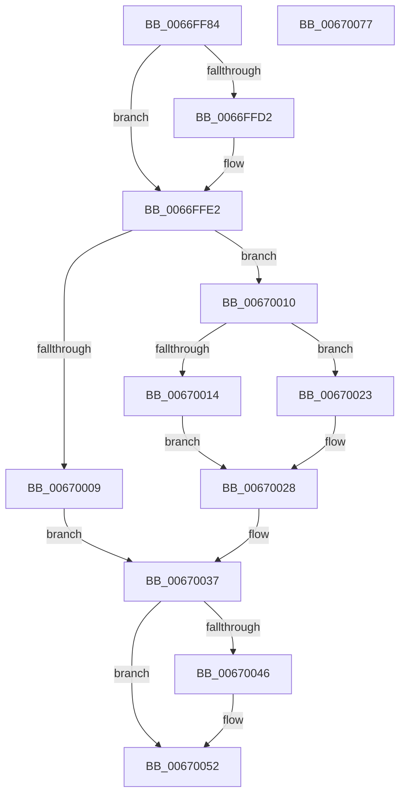

# MmSetCommitReleaseEligibility

- RVA: `0x0066FF84`–`0x00670078` (길이 `244` bytes)
- VA: `0x000000014066FF84`
- 실행 섹션: `.text`
- PDB 이름 있음: `예`; PDB Function 태그: `아니요`
- unwind 정보 RVA: `0x000D7734`
- 디코드: `66`개 명령, `244/244` bytes 표시
- 미해석 바이트: `0` (있으면 어셈블리에 `.byte`로 보존)

> 이 문서는 커널 이미지의 기계어와 PDB 기호를 분석해 생성했습니다. 4번과 5번은 함수 원형과 자료형을 바이너리 사용 방식에서 추정한 C 해석이며 원본 소스 복구 결과는 아닙니다.

## 1. Dependencies

- 직접 호출 지점: **5**; 고유 호출 대상: **5**
- 직접 호출자로 확인된 함수: **1**
- RIP 상대 이미지 참조: **1**

### Outgoing calls
- `0x0066FFDD` → [KiStackAttachProcess](../21/KiStackAttachProcess_function_00216820.md) (function, `0x00216820`)
- `0x0066FFEC` → [MiLockWorkingSetExclusive](../32/MiLockWorkingSetExclusive_function_003238A0.md) (function, `0x003238A0`)
- `0x0067003D` → [MiUnlockWorkingSetExclusive](../27/MiUnlockWorkingSetExclusive_function_0027EC70.md) (function, `0x0027EC70`)
- `0x0067004D` → [KiUnstackDetachProcess](../21/KiUnstackDetachProcess_function_00217D30.md) (function, `0x00217D30`)
- `0x0067005C` → [_security_check_cookie](../6A/_security_check_cookie_function_006AC640.md) (function, `0x006AC640`)

### Direct callers
- [NtSetInformationProcess](../../page/AE/NtSetInformationProcess_function_00AE5370.md) at `0x00AE8EA7`

### Static image references
- `0x0066FF98` → RVA `0x00E0A740` (`.data`; read)

## 2. Other-region calls and transfers

- 다른 실행 섹션으로 향하는 call: **0**
- 별도 외부 분기/꼬리 이동을 확인하지 못했습니다.

## 3. Assembly (complete function range)

```asm
0066FF84  4C 8B DC                        mov r11, rsp
0066FF87  49 89 5B 10                     mov qword ptr [r11 + 0x10], rbx
0066FF8B  49 89 6B 18                     mov qword ptr [r11 + 0x18], rbp
0066FF8F  49 89 73 20                     mov qword ptr [r11 + 0x20], rsi
0066FF93  57                              push rdi
0066FF94  48 83 EC 60                     sub rsp, 0x60
0066FF98  48 8B 05 A1 A7 79 00            mov rax, qword ptr [rip + 0x79a7a1]
0066FF9F  48 33 C4                        xor rax, rsp
0066FFA2  48 89 44 24 58                  mov qword ptr [rsp + 0x58], rax
0066FFA7  0F 57 C0                        xorps xmm0, xmm0
0066FFAA  33 F6                           xor esi, esi
0066FFAC  0F 11 44 24 28                  movups xmmword ptr [rsp + 0x28], xmm0
0066FFB1  8B EA                           mov ebp, edx
0066FFB3  48 8B D9                        mov rbx, rcx
0066FFB6  0F 11 44 24 38                  movups xmmword ptr [rsp + 0x38], xmm0
0066FFBB  0F 11 44 24 48                  movups xmmword ptr [rsp + 0x48], xmm0
0066FFC0  65 48 8B 04 25 88 01 00 00      mov rax, qword ptr gs:[0x188]
0066FFC9  48 39 88 B8 00 00 00            cmp qword ptr [rax + 0xb8], rcx
0066FFD0  74 10                           je 0x14066ffe2
0066FFD2  4D 8D 43 C0                     lea r8, [r11 - 0x40]
0066FFD6  33 D2                           xor edx, edx
0066FFD8  BE 01 00 00 00                  mov esi, 1
0066FFDD  E8 3E 68 BA FF                  call 0x140216820
0066FFE2  48 8D BB 00 04 00 00            lea rdi, [rbx + 0x400]
0066FFE9  48 8B CF                        mov rcx, rdi
0066FFEC  E8 AF 38 CB FF                  call 0x1403238a0
0066FFF1  8B 97 B8 00 00 00               mov edx, dword ptr [rdi + 0xb8]
0066FFF7  44 8A C0                        mov r8b, al
0066FFFA  8B 8B F4 01 00 00               mov ecx, dword ptr [rbx + 0x1f4]
00670000  89 54 24 20                     mov dword ptr [rsp + 0x20], edx
00670004  F6 C1 20                        test cl, 0x20
00670007  74 07                           je 0x140670010
00670009  BB 0A 01 00 C0                  mov ebx, 0xc000010a
0067000E  EB 27                           jmp 0x140670037
00670010  85 ED                           test ebp, ebp
00670012  74 0F                           je 0x140670023
00670014  C1 EA 18                        shr edx, 0x18
00670017  80 E2 DF                        and dl, 0xdf
0067001A  80 CA 10                        or dl, 0x10
0067001D  88 54 24 23                     mov byte ptr [rsp + 0x23], dl
00670021  EB 05                           jmp 0x140670028
00670023  80 64 24 23 CF                  and byte ptr [rsp + 0x23], 0xcf
00670028  8B 44 24 20                     mov eax, dword ptr [rsp + 0x20]
0067002C  C1 E8 18                        shr eax, 0x18
0067002F  88 87 BB 00 00 00               mov byte ptr [rdi + 0xbb], al
00670035  33 DB                           xor ebx, ebx
00670037  41 8A D0                        mov dl, r8b
0067003A  48 8B CF                        mov rcx, rdi
0067003D  E8 2E EC C0 FF                  call 0x14027ec70
00670042  85 F6                           test esi, esi
00670044  74 0C                           je 0x140670052
00670046  33 D2                           xor edx, edx
00670048  48 8D 4C 24 28                  lea rcx, [rsp + 0x28]
0067004D  E8 DE 7C BA FF                  call 0x140217d30
00670052  8B C3                           mov eax, ebx
00670054  48 8B 4C 24 58                  mov rcx, qword ptr [rsp + 0x58]
00670059  48 33 CC                        xor rcx, rsp
0067005C  E8 DF C5 03 00                  call 0x1406ac640
00670061  4C 8D 5C 24 60                  lea r11, [rsp + 0x60]
00670066  49 8B 5B 18                     mov rbx, qword ptr [r11 + 0x18]
0067006A  49 8B 6B 20                     mov rbp, qword ptr [r11 + 0x20]
0067006E  49 8B 73 28                     mov rsi, qword ptr [r11 + 0x28]
00670072  49 8B E3                        mov rsp, r11
00670075  5F                              pop rdi
00670076  C3                              ret
00670077  CC                              int3
```

## 4. C-style interpretation (structured pseudocode)

```c
__int64 __fastcall MmSetCommitReleaseEligibility(__int64 a1, int a2)
{
    __int64 result;
    __int64 v_rbx;
    __int64 v_rsi;
    __int64 v_rsp;
    unsigned __int64 v_stack_m10;
    unsigned __int64 v_stack_m20;
    unsigned __int64 v_stack_m30;
    unsigned __int64 v_stack_m40;
    unsigned __int8 v_stack_m45;
    unsigned int v_stack_m48;
    unsigned __int64 v_stack_m8;

    *(unsigned __int64 *)(v_rsp + 16) = v_rbx;
    *(unsigned __int64 *)(v_rsp + 24) = v_rbp;
    *(unsigned __int64 *)(v_rsp + 32) = v_rsi;
    v_rsp = (v_rsp) - (96);
    result = (*(unsigned __int64 *)(v_rip + 7972769)) ^ (v_rsp);
    v_stack_m10 = result;
    v_rsi = 0;
    v_stack_m40 = v_xmm0;
    v_stack_m30 = v_xmm0;
    v_stack_m20 = v_xmm0;
    result = *(unsigned __int64 *)(gs_base + (0 + 392));
    if ((*(unsigned __int64 *)(*(unsigned __int64 *)(gs_base + (0 + 392)) + 184)) != a1) {
        a3 = v_rsp - 64;
        a2 = 0;
        v_rsi = 1;
        result = KiStackAttachProcess(a1, a2, a3, a4);
    }
    result = MiLockWorkingSetExclusive(a1 + 1024, a2, a3, a4);
    v_stack_m48 = (unsigned int)((unsigned int)(*(unsigned int *)(a1 + 1024 + 184)));
    if ((((unsigned __int8)((unsigned int)(*(unsigned int *)(a1 + 500)))) & (32)) == 0) goto loc_00670010;
    goto loc_00670037;
loc_00670010:
    if ((unsigned int)((unsigned int)(a2)) == 0) goto loc_00670023;
    a2 = (unsigned int)(((unsigned int)(*(unsigned int *)(a1 + 1024 + 184))) >> (24));
    a2 = (unsigned __int8)((a2) & (223));
    a2 = (unsigned __int8)((a2) | (16));
    v_stack_m45 = (unsigned __int8)(a2);
    goto loc_00670028;
loc_00670023:
loc_00670028:
    result = (unsigned int)(((unsigned int)(v_stack_m48)) >> (24));
    *(unsigned __int8 *)(a1 + 1024 + 187) = (unsigned __int8)(result);
    v_rbx = 0;
loc_00670037:
    result = MiUnlockWorkingSetExclusive(a1 + 1024, (unsigned __int8)((unsigned __int8)(result)), (unsigned __int8)(result), a4);
    if ((unsigned int)(v_rsi) != 0) {
        a2 = 0;
        a1 = v_stack_m40;
        result = KiUnstackDetachProcess(a1, a2, (unsigned __int8)(result), a4);
    }
    a1 = (v_stack_m10) ^ (v_rsp);
    result = _security_check_cookie(a1, a2, (unsigned __int8)(result), a4);
    return result;
}
```

## 5. (Beta) C Style

```c
int64_t MmSetCommitReleaseEligibility(void *Arg1, int32_t Arg2)
{
    uint8_t *arg1 = (uint8_t *)Arg1;

    int64_t result;
    int64_t local_rbx;
    int64_t local_rsi;
    int64_t local_rsp;
    uint64_t v_stack_m10;
    uint64_t v_stack_m20;
    uint64_t v_stack_m30;
    uint64_t v_stack_m40;
    uint8_t v_stack_m45;
    uint32_t v_stack_m48;
    uint64_t v_stack_m8;

    *(uint64_t *)(local_rsp + 0x10) = local_rbx;
    *(uint64_t *)(local_rsp + 0x18) = local_rbp;
    *(uint64_t *)(local_rsp + 0x20) = local_rsi;
    local_rsp = (local_rsp) - (96);
    result = (*(uint64_t *)(v_rip + 0x79A7A1)) ^ (local_rsp);
    v_stack_m10 = result;
    local_rsi = 0;
    v_stack_m40 = v_xmm0;
    v_stack_m30 = v_xmm0;
    v_stack_m20 = v_xmm0;
    result = *(uint64_t *)(gs_base + (0 + 0x188));
    if ((*(uint64_t *)(*(uint64_t *)(gs_base + (0 + 0x188)) + 0xB8)) != Arg1) {
        a3 = local_rsp - 64;
        Arg2 = 0;
        local_rsi = 1;
        result = KiStackAttachProcess(Arg1, Arg2, a3, a4);
    }
    result = MiLockWorkingSetExclusive(Arg1 + 1024, Arg2, a3, a4);
    v_stack_m48 = (uint32_t)((uint32_t)(*(uint32_t *)(arg1 + 0x400 + 0xB8)));
    if ((((uint8_t)((uint32_t)(*(uint32_t *)(arg1 + 0x1F4)))) & (32)) == 0) goto loc_00670010;
    goto loc_00670037;
loc_00670010:
    if ((uint32_t)((uint32_t)(Arg2)) == 0) goto loc_00670023;
    Arg2 = (uint32_t)(((uint32_t)(*(uint32_t *)(arg1 + 0x400 + 0xB8))) >> (24));
    Arg2 = (uint8_t)((Arg2) & (223));
    Arg2 = (uint8_t)((Arg2) | (16));
    v_stack_m45 = (uint8_t)(Arg2);
    goto loc_00670028;
loc_00670023:
loc_00670028:
    result = (uint32_t)(((uint32_t)(v_stack_m48)) >> (24));
    *(uint8_t *)(arg1 + 0x400 + 0xBB) = (uint8_t)(result);
    local_rbx = 0;
loc_00670037:
    result = MiUnlockWorkingSetExclusive(Arg1 + 1024, (uint8_t)((uint8_t)(result)), (uint8_t)(result), a4);
    if ((uint32_t)(local_rsi) != 0) {
        Arg2 = 0;
        Arg1 = v_stack_m40;
        result = KiUnstackDetachProcess(Arg1, Arg2, (uint8_t)(result), a4);
    }
    Arg1 = (v_stack_m10) ^ (local_rsp);
    result = _security_check_cookie(Arg1, Arg2, (uint8_t)(result), a4);
    return result;
}
```

### 관측된 메모리 오프셋

구조체 형식이 확인되지 않은 접근은 인자 기준의 오프셋으로만 기록했습니다.

| 기준 인자 | 오프셋 표현 | 폭 (bit) | 접근 |
|---|---:|---:|---|
| `Arg1` | `+ 0xB8` | `32` | `R` |
| `Arg1` | `+ 0xBB` | `8` | `W` |
| `Arg1` | `+ 0x1F4` | `32` | `R` |
| `Arg1` | `+ 0x400` | `64` | `R` |

## 6. Execution-region graph

[열기: 2D/3D 그래프와 함수 탐색 컨트롤 패널](../../../control-panel.html?section=text&rva=0x0066FF84&view=graph)

- 2D 그래프는 위에서 아래로 흐르고, 3D 그래프는 빈 공간을 드래그해 회전합니다. Shift+드래그는 이동, 휠은 확대·축소, 함수 노드 선택은 대상 보고서 이동입니다.

### Static fallback


