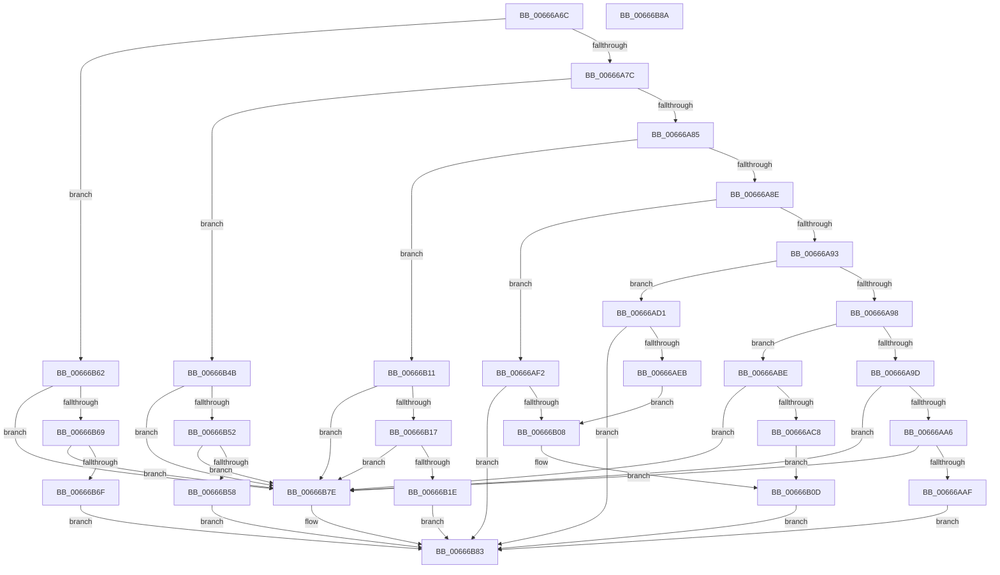

# PrExtControlOperations

- RVA: `0x00666A6C`–`0x00666B8B` (길이 `287` bytes)
- VA: `0x0000000140666A6C`
- 실행 섹션: `.text`
- PDB 이름 있음: `예`; PDB Function 태그: `아니요`
- unwind 정보 RVA: `0x0005C788`
- 디코드: `79`개 명령, `287/287` bytes 표시
- 미해석 바이트: `0` (있으면 어셈블리에 `.byte`로 보존)

> 이 문서는 커널 이미지의 기계어와 PDB 기호를 분석해 생성했습니다. 4번과 5번은 함수 원형과 자료형을 바이너리 사용 방식에서 추정한 C 해석이며 원본 소스 복구 결과는 아닙니다.

## 1. Dependencies

- 직접 호출 지점: **4**; 고유 호출 대상: **3**
- 직접 호출자로 확인된 함수: **5**
- RIP 상대 이미지 참조: **9**

### Outgoing calls
- `0x00666ACA` → [MicrocodeValidate](MicrocodeValidate_function_00667688.md) (function, `0x00667688`)
- `0x00666ADB` → [RtlFindExportedRoutineByName](../../page/90/RtlFindExportedRoutineByName_function_0090F0A0.md) (function, `0x0090F0A0`)
- `0x00666AFC` → [RtlFindExportedRoutineByName](../../page/90/RtlFindExportedRoutineByName_function_0090F0A0.md) (function, `0x0090F0A0`)
- `0x00666B08` → [guard_dispatch_icall](../6B/guard_dispatch_icall_function_006BAAD0.md) (function, `0x006BAAD0`)

### Direct callers
- [HalpMcEnumerateAndSetPatchConfig](../55/HalpMcEnumerateAndSetPatchConfig_function_0055AB38.md) at `0x0055AEA2`
- [HalpMcGetRollbackRequest](../55/HalpMcGetRollbackRequest_function_0055AFEC.md) at `0x0055B090`
- [HalpMcUpdateInitializeBSP](../55/HalpMcUpdateInitializeBSP_function_0055B22C.md) at `0x0055B271`
- [HalpMcUpdateInitializeBSP](../55/HalpMcUpdateInitializeBSP_function_0055B22C.md) at `0x0055B28B`
- [HalpLoadMicrocode](../../page/70/HalpLoadMicrocode_function_0070B200.md) at `0x0070B281`
- [HalpLoadMicrocode](../../page/70/HalpLoadMicrocode_function_0070B200.md) at `0x0070B368`
- [HalpLoadMicrocode](../../page/70/HalpLoadMicrocode_function_0070B200.md) at `0x0070B3F6`
- [HalpProcInitSystem](../../pagelk/B5/HalpProcInitSystem_function_00B5D440.md) at `0x00B5D483`

### Static image references
- `0x00666AB3` → RVA `0x00EF7CCC` (`.data`; write)
- `0x00666AD1` → RVA `0x00039FF0` (`.rdata`; read)
- `0x00666B21` → RVA `0x00EF7CA0` (`.data`; read)
- `0x00666B2C` → RVA `0x00EF7CB0` (`.data`; read)
- `0x00666B38` → RVA `0x00EF7CC0` (`.data`; write)
- `0x00666B43` → RVA `0x00EF7CC8` (`.data`; write)
- `0x00666B5A` → RVA `0x00EF7CCD` (`.data`; write)
- `0x00666B6F` → RVA `0x00EF7CD8` (`.data`; write)
- `0x00666B76` → RVA `0x00EF7CE0` (`.data`; write)

## 2. Other-region calls and transfers

- 다른 실행 섹션으로 향하는 call: **2**
  - `0x00666ADB` → [RtlFindExportedRoutineByName](../../page/90/RtlFindExportedRoutineByName_function_0090F0A0.md) (`.text` → `PAGE`)
  - `0x00666AFC` → [RtlFindExportedRoutineByName](../../page/90/RtlFindExportedRoutineByName_function_0090F0A0.md) (`.text` → `PAGE`)
- 별도 외부 분기/꼬리 이동을 확인하지 못했습니다.

## 3. Assembly (complete function range)

```asm
00666A6C  48 83 EC 28                     sub rsp, 0x28
00666A70  4C 8B CA                        mov r9, rdx
00666A73  83 E9 01                        sub ecx, 1
00666A76  0F 84 E6 00 00 00               je 0x140666b62
00666A7C  83 E9 02                        sub ecx, 2
00666A7F  0F 84 C6 00 00 00               je 0x140666b4b
00666A85  83 E9 02                        sub ecx, 2
00666A88  0F 84 83 00 00 00               je 0x140666b11
00666A8E  83 E9 03                        sub ecx, 3
00666A91  74 5F                           je 0x140666af2
00666A93  83 E9 01                        sub ecx, 1
00666A96  74 39                           je 0x140666ad1
00666A98  83 E9 01                        sub ecx, 1
00666A9B  74 21                           je 0x140666abe
00666A9D  83 F9 01                        cmp ecx, 1
00666AA0  0F 85 D8 00 00 00               jne 0x140666b7e
00666AA6  44 3B C1                        cmp r8d, ecx
00666AA9  0F 85 CF 00 00 00               jne 0x140666b7e
00666AAF  8A 02                           mov al, byte ptr [rdx]
00666AB1  33 C9                           xor ecx, ecx
00666AB3  88 05 13 12 89 00               mov byte ptr [rip + 0x891213], al
00666AB9  E9 C5 00 00 00                  jmp 0x140666b83
00666ABE  41 83 F8 04                     cmp r8d, 4
00666AC2  0F 85 B6 00 00 00               jne 0x140666b7e
00666AC8  8B 0A                           mov ecx, dword ptr [rdx]
00666ACA  E8 B9 0B 00 00                  call 0x140667688
00666ACF  EB 3C                           jmp 0x140666b0d
00666AD1  48 8D 15 18 35 9D FF            lea rdx, [rip - 0x62cae8]
00666AD8  49 8B C9                        mov rcx, r9
00666ADB  E8 C0 85 2A 00                  call 0x14090f0a0
00666AE0  33 C9                           xor ecx, ecx
00666AE2  48 85 C0                        test rax, rax
00666AE5  0F 84 98 00 00 00               je 0x140666b83
00666AEB  B9 01 00 00 00                  mov ecx, 1
00666AF0  EB 16                           jmp 0x140666b08
00666AF2  48 8D 15 F7 34 9D FF            lea rdx, [rip - 0x62cb09]
00666AF9  49 8B C9                        mov rcx, r9
00666AFC  E8 9F 85 2A 00                  call 0x14090f0a0
00666B01  33 C9                           xor ecx, ecx
00666B03  48 85 C0                        test rax, rax
00666B06  74 7B                           je 0x140666b83
00666B08  E8 C3 3F 05 00                  call 0x1406baad0
00666B0D  8B C8                           mov ecx, eax
00666B0F  EB 72                           jmp 0x140666b83
00666B11  41 83 F8 2C                     cmp r8d, 0x2c
00666B15  75 67                           jne 0x140666b7e
00666B17  33 C9                           xor ecx, ecx
00666B19  4D 85 C9                        test r9, r9
00666B1C  74 60                           je 0x140666b7e
00666B1E  0F 10 02                        movups xmm0, xmmword ptr [rdx]
00666B21  0F 11 05 78 11 89 00            movups xmmword ptr [rip + 0x891178], xmm0
00666B28  0F 10 4A 10                     movups xmm1, xmmword ptr [rdx + 0x10]
00666B2C  0F 11 0D 7D 11 89 00            movups xmmword ptr [rip + 0x89117d], xmm1
00666B33  F2 0F 10 42 20                  movsd xmm0, qword ptr [rdx + 0x20]
00666B38  F2 0F 11 05 80 11 89 00         movsd qword ptr [rip + 0x891180], xmm0
00666B40  8B 42 28                        mov eax, dword ptr [rdx + 0x28]
00666B43  89 05 7F 11 89 00               mov dword ptr [rip + 0x89117f], eax
00666B49  EB 38                           jmp 0x140666b83
00666B4B  33 C9                           xor ecx, ecx
00666B4D  4D 85 C9                        test r9, r9
00666B50  74 2C                           je 0x140666b7e
00666B52  41 83 F8 01                     cmp r8d, 1
00666B56  75 26                           jne 0x140666b7e
00666B58  8A 02                           mov al, byte ptr [rdx]
00666B5A  88 05 6D 11 89 00               mov byte ptr [rip + 0x89116d], al
00666B60  EB 21                           jmp 0x140666b83
00666B62  33 C9                           xor ecx, ecx
00666B64  4D 85 C9                        test r9, r9
00666B67  74 15                           je 0x140666b7e
00666B69  41 83 F8 0C                     cmp r8d, 0xc
00666B6D  75 0F                           jne 0x140666b7e
00666B6F  4C 89 0D 62 11 89 00            mov qword ptr [rip + 0x891162], r9
00666B76  88 0D 64 11 89 00               mov byte ptr [rip + 0x891164], cl
00666B7C  EB 05                           jmp 0x140666b83
00666B7E  B9 0D 00 00 C0                  mov ecx, 0xc000000d
00666B83  8B C1                           mov eax, ecx
00666B85  48 83 C4 28                     add rsp, 0x28
00666B89  C3                              ret
00666B8A  CC                              int3
```

## 4. C-style interpretation (structured pseudocode)

```c
__int64 __fastcall PrExtControlOperations(int a1, __int64 a2, int a3)
{
    __int64 result;
    __int64 v_rsp;

    v_rsp = (v_rsp) - (40);
    a1 = (unsigned int)((a1) - (1));
    if (condition_is_equal) goto loc_00666B62;
    a1 = (unsigned int)((a1) - (2));
    if (condition_is_equal) goto loc_00666B4B;
    a1 = (unsigned int)((a1) - (2));
    if (condition_is_equal) goto loc_00666B11;
    a1 = (unsigned int)((a1) - (3));
    if (condition_is_equal) goto loc_00666AF2;
    a1 = (unsigned int)((a1) - (1));
    if (condition_is_equal) goto loc_00666AD1;
    a1 = (unsigned int)((a1) - (1));
    if (condition_is_equal) goto loc_00666ABE;
    if (a1 != 1) goto loc_00666B7E;
    if (a3 != a1) goto loc_00666B7E;
    a1 = 0;
    *(unsigned __int8 *)(v_rip + 8983059) = (unsigned __int8)(*(unsigned __int8 *)(a2));
    goto loc_00666B83;
loc_00666ABE:
    if (a3 != 4) goto loc_00666B7E;
    result = MicrocodeValidate((unsigned int)(*(unsigned int *)(a2)), a2, a3, a2);
    goto loc_00666B0D;
loc_00666AD1:
    result = RtlFindExportedRoutineByName(a2, v_rip - 6474472, a3, a2);
    a1 = 0;
    if (result == 0) goto loc_00666B83;
    goto loc_00666B08;
loc_00666AF2:
    result = RtlFindExportedRoutineByName(a2, v_rip - 6474505, a3, a2);
    a1 = 0;
    if (result == 0) goto loc_00666B83;
loc_00666B08:
    result = guard_dispatch_icall(a1, v_rip - 6474505, a3, a2);
loc_00666B0D:
    goto loc_00666B83;
loc_00666B11:
    if (a3 != 44) goto loc_00666B7E;
    a1 = 0;
    if (a2 == 0) goto loc_00666B7E;
    *(unsigned __int64 *)(v_rip + 8982904) = v_xmm0;
    *(unsigned __int64 *)(v_rip + 8982909) = v_xmm1;
    *(unsigned __int64 *)(v_rip + 8982912) = v_xmm0;
    *(unsigned int *)(v_rip + 8982911) = (unsigned int)((unsigned int)(*(unsigned int *)(v_rip - 6474505 + 40)));
    goto loc_00666B83;
loc_00666B4B:
    a1 = 0;
    if (a2 == 0) goto loc_00666B7E;
    if (a3 != 1) goto loc_00666B7E;
    *(unsigned __int8 *)(v_rip + 8982893) = (unsigned __int8)(*(unsigned __int8 *)(v_rip - 6474505));
    goto loc_00666B83;
loc_00666B62:
    a1 = 0;
    if (a2 == 0) goto loc_00666B7E;
    if (a3 != 12) goto loc_00666B7E;
    *(unsigned __int64 *)(v_rip + 8982882) = a2;
    *(unsigned __int8 *)(v_rip + 8982884) = 0;
    goto loc_00666B83;
loc_00666B7E:
loc_00666B83:
    v_rsp = (v_rsp) + (40);
    return (unsigned int)((unsigned int)((unsigned int)(0xC000000DULL)));
}
```

## 5. (Beta) C Style

```c
int64_t PrExtControlOperations(int32_t Arg1, void *Arg2, int32_t Arg3)
{
    uint8_t *arg2 = (uint8_t *)Arg2;

    int64_t result;
    int64_t local_rsp;

    local_rsp = (local_rsp) - (40);
    Arg1 = (uint32_t)((Arg1) - (1));
    if (condition_is_equal) goto loc_00666B62;
    Arg1 = (uint32_t)((Arg1) - (2));
    if (condition_is_equal) goto loc_00666B4B;
    Arg1 = (uint32_t)((Arg1) - (2));
    if (condition_is_equal) goto loc_00666B11;
    Arg1 = (uint32_t)((Arg1) - (3));
    if (condition_is_equal) goto loc_00666AF2;
    Arg1 = (uint32_t)((Arg1) - (1));
    if (condition_is_equal) goto loc_00666AD1;
    Arg1 = (uint32_t)((Arg1) - (1));
    if (condition_is_equal) goto loc_00666ABE;
    if (Arg1 != 1) goto loc_00666B7E;
    if (Arg3 != Arg1) goto loc_00666B7E;
    Arg1 = 0;
    *(uint8_t *)(v_rip + 0x891213) = (uint8_t)(*(uint8_t *)(arg2));
    goto loc_00666B83;
loc_00666ABE:
    if (Arg3 != 4) goto loc_00666B7E;
    result = MicrocodeValidate((uint32_t)(*(uint32_t *)(arg2)), Arg2, Arg3, Arg2);
    goto loc_00666B0D;
loc_00666AD1:
    result = RtlFindExportedRoutineByName(Arg2, v_rip - 6474472, Arg3, Arg2);
    Arg1 = 0;
    if (result == 0) goto loc_00666B83;
    goto loc_00666B08;
loc_00666AF2:
    result = RtlFindExportedRoutineByName(Arg2, v_rip - 6474505, Arg3, Arg2);
    Arg1 = 0;
    if (result == 0) goto loc_00666B83;
loc_00666B08:
    result = guard_dispatch_icall(Arg1, v_rip - 6474505, Arg3, Arg2);
loc_00666B0D:
    goto loc_00666B83;
loc_00666B11:
    if (Arg3 != 44) goto loc_00666B7E;
    Arg1 = 0;
    if (Arg2 == NULL) goto loc_00666B7E;
    *(uint64_t *)(v_rip + 0x891178) = v_xmm0;
    *(uint64_t *)(v_rip + 0x89117D) = v_xmm1;
    *(uint64_t *)(v_rip + 0x891180) = v_xmm0;
    *(uint32_t *)(v_rip + 0x89117F) = (uint32_t)((uint32_t)(*(uint32_t *)(v_rip - 0x62CB09 + 0x28)));
    goto loc_00666B83;
loc_00666B4B:
    Arg1 = 0;
    if (Arg2 == NULL) goto loc_00666B7E;
    if (Arg3 != 1) goto loc_00666B7E;
    *(uint8_t *)(v_rip + 0x89116D) = (uint8_t)(*(uint8_t *)(v_rip - 0x62CB09));
    goto loc_00666B83;
loc_00666B62:
    Arg1 = 0;
    if (Arg2 == NULL) goto loc_00666B7E;
    if (Arg3 != 12) goto loc_00666B7E;
    *(void **)(v_rip + 0x891162) = Arg2;
    *(uint8_t *)(v_rip + 0x891164) = 0;
    goto loc_00666B83;
loc_00666B7E:
loc_00666B83:
    local_rsp = (local_rsp) + (40);
    return (uint32_t)((uint32_t)((uint32_t)(0xC000000DULL)));
}
```

### 관측된 메모리 오프셋

구조체 형식이 확인되지 않은 접근은 인자 기준의 오프셋으로만 기록했습니다.

| 기준 인자 | 오프셋 표현 | 폭 (bit) | 접근 |
|---|---:|---:|---|
| `Arg2` | `+ 0x0` | `8` | `R` |
| `Arg2` | `+ 0x0` | `32` | `R` |
| `Arg2` | `+ 0x0` | `128` | `R` |
| `Arg2` | `+ 0x10` | `128` | `R` |
| `Arg2` | `+ 0x20` | `64` | `R` |
| `Arg2` | `+ 0x28` | `32` | `R` |

## 6. Execution-region graph

[열기: 2D/3D 그래프와 함수 탐색 컨트롤 패널](../../../control-panel.html?section=text&rva=0x00666A6C&view=graph)

- 2D 그래프는 위에서 아래로 흐르고, 3D 그래프는 빈 공간을 드래그해 회전합니다. Shift+드래그는 이동, 휠은 확대·축소, 함수 노드 선택은 대상 보고서 이동입니다.

### Static fallback


