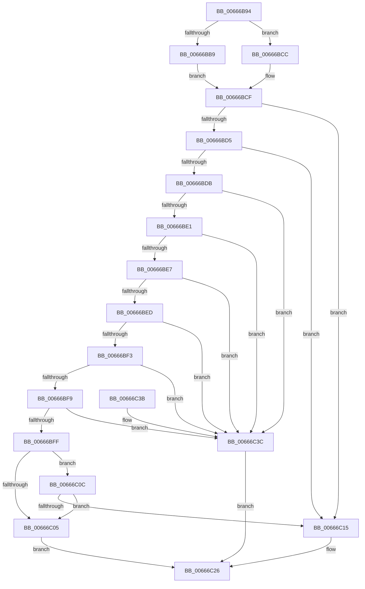

# PrExtExportRecordData

- RVA: `0x00666B94`–`0x00666C43` (길이 `175` bytes)
- VA: `0x0000000140666B94`
- 실행 섹션: `.text`
- PDB 이름 있음: `예`; PDB Function 태그: `아니요`
- unwind 정보 RVA: `0x00069AD0`
- 디코드: `55`개 명령, `175/175` bytes 표시
- 미해석 바이트: `0` (있으면 어셈블리에 `.byte`로 보존)

> 이 문서는 커널 이미지의 기계어와 PDB 기호를 분석해 생성했습니다. 4번과 5번은 함수 원형과 자료형을 바이너리 사용 방식에서 추정한 C 해석이며 원본 소스 복구 결과는 아닙니다.

## 1. Dependencies

- 직접 호출 지점: **3**; 고유 호출 대상: **2**
- 직접 호출자로 확인된 함수: **1**
- RIP 상대 이미지 참조: **0**

### Outgoing calls
- `0x00666BB9` → [Feature_Microcode_Client_CD__private_IsEnabledDeviceUsageNoInline](Feature_Microcode_Client_CD__private_IsEnabledDeviceUsageNoInline_function_00666A18.md) (function, `0x00666A18`)
- `0x00666C0C` → [Feature_Microcode_Client_CD__private_IsEnabledDeviceUsageNoInline](Feature_Microcode_Client_CD__private_IsEnabledDeviceUsageNoInline_function_00666A18.md) (function, `0x00666A18`)
- `0x00666C21` → [GetMicrocodePatchData](GetMicrocodePatchData_function_00666E48.md) (function, `0x00666E48`)

### Direct callers
- [HalpLoadMicrocode](../../page/70/HalpLoadMicrocode_function_0070B200.md) at `0x0070B316`

### Static image references
- 디코드된 RIP-relative 메모리 참조가 없습니다.

## 2. Other-region calls and transfers

- 다른 실행 섹션으로 향하는 call: **0**
- 별도 외부 분기/꼬리 이동을 확인하지 못했습니다.

## 3. Assembly (complete function range)

```asm
00666B94  48 89 5C 24 08                  mov qword ptr [rsp + 8], rbx
00666B99  48 89 6C 24 10                  mov qword ptr [rsp + 0x10], rbp
00666B9E  48 89 74 24 18                  mov qword ptr [rsp + 0x18], rsi
00666BA3  57                              push rdi
00666BA4  48 83 EC 20                     sub rsp, 0x20
00666BA8  49 8B F9                        mov rdi, r9
00666BAB  49 8B F0                        mov rsi, r8
00666BAE  48 8B EA                        mov rbp, rdx
00666BB1  48 8B D9                        mov rbx, rcx
00666BB4  48 85 C9                        test rcx, rcx
00666BB7  75 13                           jne 0x140666bcc
00666BB9  E8 5A FE FF FF                  call 0x140666a18
00666BBE  F7 D8                           neg eax
00666BC0  45 1B D2                        sbb r10d, r10d
00666BC3  41 83 E2 0C                     and r10d, 0xc
00666BC7  41 FF C2                        inc r10d
00666BCA  EB 03                           jmp 0x140666bcf
00666BCC  44 8B 11                        mov r10d, dword ptr [rcx]
00666BCF  41 83 EA 01                     sub r10d, 1
00666BD3  74 40                           je 0x140666c15
00666BD5  41 83 EA 01                     sub r10d, 1
00666BD9  74 3A                           je 0x140666c15
00666BDB  41 83 EA 01                     sub r10d, 1
00666BDF  74 5B                           je 0x140666c3c
00666BE1  41 83 EA 01                     sub r10d, 1
00666BE5  74 55                           je 0x140666c3c
00666BE7  41 83 EA 01                     sub r10d, 1
00666BEB  74 4F                           je 0x140666c3c
00666BED  41 83 EA 01                     sub r10d, 1
00666BF1  74 49                           je 0x140666c3c
00666BF3  41 83 EA 01                     sub r10d, 1
00666BF7  74 43                           je 0x140666c3c
00666BF9  41 83 EA 02                     sub r10d, 2
00666BFD  74 3D                           je 0x140666c3c
00666BFF  41 83 FA 04                     cmp r10d, 4
00666C03  74 07                           je 0x140666c0c
00666C05  B8 01 00 00 C0                  mov eax, 0xc0000001
00666C0A  EB 1A                           jmp 0x140666c26
00666C0C  E8 07 FE FF FF                  call 0x140666a18
00666C11  85 C0                           test eax, eax
00666C13  74 F0                           je 0x140666c05
00666C15  4C 8B CF                        mov r9, rdi
00666C18  4C 8B C6                        mov r8, rsi
00666C1B  48 8B D5                        mov rdx, rbp
00666C1E  48 8B CB                        mov rcx, rbx
00666C21  E8 22 02 00 00                  call 0x140666e48
00666C26  48 8B 5C 24 30                  mov rbx, qword ptr [rsp + 0x30]
00666C2B  48 8B 6C 24 38                  mov rbp, qword ptr [rsp + 0x38]
00666C30  48 8B 74 24 40                  mov rsi, qword ptr [rsp + 0x40]
00666C35  48 83 C4 20                     add rsp, 0x20
00666C39  5F                              pop rdi
00666C3A  C3                              ret
00666C3B  CC                              int3
00666C3C  B8 25 02 00 C0                  mov eax, 0xc0000225
00666C41  EB E3                           jmp 0x140666c26
```

## 4. C-style interpretation (structured pseudocode)

```c
__int64 __fastcall PrExtExportRecordData(__int64 a1, __int64 a2, __int64 a3, __int64 a4)
{
    __int64 result;
    __int64 v_r10;
    __int64 v_rsp;
    unsigned __int64 v_stack_p10;
    unsigned __int64 v_stack_p18;
    unsigned __int64 v_stack_p8;

    v_stack_p8 = v_rbx;
    v_stack_p10 = v_rbp;
    v_stack_p18 = v_rsi;
    v_rsp = (v_rsp) - (32);
    if (a1 != 0) goto loc_00666BCC;
    result = Feature_Microcode_Client_CD__private_IsEnabledDeviceUsageNoInline(a1, a2, a3, a4);
    result = (unsigned int)(-(result));
    v_r10 = (unsigned int)((v_r10) & (12));
    v_r10 = (unsigned int)((v_r10) + 1);
    goto loc_00666BCF;
loc_00666BCC:
loc_00666BCF:
    v_r10 = (unsigned int)(((unsigned int)(*(unsigned int *)(a1))) - (1));
    if (condition_is_equal) goto loc_00666C15;
    v_r10 = (unsigned int)((v_r10) - (1));
    if (condition_is_equal) goto loc_00666C15;
    v_r10 = (unsigned int)((v_r10) - (1));
    if (condition_is_equal) goto loc_00666C3C;
    v_r10 = (unsigned int)((v_r10) - (1));
    if (condition_is_equal) goto loc_00666C3C;
    v_r10 = (unsigned int)((v_r10) - (1));
    if (condition_is_equal) goto loc_00666C3C;
    v_r10 = (unsigned int)((v_r10) - (1));
    if (condition_is_equal) goto loc_00666C3C;
    v_r10 = (unsigned int)((v_r10) - (1));
    if (condition_is_equal) goto loc_00666C3C;
    v_r10 = (unsigned int)((v_r10) - (2));
    if (condition_is_equal) goto loc_00666C3C;
    if (((unsigned int)(v_r10)) == 4) goto loc_00666C0C;
loc_00666C05:
    goto loc_00666C26;
loc_00666C0C:
    result = Feature_Microcode_Client_CD__private_IsEnabledDeviceUsageNoInline(a1, a2, a3, a4);
    if ((unsigned int)(result) == 0) goto loc_00666C05;
loc_00666C15:
    result = GetMicrocodePatchData(a1, a2, a3, a4);
loc_00666C26:
    v_rsp = (v_rsp) + (32);
    return result;
loc_00666C3C:
    goto loc_00666C26;
}
```

## 5. (Beta) C Style

```c
int64_t PrExtExportRecordData(int64_t Arg1, int64_t Arg2, int64_t Arg3, int64_t Arg4)
{
    int64_t result;
    int64_t local_r10;
    int64_t local_rsp;
    uint64_t v_stack_p10;
    uint64_t v_stack_p18;
    uint64_t v_stack_p8;

    v_stack_p8 = local_rbx;
    v_stack_p10 = local_rbp;
    v_stack_p18 = local_rsi;
    local_rsp = (local_rsp) - (32);
    if (Arg1 != 0) goto loc_00666BCC;
    result = Feature_Microcode_Client_CD__private_IsEnabledDeviceUsageNoInline(Arg1, Arg2, Arg3, Arg4);
    result = (uint32_t)(-(result));
    local_r10 = (uint32_t)((local_r10) & (12));
    local_r10 = (uint32_t)((local_r10) + 1);
    goto loc_00666BCF;
loc_00666BCC:
loc_00666BCF:
    local_r10 = (uint32_t)(((uint32_t)(*(uint32_t *)(Arg1))) - (1));
    if (condition_is_equal) goto loc_00666C15;
    local_r10 = (uint32_t)((local_r10) - (1));
    if (condition_is_equal) goto loc_00666C15;
    local_r10 = (uint32_t)((local_r10) - (1));
    if (condition_is_equal) goto loc_00666C3C;
    local_r10 = (uint32_t)((local_r10) - (1));
    if (condition_is_equal) goto loc_00666C3C;
    local_r10 = (uint32_t)((local_r10) - (1));
    if (condition_is_equal) goto loc_00666C3C;
    local_r10 = (uint32_t)((local_r10) - (1));
    if (condition_is_equal) goto loc_00666C3C;
    local_r10 = (uint32_t)((local_r10) - (1));
    if (condition_is_equal) goto loc_00666C3C;
    local_r10 = (uint32_t)((local_r10) - (2));
    if (condition_is_equal) goto loc_00666C3C;
    if (((uint32_t)(local_r10)) == 4) goto loc_00666C0C;
loc_00666C05:
    goto loc_00666C26;
loc_00666C0C:
    result = Feature_Microcode_Client_CD__private_IsEnabledDeviceUsageNoInline(Arg1, Arg2, Arg3, Arg4);
    if ((uint32_t)(result) == 0) goto loc_00666C05;
loc_00666C15:
    result = GetMicrocodePatchData(Arg1, Arg2, Arg3, Arg4);
loc_00666C26:
    local_rsp = (local_rsp) + (32);
    return result;
loc_00666C3C:
    goto loc_00666C26;
}
```

## 6. Execution-region graph

[열기: 2D/3D 그래프와 함수 탐색 컨트롤 패널](../../../control-panel.html?section=text&rva=0x00666B94&view=graph)

- 2D 그래프는 위에서 아래로 흐르고, 3D 그래프는 빈 공간을 드래그해 회전합니다. Shift+드래그는 이동, 휠은 확대·축소, 함수 노드 선택은 대상 보고서 이동입니다.

### Static fallback


