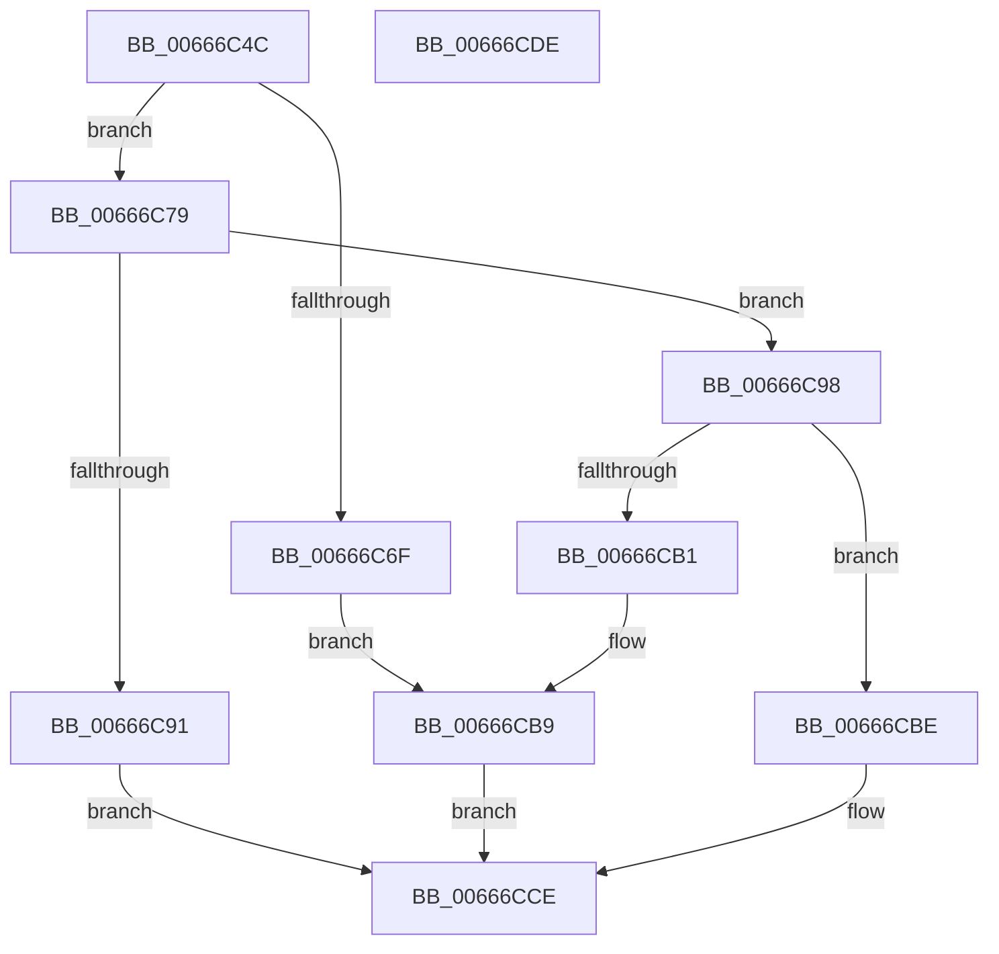

# PrExtExtractDataRecordTable

- RVA: `0x00666C4C`–`0x00666CDF` (길이 `147` bytes)
- VA: `0x0000000140666C4C`
- 실행 섹션: `.text`
- PDB 이름 있음: `예`; PDB Function 태그: `아니요`
- unwind 정보 RVA: `0x0005FD94`
- 디코드: `44`개 명령, `147/147` bytes 표시
- 미해석 바이트: `0` (있으면 어셈블리에 `.byte`로 보존)

> 이 문서는 커널 이미지의 기계어와 PDB 기호를 분석해 생성했습니다. 4번과 5번은 함수 원형과 자료형을 바이너리 사용 방식에서 추정한 C 해석이며 원본 소스 복구 결과는 아닙니다.

## 1. Dependencies

- 직접 호출 지점: **2**; 고유 호출 대상: **2**
- 직접 호출자로 확인된 함수: **1**
- RIP 상대 이미지 참조: **1**

### Outgoing calls
- `0x00666C88` → [RtlImageNtHeaderEx](../41/RtlImageNtHeaderEx_function_0041EAA0.md) (function, `0x0041EAA0`)
- `0x00666CA4` → [RtlLookupImageSectionByName](../4B/RtlLookupImageSectionByName_function_004B4F20.md) (function, `0x004B4F20`)

### Direct callers
- [HalpGetMicrocodePatchRecord](../55/HalpGetMicrocodePatchRecord_function_0055AA8C.md) at `0x0055AAD3`

### Static image references
- `0x00666C9D` → RVA `0x00039FE8` (`.rdata`; read)

## 2. Other-region calls and transfers

- 다른 실행 섹션으로 향하는 call: **0**
- 별도 외부 분기/꼬리 이동을 확인하지 못했습니다.

## 3. Assembly (complete function range)

```asm
00666C4C  48 89 5C 24 10                  mov qword ptr [rsp + 0x10], rbx
00666C51  48 89 74 24 18                  mov qword ptr [rsp + 0x18], rsi
00666C56  57                              push rdi
00666C57  48 83 EC 20                     sub rsp, 0x20
00666C5B  48 83 64 24 30 00               and qword ptr [rsp + 0x30], 0
00666C61  49 8B F0                        mov rsi, r8
00666C64  48 8B DA                        mov rbx, rdx
00666C67  48 8B F9                        mov rdi, rcx
00666C6A  48 85 C9                        test rcx, rcx
00666C6D  75 0A                           jne 0x140666c79
00666C6F  48 21 0A                        and qword ptr [rdx], rcx
00666C72  B8 0D 00 00 C0                  mov eax, 0xc000000d
00666C77  EB 40                           jmp 0x140666cb9
00666C79  45 33 C0                        xor r8d, r8d
00666C7C  4C 8D 4C 24 30                  lea r9, [rsp + 0x30]
00666C81  48 8B D7                        mov rdx, rdi
00666C84  41 8D 48 01                     lea ecx, [r8 + 1]
00666C88  E8 13 7E DB FF                  call 0x14041eaa0
00666C8D  85 C0                           test eax, eax
00666C8F  79 07                           jns 0x140666c98
00666C91  B8 01 00 00 C0                  mov eax, 0xc0000001
00666C96  EB 36                           jmp 0x140666cce
00666C98  48 8B 4C 24 30                  mov rcx, qword ptr [rsp + 0x30]
00666C9D  48 8D 15 44 33 9D FF            lea rdx, [rip - 0x62ccbc]
00666CA4  E8 77 E2 E4 FF                  call 0x1404b4f20
00666CA9  48 8B C8                        mov rcx, rax
00666CAC  48 85 C0                        test rax, rax
00666CAF  75 0D                           jne 0x140666cbe
00666CB1  48 21 03                        and qword ptr [rbx], rax
00666CB4  B8 49 00 00 C0                  mov eax, 0xc0000049
00666CB9  83 26 00                        and dword ptr [rsi], 0
00666CBC  EB 10                           jmp 0x140666cce
00666CBE  8B 40 0C                        mov eax, dword ptr [rax + 0xc]
00666CC1  48 03 C7                        add rax, rdi
00666CC4  48 89 03                        mov qword ptr [rbx], rax
00666CC7  8B 41 08                        mov eax, dword ptr [rcx + 8]
00666CCA  89 06                           mov dword ptr [rsi], eax
00666CCC  33 C0                           xor eax, eax
00666CCE  48 8B 5C 24 38                  mov rbx, qword ptr [rsp + 0x38]
00666CD3  48 8B 74 24 40                  mov rsi, qword ptr [rsp + 0x40]
00666CD8  48 83 C4 20                     add rsp, 0x20
00666CDC  5F                              pop rdi
00666CDD  C3                              ret
00666CDE  CC                              int3
```

## 4. C-style interpretation (structured pseudocode)

```c
__int64 __fastcall PrExtExtractDataRecordTable(__int64 a1, __int64 a2, __int64 a3)
{
    __int64 result;
    __int64 v_rsp;
    unsigned __int64 v_stack_p10;
    unsigned __int64 v_stack_p18;
    unsigned __int64 v_stack_p8;

    v_stack_p10 = v_rbx;
    v_stack_p18 = v_rsi;
    v_rsp = (v_rsp) - (32);
    if (a1 != 0) goto loc_00666C79;
    goto loc_00666CB9;
loc_00666C79:
    a3 = 0;
    result = RtlImageNtHeaderEx(a3 + 1, a1, a3, v_stack_p8);
    if (!sign_flag) goto loc_00666C98;
    goto loc_00666CCE;
loc_00666C98:
    result = RtlLookupImageSectionByName(v_stack_p8, v_rip - 6474940, a3, v_stack_p8);
    if (result != 0) goto loc_00666CBE;
loc_00666CB9:
    goto loc_00666CCE;
loc_00666CBE:
    result = ((unsigned int)(*(unsigned int *)((unsigned int)(0xC0000049ULL) + 12))) + (a1);
    *(unsigned __int64 *)(a2) = result;
    *(unsigned int *)(a3) = (unsigned int)((unsigned int)(*(unsigned int *)(result + 8)));
    result = 0;
loc_00666CCE:
    v_rsp = (v_rsp) + (32);
    return result;
}
```

## 5. (Beta) C Style

```c
int64_t PrExtExtractDataRecordTable(int64_t Arg1, void *Arg2, void *Arg3)
{
    uint8_t *arg2 = (uint8_t *)Arg2;
    uint8_t *arg3 = (uint8_t *)Arg3;

    int64_t result;
    int64_t local_rsp;
    uint64_t v_stack_p10;
    uint64_t v_stack_p18;
    uint64_t v_stack_p8;

    v_stack_p10 = local_rbx;
    v_stack_p18 = local_rsi;
    local_rsp = (local_rsp) - (32);
    if (Arg1 != 0) goto loc_00666C79;
    goto loc_00666CB9;
loc_00666C79:
    Arg3 = 0;
    result = RtlImageNtHeaderEx(Arg3 + 1, Arg1, Arg3, v_stack_p8);
    if (!sign_flag) goto loc_00666C98;
    goto loc_00666CCE;
loc_00666C98:
    result = RtlLookupImageSectionByName(v_stack_p8, v_rip - 6474940, Arg3, v_stack_p8);
    if (result != 0) goto loc_00666CBE;
loc_00666CB9:
    goto loc_00666CCE;
loc_00666CBE:
    result = ((uint32_t)(*(uint32_t *)((uint32_t)(0xC0000049ULL) + 0xC))) + (Arg1);
    *(uint64_t *)(arg2) = result;
    *(uint32_t *)(arg3) = (uint32_t)((uint32_t)(*(uint32_t *)(result + 0x8)));
    result = 0;
loc_00666CCE:
    local_rsp = (local_rsp) + (32);
    return result;
}
```

### 관측된 메모리 오프셋

구조체 형식이 확인되지 않은 접근은 인자 기준의 오프셋으로만 기록했습니다.

| 기준 인자 | 오프셋 표현 | 폭 (bit) | 접근 |
|---|---:|---:|---|
| `Arg2` | `+ 0x0` | `64` | `R/W` |
| `Arg2` | `+ 0x0` | `64` | `W` |
| `Arg3` | `+ 0x0` | `32` | `R/W` |
| `Arg3` | `+ 0x0` | `32` | `W` |

## 6. Execution-region graph

[열기: 2D/3D 그래프와 함수 탐색 컨트롤 패널](../../../control-panel.html?section=text&rva=0x00666C4C&view=graph)

- 2D 그래프는 위에서 아래로 흐르고, 3D 그래프는 빈 공간을 드래그해 회전합니다. Shift+드래그는 이동, 휠은 확대·축소, 함수 노드 선택은 대상 보고서 이동입니다.

### Static fallback


