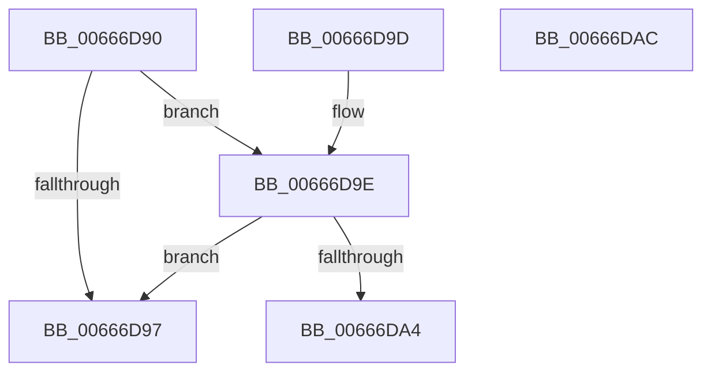

# PrExtGetRecordDataLength

- RVA: `0x00666D90`–`0x00666DAD` (길이 `29` bytes)
- VA: `0x0000000140666D90`
- 실행 섹션: `.text`
- PDB 이름 있음: `예`; PDB Function 태그: `아니요`
- unwind 정보 RVA: `0x000DB714`
- 디코드: `12`개 명령, `29/29` bytes 표시
- 미해석 바이트: `0` (있으면 어셈블리에 `.byte`로 보존)

> 이 문서는 커널 이미지의 기계어와 PDB 기호를 분석해 생성했습니다. 4번과 5번은 함수 원형과 자료형을 바이너리 사용 방식에서 추정한 C 해석이며 원본 소스 복구 결과는 아닙니다.

## 1. Dependencies

- 직접 호출 지점: **0**; 고유 호출 대상: **0**
- 직접 호출자로 확인된 함수: **4**
- RIP 상대 이미지 참조: **0**

### Outgoing calls
- 직접 디코드된 call 명령이 없습니다.

### Direct callers
- [IntelMicrocodeGetRecordData](IntelMicrocodeGetRecordData_function_00667954.md) at `0x00667987`
- [AMDMicrocodeGetRecordData](AMDMicrocodeGetRecordData_function_00667CA0.md) at `0x00667D0C`
- [AMDMicrocodeV1GetRecordData](AMDMicrocodeV1GetRecordData_function_00667EC8.md) at `0x00667EF9`
- [HalpLoadMicrocode](../../page/70/HalpLoadMicrocode_function_0070B200.md) at `0x0070B2CD`

### Static image references
- 디코드된 RIP-relative 메모리 참조가 없습니다.

## 2. Other-region calls and transfers

- 다른 실행 섹션으로 향하는 call: **0**
- 별도 외부 분기/꼬리 이동을 확인하지 못했습니다.

## 3. Assembly (complete function range)

```asm
00666D90  33 C0                           xor eax, eax
00666D92  48 85 C9                        test rcx, rcx
00666D95  75 07                           jne 0x140666d9e
00666D97  B8 0D 00 00 C0                  mov eax, 0xc000000d
00666D9C  C3                              ret
00666D9D  CC                              int3
00666D9E  48 83 FA 10                     cmp rdx, 0x10
00666DA2  72 F3                           jb 0x140666d97
00666DA4  48 8B 49 08                     mov rcx, qword ptr [rcx + 8]
00666DA8  49 89 08                        mov qword ptr [r8], rcx
00666DAB  C3                              ret
00666DAC  CC                              int3
```

## 4. C-style interpretation (structured pseudocode)

```c
__int64 __fastcall PrExtGetRecordDataLength(__int64 a1, __int64 a2, __int64 a3)
{
    __int64 result;

    result = 0;
    if (a1 != 0) goto loc_00666D9E;
loc_00666D97:
    return (unsigned int)(0xC000000DULL);
loc_00666D9E:
    if (a2 < 16) goto loc_00666D97;
    *(unsigned __int64 *)(a3) = *(unsigned __int64 *)(a1 + 8);
    return (unsigned int)(0xC000000DULL);
}
```

## 5. (Beta) C Style

```c
int64_t PrExtGetRecordDataLength(int64_t Arg1, int64_t Arg2, void *Arg3)
{
    uint8_t *arg3 = (uint8_t *)Arg3;

    int64_t result;

    result = 0;
    if (Arg1 != 0) goto loc_00666D9E;
loc_00666D97:
    return (uint32_t)(0xC000000DULL);
loc_00666D9E:
    if (Arg2 < 16) goto loc_00666D97;
    *(uint64_t *)(arg3) = *(uint64_t *)(Arg1 + 0x8);
    return (uint32_t)(0xC000000DULL);
}
```

### 관측된 메모리 오프셋

구조체 형식이 확인되지 않은 접근은 인자 기준의 오프셋으로만 기록했습니다.

| 기준 인자 | 오프셋 표현 | 폭 (bit) | 접근 |
|---|---:|---:|---|
| `Arg3` | `+ 0x0` | `64` | `W` |

## 6. Execution-region graph

[열기: 2D/3D 그래프와 함수 탐색 컨트롤 패널](../../../control-panel.html?section=text&rva=0x00666D90&view=graph)

- 2D 그래프는 위에서 아래로 흐르고, 3D 그래프는 빈 공간을 드래그해 회전합니다. Shift+드래그는 이동, 휠은 확대·축소, 함수 노드 선택은 대상 보고서 이동입니다.

### Static fallback


