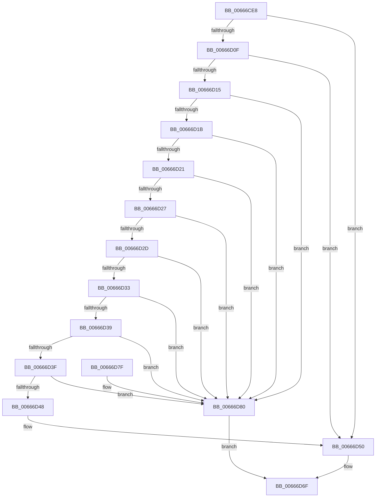

# PrExtGetRecord

- RVA: `0x00666CE8`–`0x00666D87` (길이 `159` bytes)
- VA: `0x0000000140666CE8`
- 실행 섹션: `.text`
- PDB 이름 있음: `예`; PDB Function 태그: `아니요`
- unwind 정보 RVA: `0x00069D68`
- 디코드: `47`개 명령, `159/159` bytes 표시
- 미해석 바이트: `0` (있으면 어셈블리에 `.byte`로 보존)

> 이 문서는 커널 이미지의 기계어와 PDB 기호를 분석해 생성했습니다. 4번과 5번은 함수 원형과 자료형을 바이너리 사용 방식에서 추정한 C 해석이며 원본 소스 복구 결과는 아닙니다.

## 1. Dependencies

- 직접 호출 지점: **2**; 고유 호출 대상: **2**
- 직접 호출자로 확인된 함수: **1**
- RIP 상대 이미지 참조: **1**

### Outgoing calls
- `0x00666D3F` → [Feature_Microcode_Client_CD__private_IsEnabledDeviceUsageNoInline](Feature_Microcode_Client_CD__private_IsEnabledDeviceUsageNoInline_function_00666A18.md) (function, `0x00666A18`)
- `0x00666D6A` → [MicrocodeGetRecord](MicrocodeGetRecord_function_00667060.md) (function, `0x00667060`)

### Direct callers
- [HalpGetMicrocodePatchRecord](../55/HalpGetMicrocodePatchRecord_function_0055AA8C.md) at `0x0055AB00`

### Static image references
- `0x00666CFD` → RVA `0x00F9053C` (`.data`; read)

## 2. Other-region calls and transfers

- 다른 실행 섹션으로 향하는 call: **0**
- 별도 외부 분기/꼬리 이동을 확인하지 못했습니다.

## 3. Assembly (complete function range)

```asm
00666CE8  48 89 5C 24 08                  mov qword ptr [rsp + 8], rbx
00666CED  48 89 74 24 10                  mov qword ptr [rsp + 0x10], rsi
00666CF2  57                              push rdi
00666CF3  48 83 EC 30                     sub rsp, 0x30
00666CF7  48 8B F1                        mov rsi, rcx
00666CFA  49 8B D9                        mov rbx, r9
00666CFD  8B 0D 39 98 92 00               mov ecx, dword ptr [rip + 0x929839]
00666D03  48 8B FA                        mov rdi, rdx
00666D06  44 8B C1                        mov r8d, ecx
00666D09  41 83 E8 01                     sub r8d, 1
00666D0D  74 41                           je 0x140666d50
00666D0F  41 83 E8 01                     sub r8d, 1
00666D13  74 3B                           je 0x140666d50
00666D15  41 83 E8 01                     sub r8d, 1
00666D19  74 65                           je 0x140666d80
00666D1B  41 83 E8 01                     sub r8d, 1
00666D1F  74 5F                           je 0x140666d80
00666D21  41 83 E8 01                     sub r8d, 1
00666D25  74 59                           je 0x140666d80
00666D27  41 83 E8 01                     sub r8d, 1
00666D2B  74 53                           je 0x140666d80
00666D2D  41 83 E8 01                     sub r8d, 1
00666D31  74 4D                           je 0x140666d80
00666D33  41 83 E8 02                     sub r8d, 2
00666D37  74 47                           je 0x140666d80
00666D39  41 83 F8 04                     cmp r8d, 4
00666D3D  75 41                           jne 0x140666d80
00666D3F  E8 D4 FC FF FF                  call 0x140666a18
00666D44  85 C0                           test eax, eax
00666D46  74 38                           je 0x140666d80
00666D48  4C 8B CB                        mov r9, rbx
00666D4B  B9 0D 00 00 00                  mov ecx, 0xd
00666D50  48 8B 44 24 68                  mov rax, qword ptr [rsp + 0x68]
00666D55  4C 8B C7                        mov r8, rdi
00666D58  48 89 44 24 28                  mov qword ptr [rsp + 0x28], rax
00666D5D  48 8B D6                        mov rdx, rsi
00666D60  48 8B 44 24 60                  mov rax, qword ptr [rsp + 0x60]
00666D65  48 89 44 24 20                  mov qword ptr [rsp + 0x20], rax
00666D6A  E8 F1 02 00 00                  call 0x140667060
00666D6F  48 8B 5C 24 40                  mov rbx, qword ptr [rsp + 0x40]
00666D74  48 8B 74 24 48                  mov rsi, qword ptr [rsp + 0x48]
00666D79  48 83 C4 30                     add rsp, 0x30
00666D7D  5F                              pop rdi
00666D7E  C3                              ret
00666D7F  CC                              int3
00666D80  B8 BB 00 00 C0                  mov eax, 0xc00000bb
00666D85  EB E8                           jmp 0x140666d6f
```

## 4. C-style interpretation (structured pseudocode)

```c
__int64 __fastcall PrExtGetRecord(__int64 a1, __int64 a2, __int64 a3, __int64 a4, __int64 a5, __int64 a6)
{
    __int64 result;
    __int64 v_rsp;
    unsigned __int64 v_stack_m10;
    unsigned __int64 v_stack_m18;
    unsigned __int64 v_stack_p10;
    unsigned __int64 v_stack_p8;

    v_stack_p8 = v_rbx;
    v_stack_p10 = v_rsi;
    v_rsp = (v_rsp) - (48);
    a3 = (unsigned int)(((unsigned int)((unsigned int)((unsigned int)(*(unsigned int *)(v_rip + 9607225))))) - (1));
    if (condition_is_equal) goto loc_00666D50;
    a3 = (unsigned int)((a3) - (1));
    if (condition_is_equal) goto loc_00666D50;
    a3 = (unsigned int)((a3) - (1));
    if (condition_is_equal) goto loc_00666D80;
    a3 = (unsigned int)((a3) - (1));
    if (condition_is_equal) goto loc_00666D80;
    a3 = (unsigned int)((a3) - (1));
    if (condition_is_equal) goto loc_00666D80;
    a3 = (unsigned int)((a3) - (1));
    if (condition_is_equal) goto loc_00666D80;
    a3 = (unsigned int)((a3) - (1));
    if (condition_is_equal) goto loc_00666D80;
    a3 = (unsigned int)((a3) - (2));
    if (condition_is_equal) goto loc_00666D80;
    if (((unsigned int)(a3)) != 4) goto loc_00666D80;
    result = Feature_Microcode_Client_CD__private_IsEnabledDeviceUsageNoInline((unsigned int)(*(unsigned int *)(v_rip + 9607225)), a2, a3, a4);
    if ((unsigned int)(result) == 0) goto loc_00666D80;
loc_00666D50:
    v_stack_m10 = a6;
    v_stack_m18 = a5;
    result = MicrocodeGetRecord(13, a1, a2, a4);
loc_00666D6F:
    v_rsp = (v_rsp) + (48);
    return result;
loc_00666D80:
    goto loc_00666D6F;
}
```

## 5. (Beta) C Style

```c
int64_t PrExtGetRecord(int64_t Arg1, int64_t Arg2, int64_t Arg3, int64_t Arg4, int64_t Arg5, int64_t Arg6)
{
    int64_t result;
    int64_t local_rsp;
    uint64_t v_stack_m10;
    uint64_t v_stack_m18;
    uint64_t v_stack_p10;
    uint64_t v_stack_p8;

    v_stack_p8 = local_rbx;
    v_stack_p10 = local_rsi;
    local_rsp = (local_rsp) - (48);
    Arg3 = (uint32_t)(((uint32_t)((uint32_t)((uint32_t)(*(uint32_t *)(v_rip + 0x929839))))) - (1));
    if (condition_is_equal) goto loc_00666D50;
    Arg3 = (uint32_t)((Arg3) - (1));
    if (condition_is_equal) goto loc_00666D50;
    Arg3 = (uint32_t)((Arg3) - (1));
    if (condition_is_equal) goto loc_00666D80;
    Arg3 = (uint32_t)((Arg3) - (1));
    if (condition_is_equal) goto loc_00666D80;
    Arg3 = (uint32_t)((Arg3) - (1));
    if (condition_is_equal) goto loc_00666D80;
    Arg3 = (uint32_t)((Arg3) - (1));
    if (condition_is_equal) goto loc_00666D80;
    Arg3 = (uint32_t)((Arg3) - (1));
    if (condition_is_equal) goto loc_00666D80;
    Arg3 = (uint32_t)((Arg3) - (2));
    if (condition_is_equal) goto loc_00666D80;
    if (((uint32_t)(Arg3)) != 4) goto loc_00666D80;
    result = Feature_Microcode_Client_CD__private_IsEnabledDeviceUsageNoInline((uint32_t)(*(uint32_t *)(v_rip + 0x929839)), Arg2, Arg3, Arg4);
    if ((uint32_t)(result) == 0) goto loc_00666D80;
loc_00666D50:
    v_stack_m10 = Arg6;
    v_stack_m18 = Arg5;
    result = MicrocodeGetRecord(13, Arg1, Arg2, Arg4);
loc_00666D6F:
    local_rsp = (local_rsp) + (48);
    return result;
loc_00666D80:
    goto loc_00666D6F;
}
```

## 6. Execution-region graph

[열기: 2D/3D 그래프와 함수 탐색 컨트롤 패널](../../../control-panel.html?section=text&rva=0x00666CE8&view=graph)

- 2D 그래프는 위에서 아래로 흐르고, 3D 그래프는 빈 공간을 드래그해 회전합니다. Shift+드래그는 이동, 휠은 확대·축소, 함수 노드 선택은 대상 보고서 이동입니다.

### Static fallback


