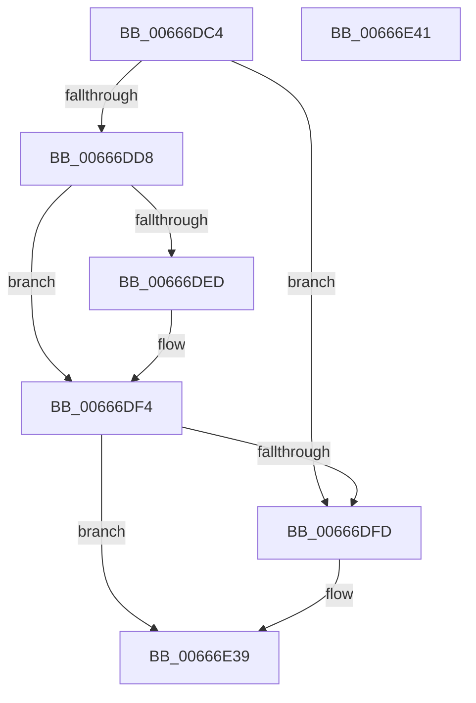

# PrExtLogToTelemetry

- RVA: `0x00666DC4`–`0x00666E42` (길이 `126` bytes)
- VA: `0x0000000140666DC4`
- 실행 섹션: `.text`
- PDB 이름 있음: `예`; PDB Function 태그: `아니요`
- unwind 정보 RVA: `0x00071A74`
- 디코드: `30`개 명령, `126/126` bytes 표시
- 미해석 바이트: `0` (있으면 어셈블리에 `.byte`로 보존)

> 이 문서는 커널 이미지의 기계어와 PDB 기호를 분석해 생성했습니다. 4번과 5번은 함수 원형과 자료형을 바이너리 사용 방식에서 추정한 C 해석이며 원본 소스 복구 결과는 아닙니다.

## 1. Dependencies

- 직접 호출 지점: **2**; 고유 호출 대상: **2**
- 직접 호출자로 확인된 함수: **1**
- RIP 상대 이미지 참조: **7**

### Outgoing calls
- `0x00666DE4` → [TraceLoggingRegisterEx_EtwRegister_EtwSetInformation](../../page/92/TraceLoggingRegisterEx_EtwRegister_EtwSetInformation_function_009208A0.md) (function, `0x009208A0`)
- `0x00666E32` → [PrpWriteTraceLoggingEvent](PrpWriteTraceLoggingEvent_function_0066774C.md) (function, `0x0066774C`)

### Direct callers
- [HalpProcInitSystem](../../pagelk/B5/HalpProcInitSystem_function_00B5D440.md) at `0x00B5D48D`

### Static image references
- `0x00666DCA` → RVA `0x00EF7CCE` (`.data`; read)
- `0x00666DDB` → RVA `0x00E09860` (`.data`; read)
- `0x00666DED` → RVA `0x00EF7CCE` (`.data`; write)
- `0x00666DFD` → RVA `0x00EF7CA0` (`.data`; read)
- `0x00666E04` → RVA `0x00EF7CC8` (`.data`; read)
- `0x00666E0F` → RVA `0x00EF7CB0` (`.data`; read)
- `0x00666E1F` → RVA `0x00EF7CC0` (`.data`; read)

## 2. Other-region calls and transfers

- 다른 실행 섹션으로 향하는 call: **1**
  - `0x00666DE4` → [TraceLoggingRegisterEx_EtwRegister_EtwSetInformation](../../page/92/TraceLoggingRegisterEx_EtwRegister_EtwSetInformation_function_009208A0.md) (`.text` → `PAGE`)
- 별도 외부 분기/꼬리 이동을 확인하지 못했습니다.

## 3. Assembly (complete function range)

```asm
00666DC4  40 53                           push rbx
00666DC6  48 83 EC 50                     sub rsp, 0x50
00666DCA  80 3D FD 0E 89 00 00            cmp byte ptr [rip + 0x890efd], 0
00666DD1  BB BB 00 00 C0                  mov ebx, 0xc00000bb
00666DD6  75 25                           jne 0x140666dfd
00666DD8  45 33 C0                        xor r8d, r8d
00666DDB  48 8D 0D 7E 2A 7A 00            lea rcx, [rip + 0x7a2a7e]
00666DE2  33 D2                           xor edx, edx
00666DE4  E8 B7 9A 2B 00                  call 0x1409208a0
00666DE9  85 C0                           test eax, eax
00666DEB  78 07                           js 0x140666df4
00666DED  C6 05 DA 0E 89 00 01            mov byte ptr [rip + 0x890eda], 1
00666DF4  80 3D D3 0E 89 00 00            cmp byte ptr [rip + 0x890ed3], 0
00666DFB  74 3C                           je 0x140666e39
00666DFD  0F 10 05 9C 0E 89 00            movups xmm0, xmmword ptr [rip + 0x890e9c]
00666E04  8B 05 BE 0E 89 00               mov eax, dword ptr [rip + 0x890ebe]
00666E0A  48 8D 4C 24 20                  lea rcx, [rsp + 0x20]
00666E0F  0F 10 0D 9A 0E 89 00            movups xmm1, xmmword ptr [rip + 0x890e9a]
00666E16  89 44 24 48                     mov dword ptr [rsp + 0x48], eax
00666E1A  0F 29 44 24 20                  movaps xmmword ptr [rsp + 0x20], xmm0
00666E1F  F2 0F 10 05 99 0E 89 00         movsd xmm0, qword ptr [rip + 0x890e99]
00666E27  F2 0F 11 44 24 40               movsd qword ptr [rsp + 0x40], xmm0
00666E2D  0F 29 4C 24 30                  movaps xmmword ptr [rsp + 0x30], xmm1
00666E32  E8 15 09 00 00                  call 0x14066774c
00666E37  33 DB                           xor ebx, ebx
00666E39  8B C3                           mov eax, ebx
00666E3B  48 83 C4 50                     add rsp, 0x50
00666E3F  5B                              pop rbx
00666E40  C3                              ret
00666E41  CC                              int3
```

## 4. C-style interpretation (structured pseudocode)

```c
__int64 __fastcall PrExtLogToTelemetry(__int64 a1, int a2, int a3)
{
    __int64 result;
    __int64 v_rbx;
    __int64 v_rsp;
    unsigned int v_stack_m10;
    unsigned __int64 v_stack_m18;
    unsigned __int64 v_stack_m28;
    unsigned __int64 v_stack_m38;

    v_rsp = (v_rsp) - (80);
    if ((*(unsigned __int8 *)(v_rip + 8982269)) != 0) goto loc_00666DFD;
    a3 = 0;
    a2 = 0;
    result = TraceLoggingRegisterEx_EtwRegister_EtwSetInformation(v_rip + 8006270, a2, a3, a4);
    if (!(sign_flag)) {
        *(unsigned __int8 *)(v_rip + 8982234) = 1;
    }
    v_rbx = (unsigned int)(0xC00000BBULL);
    if ((*(unsigned __int8 *)(v_rip + 8982227)) != 0) {
        result = *(unsigned int *)(v_rip + 8982206);
        a1 = v_stack_m38;
        v_stack_m10 = (unsigned int)(result);
        v_stack_m38 = v_xmm0;
        v_stack_m18 = v_xmm0;
        v_stack_m28 = v_xmm1;
        result = PrpWriteTraceLoggingEvent(a1, a2, a3, a4);
        v_rbx = 0;
    }
    v_rsp = (v_rsp) + (80);
    return 0;
}
```

## 5. (Beta) C Style

```c
int64_t PrExtLogToTelemetry(int64_t Arg1, int32_t Arg2, int32_t Arg3)
{
    int64_t result;
    int64_t local_rbx;
    int64_t local_rsp;
    uint32_t v_stack_m10;
    uint64_t v_stack_m18;
    uint64_t v_stack_m28;
    uint64_t v_stack_m38;

    local_rsp = (local_rsp) - (80);
    if ((*(uint8_t *)(v_rip + 0x890EFD)) != 0) goto loc_00666DFD;
    Arg3 = 0;
    Arg2 = 0;
    result = TraceLoggingRegisterEx_EtwRegister_EtwSetInformation(v_rip + 8006270, Arg2, Arg3, a4);
    if (!(sign_flag)) {
        *(uint8_t *)(v_rip + 0x890EDA) = 1;
    }
    local_rbx = (uint32_t)(0xC00000BBULL);
    if ((*(uint8_t *)(v_rip + 0x890ED3)) != 0) {
        result = *(uint32_t *)(v_rip + 0x890EBE);
        Arg1 = v_stack_m38;
        v_stack_m10 = (uint32_t)(result);
        v_stack_m38 = v_xmm0;
        v_stack_m18 = v_xmm0;
        v_stack_m28 = v_xmm1;
        result = PrpWriteTraceLoggingEvent(Arg1, Arg2, Arg3, a4);
        local_rbx = 0;
    }
    local_rsp = (local_rsp) + (80);
    return 0;
}
```

## 6. Execution-region graph

[열기: 2D/3D 그래프와 함수 탐색 컨트롤 패널](../../../control-panel.html?section=text&rva=0x00666DC4&view=graph)

- 2D 그래프는 위에서 아래로 흐르고, 3D 그래프는 빈 공간을 드래그해 회전합니다. Shift+드래그는 이동, 휠은 확대·축소, 함수 노드 선택은 대상 보고서 이동입니다.

### Static fallback


