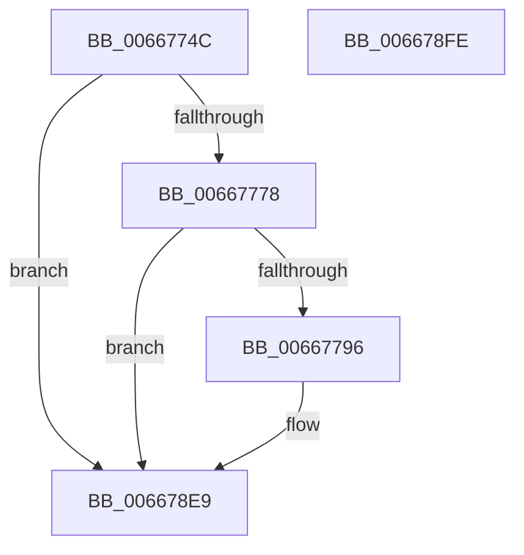

# PrpWriteTraceLoggingEvent

- RVA: `0x0066774C`–`0x006678FF` (길이 `435` bytes)
- VA: `0x000000014066774C`
- 실행 섹션: `.text`
- PDB 이름 있음: `예`; PDB Function 태그: `아니요`
- unwind 정보 RVA: `0x000C6E18`
- 디코드: `87`개 명령, `435/435` bytes 표시
- 미해석 바이트: `0` (있으면 어셈블리에 `.byte`로 보존)

> 이 문서는 커널 이미지의 기계어와 PDB 기호를 분석해 생성했습니다. 4번과 5번은 함수 원형과 자료형을 바이너리 사용 방식에서 추정한 C 해석이며 원본 소스 복구 결과는 아닙니다.

## 1. Dependencies

- 직접 호출 지점: **3**; 고유 호출 대상: **3**
- 직접 호출자로 확인된 함수: **1**
- RIP 상대 이미지 참조: **3**

### Outgoing calls
- `0x00667789` → [tlgKeywordOn](../42/tlgKeywordOn_function_0042EAA0.md) (function, `0x0042EAA0`)
- `0x006678E4` → [tlgWriteTransfer_EtwWriteTransfer](../42/tlgWriteTransfer_EtwWriteTransfer_function_004260E0.md) (function, `0x004260E0`)
- `0x006678F0` → [_security_check_cookie](../6A/_security_check_cookie_function_006AC640.md) (function, `0x006AC640`)

### Direct callers
- [PrExtLogToTelemetry](PrExtLogToTelemetry_function_00666DC4.md) at `0x00666E32`

### Static image references
- `0x0066775A` → RVA `0x00E0A740` (`.data`; read)
- `0x00667768` → RVA `0x00E09860` (`.data`; read)
- `0x006677A2` → RVA `0x00055E03` (`.rdata`; read)

## 2. Other-region calls and transfers

- 다른 실행 섹션으로 향하는 call: **0**
- 별도 외부 분기/꼬리 이동을 확인하지 못했습니다.

## 3. Assembly (complete function range)

```asm
0066774C  40 55                           push rbp
0066774E  48 8D 6C 24 A0                  lea rbp, [rsp - 0x60]
00667753  48 81 EC 60 01 00 00            sub rsp, 0x160
0066775A  48 8B 05 DF 2F 7A 00            mov rax, qword ptr [rip + 0x7a2fdf]
00667761  48 33 C4                        xor rax, rsp
00667764  48 89 45 50                     mov qword ptr [rbp + 0x50], rax
00667768  83 3D F1 20 7A 00 05            cmp dword ptr [rip + 0x7a20f1], 5
0066776F  4C 8B C1                        mov r8, rcx
00667772  0F 86 71 01 00 00               jbe 0x1406678e9
00667778  48 BA 00 00 00 00 00 80 00 00   movabs rdx, 0x800000000000
00667782  48 8D 0D D7 20 7A 00            lea rcx, [rip + 0x7a20d7]
00667789  E8 12 73 DC FF                  call 0x14042eaa0
0066778E  84 C0                           test al, al
00667790  0F 84 53 01 00 00               je 0x1406678e9
00667796  41 8B 00                        mov eax, dword ptr [r8]
00667799  48 8D 4C 24 44                  lea rcx, [rsp + 0x44]
0066779E  89 44 24 34                     mov dword ptr [rsp + 0x34], eax
006677A2  48 8D 15 5A E6 9E FF            lea rdx, [rip - 0x6119a6]
006677A9  48 8D 44 24 34                  lea rax, [rsp + 0x34]
006677AE  48 89 4D D0                     mov qword ptr [rbp - 0x30], rcx
006677B2  48 89 45 90                     mov qword ptr [rbp - 0x70], rax
006677B6  48 8D 0D A3 20 7A 00            lea rcx, [rip + 0x7a20a3]
006677BD  41 8B 40 04                     mov eax, dword ptr [r8 + 4]
006677C1  45 33 C9                        xor r9d, r9d
006677C4  89 44 24 38                     mov dword ptr [rsp + 0x38], eax
006677C8  48 8D 44 24 38                  lea rax, [rsp + 0x38]
006677CD  48 89 45 A0                     mov qword ptr [rbp - 0x60], rax
006677D1  41 8B 40 08                     mov eax, dword ptr [r8 + 8]
006677D5  89 44 24 3C                     mov dword ptr [rsp + 0x3c], eax
006677D9  48 8D 44 24 3C                  lea rax, [rsp + 0x3c]
006677DE  48 89 45 B0                     mov qword ptr [rbp - 0x50], rax
006677E2  41 8B 40 0C                     mov eax, dword ptr [r8 + 0xc]
006677E6  89 44 24 40                     mov dword ptr [rsp + 0x40], eax
006677EA  48 8D 44 24 40                  lea rax, [rsp + 0x40]
006677EF  48 89 45 C0                     mov qword ptr [rbp - 0x40], rax
006677F3  41 8B 40 14                     mov eax, dword ptr [r8 + 0x14]
006677F7  89 44 24 44                     mov dword ptr [rsp + 0x44], eax
006677FB  89 44 24 48                     mov dword ptr [rsp + 0x48], eax
006677FF  48 8D 44 24 48                  lea rax, [rsp + 0x48]
00667804  48 89 45 E0                     mov qword ptr [rbp - 0x20], rax
00667808  41 8B 40 18                     mov eax, dword ptr [r8 + 0x18]
0066780C  89 44 24 4C                     mov dword ptr [rsp + 0x4c], eax
00667810  48 8D 44 24 4C                  lea rax, [rsp + 0x4c]
00667815  48 89 45 F0                     mov qword ptr [rbp - 0x10], rax
00667819  41 8B 40 1C                     mov eax, dword ptr [r8 + 0x1c]
0066781D  89 44 24 50                     mov dword ptr [rsp + 0x50], eax
00667821  48 8D 44 24 50                  lea rax, [rsp + 0x50]
00667826  48 89 45 00                     mov qword ptr [rbp], rax
0066782A  41 8A 40 20                     mov al, byte ptr [r8 + 0x20]
0066782E  88 44 24 30                     mov byte ptr [rsp + 0x30], al
00667832  48 8D 44 24 30                  lea rax, [rsp + 0x30]
00667837  48 89 45 10                     mov qword ptr [rbp + 0x10], rax
0066783B  41 8B 40 24                     mov eax, dword ptr [r8 + 0x24]
0066783F  89 44 24 54                     mov dword ptr [rsp + 0x54], eax
00667843  48 8D 44 24 54                  lea rax, [rsp + 0x54]
00667848  48 89 45 20                     mov qword ptr [rbp + 0x20], rax
0066784C  41 8B 40 28                     mov eax, dword ptr [r8 + 0x28]
00667850  45 33 C0                        xor r8d, r8d
00667853  89 44 24 58                     mov dword ptr [rsp + 0x58], eax
00667857  48 8D 44 24 58                  lea rax, [rsp + 0x58]
0066785C  48 89 45 30                     mov qword ptr [rbp + 0x30], rax
00667860  48 8D 44 24 60                  lea rax, [rsp + 0x60]
00667865  48 89 45 40                     mov qword ptr [rbp + 0x40], rax
00667869  48 8D 44 24 70                  lea rax, [rsp + 0x70]
0066786E  48 89 44 24 28                  mov qword ptr [rsp + 0x28], rax
00667873  C7 44 24 20 0E 00 00 00         mov dword ptr [rsp + 0x20], 0xe
0066787B  48 C7 45 98 04 00 00 00         mov qword ptr [rbp - 0x68], 4
00667883  48 C7 45 A8 04 00 00 00         mov qword ptr [rbp - 0x58], 4
0066788B  48 C7 45 B8 04 00 00 00         mov qword ptr [rbp - 0x48], 4
00667893  48 C7 45 C8 04 00 00 00         mov qword ptr [rbp - 0x38], 4
0066789B  48 C7 45 D8 04 00 00 00         mov qword ptr [rbp - 0x28], 4
006678A3  48 C7 45 E8 04 00 00 00         mov qword ptr [rbp - 0x18], 4
006678AB  48 C7 45 F8 04 00 00 00         mov qword ptr [rbp - 8], 4
006678B3  48 C7 45 08 04 00 00 00         mov qword ptr [rbp + 8], 4
006678BB  48 C7 45 18 01 00 00 00         mov qword ptr [rbp + 0x18], 1
006678C3  48 C7 45 28 04 00 00 00         mov qword ptr [rbp + 0x28], 4
006678CB  48 C7 45 38 04 00 00 00         mov qword ptr [rbp + 0x38], 4
006678D3  48 C7 44 24 60 00 00 00 02      mov qword ptr [rsp + 0x60], 0x2000000
006678DC  48 C7 45 48 08 00 00 00         mov qword ptr [rbp + 0x48], 8
006678E4  E8 F7 E7 DB FF                  call 0x1404260e0
006678E9  48 8B 4D 50                     mov rcx, qword ptr [rbp + 0x50]
006678ED  48 33 CC                        xor rcx, rsp
006678F0  E8 4B 4D 04 00                  call 0x1406ac640
006678F5  48 81 C4 60 01 00 00            add rsp, 0x160
006678FC  5D                              pop rbp
006678FD  C3                              ret
006678FE  CC                              int3
```

## 4. C-style interpretation (structured pseudocode)

```c
__int64 __fastcall PrpWriteTraceLoggingEvent(__int64 a1, __int64 a2, __int64 a3, int a4)
{
    __int64 result;
    __int64 v_rsp;
    unsigned __int64 v_stack_m108;
    unsigned int v_stack_m110;
    unsigned int v_stack_m114;
    unsigned int v_stack_m118;
    unsigned int v_stack_m11C;
    unsigned int v_stack_m120;
    unsigned __int64 v_stack_m124;
    unsigned int v_stack_m128;
    unsigned int v_stack_m12C;
    unsigned int v_stack_m130;
    unsigned int v_stack_m134;
    unsigned __int8 v_stack_m138;
    unsigned __int64 v_stack_m140;
    unsigned int v_stack_m148;
    unsigned __int64 v_stack_m18;
    unsigned __int64 v_stack_m20;
    unsigned __int64 v_stack_m28;
    unsigned __int64 v_stack_m30;
    unsigned __int64 v_stack_m38;
    unsigned __int64 v_stack_m40;
    unsigned __int64 v_stack_m48;
    unsigned __int64 v_stack_m50;
    unsigned __int64 v_stack_m58;
    unsigned __int64 v_stack_m60;
    unsigned __int64 v_stack_m68;
    unsigned __int64 v_stack_m70;
    unsigned __int64 v_stack_m78;
    unsigned __int64 v_stack_m80;
    unsigned __int64 v_stack_m88;
    unsigned __int64 v_stack_m90;
    unsigned __int64 v_stack_m98;
    unsigned __int64 v_stack_mA0;
    unsigned __int64 v_stack_mA8;
    unsigned __int64 v_stack_mB0;
    unsigned __int64 v_stack_mB8;
    unsigned __int64 v_stack_mC0;
    unsigned __int64 v_stack_mC8;
    unsigned __int64 v_stack_mD0;
    unsigned __int64 v_stack_mD8;
    unsigned __int64 v_stack_mF8;

    v_rsp = (v_rsp) - (352);
    result = (*(unsigned __int64 *)(v_rip + 8007647)) ^ (v_rsp);
    v_stack_m18 = result;
    if ((*(unsigned int *)(v_rip + 8003825)) <= 5) goto loc_006678E9;
    result = tlgKeywordOn(v_rip + 8003799, a2, a1, a4);
    if ((unsigned __int8)(result) != 0) {
        result = *(unsigned int *)(a1);
        a1 = v_stack_m124;
        v_stack_m134 = (unsigned int)(result);
        a2 = v_rip - 6363558;
        result = v_stack_m134;
        v_stack_m98 = a1;
        v_stack_mD8 = result;
        a1 = v_rip + 8003747;
        result = *(unsigned int *)(a1 + 4);
        a4 = 0;
        v_stack_m130 = (unsigned int)(result);
        result = v_stack_m130;
        v_stack_mC8 = result;
        result = *(unsigned int *)(a1 + 8);
        v_stack_m12C = (unsigned int)(result);
        result = v_stack_m12C;
        v_stack_mB8 = result;
        result = *(unsigned int *)(a1 + 12);
        v_stack_m128 = (unsigned int)(result);
        result = v_stack_m128;
        v_stack_mA8 = result;
        result = *(unsigned int *)(a1 + 20);
        v_stack_m124 = (unsigned int)(result);
        v_stack_m120 = (unsigned int)(result);
        result = v_stack_m120;
        v_stack_m88 = result;
        result = *(unsigned int *)(a1 + 24);
        v_stack_m11C = (unsigned int)(result);
        result = v_stack_m11C;
        v_stack_m78 = result;
        result = *(unsigned int *)(a1 + 28);
        v_stack_m118 = (unsigned int)(result);
        result = v_stack_m118;
        v_stack_m68 = result;
        result = *(unsigned __int8 *)(a1 + 32);
        v_stack_m138 = (unsigned __int8)(result);
        result = v_stack_m138;
        v_stack_m58 = result;
        result = *(unsigned int *)(a1 + 36);
        v_stack_m114 = (unsigned int)(result);
        result = v_stack_m114;
        v_stack_m48 = result;
        result = *(unsigned int *)(a1 + 40);
        a3 = 0;
        v_stack_m110 = (unsigned int)(result);
        result = v_stack_m110;
        v_stack_m38 = result;
        result = v_stack_m108;
        v_stack_m28 = result;
        result = v_stack_mF8;
        v_stack_m140 = result;
        v_stack_m148 = 14;
        v_stack_mD0 = 4;
        v_stack_mC0 = 4;
        v_stack_mB0 = 4;
        v_stack_mA0 = 4;
        v_stack_m90 = 4;
        v_stack_m80 = 4;
        v_stack_m70 = 4;
        v_stack_m60 = 4;
        v_stack_m50 = 1;
        v_stack_m40 = 4;
        v_stack_m30 = 4;
        v_stack_m108 = 0x2000000ULL;
        v_stack_m20 = 8;
        result = tlgWriteTransfer_EtwWriteTransfer(a1, a2, a3, a4);
    }
    a1 = (v_stack_m18) ^ (v_rsp);
    result = _security_check_cookie(a1, a2, a3, a4);
    v_rsp = (v_rsp) + (352);
    return result;
}
```

## 5. (Beta) C Style

```c
int64_t PrpWriteTraceLoggingEvent(int64_t Arg1, int64_t Arg2, int64_t Arg3, int32_t Arg4)
{
    int64_t result;
    int64_t local_rsp;
    uint64_t v_stack_m108;
    uint32_t v_stack_m110;
    uint32_t v_stack_m114;
    uint32_t v_stack_m118;
    uint32_t v_stack_m11C;
    uint32_t v_stack_m120;
    uint64_t v_stack_m124;
    uint32_t v_stack_m128;
    uint32_t v_stack_m12C;
    uint32_t v_stack_m130;
    uint32_t v_stack_m134;
    uint8_t v_stack_m138;
    uint64_t v_stack_m140;
    uint32_t v_stack_m148;
    uint64_t v_stack_m18;
    uint64_t v_stack_m20;
    uint64_t v_stack_m28;
    uint64_t v_stack_m30;
    uint64_t v_stack_m38;
    uint64_t v_stack_m40;
    uint64_t v_stack_m48;
    uint64_t v_stack_m50;
    uint64_t v_stack_m58;
    uint64_t v_stack_m60;
    uint64_t v_stack_m68;
    uint64_t v_stack_m70;
    uint64_t v_stack_m78;
    uint64_t v_stack_m80;
    uint64_t v_stack_m88;
    uint64_t v_stack_m90;
    uint64_t v_stack_m98;
    uint64_t v_stack_mA0;
    uint64_t v_stack_mA8;
    uint64_t v_stack_mB0;
    uint64_t v_stack_mB8;
    uint64_t v_stack_mC0;
    uint64_t v_stack_mC8;
    uint64_t v_stack_mD0;
    uint64_t v_stack_mD8;
    uint64_t v_stack_mF8;

    local_rsp = (local_rsp) - (352);
    result = (*(uint64_t *)(v_rip + 0x7A2FDF)) ^ (local_rsp);
    v_stack_m18 = result;
    if ((*(uint32_t *)(v_rip + 0x7A20F1)) <= 5) goto loc_006678E9;
    result = tlgKeywordOn(v_rip + 8003799, Arg2, Arg1, Arg4);
    if ((uint8_t)(result) != 0) {
        result = *(uint32_t *)(Arg1);
        Arg1 = v_stack_m124;
        v_stack_m134 = (uint32_t)(result);
        Arg2 = v_rip - 6363558;
        result = v_stack_m134;
        v_stack_m98 = Arg1;
        v_stack_mD8 = result;
        Arg1 = v_rip + 8003747;
        result = *(uint32_t *)(Arg1 + 0x4);
        Arg4 = 0;
        v_stack_m130 = (uint32_t)(result);
        result = v_stack_m130;
        v_stack_mC8 = result;
        result = *(uint32_t *)(Arg1 + 0x8);
        v_stack_m12C = (uint32_t)(result);
        result = v_stack_m12C;
        v_stack_mB8 = result;
        result = *(uint32_t *)(Arg1 + 0xC);
        v_stack_m128 = (uint32_t)(result);
        result = v_stack_m128;
        v_stack_mA8 = result;
        result = *(uint32_t *)(Arg1 + 0x14);
        v_stack_m124 = (uint32_t)(result);
        v_stack_m120 = (uint32_t)(result);
        result = v_stack_m120;
        v_stack_m88 = result;
        result = *(uint32_t *)(Arg1 + 0x18);
        v_stack_m11C = (uint32_t)(result);
        result = v_stack_m11C;
        v_stack_m78 = result;
        result = *(uint32_t *)(Arg1 + 0x1C);
        v_stack_m118 = (uint32_t)(result);
        result = v_stack_m118;
        v_stack_m68 = result;
        result = *(uint8_t *)(Arg1 + 0x20);
        v_stack_m138 = (uint8_t)(result);
        result = v_stack_m138;
        v_stack_m58 = result;
        result = *(uint32_t *)(Arg1 + 0x24);
        v_stack_m114 = (uint32_t)(result);
        result = v_stack_m114;
        v_stack_m48 = result;
        result = *(uint32_t *)(Arg1 + 0x28);
        Arg3 = 0;
        v_stack_m110 = (uint32_t)(result);
        result = v_stack_m110;
        v_stack_m38 = result;
        result = v_stack_m108;
        v_stack_m28 = result;
        result = v_stack_mF8;
        v_stack_m140 = result;
        v_stack_m148 = 14;
        v_stack_mD0 = 4;
        v_stack_mC0 = 4;
        v_stack_mB0 = 4;
        v_stack_mA0 = 4;
        v_stack_m90 = 4;
        v_stack_m80 = 4;
        v_stack_m70 = 4;
        v_stack_m60 = 4;
        v_stack_m50 = 1;
        v_stack_m40 = 4;
        v_stack_m30 = 4;
        v_stack_m108 = 0x2000000ULL;
        v_stack_m20 = 8;
        result = tlgWriteTransfer_EtwWriteTransfer(Arg1, Arg2, Arg3, Arg4);
    }
    Arg1 = (v_stack_m18) ^ (local_rsp);
    result = _security_check_cookie(Arg1, Arg2, Arg3, Arg4);
    local_rsp = (local_rsp) + (352);
    return result;
}
```

## 6. Execution-region graph

[열기: 2D/3D 그래프와 함수 탐색 컨트롤 패널](../../../control-panel.html?section=text&rva=0x0066774C&view=graph)

- 2D 그래프는 위에서 아래로 흐르고, 3D 그래프는 빈 공간을 드래그해 회전합니다. Shift+드래그는 이동, 휠은 확대·축소, 함수 노드 선택은 대상 보고서 이동입니다.

### Static fallback


