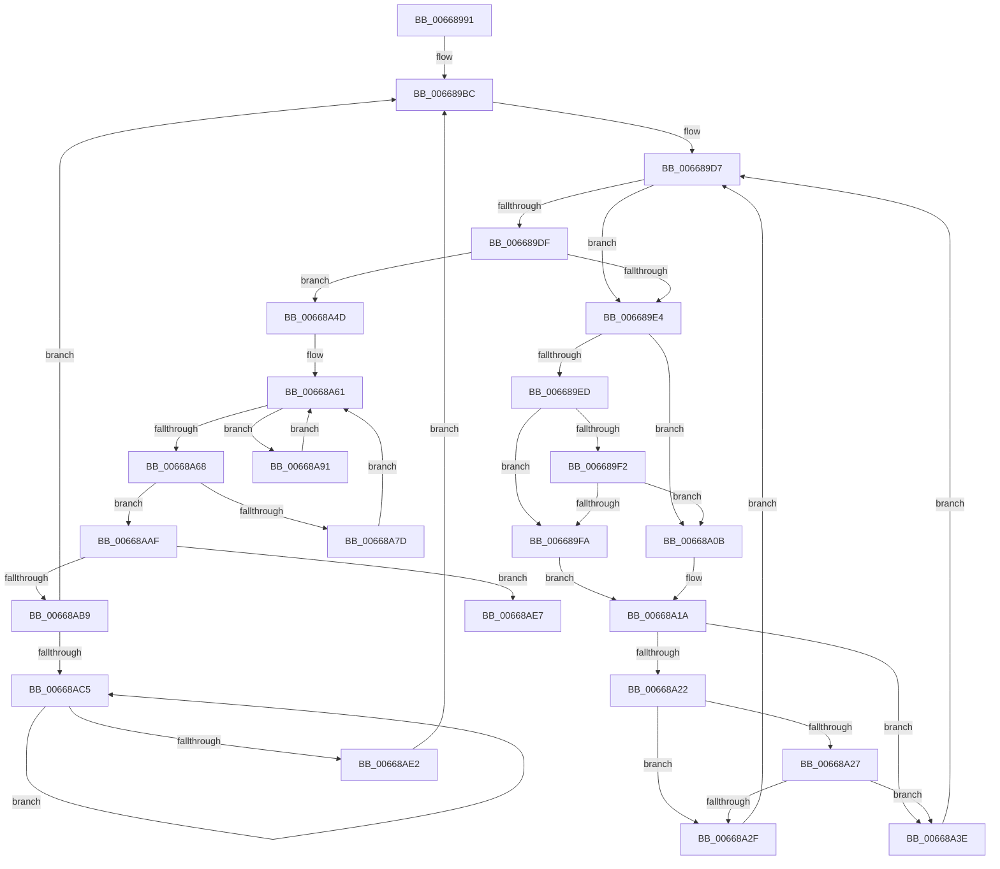

# sub_00668991

- RVA: `0x00668991`–`0x00668B02` (길이 `369` bytes)
- VA: `0x0000000140668991`
- 실행 섹션: `.text`
- PDB 이름 있음: `아니요`; PDB Function 태그: `아니요`
- unwind 정보 RVA: `0x000D6288`
- 디코드: `105`개 명령, `369/369` bytes 표시
- 미해석 바이트: `0` (있으면 어셈블리에 `.byte`로 보존)

> 이 문서는 커널 이미지의 기계어와 PDB 기호를 분석해 생성했습니다. 4번과 5번은 함수 원형과 자료형을 바이너리 사용 방식에서 추정한 C 해석이며 원본 소스 복구 결과는 아닙니다.

## 1. Dependencies

- 직접 호출 지점: **1**; 고유 호출 대상: **1**
- 직접 호출자로 확인된 함수: **0**
- RIP 상대 이미지 참조: **1**

### Outgoing calls
- `0x006689B3` → [qsort](../50/qsort_function_005009F0.md) (function, `0x005009F0`)

### Direct callers
- 이 함수 시작 RVA로 연결되는 직접 call은 확인되지 않았습니다. 간접 호출은 완전히 역산할 수 없습니다.

### Static image references
- `0x00668996` → RVA `0x00668B70` (`AccelpCodeSort`; read)

## 2. Other-region calls and transfers

- 다른 실행 섹션으로 향하는 call: **0**
- call이 아닌 외부 분기/꼬리 이동: **1**
  - `0x00668B00` → [sub_00668B02 + 0x58](Unknown_function_00668B02.md) (`tail-transfer`)

## 3. Assembly (complete function range)

```asm
00668991  48 89 6C 24 40                  mov qword ptr [rsp + 0x40], rbp
00668996  4C 8D 0D D3 01 00 00            lea r9, [rip + 0x1d3]
0066899D  4C 89 74 24 48                  mov qword ptr [rsp + 0x48], r14
006689A2  41 B8 18 00 00 00               mov r8d, 0x18
006689A8  48 8B D6                        mov rdx, rsi
006689AB  4C 89 7C 24 50                  mov qword ptr [rsp + 0x50], r15
006689B0  48 8B CB                        mov rcx, rbx
006689B3  E8 38 80 E9 FF                  call 0x1405009f0
006689B8  48 8D 73 18                     lea rsi, [rbx + 0x18]
006689BC  48 89 5F 08                     mov qword ptr [rdi + 8], rbx
006689C0  48 8D 53 30                     lea rdx, [rbx + 0x30]
006689C4  48 89 77 10                     mov qword ptr [rdi + 0x10], rsi
006689C8  48 8B CF                        mov rcx, rdi
006689CB  48 8B 06                        mov rax, qword ptr [rsi]
006689CE  4C 8B C7                        mov r8, rdi
006689D1  48 03 03                        add rax, qword ptr [rbx]
006689D4  48 89 07                        mov qword ptr [rdi], rax
006689D7  4C 8B C9                        mov r9, rcx
006689DA  48 3B D7                        cmp rdx, rdi
006689DD  75 05                           jne 0x1406689e4
006689DF  4C 3B C1                        cmp r8, rcx
006689E2  74 69                           je 0x140668a4d
006689E4  48 83 C1 18                     add rcx, 0x18
006689E8  48 3B D7                        cmp rdx, rdi
006689EB  74 1E                           je 0x140668a0b
006689ED  4C 3B C1                        cmp r8, rcx
006689F0  73 08                           jae 0x1406689fa
006689F2  48 8B 02                        mov rax, qword ptr [rdx]
006689F5  49 39 00                        cmp qword ptr [r8], rax
006689F8  72 11                           jb 0x140668a0b
006689FA  48 89 51 08                     mov qword ptr [rcx + 8], rdx
006689FE  4C 8D 49 10                     lea r9, [rcx + 0x10]
00668A02  48 8B 02                        mov rax, qword ptr [rdx]
00668A05  48 83 C2 18                     add rdx, 0x18
00668A09  EB 0F                           jmp 0x140668a1a
00668A0B  49 83 C1 28                     add r9, 0x28
00668A0F  4D 89 41 F8                     mov qword ptr [r9 - 8], r8
00668A13  49 8B 00                        mov rax, qword ptr [r8]
00668A16  49 83 C0 18                     add r8, 0x18
00668A1A  48 89 01                        mov qword ptr [rcx], rax
00668A1D  48 3B D7                        cmp rdx, rdi
00668A20  74 1C                           je 0x140668a3e
00668A22  4C 3B C1                        cmp r8, rcx
00668A25  73 08                           jae 0x140668a2f
00668A27  48 8B 02                        mov rax, qword ptr [rdx]
00668A2A  49 39 00                        cmp qword ptr [r8], rax
00668A2D  72 0F                           jb 0x140668a3e
00668A2F  49 89 11                        mov qword ptr [r9], rdx
00668A32  48 8B 02                        mov rax, qword ptr [rdx]
00668A35  48 01 01                        add qword ptr [rcx], rax
00668A38  48 83 C2 18                     add rdx, 0x18
00668A3C  EB 99                           jmp 0x1406689d7
00668A3E  4D 89 01                        mov qword ptr [r9], r8
00668A41  49 8B 00                        mov rax, qword ptr [r8]
00668A44  48 01 01                        add qword ptr [rcx], rax
00668A47  49 83 C0 18                     add r8, 0x18
00668A4B  EB 8A                           jmp 0x1406689d7
00668A4D  45 33 C9                        xor r9d, r9d
00668A50  48 8D 93 18 30 00 00            lea rdx, [rbx + 0x3018]
00668A57  45 33 D2                        xor r10d, r10d
00668A5A  4C 8D 83 20 30 00 00            lea r8, [rbx + 0x3020]
00668A61  48 83 79 08 00                  cmp qword ptr [rcx + 8], 0
00668A66  75 29                           jne 0x140668a91
00668A68  48 8B 41 10                     mov rax, qword ptr [rcx + 0x10]
00668A6C  4C 89 49 08                     mov qword ptr [rcx + 8], r9
00668A70  44 88 8C 03 48 3A 00 00         mov byte ptr [rbx + rax + 0x3a48], r9b
00668A78  4D 85 D2                        test r10, r10
00668A7B  74 32                           je 0x140668aaf
00668A7D  48 8B 4A F0                     mov rcx, qword ptr [rdx - 0x10]
00668A81  49 83 E8 10                     sub r8, 0x10
00668A85  49 FF CA                        dec r10
00668A88  48 83 EA 10                     sub rdx, 0x10
00668A8C  4D 8B 08                        mov r9, qword ptr [r8]
00668A8F  EB D0                           jmp 0x140668a61
00668A91  49 FF C1                        inc r9
00668A94  49 FF C2                        inc r10
00668A97  4D 89 08                        mov qword ptr [r8], r9
00668A9A  49 83 C0 10                     add r8, 0x10
00668A9E  48 8B 41 08                     mov rax, qword ptr [rcx + 8]
00668AA2  48 89 02                        mov qword ptr [rdx], rax
00668AA5  48 83 C2 10                     add rdx, 0x10
00668AA9  48 8B 49 10                     mov rcx, qword ptr [rcx + 0x10]
00668AAD  EB B2                           jmp 0x140668a61
00668AAF  4C 8B 5B 08                     mov r11, qword ptr [rbx + 8]
00668AB3  49 83 FB 0F                     cmp r11, 0xf
00668AB7  76 2E                           jbe 0x140668ae7
00668AB9  48 8B CB                        mov rcx, rbx
00668ABC  48 3B DF                        cmp rbx, rdi
00668ABF  0F 83 F7 FE FF FF               jae 0x1406689bc
00668AC5  48 8B 01                        mov rax, qword ptr [rcx]
00668AC8  48 FF C0                        inc rax
00668ACB  48 C7 41 08 00 00 00 00         mov qword ptr [rcx + 8], 0
00668AD3  48 D1 E8                        shr rax, 1
00668AD6  48 89 01                        mov qword ptr [rcx], rax
00668AD9  48 83 C1 18                     add rcx, 0x18
00668ADD  48 3B CF                        cmp rcx, rdi
00668AE0  72 E3                           jb 0x140668ac5
00668AE2  E9 D5 FE FF FF                  jmp 0x1406689bc
00668AE7  48 8B 57 F0                     mov rdx, qword ptr [rdi - 0x10]
00668AEB  45 33 C9                        xor r9d, r9d
00668AEE  4C 8B 7C 24 50                  mov r15, qword ptr [rsp + 0x50]
00668AF3  4C 8B 74 24 48                  mov r14, qword ptr [rsp + 0x48]
00668AF8  48 8B 6C 24 40                  mov rbp, qword ptr [rsp + 0x40]
00668AFD  49 3B D3                        cmp rdx, r11
00668B00  77 58                           ja 0x140668b5a
```

## 4. C-style interpretation (structured pseudocode)

```c
__int64 __fastcall sub_00668991(__int64 a1, __int64 a2, __int64 a3, __int64 a4, __int64 a5, __int64 a6, __int64 a7, __int64 a8, __int64 a9, __int64 a10)
{
    __int64 result;
    __int64 v_r10;
    unsigned __int64 v_stack_p40;
    unsigned __int64 v_stack_p48;
    unsigned __int64 v_stack_p50;

    v_stack_p40 = v_rbp;
    v_stack_p48 = v_r14;
    v_stack_p50 = v_r15;
    result = qsort(v_rbx, v_rsi, 24, v_rip + 467);
loc_006689BC:
    *(unsigned __int64 *)(v_rdi + 8) = v_rbx;
    *(unsigned __int64 *)(v_rdi + 16) = v_rbx + 24;
    result = (*(unsigned __int64 *)(v_rbx + 24)) + (*(unsigned __int64 *)(v_rbx));
    *(unsigned __int64 *)(v_rdi) = result;
loc_006689D7:
    if ((v_rbx + 48) != v_rdi) goto loc_006689E4;
    if (v_rdi == v_rdi) goto loc_00668A4D;
loc_006689E4:
    a1 = (v_rdi) + (24);
    if ((v_rbx + 48) == v_rdi) goto loc_00668A0B;
    if (v_rdi >= a1) goto loc_006689FA;
    if ((*(unsigned __int64 *)(v_rdi)) < (*(unsigned __int64 *)(v_rbx + 48))) goto loc_00668A0B;
loc_006689FA:
    *(unsigned __int64 *)(a1 + 8) = v_rbx + 48;
    a2 = (v_rbx + 48) + (24);
    goto loc_00668A1A;
loc_00668A0B:
    a4 = (a1 + 16) + (40);
    *(unsigned __int64 *)(a4 - 8) = v_rdi;
    a3 = (v_rdi) + (24);
loc_00668A1A:
    *(unsigned __int64 *)(a1) = *(unsigned __int64 *)(v_rdi);
    if (a2 == v_rdi) goto loc_00668A3E;
    if (a3 >= a1) goto loc_00668A2F;
    if ((*(unsigned __int64 *)(a3)) < (*(unsigned __int64 *)(a2))) goto loc_00668A3E;
loc_00668A2F:
    *(unsigned __int64 *)(a4) = a2;
    a2 = (a2) + (24);
    goto loc_006689D7;
loc_00668A3E:
    *(unsigned __int64 *)(a4) = a3;
    a3 = (a3) + (24);
    goto loc_006689D7;
loc_00668A4D:
    a4 = 0;
    v_r10 = 0;
loc_00668A61:
    if ((*(unsigned __int64 *)(a1 + 8)) != 0) goto loc_00668A91;
    *(unsigned __int64 *)(a1 + 8) = 0;
    *(unsigned __int8 *)(v_rbx + *(unsigned __int64 *)(a1 + 16) * 1 + 14920) = 0;
    if (0 == 0) goto loc_00668AAF;
    a3 = (v_rbx + 12320) - (16);
    v_r10 = (v_r10) - 1;
    a2 = (v_rbx + 12312) - (16);
    goto loc_00668A61;
loc_00668A91:
    a4 = (*(unsigned __int64 *)(a3)) + 1;
    v_r10 = (v_r10) + 1;
    *(unsigned __int64 *)(a3) = a4;
    a3 = (a3) + (16);
    *(unsigned __int64 *)(a2) = *(unsigned __int64 *)(*(unsigned __int64 *)(v_rbx + 12312 - 16) + 8);
    a2 = (a2) + (16);
    goto loc_00668A61;
loc_00668AAF:
    if ((*(unsigned __int64 *)(v_rbx + 8)) <= 15) goto loc_00668AE7;
    if (v_rbx >= v_rdi) goto loc_006689BC;
loc_00668AC5:
    result = (*(unsigned __int64 *)(v_rbx)) + 1;
    *(unsigned __int64 *)(v_rbx + 8) = 0;
    result = (result) >> (1);
    *(unsigned __int64 *)(v_rbx) = result;
    a1 = (v_rbx) + (24);
    if (a1 < v_rdi) goto loc_00668AC5;
    goto loc_006689BC;
loc_00668AE7:
    a4 = 0;
}
```

## 5. (Beta) C Style

```c
int64_t sub_00668991(int64_t Arg1, int64_t Arg2, int64_t Arg3, int64_t Arg4, uint64_t Arg5, uint64_t Arg6, uint64_t Arg7, int64_t Arg8, int64_t Arg9, int64_t Arg10)
{
    int64_t result;
    int64_t local_r10;
    uint64_t v_stack_p40;
    uint64_t v_stack_p48;
    uint64_t v_stack_p50;

    v_stack_p40 = local_rbp;
    v_stack_p48 = local_r14;
    v_stack_p50 = local_r15;
    result = qsort(local_rbx, local_rsi, 24, v_rip + 467);
loc_006689BC:
    *(uint64_t *)(local_rdi + 0x8) = local_rbx;
    *(uint64_t *)(local_rdi + 0x10) = local_rbx + 24;
    result = (*(uint64_t *)(local_rbx + 0x18)) + (*(uint64_t *)(local_rbx));
    *(uint64_t *)(local_rdi) = result;
loc_006689D7:
    if ((local_rbx + 48) != local_rdi) goto loc_006689E4;
    if (local_rdi == local_rdi) goto loc_00668A4D;
loc_006689E4:
    Arg1 = (local_rdi) + (24);
    if ((local_rbx + 48) == local_rdi) goto loc_00668A0B;
    if (local_rdi >= Arg1) goto loc_006689FA;
    if ((*(uint64_t *)(local_rdi)) < (*(uint64_t *)(local_rbx + 0x30))) goto loc_00668A0B;
loc_006689FA:
    *(uint64_t *)(Arg1 + 0x8) = local_rbx + 48;
    Arg2 = (local_rbx + 48) + (24);
    goto loc_00668A1A;
loc_00668A0B:
    Arg4 = (Arg1 + 16) + (40);
    *(uint64_t *)(Arg4 - 0x8) = local_rdi;
    Arg3 = (local_rdi) + (24);
loc_00668A1A:
    *(uint64_t *)(Arg1) = *(uint64_t *)(local_rdi);
    if (Arg2 == local_rdi) goto loc_00668A3E;
    if (Arg3 >= Arg1) goto loc_00668A2F;
    if ((*(uint64_t *)(Arg3)) < (*(uint64_t *)(Arg2))) goto loc_00668A3E;
loc_00668A2F:
    *(uint64_t *)(Arg4) = Arg2;
    Arg2 = (Arg2) + (24);
    goto loc_006689D7;
loc_00668A3E:
    *(uint64_t *)(Arg4) = Arg3;
    Arg3 = (Arg3) + (24);
    goto loc_006689D7;
loc_00668A4D:
    Arg4 = 0;
    local_r10 = 0;
loc_00668A61:
    if ((*(uint64_t *)(Arg1 + 0x8)) != 0) goto loc_00668A91;
    *(uint64_t *)(Arg1 + 0x8) = 0;
    *(uint8_t *)(local_rbx + *(uint64_t *)(Arg1 + 0x10) * 1 + 0x3A48) = 0;
    if (0 == 0) goto loc_00668AAF;
    Arg3 = (local_rbx + 12320) - (16);
    local_r10 = (local_r10) - 1;
    Arg2 = (local_rbx + 12312) - (16);
    goto loc_00668A61;
loc_00668A91:
    Arg4 = (*(uint64_t *)(Arg3)) + 1;
    local_r10 = (local_r10) + 1;
    *(uint64_t *)(Arg3) = Arg4;
    Arg3 = (Arg3) + (16);
    *(uint64_t *)(Arg2) = *(uint64_t *)(*(uint64_t *)(local_rbx + 0x3018 - 0x10) + 0x8);
    Arg2 = (Arg2) + (16);
    goto loc_00668A61;
loc_00668AAF:
    if ((*(uint64_t *)(local_rbx + 0x8)) <= 15) goto loc_00668AE7;
    if (local_rbx >= local_rdi) goto loc_006689BC;
loc_00668AC5:
    result = (*(uint64_t *)(local_rbx)) + 1;
    *(uint64_t *)(local_rbx + 0x8) = 0;
    result = (result) >> (1);
    *(uint64_t *)(local_rbx) = result;
    Arg1 = (local_rbx) + (24);
    if (Arg1 < local_rdi) goto loc_00668AC5;
    goto loc_006689BC;
loc_00668AE7:
    Arg4 = 0;
}
```

## 6. Execution-region graph

[열기: 2D/3D 그래프와 함수 탐색 컨트롤 패널](../../../control-panel.html?section=text&rva=0x00668991&view=graph)

- 2D 그래프는 위에서 아래로 흐르고, 3D 그래프는 빈 공간을 드래그해 회전합니다. Shift+드래그는 이동, 휠은 확대·축소, 함수 노드 선택은 대상 보고서 이동입니다.

### Static fallback


