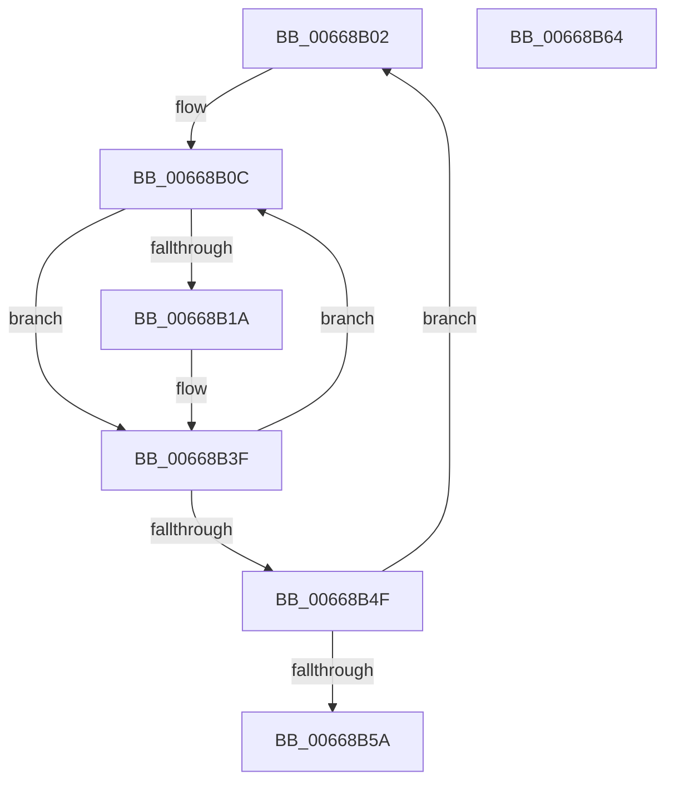

# sub_00668B02

- RVA: `0x00668B02`–`0x00668B65` (길이 `99` bytes)
- VA: `0x0000000140668B02`
- 실행 섹션: `.text`
- PDB 이름 있음: `아니요`; PDB Function 태그: `아니요`
- unwind 정보 RVA: `0x000D62A4`
- 디코드: `32`개 명령, `99/99` bytes 표시
- 미해석 바이트: `0` (있으면 어셈블리에 `.byte`로 보존)

> 이 문서는 커널 이미지의 기계어와 PDB 기호를 분석해 생성했습니다. 4번과 5번은 함수 원형과 자료형을 바이너리 사용 방식에서 추정한 C 해석이며 원본 소스 복구 결과는 아닙니다.

## 1. Dependencies

- 직접 호출 지점: **0**; 고유 호출 대상: **0**
- 직접 호출자로 확인된 함수: **0**
- RIP 상대 이미지 참조: **0**

### Outgoing calls
- 직접 디코드된 call 명령이 없습니다.

### Direct callers
- 이 함수 시작 RVA로 연결되는 직접 call은 확인되지 않았습니다. 간접 호출은 완전히 역산할 수 없습니다.

### Static image references
- 디코드된 RIP-relative 메모리 참조가 없습니다.

## 2. Other-region calls and transfers

- 다른 실행 섹션으로 향하는 call: **0**
- 별도 외부 분기/꼬리 이동을 확인하지 못했습니다.

## 3. Assembly (complete function range)

```asm
00668B02  45 33 C0                        xor r8d, r8d
00668B05  4C 8D 93 48 31 00 00            lea r10, [rbx + 0x3148]
00668B0C  42 0F B6 84 03 48 3A 00 00      movzx eax, byte ptr [rbx + r8 + 0x3a48]
00668B15  48 3B C2                        cmp rax, rdx
00668B18  75 25                           jne 0x140668b3f
00668B1A  41 8B 02                        mov eax, dword ptr [r10]
00668B1D  0F B7 CA                        movzx ecx, dx
00668B20  C1 E1 0F                        shl ecx, 0xf
00668B23  33 C8                           xor ecx, eax
00668B25  81 E1 00 80 07 00               and ecx, 0x78000
00668B2B  33 C8                           xor ecx, eax
00668B2D  41 8B C1                        mov eax, r9d
00668B30  33 C1                           xor eax, ecx
00668B32  25 FF 7F 00 00                  and eax, 0x7fff
00668B37  33 C1                           xor eax, ecx
00668B39  41 89 02                        mov dword ptr [r10], eax
00668B3C  49 FF C1                        inc r9
00668B3F  49 FF C0                        inc r8
00668B42  49 83 C2 04                     add r10, 4
00668B46  49 81 F8 00 01 00 00            cmp r8, 0x100
00668B4D  72 BD                           jb 0x140668b0c
00668B4F  4D 03 C9                        add r9, r9
00668B52  48 FF C2                        inc rdx
00668B55  49 3B D3                        cmp rdx, r11
00668B58  76 A8                           jbe 0x140668b02
00668B5A  33 C0                           xor eax, eax
00668B5C  48 83 C4 20                     add rsp, 0x20
00668B60  5F                              pop rdi
00668B61  5E                              pop rsi
00668B62  5B                              pop rbx
00668B63  C3                              ret
00668B64  CC                              int3
```

## 4. C-style interpretation (structured pseudocode)

```c
__int64 __fastcall sub_00668B02(__int64 a1, __int64 a2, int a3, __int64 a4)
{
    __int64 result;
    __int64 v_r10;
    __int64 v_rsp;

    a3 = 0;
loc_00668B0C:
    result = *(unsigned __int8 *)(v_rbx + a3 * 1 + 14920);
    if ((*(unsigned __int8 *)(v_rbx + a3 * 1 + 14920)) == a2) {
        result = *(unsigned int *)(v_rbx + 12616);
        a1 = (unsigned __int16)(a2);
        a1 = (unsigned int)((a1) << (15));
        a1 = (unsigned int)((a1) ^ ((unsigned int)(result)));
        a1 = (unsigned int)((a1) & (0x78000ULL));
        a1 = (unsigned int)((a1) ^ ((unsigned int)(result)));
        result = (unsigned int)(a4);
        result = (unsigned int)((result) ^ ((unsigned int)(a1)));
        result = (unsigned int)((result) & (0x7FFFULL));
        result = (unsigned int)((result) ^ ((unsigned int)(a1)));
        *(unsigned int *)(v_rbx + 12616) = (unsigned int)(result);
        a4 = (a4) + 1;
    }
    a3 = (a3) + 1;
    v_r10 = (v_rbx + 12616) + (4);
    if (a3 < 256) goto loc_00668B0C;
    a4 = (a4) + (a4);
    a2 = (a2) + 1;
    if (a2 <= v_r11) goto loc_00668B02;
    result = 0;
    v_rsp = (v_rsp) + (32);
    return result;
}
```

## 5. (Beta) C Style

```c
int64_t sub_00668B02(int64_t Arg1, int64_t Arg2, int32_t Arg3, int64_t Arg4)
{
    int64_t result;
    int64_t local_r10;
    int64_t local_rsp;

    Arg3 = 0;
loc_00668B0C:
    result = *(uint8_t *)(local_rbx + Arg3 * 1 + 0x3A48);
    if ((*(uint8_t *)(local_rbx + Arg3 * 1 + 0x3A48)) == Arg2) {
        result = *(uint32_t *)(local_rbx + 0x3148);
        Arg1 = (uint16_t)(Arg2);
        Arg1 = (uint32_t)((Arg1) << (15));
        Arg1 = (uint32_t)((Arg1) ^ ((uint32_t)(result)));
        Arg1 = (uint32_t)((Arg1) & (0x78000ULL));
        Arg1 = (uint32_t)((Arg1) ^ ((uint32_t)(result)));
        result = (uint32_t)(Arg4);
        result = (uint32_t)((result) ^ ((uint32_t)(Arg1)));
        result = (uint32_t)((result) & (0x7FFFULL));
        result = (uint32_t)((result) ^ ((uint32_t)(Arg1)));
        *(uint32_t *)(local_rbx + 0x3148) = (uint32_t)(result);
        Arg4 = (Arg4) + 1;
    }
    Arg3 = (Arg3) + 1;
    local_r10 = (local_rbx + 12616) + (4);
    if (Arg3 < 256) goto loc_00668B0C;
    Arg4 = (Arg4) + (Arg4);
    Arg2 = (Arg2) + 1;
    if (Arg2 <= local_r11) goto loc_00668B02;
    result = 0;
    local_rsp = (local_rsp) + (32);
    return result;
}
```

## 6. Execution-region graph

[열기: 2D/3D 그래프와 함수 탐색 컨트롤 패널](../../../control-panel.html?section=text&rva=0x00668B02&view=graph)

- 2D 그래프는 위에서 아래로 흐르고, 3D 그래프는 빈 공간을 드래그해 회전합니다. Shift+드래그는 이동, 휠은 확대·축소, 함수 노드 선택은 대상 보고서 이동입니다.

### Static fallback


