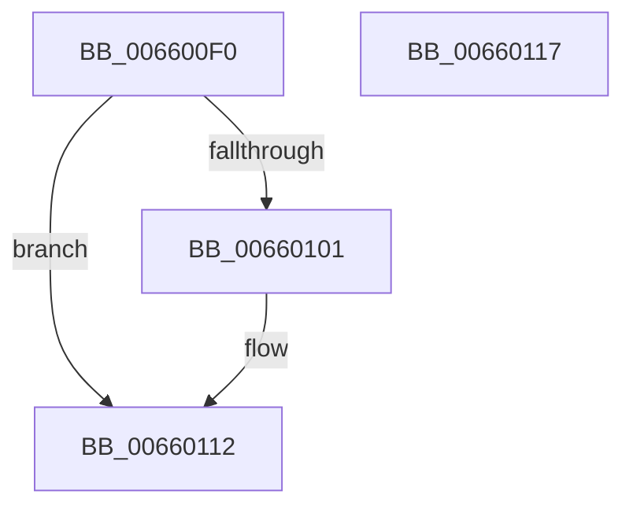

# WheaDeferredRecoveryService

- RVA: `0x006600F0`–`0x00660118` (길이 `40` bytes)
- VA: `0x00000001406600F0`
- 실행 섹션: `.text`
- PDB 이름 있음: `예`; PDB Function 태그: `아니요`
- unwind 정보 RVA: `0x0005C788`
- 디코드: `12`개 명령, `40/40` bytes 표시
- 미해석 바이트: `0` (있으면 어셈블리에 `.byte`로 보존)

> 이 문서는 커널 이미지의 기계어와 PDB 기호를 분석해 생성했습니다. 4번과 5번은 함수 원형과 자료형을 바이너리 사용 방식에서 추정한 C 해석이며 원본 소스 복구 결과는 아닙니다.

## 1. Dependencies

- 직접 호출 지점: **1**; 고유 호출 대상: **1**
- 직접 호출자로 확인된 함수: **1**
- RIP 상대 이미지 참조: **2**

### Outgoing calls
- `0x0066010D` → [KeInsertQueueDpc](../20/KeInsertQueueDpc_function_00207C50.md) (function, `0x00207C50`)

### Direct callers
- [HalpInterruptDeferredRecoveryService](../55/HalpInterruptDeferredRecoveryService_function_0055B830.md) at `0x0055B834`

### Static image references
- `0x006600F6` → RVA `0x00EEF560` (`.data`; read/write)
- `0x00660104` → RVA `0x00EF9F60` (`.data`; read)

## 2. Other-region calls and transfers

- 다른 실행 섹션으로 향하는 call: **0**
- 별도 외부 분기/꼬리 이동을 확인하지 못했습니다.

## 3. Assembly (complete function range)

```asm
006600F0  48 83 EC 28                     sub rsp, 0x28
006600F4  33 C0                           xor eax, eax
006600F6  87 05 64 F4 88 00               xchg dword ptr [rip + 0x88f464], eax
006600FC  83 F8 01                        cmp eax, 1
006600FF  75 11                           jne 0x140660112
00660101  45 33 C0                        xor r8d, r8d
00660104  48 8D 0D 55 9E 89 00            lea rcx, [rip + 0x899e55]
0066010B  33 D2                           xor edx, edx
0066010D  E8 3E 7B BA FF                  call 0x140207c50
00660112  48 83 C4 28                     add rsp, 0x28
00660116  C3                              ret
00660117  CC                              int3
```

## 4. C-style interpretation (structured pseudocode)

```c
__int64 __fastcall WheaDeferredRecoveryService(__int64 a1, int a2, int a3)
{
    __int64 result;
    __int64 v_rsp;

    v_rsp = (v_rsp) - (40);
    result = 0;
    if (0 == 1) {
        a3 = 0;
        a1 = v_rip + 9018965;
        a2 = 0;
        result = KeInsertQueueDpc(a1, a2, a3, a4);
    }
    v_rsp = (v_rsp) + (40);
    return result;
}
```

## 5. (Beta) C Style

```c
int64_t WheaDeferredRecoveryService(int64_t Arg1, int32_t Arg2, int32_t Arg3)
{
    int64_t result;
    int64_t local_rsp;

    local_rsp = (local_rsp) - (40);
    result = 0;
    if (0 == 1) {
        Arg3 = 0;
        Arg1 = v_rip + 9018965;
        Arg2 = 0;
        result = KeInsertQueueDpc(Arg1, Arg2, Arg3, a4);
    }
    local_rsp = (local_rsp) + (40);
    return result;
}
```

## 6. Execution-region graph

[열기: 2D/3D 그래프와 함수 탐색 컨트롤 패널](../../../control-panel.html?section=text&rva=0x006600F0&view=graph)

- 2D 그래프는 위에서 아래로 흐르고, 3D 그래프는 빈 공간을 드래그해 회전합니다. Shift+드래그는 이동, 휠은 확대·축소, 함수 노드 선택은 대상 보고서 이동입니다.

### Static fallback


